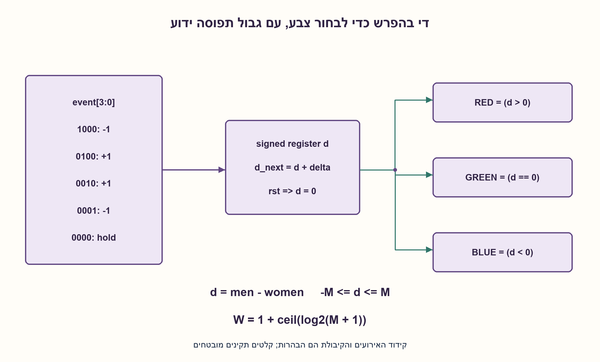
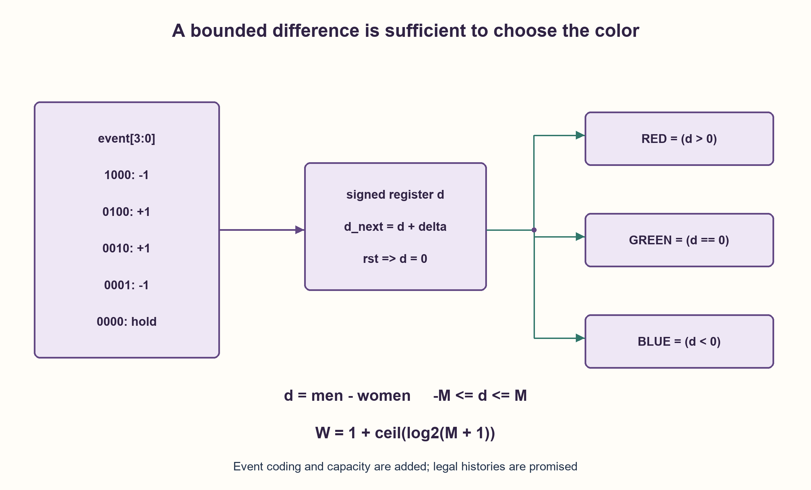

# PREP-256 — גברים ונשים בחדר — שלוש נורות לפי הפרש הספירות

פתרון מוצע בסיוע AI; ביקורת מקצועית אנושית ממתינה. הקושי אינו מכויל.

[צילום מקור פרטי](../sources/2026-11-03-batch20-14.png)

חדר עם מסדרון צר שבו עובר אדם אחד בכל פעם. גלאי מאפיין ארבעה מצבים: גבר יוצא, גבר נכנס, אישה יוצאת, אישה נכנסת. כשאין תנועה מוציא 0000. ממש מערכת עם שלוש נורות: RED אם יש יותר גברים בחדר, GREEN אם מספר הגברים והנשים שווה, BLUE אם יש יותר נשים.

חברות לפי הדיווח בצילום בלבד: Marvell.

## עברית

גלאי במעבר צר מדווח בכל פעם על אירוע אחד: גבר יוצא, גבר נכנס, אישה יוצאת או אישה נכנסת. ללא תנועה הוא מדווח0000. תכננו מערכת שבה RED=1 אם בחדר יותר גברים, GREEN=1 אם הכמויות שוות ו־BLUE=1 אם יש יותר נשים.

לצורך מימוש מדויק נגדיר שהחדר ריק באיפוס; הדיווחים סינכרוניים ואחד בכל מחזור, ומתארים כניסות ויציאות תקינות. נגדיר קיבולת מרבית M≥1. קידוד one-hot משלים, שלא הופיע במקור:1000 גבר יוצא,0100 גבר נכנס,0010 אישה יוצאת,0001 אישה נכנסת.0000 משאיר מצב. מילים אחרות ישאירו מצב לפי מדיניות שנבחרה כאן. הפלטים מתעדכנים לאחר דגימת האירוע. הסבירו גם מדוע ללא גבול על תפוסה אין FSM סופית מדויקת לכל ההיסטוריות.

1. האם צריך לדעת את שתי הספירות בנפרד כדי לבחור נורה, או שמספיק לדעת את ההפרש?
2. כניסת גבר ויציאת אישה משנות את ההפרש באותו כיוון. מה קורה בשני האירועים האחרים?
3. שמרו d=men−women במונה מסומן, ועדכנו ב־±1. סימן d ואפס קובעים את שלוש הנורות; חשבו גם את טווח d.

### לשמור את המידע שהיציאה צריכה
נגדיר `d=men−women`. באיפוס d=0 ולכן GREEN נדלק גם בחדר ריק. כניסת גבר מוסיפה1; יציאת גבר מחסירה1. כניסת אישה מחסירה1; יציאת אישה מוסיפה1. אין צורך לאחסן את שני המונים כדי לבחור צבע בלבד.

|אירוע לפי הקידוד המשלים|שינוי d|
|---|---|
|1000 גבר יוצא|−1|
|0100 גבר נכנס|+1|
|0010 אישה יוצאת|+1|
|0001 אישה נכנסת|−1|
|0000 אין תנועה|0|

לאחר עדכון האוגר: `RED=(d>0)`, ‏`GREEN=(d=0)`, ‏`BLUE=(d<0)`. בדיוק נורה אחת פעילה. המערכת נועדה להשוות מספרים, לא לסווג אנשים בעצמה; הגלאי כבר מספק סוג אירוע מוגדר.

### רוחב האוגר והוכחת נכונות
בקיבולת M, ‏−M≤d≤M. רוחב signed two's-complement בטוח הוא `W=1+ceil(log2(M+1))`. למשל M=8 דורש W=5; ארבע סיביות מסומנות אינן מייצגות +8. אפשר גם לקודד ישירות2M+1 מצבים, בלי טענת מינימום לספריית תאים.

באינדוקציה: באיפוס האינווריאנט d=men−women נכון; כל אחד מארבעת האירועים משנה את צד ימין בדיוק באותו ±1 כמו את האוגר. היעדר אירוע משמר אותו. ההבטחה על קיבולת והיסטוריה תקינה מונעת גלישה; אין להשתמש בחשבון מודולרי ואז להסתמך על הסימן. האוגר לבדו אינו מאמת שמי שיצא אכן היה בחדר או שלא חרגנו מהקיבולת: אימות כזה דורש מידע נוסף או חוזה חיישן. קוד HDL מניח דיווחים תקינים, ולא מציג את hold של מילה לא חוקית כהגנה מכל תקלה.

### מדוע שלושה מצבי צבע אינם מספיקים?
מהפרש+1, יציאת גבר אחת מביאה לשוויון; מהפרש+100 היא עדיין משאירה RED. לכן צריך לזכור גם מרחק מאפס. אם התפוסה אינה מוגבלת, נניח שני הפרשים שונים i<j חולקים אותו מצב פנימי. לאחר i יציאות גברים, ההיסטוריה הראשונה מגיעה לשוויון והשנייה נשארת חיובית; אותו מצב וקלט זהה היו מחייבים אותה יציאה, סתירה. לכן מספר מצבים קבוע לא מספיק לכל הערכים הבלתי מוגבלים. עם גבול M משתמשים בזיכרון O(log M), תוספת/חיסור ומשווה אפס/סימן. רוחבי המונים, לא שלוש נורות בלבד, קובעים את גדילת המשאבים.

### קוד SystemVerilog; תוצאות סימולציה בדוח נפרד

```systemverilog
`timescale 1ns/1ps
// Bounded occupancy contract: abs(men-women) <= CAPACITY for legal histories.
module prep256 #(parameter integer CAPACITY=8,
                 parameter integer W=$clog2(CAPACITY+1)+1)
  (input wire clk, rst, input wire [3:0] event_code,
   output wire red, green, blue, output reg signed [W-1:0] difference);
  always @(posedge clk) begin
    if (rst) difference <= 0;
    else case (event_code)
      4'b0100, 4'b0010: difference <= difference + 1;
      4'b1000, 4'b0001: difference <= difference - 1;
      default: difference <= difference; // none; invalid words hold by choice
    endcase
  end
  assign red = difference > 0;
  assign green = difference == 0;
  assign blue = difference < 0;
endmodule
```




### assumptions

```json
[
  "חדר ריק באיפוס; גלאי אמין, סינכרוני ואירוע יחיד.",
  "קיבולת M≥1 והיסטוריה חוקית; קידוד one-hot נקבע כאן."
]
```

### optimality

אוגר O(log M) ביטים ומעגל עדכון והשוואה ברוחב זה; בלי טענת מינימום שטח או זמן פיזי.

### verification

מודל עצמאי בדק29,760 טענות על קיבולות1..16, כל אוכלוסייה חוקית וכל מילות האירוע, עם בדיקת טווח ואחת משלוש נורות. RTL מופיע לבדיקת סימולציה נפרדת.

ששת מימושי החומרה של האצווה קומפלו ב־Icarus Verilog עם ‎-g2012 -Wall והורצו ב־vvp בסביבה מבודדת ללא רשת:333,512 בדיקות עברו. נכללו גם נועלי ה־NAND של גלאי הפולס. נותרה אזהרה טכנית אחת על ירושת timescale של מודול הבדיקה tb, ללא כשל פונקציונלי. ראיה: checks/batch1103-native-verification.json. לא בוצעו סינתזה, STA או מדידה פיזית.

### edge_cases

```json
[
  "חדר ריק ושוויון שאינו אפס.",
  "d=±M, חזרה דרך אפס, אירועי סרק.",
  "אין להניח אפשרות לאמת יציאה או קיבולת מתוך d בלבד."
]
```

### common_mistakes

שמירת שלושה צבעים בלבד; ספירה לא מסומנת; גלישה ושימוש שגוי בסימן; החלפת סימן של יציאת אישה; הצגת קידוד שהמצאנו כנתון מקור.

### interview_answer

אשמור הפרש מסומן. כניסת גבר ויציאת אישה מוסיפות1, ושני האירועים האחרים מחסירים1. השוואה לאפס קובעת צבע, וברוחב הזיכרון אשתמש בגבול התפוסה.

### source_ambiguities

הקיבולת, מצב ההתחלה, קידוד האירועים ומדיניות קלט לא חוקי אינם מוגדרים במקור והוספו במפורש.

### solution_extensions

```json
{
  "question": "כיצד תבדקו יציאה לא חוקית או חריגה מהקיבולת?",
  "direction": "שמרו ספירות נפרדות או מספיק מידע נוסף; הגדירו נורת שגיאה ומדיניות התאוששות.",
  "tests": "מצב מספיק להפקת פלט לעומת מצב מספיק לאימות קלט."
}
```

## English

A narrow doorway detector reports one event at a time: man exits, man enters, woman exits or woman enters. With no movement it reports0000. Design RED=1 for more men, GREEN=1 for equal populations and BLUE=1 for more women.

For an exact implementation assume an empty room at reset, synchronous reports with one event per cycle and valid entry/exit histories. Declare maximum occupancy M≥1. Added one-hot coding, absent from the source:1000 man exits,0100 man enters,0010 woman exits,0001 woman enters.0000 holds; other words also hold by the chosen policy. Outputs reflect the state after sampling the event. Explain why unbounded occupancy cannot be tracked exactly by a finite FSM for every history.

1. Do the three lights need both counts, or only their difference?
2. A man entering and a woman leaving change the difference in the same direction. What about the other two events?
3. Store signed d=men−women and update by±1. Its sign/zero chooses the lights; size it for the full difference range.

### Store what the output needs
Let `d=men−women`. Reset gives d=0, so GREEN also covers an empty room. Man enters adds1; man exits subtracts1. Woman enters subtracts1; woman exits adds1. Comparing populations alone does not require storing both counts.

|Added event code|Change in d|
|---|---|
|1000 man exits|−1|
|0100 man enters|+1|
|0010 woman exits|+1|
|0001 woman enters|−1|
|0000 no movement|0|

After updating state, `RED=(d>0)`, `GREEN=(d=0)`, `BLUE=(d<0)`. Exactly one light is on. The circuit compares counts; it does not infer a person's classification itself—the detector already provides the defined event type.

### Width and correctness
With occupancy at most M, −M≤d≤M. Safe signed two's-complement width is `W=1+ceil(log2(M+1))`. M=8 requires W=5 because four signed bits cannot represent+8. Directly encoding2M+1 states is another option; no physical cell minimum is claimed.

Induction: reset establishes d=men−women; each event changes both the actual difference and stored value by the same±1. No event holds both. The capacity and valid-history promises avoid overflow; modular wrap followed by a sign test would be wrong. Difference alone cannot validate that a departing person was present or that capacity was respected. Such validation requires extra information or a sensor contract. The RTL assumes legal reports; holding on an invalid word does not protect against every sensor error.

### Why three color states are insufficient
From+1, one man leaving produces equality; from+100 it still leaves RED. Distance from zero matters. If occupancy is unbounded, suppose distinct differences i<j share one state. Apply i man-exit events: the first history reaches equality while the second remains positive. Identical state and inputs would require identical outputs, a contradiction. Thus fixed finite storage cannot handle all unbounded histories exactly. A bound M permits O(log M) state with increment/decrement and sign/zero tests; three lamps do not imply three sufficient states.

### SystemVerilog; simulation results are in a separate report

```systemverilog
`timescale 1ns/1ps
// Bounded occupancy contract: abs(men-women) <= CAPACITY for legal histories.
module prep256 #(parameter integer CAPACITY=8,
                 parameter integer W=$clog2(CAPACITY+1)+1)
  (input wire clk, rst, input wire [3:0] event_code,
   output wire red, green, blue, output reg signed [W-1:0] difference);
  always @(posedge clk) begin
    if (rst) difference <= 0;
    else case (event_code)
      4'b0100, 4'b0010: difference <= difference + 1;
      4'b1000, 4'b0001: difference <= difference - 1;
      default: difference <= difference; // none; invalid words hold by choice
    endcase
  end
  assign red = difference > 0;
  assign green = difference == 0;
  assign blue = difference < 0;
endmodule
```




### assumptions

```json
[
  "Empty room at reset; reliable synchronous single-event detector.",
  "Capacity M≥1 and legal histories; one-hot coding is an editorial choice."
]
```

### optimality

O(log M) stored bits and matching-width update/comparison logic; no minimum physical area or timing claim.

### verification

An independent population oracle checked29,760 assertions over capacities1..16, every legal population and all event words, including signed range and one-of-three outputs. RTL is supplied for separately recorded simulation.

All six hardware implementations were compiled with Icarus Verilog -g2012 -Wall and run with vvp in an isolated network-denied environment:333,512 checks passed, including the pulse detector NAND latches. One technical warning remained about tb inheriting a timescale, without a functional failure. Evidence: checks/batch1103-native-verification.json. No synthesis, STA or physical measurement was performed.

### edge_cases

```json
[
  "Empty room and nonzero equal populations.",
  "d=±M, crossing zero and idle cycles.",
  "Do not assume d alone validates departures or occupancy."
]
```

### common_mistakes

Storing only three colors; unsigned arithmetic; wraparound sign errors; reversing the woman-exit delta; presenting added coding as a source fact.

### interview_answer

Store a signed difference. Man-enter and woman-exit add1; the other two subtract1. Compare with zero for color, and size storage from the occupancy bound.

### source_ambiguities

Capacity, initial state, event coding and invalid-input policy are unspecified in the source and explicitly added.

### solution_extensions

```json
{
  "question": "How would you detect an invalid exit or capacity violation?",
  "direction": "Store both populations or sufficient extra information, with an error flag and recovery policy.",
  "tests": "State sufficient for output versus state sufficient for input validation."
}
```
