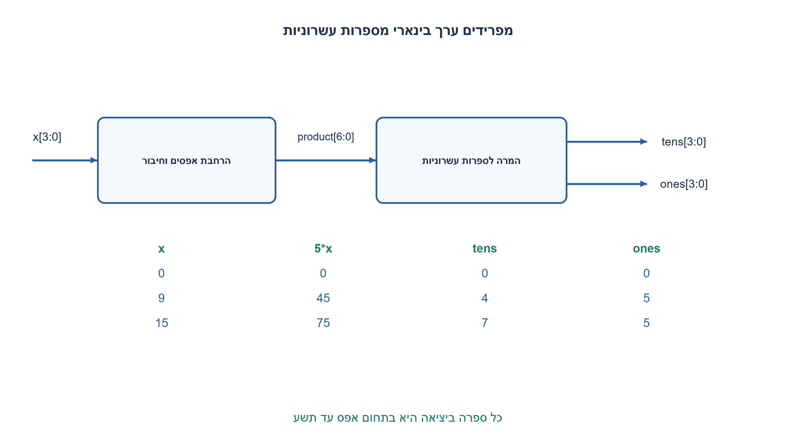
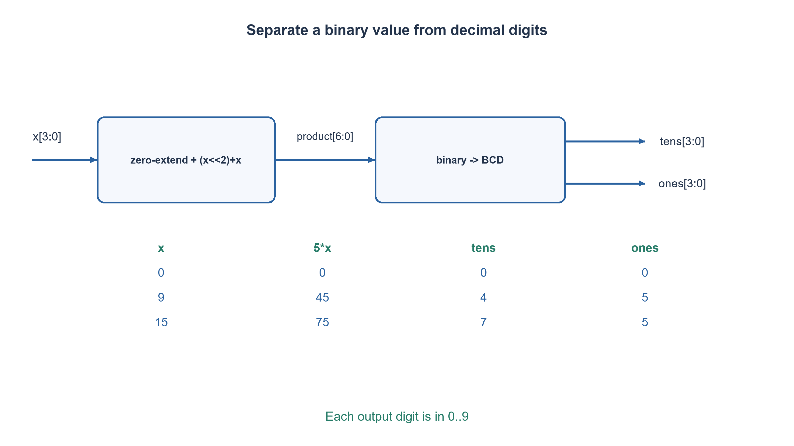

# PREP-257 — כפל קלט בינארי בן ארבע סיביות בחמש והצגה בשתי ספרות

פתרון מוצע בסיוע AI; ביקורת מקצועית אנושית ממתינה. הקושי אינו מכויל.

[צילום מקור פרטי](../sources/2026-11-07-batch30-01.png)

תכנן מערכת המכפילה ב-5. כניסה: 4 ביטים. יציאה: להציג את התוצאה בשתי ספרות עשרוניות A,B.

חברות לפי הדיווח בצילום בלבד: NVIDIA.

## עברית

תכננו מערכת צירופית המקבלת x בן ארבע סיביות, מכפילה את ערכו בחמש ומוציאה שתי ספרות עשרוניות A,B. הגדירו רוחבים, קידוד היציאה, מימוש ובדיקות.

הבהרה שנוספה למקור: הקלט הוא unsigned בינארי רגיל וכל הערכים 0..15 חוקיים, ולא ספרת BCD המוגבלת ל־9. A היא ספרת העשרות ו־B ספרת היחידות, כל אחת בקוד BCD בן ארבע סיביות. אפס מוביל מוצג כ־0. מפענח לתצוגת שבעה מקטעים אינו נדרש. אין שעון או דרישת מינימום רכיבים.

1. מהו ערך התוצאה הגדול ביותר, וכמה ביטים דרושים כדי להחזיק אותו בלי גלישה?
2. הפרידו בין חישוב המכפלה בבינארי ובין הצגת שתי ספרות בבסיס עשר.
3. חמש פעמים x שווה לארבע פעמים x ועוד x. לאחר הרחבת הרוחב, אפשר להמיר את התוצאה ל־BCD בשיטת הוספת שלוש והזזה.

### מחשבים ערך ואז מייצגים אותו
הערך הגדול ביותר הוא `5·15=75`, ולכן המכפלה דורשת שבע סיביות: שש סיביות מגיעות רק עד63. שני קודי BCD הם שמונה חוטים, אך אינם מספר בינארי בן שמונה סיביות: למשל75 מיוצג כ־`0111 0101`, ולא כ־`0100 1011` שהוא75 בינארי.

מרחיבים את x באפסים לפני ההזזה והחיבור, ומחשבים `p=(x<<2)+x` ברוחב7. כך15 לא נחתך בזמן ההזזה. אחר כך מוציאים `A=floor(p/10)` ו־`B=p mod10`. שתי המשוואות מגדירות את התוצאה; הן אינן מחייבות מכפיל או מחלק כללי בחומרה.

### המרה באמצעות double dabble
מתחילים שתי ספרות BCD באפס. עוברים על שבע סיביות p מן ה־MSB אל ה־LSB. לפני כל הזזה, מוסיפים3 לכל ספרה שערכה לפחות5; אחר כך מזיזים את שמונת ביטי ה־BCD שמאלה ומכניסים את סיבית p הבאה. הלולאה בקוד צירופית: כלי סינתזה יכול לפרוס שבעה שלבים, ואין כאן שבעה מחזורי שעון.

אינווריאנט ההמרה: אחרי k צעדים, שתי הספרות מייצגות את הקידומת הבינארית שכבר עובדה בבסיס עשר. הוספת ביט מבצעת כפל בשתיים וחיבור הביט. לספרה d<5 הכפלה בשתיים אינה דורשת נשיאה עשרונית. עבור d≥5, ההוספה3 לפני הזזה מוסיפה6 לאחר ההזזה; הדבר מתקן את הפער בין בסיס16 של ארבעת החוטים לבסיס10 של הספרה, ומעביר נשיאה נכונה לספרה הבאה. התחום0..75 מבטיח ששתי ספרות מספיקות.

|x|מכפלה בינארית|A|B|
|---|---|---|---|
|0|0000000|0|0|
|2|0001010|1|0|
|9|0101101|4|5|
|15|1001011|7|5|

נבדקים כל16 הקלטים מול כפל של מספרים שלמים ו־divmod עצמאי. PREP-181 שונה: הוא מקבל ספרת BCD חוקית0..9 ומכפיל בשלוש; לא מחליפים את תחומו או את ההיסטוריה שלו בתרגיל הזה. אפשר לשתף בין המימושים ממיר BCD, אך אין כאן הוכחת מינימום שערים.

### קוד SystemVerilog; תוצאות סימולציה בדוח נפרד

```systemverilog
`timescale 1ns/1ps
// All sixteen ordinary-binary inputs are legal; result range is 0..75.
module prep257(input wire [3:0] x,
               output wire [3:0] tens, ones);
  reg [6:0] product;
  reg [7:0] bcd;
  integer i;
  always @* begin
    product = ({3'b000,x} << 2) + {3'b000,x};
    bcd = 8'd0;
    for (i=6; i>=0; i=i-1) begin
      if (bcd[3:0] >= 5) bcd[3:0] = bcd[3:0] + 4'd3;
      if (bcd[7:4] >= 5) bcd[7:4] = bcd[7:4] + 4'd3;
      bcd = {bcd[6:0],product[i]};
    end
  end
  assign tens = bcd[7:4];
  assign ones = bcd[3:0];
endmodule
```




### assumptions

```json
[
  "קלט בינארי רגיל 0..15; שתי יציאות BCD עם עשרות לפני יחידות.",
  "הרחבת אפסים לפני חישוב המכפלה; מימוש צירופי ללא גלישה."
]
```

### optimality

מכפלה בהזזה וחיבור וממיר פרוס בן שבעה שלבים; בפיתוח רוחב n, המרה ספרתית פרוסה עולה בקירוב O(n²) תאי תיקון, וניתן לבחור מימוש טורי עם השהיה. אין טענת מינימום פיזי.

### verification

בדיקת Python ממצה של16 קלטים מול כפל ו־divmod עצמאיים עברה. הקוד המצורף הוא RTL; מצב קימפולו וסימולצייתו נרשם בדוח האצווה, בנפרד מהמודל.

אימות RTL בפועל: ששת מימושי החומרה של האצווה קומפלו ב־Icarus Verilog12 עם ‎-g2012 -Wall והורצו ב־vvp בסביבה מבודדת ללא רשת. הרתמה המשולבת עברה172,128 בדיקות; רתמת FIFO נפרדת עברה15,729 בדיקות עם5,587 כתיבות ו־5,587 קריאות מאושרות. הכיסוי כולל שתי גרסאות SR, שני סדרי קלט טורי, כל קלטי BCD והסף, ותעבורת FIFO דיגיטלית מוגבלת. ראיה: checks/batch1107-native-verification.json. אין סינתזה, STA, סימולציית מטא־יציבות או אישור CDC פיזי.

### edge_cases

```json
[
  "0,1,2 ו־15; מעבר יחידות9→עשרות1.",
  "הקלטים10..15 חוקיים;75 דורש שבע סיביות בינאריות."
]
```

### common_mistakes

חיתוך ההזזה לרוחב4; פירוש הקלט כ־BCD; חיבור שני ניבלים של מכפלה בינארית ישירות למסכי ספרות.

### interview_answer

ארחיב את הקלט לשבע סיביות, אחבר x לארבע פעמים x, ואז אמיר את התוצאה לשתי ספרות BCD. הטווח המרבי75 קובע את הרוחב ואת מספר הספרות.

### source_ambiguities

המקור אינו מגדיר BCD או מסכי שבעה מקטעים. קידוד שתי הספרות וכיוון A/B הם הבהרות עריכה מפורשות.

### solution_extensions

```json
{
  "question": "כיצד מממשים את ההמרה עם פחות לוגיקה צירופית?",
  "direction": "ממחזרים שלב תיקון והזזה באמצעות אוגרים ובקר, במשך שבעה צעדים, ומגדירים start/busy/valid.",
  "tests": "פשרת שטח מול השהיה וממשק סדרתי."
}
```

## English

Design a combinational system taking four-bit x, multiplying its value by five, and producing decimal digits A,B. Define widths, output encoding, implementation and tests.

Editorial clarifications: x is ordinary unsigned binary, so all 0..15 are legal; it is not a BCD digit limited to9. A is the tens digit and B the units digit, each encoded in four-bit BCD. Display a leading zero as0. A seven-segment decoder is outside this contract. No clock or component minimum is required.

1. What is the largest result, and how many bits hold it without overflow?
2. Separate computing a binary product from encoding its decimal digits.
3. Five times x is (x shifted left by two) plus x. Widen first, then use add-three-and-shift to convert the product to BCD.

### Compute a value, then encode its digits
The largest product is `5·15=75`, requiring seven binary bits: six stop at63. Two BCD digits use eight wires but are not an eight-bit binary number. Decimal75 is BCD `0111 0101`, whereas ordinary binary75 is `0100 1011`.

Zero-extend x before shifting and adding, then compute `p=(x<<2)+x` at width7. Otherwise the shifted operand can truncate. The required outputs are `A=floor(p/10)` and `B=p mod10`; these define the function without requiring a general hardware multiplier or divider.

### Add-three-and-shift conversion
Initialize both BCD digits to zero. Process the seven bits of p from MSB to LSB. Before each shift add3 to any BCD digit at least5, then shift the eight BCD wires left and insert the next input bit. The supplied loop is combinational: synthesis may unroll seven stages; it does not consume seven clock cycles.

Invariant: after k steps the BCD digits encode the processed binary prefix in base ten. Appending a bit doubles that prefix and adds the bit. For d<5, doubling the digit needs no decimal carry. For d≥5, adding3 before the shift adds6 after the shift, correcting the difference between the physical nibble radix16 and the decimal radix10 and producing the required carry. Values0..75 fit two decimal digits.

|x|Binary product|A|B|
|---|---|---|---|
|0|0000000|0|0|
|2|0001010|1|0|
|9|0101101|4|5|
|15|1001011|7|5|

All16 inputs are checked against integer multiplication and independent divmod. PREP-181 instead accepts legal BCD0..9 and multiplies by three; its contract and history remain separate. A converter could be shared between constructions, without implying a globally minimum gate implementation.

### SystemVerilog; simulation results are in a separate report

```systemverilog
`timescale 1ns/1ps
// All sixteen ordinary-binary inputs are legal; result range is 0..75.
module prep257(input wire [3:0] x,
               output wire [3:0] tens, ones);
  reg [6:0] product;
  reg [7:0] bcd;
  integer i;
  always @* begin
    product = ({3'b000,x} << 2) + {3'b000,x};
    bcd = 8'd0;
    for (i=6; i>=0; i=i-1) begin
      if (bcd[3:0] >= 5) bcd[3:0] = bcd[3:0] + 4'd3;
      if (bcd[7:4] >= 5) bcd[7:4] = bcd[7:4] + 4'd3;
      bcd = {bcd[6:0],product[i]};
    end
  end
  assign tens = bcd[7:4];
  assign ones = bcd[3:0];
endmodule
```




### assumptions

```json
[
  "Ordinary unsigned binary0..15; BCD tens and units.",
  "Zero extension precedes arithmetic; combinational operation without overflow."
]
```

### optimality

A shift-and-add product and seven unrolled conversion steps. For generalized n-bit conversion an unrolled decimal construction has approximately O(n²) correction cells; a serial version trades area for cycles. No physical minimum is claimed.

### verification

Exhaustive Python verification of16 inputs against independent multiplication/divmod passed. The attached RTL is distinct from the model; compilation/simulation status is recorded in the batch report.

Executed RTL verification: the six batch hardware implementations were compiled with Icarus Verilog12 -g2012 -Wall and run with vvp in an isolated network-denied environment. The combined harness passed172,128 checks; the separate FIFO harness passed15,729 checks with5,587 accepted writes and5,587 accepted reads. Scope includes both SR priorities, both serial input orders, BCD/threshold inputs and bounded ideal FIFO traffic. Evidence: checks/batch1107-native-verification.json. No synthesis, STA, metastability simulation or physical CDC closure was performed.

### edge_cases

```json
[
  "0,1,2,15 and the decimal9-to10 boundary.",
  "Inputs10..15 are legal;75 requires seven binary bits."
]
```

### common_mistakes

Truncating the shift to four bits; interpreting x as BCD; driving digit displays directly with binary nibbles.

### interview_answer

Widen to seven bits, add x to four times x, then convert to two BCD digits. Maximum75 determines the binary width and decimal digit count.

### source_ambiguities

The source does not define BCD or seven-segment outputs. Digit encoding and the A/B tens/units order are explicit editorial clarifications.

### solution_extensions

```json
{
  "question": "How can the converter use less combinational logic?",
  "direction": "Reuse one correction-and-shift stage with registers/control for seven steps, defining start/busy/valid.",
  "tests": "Area/latency tradeoffs and interfaces."
}
```
