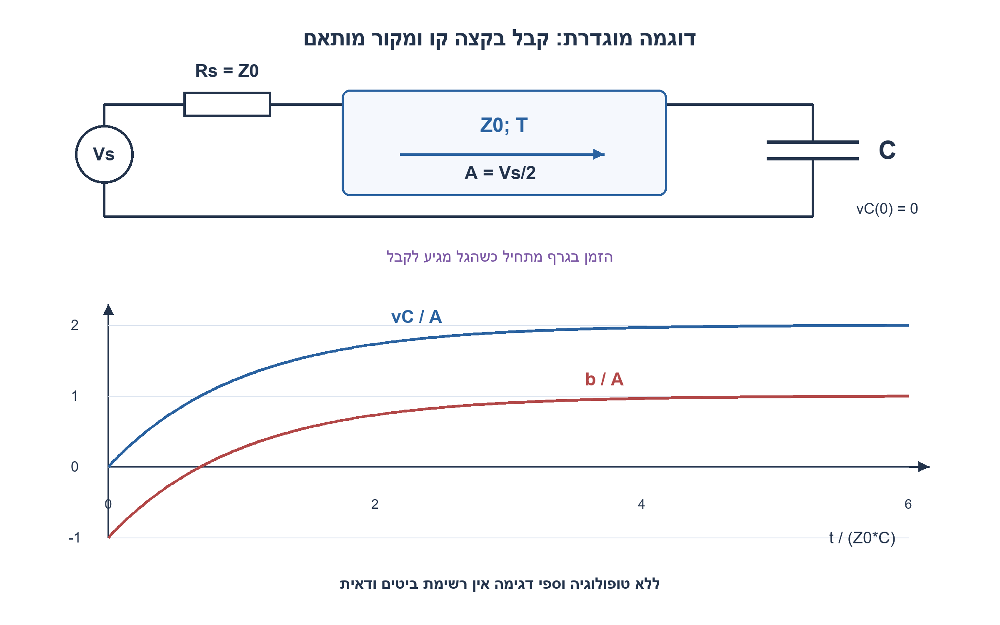
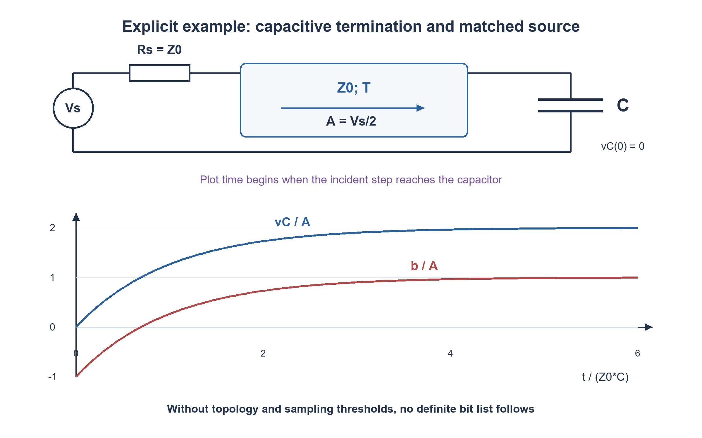

# PREP-258 — קו תמסורת וקבל: החזרות, עכבה ומה דוגמים

פתרון מוצע בסיוע AI; ביקורת מקצועית אנושית ממתינה.

[מקור פרטי](../sources/2026-11-07-batch30-08.png)

שאלת קווי תמסורת חסרי הפסדים וקבל במעגל. משדרים בית: 1. מה יכול להיות בעייתי במעגל? 2. אם המערכת דוגמת באפס זמן ואין ענייני setup וכדומה, אילו בתים לא יידגמו כראוי ולמה? 3. באיזו התנגדות מדובר?

## עברית

במערכת ספרתית יש קו תמסורת אידאלי ללא הפסדים וקבל. דנים בהעברת ביטים על המערכת ובדגימה בזמן מוגדר.

א. אילו בעיות יכולות להופיע גם כשהקו עצמו אינו מאבד אנרגיה?
ב. אם מתעלמים במכוון מ־setup ו־hold והדוגם אידאלי, האם אפשר לדעת אילו ביטים ייקראו נכון ברגע t=0?
ג. איזו ״התנגדות״ מתארת את הקו, ומה ההבדל בין התנגדות אוהמית, עכבה אופיינית ועכבת הקבל?

בצילום לא נמסרו טופולוגיה, אורכי קווים, מיקום הקבל והדוגם, גל שידור, מצב התחלתי או ספי לוגיקה. הסבירו מה עדיין ניתן להסיק ומה אינו נקבע. כהדגמה נפרדת ומוצהרת, נתחו קו בעל עכבה Z0, מקור מותאם ועומס שהוא קבל C לאדמה, שמתחו ההתחלתי אפס. מדרגת מתח נכנסת בגודל A מגיעה לקבל בזמן מקומי t=0. מצאו את מתח הקבל ואת הגל המוחזר.

1. ״ללא הפסדים״ מתאר פיזור אנרגיה ולא זמן התפשטות או התאמת עומס. מה קורה כשהגל מגיע לעכבה שונה?
2. המתח בדוגם הוא סכום הגל הנכנס והחוזר בזמן ובמיקום שלו. בלי הנתונים הללו ובלי סף אי אפשר לתת רשימת ביטים נכונה.
3. בדוגמת קבל הקצה השתמשו ב־v=A+b וב־i=(A−b)/Z0=C·dv/dt. איזה תנאי התחלה כופה רציפות מתח הקבל?

### קודם מפרידים בין מידע חסר לבין פיזיקה שאפשר להסיק
אין בצילום מעגל שממנו אפשר לחשב וקטור ביטים מסוים. גם דוגם מושלם אינו משחזר מידע שטרם הגיע אליו. צריך את היסטוריית האות, זמני המעבר, נקודת המדידה, Z0, עכבת המקור והעומס, הקבל ומטענו ההתחלתי וספי VIH/VIL. ״t=0״ דורש הגדרה: תחילת השידור במקור שונה מהגעת חזית לעומס. ערך בדיוק באי־רציפות אידאלית מצריך הגדרת צד הגבול; אין להמציא סיבית ודאית שם.

קו חסר הפסדים עדיין משהה חזיתות ומחזיר גלים כאשר העומס אינו מותאם. חיבורי הסתעפות, קבל ושינוי בעכבה עלולים ליצור השהיה במעבר סף, overshoot או ringing, ולגרום לחפיפה בין השפעות של ביטים עוקבים. לא כל טופולוגיה תיצור כל תופעה: למשל קבל עם מקור מותאם נותן את התגובה המונוטונית שבהמשך. אם המקור והעומס מחזירים שוב ושוב ואין מנגנון פיזור, אין הבטחה שהאנרגיה תיעלם או שהמערכת תתייצב במהירות. ביטול setup/hold בתרגיל אינו מבטל השהיה והחזרות אנלוגיות. במימוש אמיתי גם חלון הדגימה חוזר להיות חשוב.

### Z0 אינו נגד חימום בתוך קו אידאלי
אם L′ ו־C′ הם השראות וקיבול ליחידת אורך, אז `Z0=sqrt(L′/C′)` ו־`vprop=1/sqrt(L′C′)`. היחס בין מתח הגל המתקדם לזרמו הוא Z0, אף שהתנגדות הטור האוהמית בקו האידאלי היא אפס. אנרגיה נעה ונאגרת בשדות. לעומס יש עכבה אחרת: לקבל `ZC=1/(jωC)`. במצב סינוסי מקדם החזרת המתח הוא `Γ=(ZL−Z0)/(ZL+Z0)`; קבל אידאלי משנה גם מופע. בקצה פתוח Γ=+1, בקצר Γ=−1, ובעומס נגדי Z0 מתקבל אפס. אלה תנאי קצה ולא ערכים קבועים לכל עומס.

### דוגמה שהוגדרה במפורש: קבל בקצה הקו
נסמן את הגל החוזר b. בקצה `v=A+b`, והזרם לתוך הקבל הוא `(A−b)/Z0=(2A−v)/Z0`. לכן `Z0·C·dv/dt+v=2A`. עבור קבל לא טעון ומדרגה מגיעה ב־t=0:

```text
τ = Z0*C
vC(t) = 2A*(1-exp(-t/τ))
b(t)  = A*(1-2exp(-t/τ))
iC(t) = (2A/Z0)*exp(-t/τ), t>=0
```

מיד בהגעה מתח הקבל נשאר אפס ו־b(0+)=-A. בהמשך מתחו מתקרב ל־2A והגל החוזר ל־+A. עבור מקור מתח מדרגה Vs עם התנגדות טור Rs=Z0, הגל שהושק הוא A=Vs/2, ולכן הגבול הסופי הוא Vs; אין הכפלת מתח המקור היש מאין. אם זמן המעבר החד־כיווני T, המקור לא רואה את החזרת העומס לפני 2T. המקור המותאם סופג את הגל החוזר, ולכן אין החזרה נוספת ממנו בדוגמה הזאת.

לסף יחיד Vth שבין 0 ל־2A, זמן החצייה המקומי הוא `−τ ln(1−Vth/(2A))`; במציאות אזור VIL..VIH אינו בהכרח ביט תקף. זה מסביר מדוע דגימה מוקדמת מדי עלולה לקרוא אפס גם אם שודרה לבסוף רמה גבוהה. אין להסיק שזה מה שקורה בצילום ללא הטופולוגיה החסרה.

המודל נבדק מול אינטגרציה נומרית נפרדת של משוואת הקבל, ויחסי מתח/זרם נשמרו. זהו אימות של המשוואות וההנחות בדוגמה, ללא SPICE, בדיקת PCB, סינתזה או קביעה איזה ביט במערכת הלא־מתוארת נקרא נכון.

[MIT — קווי תמסורת וגלים](https://ocw.mit.edu/courses/6-013-electromagnetics-and-applications-spring-2009/d3be4ea78b036a6362230fb41780cf54_MIT6_013S09_notes.pdf)
[University of Wisconsin — סיום קיבולי, פרק9](https://pages.hep.wisc.edu/~prepost/623/transmissionlines.html)



## English

A digital system contains an ideal lossless transmission line and a capacitor. Discuss bit transmission and sampling at a specified instant.

(a) What problems can occur even though the line dissipates no energy?
(b) If setup/hold are deliberately ignored and the sampler is ideal, can the correctly read bits at t=0 be identified?
(c) What “resistance” characterizes the line? Distinguish ohmic resistance, characteristic impedance and capacitor impedance.

The screenshot supplies no topology, line lengths, capacitor/sampler placement, transmitted waveform, initial state or logic thresholds. State what can and cannot be determined. As a separate explicit illustration, analyze a line of impedance Z0 with a matched source and a shunt capacitor C initially at zero volts. An incident voltage step A reaches the capacitor at local time t=0. Find capacitor voltage and the reflected wave.

1. Lossless describes energy dissipation, not propagation time or load matching. What occurs when a wave reaches an impedance discontinuity?
2. Sampler voltage is the sum of incident and reflected waves at its location and time. Without those data and a threshold, no definite bit list follows.
3. For the illustrative shunt load use v=A+b and i=(A−b)/Z0=C·dv/dt. What initial condition follows from capacitor-voltage continuity?

### Separate missing information from physical conclusions
The screenshot does not define a circuit from which a particular bit vector can be calculated. An ideal sampler cannot recover information that has not reached it. Required data include signal history, flight times, observation point, source/load impedances, Z0, capacitor placement and initial charge, and VIH/VIL thresholds. Define t=0: launch at the source differs from arrival at the load. An ideal discontinuity also needs a one-sided-time convention; it does not supply a definite bit automatically.

A lossless line can still delay edges and reflect waves at mismatches. Branches, capacitors and impedance changes may shift threshold crossings, cause overshoot/ringing, or allow successive symbols to interfere. These effects depend on topology: the matched-source capacitor example below is monotone. With repeated reflections and no dissipative path, stored energy need not disappear or settle quickly. Ignoring setup/hold does not remove analog propagation and reflection; actual hardware must consider the sampling aperture too.

### Characteristic impedance is not a heating resistor
With inductance L′ and capacitance C′ per unit length, `Z0=sqrt(L′/C′)` and `vprop=1/sqrt(L′C′)`. Z0 relates forward-wave voltage to current even when ideal-line series resistance is zero. Fields carry and store energy. The capacitor instead has `ZC=1/(jωC)`. Voltage reflection is `Γ=(ZL−Z0)/(ZL+Z0)` in sinusoidal steady state; a reactive load changes phase. Open, short and matched resistive ends give +1,−1 and0 respectively, not one universal value for every load.

### Explicit example: a capacitor at the end
For reflected wave b, `v=A+b` and load current is `(A−b)/Z0=(2A−v)/Z0`. With `i=C·dv/dt`, obtain `Z0·C·dv/dt+v=2A`. A zero-voltage capacitor and an arriving step at t=0 give:

```text
τ = Z0*C
vC(t) = 2A*(1-exp(-t/τ))
b(t)  = A*(1-2exp(-t/τ))
iC(t) = (2A/Z0)*exp(-t/τ), t>=0
```

At arrival the capacitor remains at zero and b(0+)=-A; later its voltage approaches2A and reflection approaches+A. A generator step Vs with series Rs=Z0 launches A=Vs/2, so the final capacitor voltage is Vs. This is not creation of twice the generator voltage. With one-way flight time T, the source cannot see the load reflection before2T. The matched source absorbs it without another reflected wave.

For a single threshold0<Vth<2A, the local crossing time is `−τ ln(1−Vth/(2A))`; a real VIL..VIH interval may not be a valid logic value. Thus an early sample may read low despite a final high. That observation cannot identify particular failed bits in an unspecified topology.

The model was compared against independent numerical integration and voltage/current boundary identities. It checks the declared equations, without SPICE, PCB measurements, synthesis or a claim about bits in the missing circuit.

[MIT — transmission lines and waves](https://ocw.mit.edu/courses/6-013-electromagnetics-and-applications-spring-2009/d3be4ea78b036a6362230fb41780cf54_MIT6_013S09_notes.pdf)
[University of Wisconsin — capacitive termination, section9](https://pages.hep.wisc.edu/~prepost/623/transmissionlines.html)



## Supporting material / חומר משלים

```json
{
  "assumptions": {
    "he": "הקו בדוגמה אחיד וחסר הפסדים; מקור מותאם; קבל קצה לאדמה במתח אפס; A היא אמפליטודת הגל הנכנס. אין שחזור של טופולוגיה חסרה.",
    "en": "Uniform lossless example line; matched source; initially uncharged shunt termination; A is incident-wave amplitude. Missing source topology is not reconstructed."
  },
  "optimality": {
    "he": "חישוב דגימה בנוסחה הוא O(1); לא הוכח תכנון אופטימלי. אורך קו ביחס לזמן חזית קובע אם קירוב מרוכז מספיק.",
    "en": "One closed-form sample takes O(1) arithmetic; no optimal circuit is claimed. Line flight time relative to edge time determines whether a lumped approximation suffices."
  },
  "verification": {
    "he": "30,210 בדיקות מודל: 30 קבוצות פרמטרים עם 1,001 דגימות RK4 לכל קבוצה, יחסי גבול ועוד 180 מקדמי החזרה בתדר. ללא SPICE או ניסוי.",
    "en": "30,210 model checks:30 parameter sets with1,001 RK4 samples each, boundary identities and180 frequency coefficients. No SPICE or experiment."
  },
  "edge_cases": {
    "he": "רגע לפני ואחרי הגעת חזית; קבל טעון מראש; C→0 או C גדול; סף באזור לא מוגדר; קצוות לא מותאמים; ביטים קצרים מזמן ההתייצבות.",
    "en": "Before/after arrival; precharged capacitor; C→0 or large C; undefined threshold region; mismatched ends; symbols shorter than settling time."
  },
  "common_mistakes": {
    "he": "לזהות Z0 עם התנגדות DC; לחשוב שללא הפסדים אין החזרות; להחליף A ב־Vs בלי מחלק המקור; לקבוע ביטים בלי מיקום וזמנים.",
    "en": "Equating Z0 with DC resistance; assuming lossless means reflection-free; replacing A by Vs without source division; assigning bits without timing/placement."
  },
  "interview_answer": {
    "he": "קו אידאלי עדיין משהה ומחזיר גלים. Z0 הוא יחס גל ולא הפסד אוהמי. כדי לדעת מה נקרא צריך לחשב את המתח בדוגם בזמן ובסף הנתונים.",
    "en": "An ideal line still delays and reflects waves. Z0 is a wave ratio, not an ohmic loss. Determine the sampler voltage at its specified time and threshold."
  },
  "source_ambiguities": {
    "he": "במקור אין שרטוט או נתונים מספיקים לזיהוי ביטים. קבל קצה עם מקור מותאם הוסף כהדגמה מותנית בלבד.",
    "en": "No diagram or sufficient data identifies particular sampled bits. The matched-source shunt-capacitor model is an explicit conditional illustration."
  },
  "solution_extensions": {
    "he": "אם הקבל מתחיל ב־Vinit, הפתרון הוא v=2A+(Vinit−2A)exp(−t/τ). מה משתנה כש־Rs אינו Z0? צריך לכלול החזרות חוזרות.",
    "en": "For initial Vinit, v=2A+(Vinit−2A)exp(−t/τ). If Rs differs from Z0, repeated source reflections must be included."
  },
  "technical_references": {
    "he": [
      "[MIT — קווי תמסורת וגלים](https://ocw.mit.edu/courses/6-013-electromagnetics-and-applications-spring-2009/d3be4ea78b036a6362230fb41780cf54_MIT6_013S09_notes.pdf)",
      "[University of Wisconsin — סיום קיבולי, פרק9](https://pages.hep.wisc.edu/~prepost/623/transmissionlines.html)"
    ],
    "en": [
      "[MIT — transmission lines and waves](https://ocw.mit.edu/courses/6-013-electromagnetics-and-applications-spring-2009/d3be4ea78b036a6362230fb41780cf54_MIT6_013S09_notes.pdf)",
      "[University of Wisconsin — capacitive termination, section9](https://pages.hep.wisc.edu/~prepost/623/transmissionlines.html)"
    ]
  }
}
```
