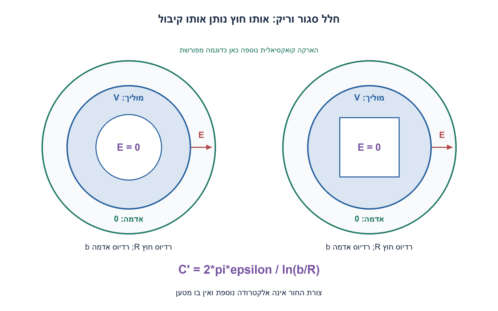
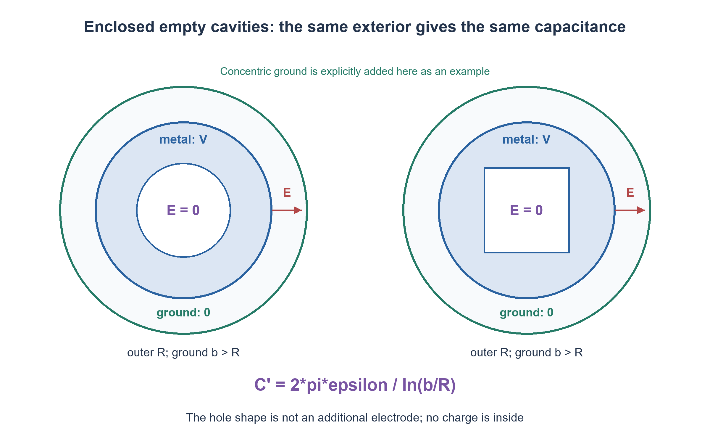

# PREP-259 — חלל במוליך: האם צורת החור משנה קיבול לאדמה?

פתרון מוצע בסיוע AI; ביקורת מקצועית אנושית ממתינה.

[מקור פרטי](../sources/2026-11-07-batch30-10.png)

נתונות שתי מערכות קיבוליות: גליל חלול עד רדיוס r וממולא עד רדיוס R במוליך מושלם, והשנייה זהה אך החתך הפנימי ריבועי. יש אדמה הנחשבת מוליך מושלם. 1. מצא קיבול. 2. למי קיבול גדול יותר? 3. מחברים מקור מתח בין הגליל לאדמה: מה התפלגות המטען? 4. האם יש מטען בפנים?

## עברית

משווים שני גופים מוליכים אידאליים: מעטפתם החיצונית גלילית וזהה ברדיוס R. באחד חלל פנימי עגול ובשני חלל בעל חתך ריבועי. המוליך עצמו ממלא את האזור שבין החלל למעטפת החיצונית. מקור מתח מחבר את הגוף לאדמה.

א. האם הנתונים מספיקים לקיבול מספרי? מהי האלקטרודה השנייה או גאומטריית הייחוס?
ב. באותם תנאים חיצוניים, האם צורת חלל ריק משנה את קיבול הגוף לאדמה?
ג. היכן נמצאים המטענים לאחר התייצבות, והאם יש שדה או מטען בתוך החלל?

הבהרה מהותית לפתרון הראשי: החללים סגורים לחלוטין, ריקים ממטענים ואינם מכילים אלקטרודה נוספת; הגאומטריה החיצונית והסביבה שוות, ומדובר באלקטרוסטטיקה. אם הגליל פתוח בקצותיו, או שהתכוונו לקבל דו־אלקטרודי בתוך החור, הסבירו מדוע זו בעיה אחרת. כדוגמה מוגדרת בלבד, חשבו קיבול ליחידת אורך כשהארקה היא גליל קואקסיאלי ברדיוס b>R וביניהם דיאלקטרי אחיד ε, ללא אפקטי קצה.

1. קיבול הוא יחס בין מטען להפרש פוטנציאל. צורת חור במוליך אינה בהכרח האזור שבו נאגרת אנרגיית השדה.
2. כל דופן חלל סגור היא באותו פוטנציאל. איזה פתרון למשוואת לפלס בתוך חלל חסר מטען מקיים את תנאי השפה?
3. פתרון יחיד וקבוע נותן E=0 בחלל. אותו תנאי שפה חיצוני נותן אותו שדה חיצוני ואותו Q/V, בלי קשר לצורת החור.

### קודם מגדירים בין מה למה מודדים
בצילום מתואר מוליך עם חור, ולא שתי אלקטרודות קואקסיאליות ברדיוסים r ו־R. רדיוס של חלל ריק אינו יוצר אלקטרודה פנימית. האדמה, מיקומה, אורך הגליל והדיאלקטרי החיצוני נחוצים לקיבול מספרי. לגוף סופי אפשר לדבר על קיבול עצמי ביחס לאינסוף, אבל גם אז R לבדו אינו קובע אותו. מודל של גליל אינסופי יחיד ביחס לאינסוף אינו נותן את נוסחת הקואקס השגרתית עם r של החור: הפוטנציאל החיצוני הלוגריתמי דורש רדיוס ייחוס.

### חלל סגור וריק אינו מוסיף שדה פנימי
בשיווי משקל אלקטרוסטטי השדה בחומר המוליך הוא אפס ופוטנציאל הגוף אחיד V. לכן כל דופן החלל נמצאת ב־V. בתוך החלל אין מטען ולכן מתקיימת משוואת לפלס. הפונקציה הקבועה V מקיימת את המשוואה ואת תנאי השפה; משפט היחידות מבטיח שזה הפתרון היחיד. מכאן השדה בחלל אפס. גם צפיפות המטען על דופן חלל כזה היא אפס, משום שקפיצת רכיב השדה הניצב משני צדיה אפס. מטען עודף אינו מתפזר בנפח המתכת: הוא נמצא על המשטחים החיצוניים, כולל השפעת צורת הקצוות אם היא קיימת.

בשני הגופים יש אותו משטח חיצוני באותו V ואותה סביבה חיצונית. בעיית השפה מחוץ להם זהה, ולכן גם השדה החיצוני והמטען Q זהים. לפיכך `C=Q/V` זהה: לא ניתן לדרג ״עגול יותר גדול״ או ״ריבוע יותר גדול״ לפי צורת החלל בלבד במודל הזה. זו מסקנה מתנאי השפה, לא מנוסחת שטח של חור.

### דוגמה עם אלקטרודת אדמה מוגדרת
מוסיפים במפורש גליל מוליך קואקסיאלי מוארק ברדיוס b>R. אז השדה קיים ב־R<ρ<b. אם המטען ליחידת אורך הוא λ, חוק גאוס נותן `E(ρ)=λ/(2περ)`. אינטגרציה נותנת `V=λ ln(b/R)/(2πε)`, ולכן:

```text
C per unit length = 2πε / ln(b/R)
C ≈ 2πε*L / ln(b/R)   # long cylinders, negligible end effects
```

רדיוס r של החלל הפנימי אינו מופיע, משום שאין שם שדה. למשל ε=ε0 ו־b=2R נותנים כ־80.26 פיקופראד למטר, ללא תלות בחור העגול או הריבועי. זהו חישוב לדוגמה עם נתון נוסף, ולא ערך שניתן להסיק מהצילום לבדו.

### מתי המסקנה משתנה?
אם יש מטען q בתוך החלל, מושרה על דופנו מטען כולל −q, והשדה הפנימי בדרך כלל אינו אפס. אם מוסיפים אלקטרודה פנימית בפוטנציאל אחר, נוצר קבל אחר שהקיבול שלו אכן תלוי בגאומטריית הרווח. חור פתוח בקצוות מאפשר שדות שוליים להיכנס, ולכן ההנחה של חלל סגור צריכה להיבדק. במעברים תלויי זמן או בתדר גבוה אין להחיל תוצאה אלקטרוסטטית באופן גורף.

בדיקת הרפיה על רשתות סופיות הראתה פוטנציאל אחיד בשני סוגי חללים; אינטגרציית שדה חיצוני אימתה את נוסחת הדוגמה. ההוכחה הכללית היא משפט היחידות, ולא הרשת המספרית. לא בוצעה סימולציית FEM של הגאומטריה החסרה או מדידת קיבול פיזית.

[University of Texas — מוליכים אידאליים וחלל ריק](https://farside.ph.utexas.edu/teaching/355/Surveyhtml/node83.html)



## English

Compare two ideal conductors with identical cylindrical outer surfaces of radius R. One contains a circular cavity and the other a square-section cavity. Conductor fills the material between cavity and outer surface, and a voltage source connects the body to ground.

(a) Is a numerical capacitance determined? Identify the second electrode/reference geometry.
(b) Under identical exterior conditions, can an empty cavity's shape change capacitance to ground?
(c) Where does charge reside at equilibrium? Is there field or charge inside the cavity?

Essential main-model assumptions: cavities are completely enclosed, contain no charge or additional electrode, exterior geometry/environment are identical, and the system is electrostatic. An open-ended bore or a two-electrode capacitor inside the hole is a different problem; explain why. As a fully specified example only, derive capacitance per unit length with a concentric grounded cylinder b>R and uniform dielectric ε between it and the body, neglecting end effects.

1. Capacitance relates charge to potential difference. A hole in a conductor is not automatically the field-energy region of a capacitor.
2. The entire enclosed cavity wall has one potential. Which solution of Laplace’s equation in a charge-free cavity satisfies that boundary?
3. Uniqueness gives constant potential and E=0 inside. Identical exterior boundary conditions give identical exterior fields and Q/V regardless of hole shape.

### Define the two sides of the capacitance first
The source describes a conductor with a hole, not two coaxial electrodes of radii r and R. An empty cavity radius does not create an inner electrode. A numerical capacitance needs the ground arrangement, body length and exterior dielectric. A finite body's self-capacitance relative to infinity is meaningful, but R alone still does not specify it. For a lone infinite cylinder, the logarithmic exterior potential needs a reference radius; the cavity radius cannot be substituted into a coax formula.

### An enclosed empty cavity has no internal field
At electrostatic equilibrium the conductor has zero field and one potential V, including its entire cavity wall. The charge-free cavity obeys Laplace’s equation. Constant V satisfies the equation and boundary values; uniqueness makes it the only solution. Hence the cavity field is zero. Its wall has zero surface charge because the normal-field jump is zero on both sides. Excess charge resides on exterior surfaces, with any actual end shape included, not in the metal bulk.

Both bodies present the same outer surface at V to the same exterior environment. Their exterior boundary problems are identical, hence so are exterior fields and total charge Q. Their `C=Q/V` values are equal. Neither a circular nor square empty hole has the larger capacitance under this model. The conclusion follows from boundary conditions, not the area of the hole.

### Example with a specified ground electrode
Explicitly add a concentric grounded cylinder b>R. Field occupies R<ρ<b. With charge per unit length λ, Gauss’s law gives `E(ρ)=λ/(2περ)`. Integrating gives `V=λ ln(b/R)/(2πε)`, so:

```text
C per unit length = 2πε / ln(b/R)
C ≈ 2πε*L / ln(b/R)   # long cylinders, negligible end effects
```

The cavity radius r does not appear because there is no field there. For ε=ε0 and b=2R, capacitance is approximately80.26pF/m, independent of circular/square cavity shape. The ground cylinder is an added illustrative condition, not a value supplied by the screenshot.

### Where the conclusion stops applying
A cavity charge q induces total wall charge−q and generally a nonzero cavity field. An added inner electrode at a different potential creates a different capacitor whose gap geometry matters. An open-ended bore admits fringe fields, so enclosure is essential. Time-dependent/high-frequency fields require a different model.

Finite-grid relaxation illustrated uniform potential in both cavity shapes, and independent exterior-field integration checked the coax example. Uniqueness supplies the general proof. No FEM reconstruction of missing geometry or physical capacitance measurement was performed.

[University of Texas — ideal conductors and empty cavities](https://farside.ph.utexas.edu/teaching/355/Surveyhtml/node83.html)



## Supporting material / חומר משלים

```json
{
  "assumptions": {
    "he": "חללים סגורים חסרי מטען או אלקטרודה; מתכת אידאלית במצב סטטי; אותו חוץ ואותה הארקה. דוגמת b>R מזניחה קצוות.",
    "en": "Enclosed charge-free cavities without inner electrode; ideal static conductor; identical exterior and ground. The b>R example neglects ends."
  },
  "optimality": {
    "he": "השוואת הקיבולים נובעת מיחידות; חישוב נוסחת הקואקס O(1). אין שיפור קיבול מוכח לפי צורת חלל ריק.",
    "en": "Capacitance equality follows from uniqueness; coax formula evaluation is O(1). No cavity-shape capacitance optimization is established."
  },
  "verification": {
    "he": "36 בדיקות: 18 רשתות חלל עגול/ריבועי עם דפנות בפוטנציאל קבוע, ועוד 18 השוואות לנוסחה באינטגרציית שדה של 10,000 תאים. סטיית החלל המרבית קטנה מ־4×10⁻¹² וולט בדוגמאות.",
    "en": "36 checks:18 circular/square cavity grids with constant walls and18 capacitance comparisons against10,000-cell radial integration. Maximum sample cavity error was below4×10⁻¹²volts."
  },
  "edge_cases": {
    "he": "חלל פתוח; מטען כלוא; אלקטרודה נוספת; קצוות גליל; דיאלקטרי חיצוני שונה; הארקה אחרת; שדה משתנה בזמן.",
    "en": "Open bore; enclosed charge; additional electrode; cylinder ends; different exterior dielectric or ground; time-dependent fields."
  },
  "common_mistakes": {
    "he": "להציב r של החור בנוסחת שני מוליכים; לדרג לפי שטח החור; לשכוח אלקטרודת ייחוס; לטעון ששדה תמיד אפס בכל חלל.",
    "en": "Using the hole radius as a second conductor; ranking by hole area; omitting a reference electrode; asserting every cavity always has zero field."
  },
  "interview_answer": {
    "he": "בחלל סגור ללא מטען הפוטנציאל אחיד ולכן אין שדה או מטען על הדופן הפנימית. עם אותו חוץ והארקה הקיבול שווה; למספר נחוצה גאומטריה מלאה.",
    "en": "A charge-free enclosed cavity has constant potential and no field or wall charge. Identical exterior/ground imply equal capacitance; a number requires full geometry."
  },
  "source_ambiguities": {
    "he": "המקור אינו מגדיר אורך, הארקה או סגירת קצוות. ההשוואה ניתנה מותנית בחללים סגורים; צוין במפורש מתי אין תשובה מספרית.",
    "en": "Length, ground geometry and closed ends are unspecified. Equality is conditional on enclosure, and numerical underdetermination is explicit."
  },
  "solution_extensions": {
    "he": "אם מכניסים מטען q לחלל, הראו במשטח גאוס בתוך המתכת שהמטען הכולל על דופן החלל הוא −q. מה נשאר מהטענה על השדה החיצוני?",
    "en": "Put charge q inside: a Gaussian surface in the metal requires total cavity-wall charge−q. Which exterior conclusions survive depends on fixed potential versus fixed total conductor charge."
  },
  "technical_references": {
    "he": [
      "[University of Texas — מוליכים אידאליים וחלל ריק](https://farside.ph.utexas.edu/teaching/355/Surveyhtml/node83.html)"
    ],
    "en": [
      "[University of Texas — ideal conductors and empty cavities](https://farside.ph.utexas.edu/teaching/355/Surveyhtml/node83.html)"
    ]
  }
}
```
