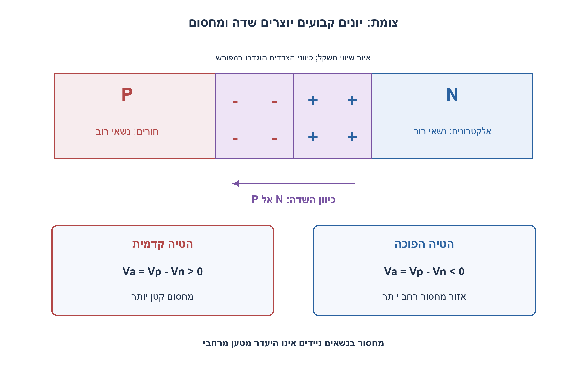
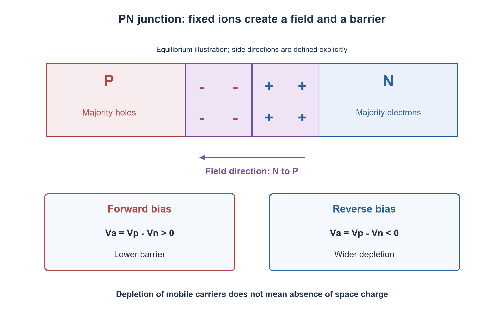

# PREP-260 — צומת PN: דיפוזיה, מחסור והטיה

פתרון מוצע בסיוע AI; ביקורת מקצועית אנושית ממתינה.

[מקור פרטי](../sources/2026-11-07-batch30-11.png)

הסבר צומת NP.

## עברית

הסבירו צומת PN בחומר מוליך למחצה: מהם האזורים מסוג P ו־N, כיצד נוצר אזור המחסור, מהו השדה המובנה ומדוע אין זרם נטו בשיווי משקל. הבדילו בין הטיה קדמית לאחורית ותארו את מאפיין הזרם ואת גבולות המודל.

הצילום הקצר כותב ״צומת NP״. לצורך הניסוח נבחר המונח המקובל PN; היפוך סדר האותיות רק משנה את סדר הצדדים בציור ואינו מגדיר רכיב אחר. אין נתוני אילוח, שטח, טמפרטורה או זרם רוויה, ולכן אין מתח סף מספרי קבוע. אם משתמשים בקירוב מחסור לצומת חד ואחיד, הגדירו את סימני ההטיה ואת הנחות הקירוב.

1. P ו־N מתארים נשאי רוב, לא גושים בעלי מטען נטו גדול. מה גורם לנשאים להתפזר כששני האזורים נפגשים?
2. כשנשאים ניידים עוזבים את אזור המפגש נשארים יוני אילוח קבועים. איזה שדה הם יוצרים, ובאיזה כיוון הוא מתנגד לדיפוזיה?
3. שיווי משקל הוא איזון זרמי דיפוזיה וסחיפה. מתח קדמי P חיובי ביחס ל־N מקטין מחסום; מתח הפוך מגדיל מחסור, עד למגבלות פריצה.

### מתחילים בנשאים, לא במתג מושלם
אילוח תורם באזור N נותן אלקטרונים כנשאי רוב, ואילוח מקבל באזור P נותן חורים כנשאי רוב. רחוק מהצומת החומר בקירוב ניטרלי: גם יוני האילוח נכללים במאזן המטען. P אינו אומר שכל האזור טעון חיובית ו־N אינו אומר שכל האזור טעון שלילית.

לאחר יצירת צומת יש גרדיאנט בריכוז הנשאים. אלקטרונים מתפזרים מ־N ל־P וחורים מ־P ל־N; ליד המפגש נחשפים יוני תורמים חיוביים בצד N ויוני מקבלים שליליים בצד P. האזור דל בנשאי רוב ניידים ולכן נקרא אזור מחסור. הוא אינו ״ריק מכל מטען״: דווקא המטען המרחבי של היונים יוצר שדה מכיוון N אל P. השדה יוצר סחיפה שמתנגדת לזרמי הדיפוזיה. בשיווי משקל תרמי זרמי הסחיפה והדיפוזיה של כל סוג נשא מאזנים זה את זה והזרם הנטו אפס; אין להסיק שהנשאים חדלו לנוע.

### מחסום מובנה ורוחב מחסור
בקירוב צומת חד, אילוח אחיד ולא מנוון, עם ריכוזים NA ו־ND וריכוז עצמי ni באותן יחידות נפח, נגדיר `VT=kT/q`. בשיווי משקל `Vbi=VT ln(NA·ND/ni²)`. זהו הפרש פוטנציאל פנימי, לא סוללה שמספקת זרם חופשי מהדקי דיודה מבודדת בשיווי משקל. אין לזהות אותו אוטומטית עם ״מתח הדלקה 0.7V״.

נגדיר Va=Vp−Vn. עבור `Vbi−Va>0` בקירוב המחסור:

```text
W = sqrt((2εs/q)*(1/NA+1/ND)*(Vbi-Va))
NA*xp = ND*xn,   W=xp+xn
xp = W*ND/(NA+ND),   xn = W*NA/(NA+ND)
```

רוב רוחב המחסור נמצא בצד בעל האילוח הנמוך יותר. למשל אם ND גדול מ־NA, xp גדול מ־xn. הנוסחאות דורשות יחידות עקביות: ערבוב ריכוזים לסמ״ק עם ε ביחידות SI שגוי. הקוד המצורף משתמש במטרים ובריכוז למטר מעוקב, ו־ni הוא פרמטר נתון בטמפרטורת העבודה.

### הטיה משנה מחסום, לא חוק בינארי של 0 או 1
במתח קדמי Va>0 המחסום קטן ונשאי מיעוט מוזרקים לצד השני; זרם גדל בקירוב אקספוננציאלי. במתח הפוך Va<0 המחסום ורוחב המחסור גדלים. קירוב הדיודה האידאלי הוא `I=Is·(exp(Va/(ηVT))−1)`, כאשר Is ו־η תלויים במודל וברכיב. הדיודה אינה ממתינה לערך יחיד אוניברסלי כדי ״להתחיל״ להוליך. במתח הפוך מתון המודל נותן זרם קרוב ל־−Is; בדיודה אמיתית יש זליגה, יצירת נשאים ולבסוף פריצת זנר או מפולת בהתאם למבנה.

הגדלת הטיה הפוכה מגדילה W ומקטינה את קיבול המחסור ליחידת שטח, `Cj/A=εs/W`. במתח קדמי ייתכן גם קיבול דיפוזיה חשוב. התנגדות טורית, טמפרטורה, רקומבינציה, רמות הזרקה גבוהות ופריצה מגבילים את הנוסחאות הפשוטות. אין להאריך את נוסחת W מעבר למחסום חיובי ולהסיק רוחב דמיוני פיזיקלי.

216 מקרי פרמטרים אימתו ניטרליות של מטעני המחסור, שטח גרף השדה המשולש מול מפל הפוטנציאל, ורוחב וקיבול בהטיה. אלה בדיקות משוואות אידאליות, לא SPICE, מדידת דיודה או כיול חומר.

[MIT — צמתי PN ואלקטרוסטטיקה](https://ocw.mit.edu/courses/6-012-microelectronic-devices-and-circuits-fall-2009/resources/mit6_012f09_lec04/)
[MIT — צומת, מחסור והטיה](https://ocw.mit.edu/courses/3-024-electronic-optical-and-magnetic-properties-of-materials-spring-2013/resources/mit3_024s13_2012lec18/)



## English

Explain a semiconductor PN junction: P/N regions, depletion formation, built-in field and zero net current at equilibrium. Distinguish forward/reverse bias, describe the current characteristic and state model limits.

The short source says “NP junction.” We use the conventional PN name; reversing the letters changes drawing order, not the device. No doping, area, temperature or saturation current is supplied, so no fixed numerical threshold follows. If using the depletion approximation for a uniform abrupt junction, define bias signs and assumptions.

1. P/N identify majority carriers, not large net charge of each bulk. What causes carriers to spread when the regions meet?
2. Mobile carriers leaving the interface expose fixed dopant ions. Which field results, and how does it oppose diffusion?
3. Equilibrium balances diffusion and drift currents. P positive relative to N lowers the barrier; reverse bias widens depletion, with breakdown outside the simple model.

### Begin with carriers, not an ideal switch
Donor doping gives N material majority electrons; acceptor doping gives P material majority holes. Away from the interface, each bulk is approximately neutral when dopant ions are included. P does not mean the entire region is net positive, nor N net negative.

Carrier concentration gradients cause electrons to diffuse N→P and holes P→N. Near the junction, mobile carriers leave exposed positive donor ions on the N side and negative acceptor ions on the P side. The depletion region lacks many mobile majority carriers but is not charge-free: fixed space charge creates a field N→P. Drift opposes diffusion. In thermal equilibrium each carrier's drift/diffusion currents balance and net current is zero; individual carriers still move.

### Built-in potential and depletion width
For a uniform abrupt nondegenerate junction, with NA,ND,ni in consistent volume units, `VT=kT/q` and `Vbi=VT ln(NA·ND/ni²)`. This is an internal potential, not an equilibrium battery available at isolated diode terminals. It is not automatically a0.7V turn-on threshold.

Define Va=Vp−Vn. The depletion approximation with a positive remaining barrier gives:

```text
W = sqrt((2εs/q)*(1/NA+1/ND)*(Vbi-Va))
NA*xp = ND*xn,   W=xp+xn
xp = W*ND/(NA+ND),   xn = W*NA/(NA+ND)
```

Depletion extends farther into the less-doped side: ND>NA implies xp>xn. Mixing cm⁻³ concentrations with SI permittivity is incorrect. The attached code consistently uses metres and m⁻³; intrinsic concentration is a supplied parameter at the operating temperature.

### Bias changes a barrier, not a binary turn-on rule
Forward Va>0 lowers the barrier and injects minority carriers; current increases approximately exponentially. Reverse Va<0 increases barrier and depletion width. The ideal-diode approximation is `I=Is·(exp(Va/(ηVT))−1)`, with saturation current Is and ideality factor η depending on device/model. There is no universal voltage below which all current is exactly zero. Moderate reverse bias approaches−Is in that ideal model; real devices have leakage/generation and eventually Zener or avalanche breakdown.

More reverse bias increases W and decreases depletion capacitance per area, `Cj/A=εs/W`; forward diffusion capacitance may matter too. Series resistance, temperature, recombination, high injection and breakdown limit the simple formulas. Do not extrapolate the width equation through a nonpositive barrier.

216 parameter cases checked depletion-charge neutrality, triangular-field potential integrals and width/capacitance changes. These are ideal-equation checks, not SPICE, measured diode curves or material calibration.

[MIT — PN-junction electrostatics](https://ocw.mit.edu/courses/6-012-microelectronic-devices-and-circuits-fall-2009/resources/mit6_012f09_lec04/)
[MIT — junction, depletion and bias](https://ocw.mit.edu/courses/3-024-electronic-optical-and-magnetic-properties-of-materials-spring-2013/resources/mit3_024s13_2012lec18/)



## Supporting material / חומר משלים

```json
{
  "assumptions": {
    "he": "צומת חד ואחיד, לא מנוון, שיווי משקל או הטיה במגבלות קירוב מחסור. Va=Vp−Vn; בקוד יחידות SI ו־ni נתון.",
    "en": "Uniform abrupt nondegenerate junction; equilibrium or bias within depletion-model limits. Va=Vp−Vn; code uses SI and supplied ni."
  },
  "optimality": {
    "he": "אין בעיית אופטימום. נוסחאות אנליטיות מחושבות ב־O(1) פעולות; התאמה לרכיב ממשי דורשת פרמטרים ומודל נוספים.",
    "en": "No optimization problem is posed. Analytical formulas use O(1) arithmetic; a real device requires additional parameters and models."
  },
  "verification": {
    "he": "216 בדיקות: מטען NA·xp=ND·xn, שדה מרבי משני הצדדים, אינטגרציית פוטנציאל ומגמת W ו־C בהטיה הפוכה. אין סימולציית רכיב פיזיקלי.",
    "en": "216 checks:NA·xp=ND·xn, matching peak fields, potential integral and reverse-bias width/capacitance trends. No physical-device simulation."
  },
  "edge_cases": {
    "he": "אילוח מאוד לא סימטרי; ערבוב יחידות; חימום שמשנה ni; מתח קדמי גבוה; פריצה; שטח לא ידוע; רקומבינציה וקיבול דיפוזיה.",
    "en": "Strongly asymmetric doping; mixed units; temperature-dependent ni; large forward bias; breakdown; unknown area; recombination and diffusion capacitance."
  },
  "common_mistakes": {
    "he": "לקרוא לאזור המחסור חסר מטען; לומר P חיובי כולו; להפוך כיוון שדה; לקבע 0.7V לכל דיודה; להציג Vbi כמקור אנרגיה חיצוני.",
    "en": "Calling depletion charge-free; treating all P bulk as positive; reversing field direction; assuming0.7V for every diode; using Vbi as an external energy source."
  },
  "interview_answer": {
    "he": "דיפוזיה חושפת יוני אילוח ויוצרת שדה N→P. הסחיפה מאזנת דיפוזיה בשיווי משקל; הטיה קדמית מורידה מחסום ואחורית מגדילה מחסור, עד גבולות המודל.",
    "en": "Diffusion exposes dopant ions and builds an N→P field. Drift balances diffusion at equilibrium; forward bias lowers the barrier, reverse bias widens depletion within model limits."
  },
  "source_ambiguities": {
    "he": "״NP״ הובן כסדר צדדים של צומת PN. אין במקור נתוני חומר או אילוח, ולכן אין מספר מתח או רוחב ייחודי.",
    "en": "“NP” is interpreted as reversed side order of a PN junction. Missing material/doping data preclude a unique voltage or width."
  },
  "solution_extensions": {
    "he": "אם ND גדל בעוד NA קבוע, איזה צד מכיל את רוב המחסור? השתמשו ביחס xp/xn=ND/NA והבחינו בין חלוקת הרוחב לבין שינוי W הכולל.",
    "en": "Increase ND while keeping NA fixed. Use xp/xn=ND/NA to distinguish which side holds most depletion from how total W changes."
  },
  "technical_references": {
    "he": [
      "[MIT — צמתי PN ואלקטרוסטטיקה](https://ocw.mit.edu/courses/6-012-microelectronic-devices-and-circuits-fall-2009/resources/mit6_012f09_lec04/)",
      "[MIT — צומת, מחסור והטיה](https://ocw.mit.edu/courses/3-024-electronic-optical-and-magnetic-properties-of-materials-spring-2013/resources/mit3_024s13_2012lec18/)"
    ],
    "en": [
      "[MIT — PN-junction electrostatics](https://ocw.mit.edu/courses/6-012-microelectronic-devices-and-circuits-fall-2009/resources/mit6_012f09_lec04/)",
      "[MIT — junction, depletion and bias](https://ocw.mit.edu/courses/3-024-electronic-optical-and-magnetic-properties-of-materials-spring-2013/resources/mit3_024s13_2012lec18/)"
    ]
  }
}
```
