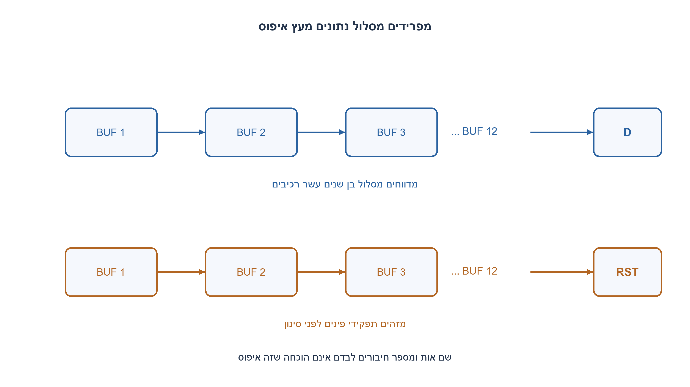
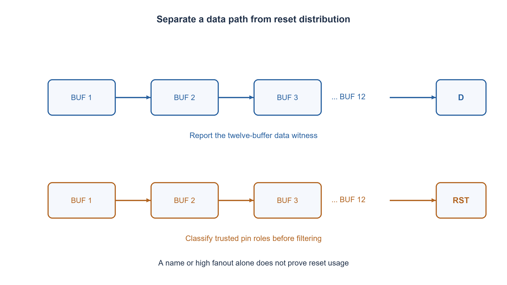

# PREP-261 — איתור שרשראות באפרים ב־netlist וסינון הפצת איפוס

פתרון מוצע בסיוע AI; ביקורת מקצועית אנושית ממתינה. הקושי אינו מכויל.

[צילום מקור פרטי](../sources/2026-11-07-batch30-22.png)

נתון דיזיין צ׳יפ עם שרשראות של באפרים. מצא והתרע על שרשראות בנות יותר מעשרה באפרים, כשיש פונקציה שמחזירה לכל בלוק את חיבוריו (netlist). בנוסף: כיצד להימנע מלמצוא את reset של המעגל, ובמה הוא מאופיין?

חברות לפי הדיווח בצילום בלבד: NVIDIA.

## עברית

נתון netlist כגרף מכוון: לכל רכיב ידוע סוגו ולכל חיבור ידועים רכיב היעד ותפקיד פין היעד. מצאו שרשראות של יותר מעשרה באפרים רצופים והחזירו מקום וכיוון מסלול שאפשר לבדוק. דונו בהתפצלות, איחוד מסלולים, מעגלים ובעלות הדיווח.

המקור מוסיף שאלה עמומה: ״איך אפשר להימנע מלמצוא את הריסט של המעגל? (במה הוא מאופיין?)״. כתרגיל ערוך נפרש זאת כהימנעות מדיווח על עץ הפצת reset כאילו היה שרשרת נתונים; זו פרשנות מפורשת ולא שחזור ודאי.

חוזה המימוש: כל vertex הוא רכיב, באפר נחשב רכיב אחד, וחוצים רק קשתות באפר→באפר רצופות. גרף הבאפרים חסר מעגלים; מעגל מדווח כשגיאה. מחזירים לכל באפר סופי שאורך מסלול מרבי אליו גדול מ־10 את האורך ועד אחד למסלול מרבי, ולא רשימה של כל המסלולים האפשריים. תפקידי reset/clock/data מגיעים מספריית תאים ומנתוני החיבור; אין לקבוע אותם רק לפי שם. מותר לסנן חרוטים שכל יעדיהם הידועים הם פיני בקרה, ואסור לסנן חרוט בעל שימוש נתונים משותף.

1. ייצגו את הבאפרים והחיבורים ביניהם כגרף. מהו מצב ביניים שאפשר לחשב פעם אחת לכל צומת?
2. בסדר טופולוגי, האורך המרבי שמסתיים בבאפר הוא אחד ועוד המקסימום אצל קודמיו.
3. שמרו לכל באפר אורך וקודם לשחזור עד. לפני סינון בקרה, הפיצו לאחור את קבוצת תפקידי פיני היעד; אל תסננו שימוש נתונים מעורב.

### מה בדיוק מדווחים?
בגרף עם התפצלויות ואיחודים עלולים להיות מספר אקספוננציאלי של מסלולים. לכן לא מבטיחים למנות את כולם בזמן לינארי. החוזה כאן מחזיר עבור כל סוף שרשרת את האורך המרבי ועד אחד. אם צריך ממש את כל המסלולים, העלות כוללת בהכרח את אורך הפלט; אפשר להחזיר גרף דחוס במקום למנותם.

מחלצים תת־גרף של באפרים. קשת דרך שער רגיל, דלגלג או פורט מסיימת רצף; חוט אינו מוסיף באפר. ממיינים טופולוגית באמצעות דרגות כניסה. אם לא כל הבאפרים יצאו מהתור, יש מעגל באפרים ואין longest path סופי לפי החוזה; לא ממשיכים ברקורסיה אינסופית.

### סינון איפוס מתוך תפקידי פינים
לכל באפר שומרים את קבוצת שימושי היעד. קשת אל פין שאינו באפר מוסיפה את התפקיד data/reset/clock; קשת לבאפר מעבירה לאחור את קבוצתו בסדר טופולוגי הפוך. מסננים רק קבוצה לא ריקה שכל תפקידיה בקרה. קבוצה הכוללת data נשארת; קבוצה ריקה נשארת כלא ידועה. כך גם באפר המפצל לפין reset ולפין data אינו נמחק בטעות.

התפקידים חייבים להגיע ממקור סמכותי כגון פיני תאים/פורט ומבנה החיבור. שם הכולל rst, מספר רב של יציאות או דמיון לעץ יכולים לשמש רמז לבדיקה, לא הוכחה: גם enable ונתונים נפוצים יכולים להיות בעלי fanout גבוה. כאשר מידע ספריית התאים חסר, מדווחים אי־ודאות ולא מסווגים בביטחון.

### אורך ושחזור
מאתחלים `L[v]=1` לכל באפר שנותר ו־`pred[v]=None`. לכל קשת באפרים u→v בסדר טופולוגי, אם `L[u]+1>L[v]`, מעדכנים את האורך ושומרים u. אינווריאנט: בעת טיפול ב־v, כל קודמיו כבר נפתרו; כל מסלול אליו מסתיים בקשת מקודם כלשהו, ולכן הנוסחה מכסה את כולם. באפר ללא יוצא מסוג באפר הוא סוף. עבור סוף שאורכו לפחות11 משחזרים pred לאחור והופכים את הרשימה.

לדוגמה, רצף B1→…→B12 המזין פין D מדווח באורך12; עץ זהה המזין רק RST מסונן. אם נוסף ענף D, הרצף נשאר. סף10 אינו ״לפחות10״: עשרה באפרים בדיוק אינם חריגה.

זמן גרעין האלגוריתם O(V+E), זיכרון O(V+E), ועוד אורך העדים המוחזרים. בקוד יש מיון שמות לשחזור דטרמיניסטי, ולכן למימוש המסוים יש גם עלות מיון עד O((V+E)log(V+E)); אפשר להשמיט מיון כאשר סדר חוקי כלשהו מספיק. זוהי ספירת רכיבים רצופים, לא STA ולא נתיב בעל ההשהיה החשמלית המרבית.

### מודל Python שנבדק

```python
"""Report one longest buffer-only witness per endpoint in a directed netlist.

Input: nodes[name] is a kind: buffer, logic, ff or port.
edges[name] lists (target, pin_role); pin_role is wire for a buffer target,
otherwise data/reset/clock from trusted cell-library/interface metadata.
No graph-name/fanout heuristic is used to declare a reset. Buffer cycles are
rejected. Control-only cones may be excluded; mixed-use cones are retained.
"""
from collections import deque


def buffer_chains(nodes, edges, limit=10, exclude_control=True):
    if type(limit) is not int or limit < 0:
        raise ValueError('Nonnegative integer limit required')
    if any(kind not in {'buffer', 'logic', 'ff', 'port'} for kind in nodes.values()):
        raise ValueError('Unknown cell kind')
    if set(edges) - set(nodes):
        raise ValueError('Unknown source cell')
    buffers = {name for name, kind in nodes.items() if kind == 'buffer'}
    succ = {name: [] for name in buffers}
    terminal_roles = {name: set() for name in buffers}
    incoming = {name: 0 for name in buffers}
    for source in nodes:
        seen = set()
        for target, role in edges.get(source, []):
            if target not in nodes or (target, role) in seen:
                raise ValueError('Unknown target or duplicate edge')
            seen.add((target, role))
            if role not in {'wire', 'data', 'reset', 'clock'}:
                raise ValueError('Unknown pin role')
            if source not in buffers:
                continue
            if target in buffers:
                if role != 'wire':
                    raise ValueError('Buffer-to-buffer connections use wire role')
                succ[source].append(target)
                incoming[target] += 1
            else:
                if role == 'wire':
                    raise ValueError('Nonbuffer target requires a terminal pin role')
                terminal_roles[source].add(role)
    ready = deque(sorted(name for name in buffers if not incoming[name]))
    order = []
    while ready:
        source = ready.popleft()
        order.append(source)
        for target in sorted(succ[source]):
            incoming[target] -= 1
            if incoming[target] == 0:
                ready.append(target)
    if len(order) != len(buffers):
        raise ValueError('Buffer-only cycle: a DAG contract is required')
    roles = {name: set(terminal_roles[name]) for name in buffers}
    for source in reversed(order):
        for target in succ[source]:
            roles[source].update(roles[target])
    excluded = {name for name in buffers
                if exclude_control and roles[name]
                and roles[name] <= {'reset', 'clock'}}
    kept = buffers - excluded
    length = {name: 1 for name in kept}
    predecessor = {name: None for name in kept}
    for source in order:
        if source not in kept:
            continue
        for target in sorted(succ[source]):
            if target in kept and length[source] + 1 > length[target]:
                length[target] = length[source] + 1
                predecessor[target] = source
    reports = []
    for end in sorted(kept):
        if any(target in kept for target in succ[end]) or length[end] <= limit:
            continue
        path, current = [], end
        while current is not None:
            path.append(current)
            current = predecessor[current]
        reports.append({'end': end, 'length': length[end], 'witness': path[::-1]})
    return {'reports': reports, 'excluded_control_buffers': sorted(excluded),
            'longest_to_buffer': dict(sorted(length.items()))}
```




### assumptions

```json
[
  "גרף מכוון עם סוגי רכיבים ותפקידי פינים אמינים; גרף הבאפרים הוא DAG.",
  "מוחזר עד מרבי אחד לכל סוף; סוגי הבקרה הם reset ו־clock. שימוש נתונים מעורב נשמר."
]
```

### optimality

ליבת DP וטופולוגיה לינארית בגרף, ועוד גודל הפלט; המימוש הדטרמיניסטי כולל מיון שמות. מונה מסלולים אינו תחליף למניית כל המסלולים.

### verification

1,903 בדיקות Python השוו לגרף אורקל רקורסיבי עצמאי: כל DAG מסודר עד5 באפרים,800 דפוסים בני6, חרוט reset, שימוש מעורב ומעגל שנדחה. אין סריקת netlist תעשייתי אמיתי.

### edge_cases

```json
[
  "עשרה לעומת אחד־עשר באפרים; גרף ריק או ללא באפרים.",
  "התפצלות ואיחוד, פין בקרה עם שימוש נתונים, צומת ללא שימוש ידוע.",
  "מעגל, קישור לרכיב שאינו קיים ותפקיד פין לא חוקי."
]
```

### common_mistakes

מספר כל המסלולים בטענה לזמן לינארי; שימוש בשם rst כהוכחה; מחיקת ענף משותף לנתונים; DFS ללא זיהוי מעגלים; ספירת שער שאינו באפר כחלק מהרצף.

### interview_answer

אבנה תת־גרף באפרים, אסווג שימושי קצה לפי פיני ספרייה, ואחשב אורך מרבי בסדר טופולוגי עם מצביע שחזור. אגדיר אם רוצים עד אחד או כל מסלול, כי גודל הפלט משנה את העלות.

### source_ambiguities

הסעיף על reset במקור אינו חד־משמעי. סינון עץ בקרה הוא פרשנות עריכתית מפורשת; אין כאן טענה שזוהי כוונת המראיין היחידה.

### solution_extensions

```json
{
  "question": "מה משתנה אם לכל קשת זמן השהיה אחר?",
  "direction": "מחליפים תוספת1 במשקל, מגדירים תחומי שעון ונקודות פתיחה/סיום; מגבלות STA אינן נובעות רק מקישוריות.",
  "tests": "הבדל בין אורך גרף ומסלול תזמון."
}
```

## English

A directed netlist identifies each cell type and every connection’s destination and pin role. Find consecutive buffer chains longer than ten, reporting locations and a checkable path. Discuss branching, reconvergence, cycles and reporting cost.

The source adds an ambiguous question literally asking how to avoid finding the circuit reset and what characterizes it. This edited exercise interprets that as avoiding false data-chain reports for reset distribution; it is an explicit interpretation, not a certain reconstruction.

Implementation contract: vertices are cells; each buffer counts once; only consecutive buffer-to-buffer arcs extend a chain. The buffer graph must be acyclic; report a cycle as invalid. For each terminal buffer whose longest incoming chain exceeds ten, return its length and one longest witness, rather than enumerate all possible paths. Reset/clock/data roles come from trusted cell-library connectivity metadata, not names alone. Control-only cones may be excluded, but a cone also feeding data must be retained.

1. Represent buffers and their connections as a graph. What result can be computed once per vertex?
2. In topological order, a buffer’s longest incoming chain is one plus the maximum over its predecessors.
3. Store length and a predecessor for one witness. Before excluding control cones, propagate terminal pin roles backward; preserve any mixed data use.

### Define the report before claiming linear time
Branching and reconvergence can create exponentially many paths. The contract returns a longest length and one witness for each chain endpoint, not all paths. Enumerating every path necessarily includes output-size cost; a compact graph is another possible interface.

Extract the buffer-only graph. An ordinary gate, flip-flop or port ends a consecutive buffer sequence; a wire does not add a cell. Use indegrees and topological sorting. If some buffers remain unsorted there is a buffer cycle, violating the DAG contract; do not recurse indefinitely or invent a finite longest path through it.

### Classify reset from trusted pin roles
For each buffer keep the set of terminal uses reachable through buffers. An edge to a nonbuffer contributes its data/reset/clock pin role. In reverse topological order, union downstream buffer role sets. Exclude only nonempty sets containing control roles alone. Preserve any set containing data, and preserve empty/unknown sets. A buffer feeding both reset and data is therefore retained.

Pin roles must come from authoritative cell-library/interface connectivity information. A name containing rst, high fanout or tree shape may help an investigation but is not proof: enables and data can share these properties. Missing pin metadata should produce uncertainty rather than a confident reset classification.

### Dynamic programming and witnesses
Initialize `L[v]=1` and `pred[v]=None` for every retained buffer. For each u→v in topological order, replace L[v] with L[u]+1 and remember u when that length is greater. When v is processed all predecessors are solved. Every path to v ends in one predecessor edge, so taking their maximum is complete. A buffer with no retained buffer successor is an endpoint. If its length exceeds10, follow pred backward and reverse the collected witness.

For example B1→…→B12 feeding a D pin reports length12; the same chain feeding RST alone is filtered. Adding a D branch retains it. Exactly ten buffers is not a violation of the strict “more than ten” threshold.

The core costs O(V+E) time and O(V+E) space plus emitted witness length. The supplied code sorts names for deterministic witnesses, adding sorting cost up to O((V+E)log(V+E)); omit that sorting if any valid order suffices. This counts consecutive cells, not electrical delay or a static timing analysis critical path.

### Verified Python teaching model

```python
"""Report one longest buffer-only witness per endpoint in a directed netlist.

Input: nodes[name] is a kind: buffer, logic, ff or port.
edges[name] lists (target, pin_role); pin_role is wire for a buffer target,
otherwise data/reset/clock from trusted cell-library/interface metadata.
No graph-name/fanout heuristic is used to declare a reset. Buffer cycles are
rejected. Control-only cones may be excluded; mixed-use cones are retained.
"""
from collections import deque


def buffer_chains(nodes, edges, limit=10, exclude_control=True):
    if type(limit) is not int or limit < 0:
        raise ValueError('Nonnegative integer limit required')
    if any(kind not in {'buffer', 'logic', 'ff', 'port'} for kind in nodes.values()):
        raise ValueError('Unknown cell kind')
    if set(edges) - set(nodes):
        raise ValueError('Unknown source cell')
    buffers = {name for name, kind in nodes.items() if kind == 'buffer'}
    succ = {name: [] for name in buffers}
    terminal_roles = {name: set() for name in buffers}
    incoming = {name: 0 for name in buffers}
    for source in nodes:
        seen = set()
        for target, role in edges.get(source, []):
            if target not in nodes or (target, role) in seen:
                raise ValueError('Unknown target or duplicate edge')
            seen.add((target, role))
            if role not in {'wire', 'data', 'reset', 'clock'}:
                raise ValueError('Unknown pin role')
            if source not in buffers:
                continue
            if target in buffers:
                if role != 'wire':
                    raise ValueError('Buffer-to-buffer connections use wire role')
                succ[source].append(target)
                incoming[target] += 1
            else:
                if role == 'wire':
                    raise ValueError('Nonbuffer target requires a terminal pin role')
                terminal_roles[source].add(role)
    ready = deque(sorted(name for name in buffers if not incoming[name]))
    order = []
    while ready:
        source = ready.popleft()
        order.append(source)
        for target in sorted(succ[source]):
            incoming[target] -= 1
            if incoming[target] == 0:
                ready.append(target)
    if len(order) != len(buffers):
        raise ValueError('Buffer-only cycle: a DAG contract is required')
    roles = {name: set(terminal_roles[name]) for name in buffers}
    for source in reversed(order):
        for target in succ[source]:
            roles[source].update(roles[target])
    excluded = {name for name in buffers
                if exclude_control and roles[name]
                and roles[name] <= {'reset', 'clock'}}
    kept = buffers - excluded
    length = {name: 1 for name in kept}
    predecessor = {name: None for name in kept}
    for source in order:
        if source not in kept:
            continue
        for target in sorted(succ[source]):
            if target in kept and length[source] + 1 > length[target]:
                length[target] = length[source] + 1
                predecessor[target] = source
    reports = []
    for end in sorted(kept):
        if any(target in kept for target in succ[end]) or length[end] <= limit:
            continue
        path, current = [], end
        while current is not None:
            path.append(current)
            current = predecessor[current]
        reports.append({'end': end, 'length': length[end], 'witness': path[::-1]})
    return {'reports': reports, 'excluded_control_buffers': sorted(excluded),
            'longest_to_buffer': dict(sorted(length.items()))}
```




### assumptions

```json
[
  "Directed cell graph with trusted pin-role metadata and an acyclic buffer subgraph.",
  "One longest witness per endpoint; reset/clock-only cones may be excluded, mixed data use remains."
]
```

### optimality

Linear graph DP/topological core plus output size; this deterministic implementation additionally sorts names. Counting or one witness is not enumeration of every path.

### verification

1,903 Python checks compare with an independent recursive graph oracle: every ordered DAG through five buffers,800 six-buffer patterns, reset-only/mixed cones and a rejected cycle. No industrial netlist was scanned.

### edge_cases

```json
[
  "Ten versus eleven buffers; empty/no-buffer graphs.",
  "Branching/reconvergence, mixed control/data and unknown uses.",
  "Cycles, unknown target cells and invalid pin roles."
]
```

### common_mistakes

Enumerating every path while claiming linear time; treating an rst name as proof; excluding mixed data use; DFS without cycle detection; counting nonbuffers inside a consecutive buffer chain.

### interview_answer

Extract buffers, classify terminal uses from library pins and compute longest chains in topological order with predecessor witnesses. Specify one witness versus all paths because output size changes the cost.

### source_ambiguities

The source reset subquestion is ambiguous. Filtering a control distribution tree is an explicit edited interpretation, not a unique recovered interviewer intention.

### solution_extensions

```json
{
  "question": "What changes when edges have different delays?",
  "direction": "Use weighted DP after defining start/end points and clock domains; STA constraints do not follow from connectivity alone.",
  "tests": "Graph length versus timing analysis."
}
```
