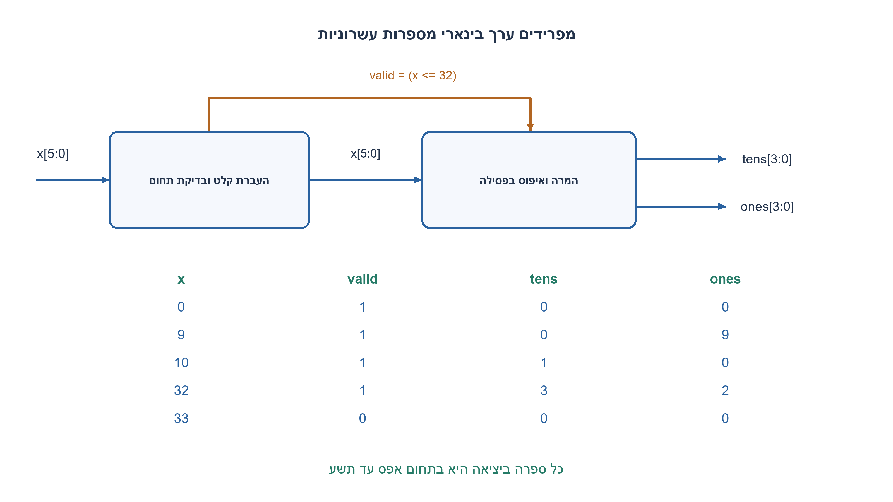
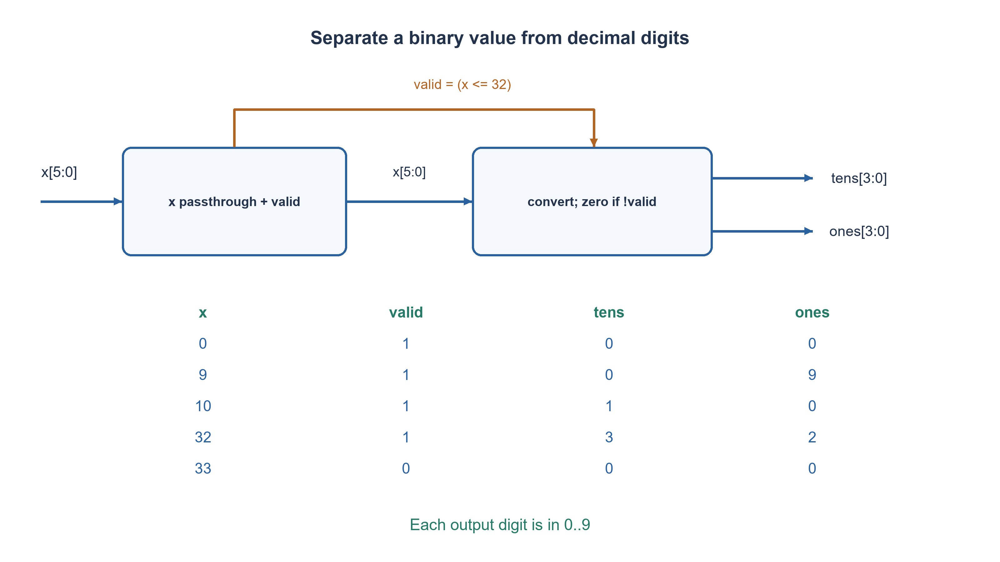

# PREP-262 — מספר בינארי עד שלושים ושתיים בשתי תצוגות עשרוניות

פתרון מוצע בסיוע AI; ביקורת מקצועית אנושית ממתינה. הקושי אינו מכויל.

[צילום מקור פרטי](../sources/2026-11-07-batch30-26.png)

נתונים שני רכיבי מסך המקבלים BCD בן 4 ביטים ומציגים ספרה 0..9. קלט בינארי בן 6 ביטים בתחום 0..32: השתמש בשני המסכים להצגת המספר העשרוני; למשל 1011 יוצג 1 ו-3. המסך אינו מקבל ערכים מחוץ ל-0..9.

חברות לפי הדיווח בצילום בלבד: NVIDIA.

## עברית

נתונים שני רכיבי תצוגת ספרה, כל אחד מקבל ארבע סיביות ומציג ערך0..9 בלבד. קלט המערכת הוא מספר בינארי בן שש סיביות שערכו בתחום0..32 כולל. תכננו את הלוגיקה המזינה את שני הרכיבים כדי להציג את המספר בעשרות וביחידות. למשל `001101` הוא13, ולכן תצוגה אחת מקבלת `0001` והשנייה `0011`.

הבהרות: המקור מגביל את הערך ל־32, גם אם שש סיביות מאפשרות63. בחוזה הערוך קלט33..63 גורם valid=0 ושתי יציאות0. בקלט חוקי valid=1. אפס מוביל מוצג0. אין לשלוח לתצוגת ספרה ערך מחוץ ל־0..9. המימוש צירופי; התצוגות הנתונות כבר מפענחות ספרות ואין צורך לבנות שוב מפענח מקטעים.

1. מה ההבדל בין פיצול מספר לשתי קבוצות ביטים ובין פיצולו לעשרות ויחידות?
2. חפשו שני ערכים t,u בתחום0..9 כך ש־x=10t+u.
3. אפשר להשתמש בהשוואות לספים10,20,30 ובחיסור עשרות, או באלגוריתם תיקון והזזה הממיר בינארי ל־BCD.

### ארבע סיביות לספרה אינן בסיס שש־עשרה לתצוגה
אם מפצלים13=001101 לשתי קבוצות, הניבל הנמוך הוא1101=13, שהמסך אינו מקבל. צריך לייצג את הערך בבסיס עשר: `t=x//10`, `u=x-10t`.

בתחום0..32 אפשר לממש ישירות `t=(x≥10)+(x≥20)+(x≥30)` עם הרחבת תוצאות ההשוואה לפני החיבור; אחר כך u=x−10t. המשוואה נכונה כי בדיוק t ספי עשרות הושגו, ושארית החלוקה נמצאת0..9. למשל32 חוצה שלושה ספים, ולכן t=3 ו־u=2. לכל הקלטים החוקיים מתקיים `10t+u=x`.

### מימוש חלופי ללא מחלק כללי
בקוד המצורף יש ממיר double dabble בן שש איטרציות צירופיות. בכל צעד מוסיפים3 לכל ספרת BCD שהיא לפחות5, מזיזים שמאלה ומכניסים את ביט הקלט הבא מן ה־MSB. האינווריאנט הוא שה־BCD מייצג את הקידומת שכבר התקבלה. תיקון3 לפני הכפלה בשתיים יוצר תיקון6 עבור ספרה העוברת את9, וכך מעביר נשיאה עשרונית במקום משקל16 של ניבל.

בודקים בנפרד valid=(x≤32). כאשר אינו חוקי, מאפסים את שתי היציאות, ולכן גם בקלט שגוי אין לתצוגות קוד10..15. תחום33..63 אינו don’t-care במימוש הזה. זהו חוזה שנוסף לעריכה, לא דרישה מפורשת מהצילום. הממיר עצמו מסוגל לקודד גם63, אך זה אינו מרחיב אוטומטית את השאלה.

|x|valid|עשרות|יחידות|
|---|---|---|---|
|0|1|0|0|
|9|1|0|9|
|10|1|1|0|
|13|1|1|3|
|32|1|3|2|
|33|0|0|0|

שתי דרכי המימוש תקפות. השוואה וחיסור פשוטים לטווח קטן; double dabble מתרחב באופן מסודר לרוחב קלט גדול יותר. בלי ספריית שערים לא קובעים איזו דרך קטנה או מהירה יותר. הלולאה נפרסת ללוגיקה, ואין לה latency של שישה מחזורי שעון במימוש ללא שעון.

### קוד SystemVerilog; תוצאות סימולציה בדוח נפרד

```systemverilog
`timescale 1ns/1ps
// Source range is 0..32 even though the input bus can encode 0..63.
module prep262(input wire [5:0] x,
               output reg valid, output reg [3:0] tens, ones);
  reg [7:0] bcd;
  integer i;
  always @* begin
    bcd = 0;
    for (i=5; i>=0; i=i-1) begin
      if (bcd[3:0] >= 5) bcd[3:0] = bcd[3:0] + 4'd3;
      if (bcd[7:4] >= 5) bcd[7:4] = bcd[7:4] + 4'd3;
      bcd = {bcd[6:0],x[i]};
    end
    valid = (x <= 6'd32);
    tens = valid ? bcd[7:4] : 4'd0;
    ones = valid ? bcd[3:0] : 4'd0;
  end
endmodule
```




### assumptions

```json
[
  "התחום החוקי0..32; שש סיביות בינאריות, שני קודי BCD.",
  "valid=0 ויציאות00 מחוץ לתחום; valid=1 בקלט חוקי."
]
```

### optimality

שש רמות המרה פרוסות ובדיקת תחום; אפשרות נוספת היא שלוש השוואות וחישוב שארית. לא נטען מינימום שערים או תזמון.

### verification

כל64 דפוסי הקלט נבדקו ב־Python מול divmod:33 חוקיים ו־31 פסולים. בדיקת RTL מתועדת בנפרד בדוח.

אימות RTL בפועל: ששת מימושי החומרה של האצווה קומפלו ב־Icarus Verilog12 עם ‎-g2012 -Wall והורצו ב־vvp בסביבה מבודדת ללא רשת. הרתמה המשולבת עברה172,128 בדיקות; רתמת FIFO נפרדת עברה15,729 בדיקות עם5,587 כתיבות ו־5,587 קריאות מאושרות. הכיסוי כולל שתי גרסאות SR, שני סדרי קלט טורי, כל קלטי BCD והסף, ותעבורת FIFO דיגיטלית מוגבלת. ראיה: checks/batch1107-native-verification.json. אין סינתזה, STA, סימולציית מטא־יציבות או אישור CDC פיזי.

### edge_cases

```json
[
  "0,9→10,19→20,29→30,32 ו־33.",
  "כל קוד יציאה חוקי למסך; אפס מוביל אינו blank."
]
```

### common_mistakes

פיצול לניבלים; התעלמות מההבדל בין שש סיביות לתחום32; יציאת13 למסך ספרה; רוחב1 לחיבור של תוצאות השוואה.

### interview_answer

אחשב עשרות ויחידות כך ש־x=10t+u, ואז כל מסך מקבל ספרת BCD חוקית. לטווח קטן אפשר להשתמש בספי10,20,30, או בממיר בינארי ל־BCD.

### source_ambiguities

שש סיביות יכולות לייצג63, אך המקור אומר במפורש עד32. valid ומדיניות אפס מוביל נוספו כדי להגדיר התנהגות מלאה.

### solution_extensions

```json
{
  "question": "כיצד מרחיבים למספר0..255?",
  "direction": "נדרשות שלוש ספרות, שמונה צעדי המרה ו־12 חוטי BCD; שתי תצוגות אינן מספיקות לייצוג כל הערכים.",
  "tests": "רוחב, טווח ומספר ספרות."
}
```

## English

Two decimal-digit display cells each accept four bits and only values0..9. The system receives a six-bit ordinary binary input whose specified value is0..32 inclusive. Design the logic feeding tens and units. For `001101`=13, one cell receives `0001` and the other `0011`.

Clarifications: the source limits the value to32 even though six bits can encode63. In this edited contract33..63 produce valid=0 and both digit outputs0; legal values produce valid=1. Display a leading zero as0. Never drive a display cell with a code outside0..9. The circuit is combinational; the supplied displays already decode digits, so segment decoding need not be rebuilt.

1. How does splitting a word into nibbles differ from splitting it into tens and units?
2. Find digits t,u in0..9 such that x=10t+u.
3. Use thresholds10,20,30 and subtract the tens, or an add-three-and-shift binary-to-BCD converter.

### Four bits per digit do not make the display hexadecimal
Splitting binary13=001101 into nibbles leaves low nibble1101=13, which the display does not accept. Encode in base ten: `t=x//10`, `u=x-10t`.

For0..32 a direct implementation is `t=(x>=10)+(x>=20)+(x>=30)`, widening comparator outputs before summing, then u=x−10t. Exactly t decimal thresholds have been crossed, leaving remainder0..9. For32, three thresholds are crossed: t=3,u=2. Every legal input satisfies `10t+u=x`.

### An alternative without a general divider
The attached code uses six combinational double-dabble iterations. Add3 to each BCD digit at least5, shift left and insert the next input bit from MSB to LSB. The invariant is that BCD encodes the processed prefix. A correction of3 before doubling supplies the correction6 needed when crossing9, creating a decimal carry instead of an uncorrected nibble radix16.

Independently check valid=(x<=32). Invalid inputs force both digit outputs to0, so even an out-of-contract input cannot feed a display the code10..15. Values33..63 are not don’t-cares in this implementation. This invalid policy is an editorial addition. Although the converter can encode63, that does not silently expand the source’s specified range.

|x|valid|tens|units|
|---|---|---|---|
|0|1|0|0|
|9|1|0|9|
|10|1|1|0|
|13|1|1|3|
|32|1|3|2|
|33|0|0|0|

Both approaches are valid. Threshold/subtraction logic is simple for a small range; double dabble generalizes regularly to wider inputs. Without a cell library no minimum area or delay comparison is claimed. The unclocked loop unrolls into logic rather than imposing six clock cycles of latency.

### SystemVerilog; simulation results are in a separate report

```systemverilog
`timescale 1ns/1ps
// Source range is 0..32 even though the input bus can encode 0..63.
module prep262(input wire [5:0] x,
               output reg valid, output reg [3:0] tens, ones);
  reg [7:0] bcd;
  integer i;
  always @* begin
    bcd = 0;
    for (i=5; i>=0; i=i-1) begin
      if (bcd[3:0] >= 5) bcd[3:0] = bcd[3:0] + 4'd3;
      if (bcd[7:4] >= 5) bcd[7:4] = bcd[7:4] + 4'd3;
      bcd = {bcd[6:0],x[i]};
    end
    valid = (x <= 6'd32);
    tens = valid ? bcd[7:4] : 4'd0;
    ones = valid ? bcd[3:0] : 4'd0;
  end
endmodule
```




### assumptions

```json
[
  "Legal range0..32; six binary bits and two BCD digit codes.",
  "Out-of-range inputs produce valid0/digits00; legal inputs produce valid1."
]
```

### optimality

Six unrolled conversion steps and a range check; three threshold comparisons and remainder calculation are another option. No gate-count or timing minimum is claimed.

### verification

All64 input patterns were checked in Python against divmod:33 legal and31 invalid. RTL execution is recorded separately in the batch report.

Executed RTL verification: the six batch hardware implementations were compiled with Icarus Verilog12 -g2012 -Wall and run with vvp in an isolated network-denied environment. The combined harness passed172,128 checks; the separate FIFO harness passed15,729 checks with5,587 accepted writes and5,587 accepted reads. Scope includes both SR priorities, both serial input orders, BCD/threshold inputs and bounded ideal FIFO traffic. Evidence: checks/batch1107-native-verification.json. No synthesis, STA, metastability simulation or physical CDC closure was performed.

### edge_cases

```json
[
  "0,9→10,19→20,29→30,32,33.",
  "Every output is a valid display digit; leading zero is not blank."
]
```

### common_mistakes

Splitting into nibbles; confusing six-bit capacity with the source limit32; passing13 to a digit cell; adding comparator bits without widening.

### interview_answer

Compute tens and units satisfying x=10t+u, then feed each display a legal BCD digit. Use thresholds10,20,30 for this range or binary-to-BCD conversion.

### source_ambiguities

Six bits encode63, but the source explicitly says through32. Valid and leading-zero policies are added to make the contract complete.

### solution_extensions

```json
{
  "question": "How does the design change for0..255?",
  "direction": "Use three digits, eight conversion steps and twelve BCD wires; two displays cannot represent every value.",
  "tests": "Widths, range and digit count."
}
```
