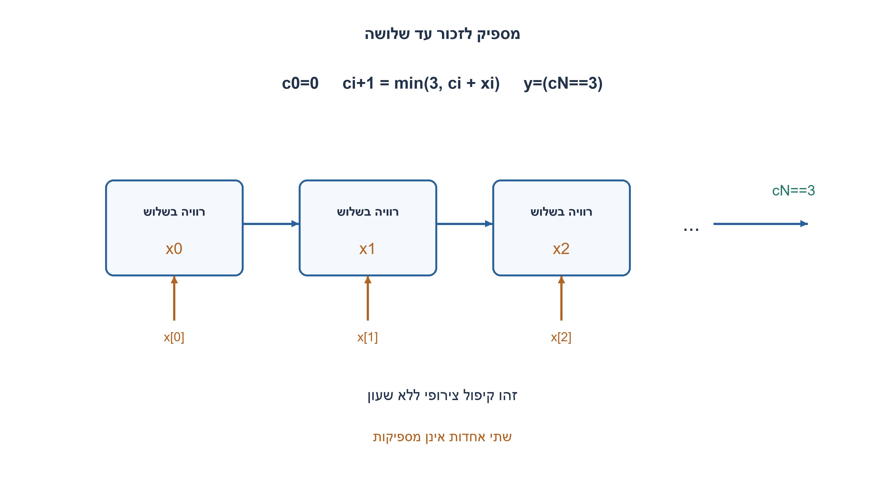
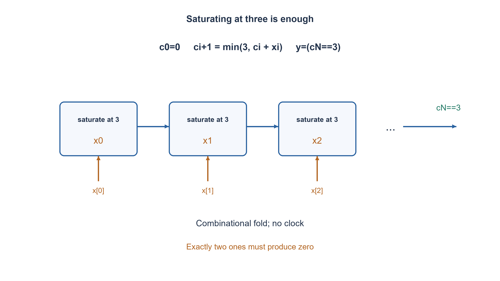

# PREP-263 — זיהוי יותר משתי כניסות פעילות

פתרון מוצע בסיוע AI; ביקורת מקצועית אנושית ממתינה. הקושי אינו מכויל.

[צילום מקור פרטי](../sources/2026-11-07-batch30-27.png)

נתונה מערכת המחזירה 1 אם יותר משתי כניסות דולקות.

חברות לפי הדיווח בצילום בלבד: NVIDIA.

## עברית

תכננו מערכת צירופית המקבלת N כניסות ביט ומחזירה1 בדיוק אם יותר משתיים מהן1, אחרת0. הגדירו מימוש הניתן להרחבה והוכיחו נכונות.

המקור אינו מגדיר N או ספריית רכיבים. בגרסה הערוכה N הוא פרמטר שלם לפחות1 בזמן בניית החומרה; כל הקלטים0/1 וללא סימן. אין שעון או דרישה לזכור מחזור קודם. בדיוק שתי כניסות פעילות אינן מספיקות; עבור N<3 הפלט תמיד0. שערים בסיסיים וחומרה צירופית מותרים, ואין דרישת מספר שערים מינימלי.

1. איזה מידע על כמות האחדות חשוב לתשובה, ואיזה מידע כבר מיותר?
2. כדי להכריע אין צורך להבחין בין3,4 ו־5 אחדות.
3. קפלו את הביטים דרך מונה צירופי רווי שערכיו0,1,2,3; הערך3 מייצג שלוש או יותר.

### לא חייבים לחשב את כל הסכום
תוצאה1 פירושה `popcount(x)≥3`. ניתן לחשב מספר אחדות מלא ולהשוות לשלוש, אך מספיק לשמור ארבע קטגוריות:0,1,2,3ומעלה. לכן צומת חישוב ביניים צריך שני חוטים בלבד.

מגדירים c0=0 ולכל ביט xi מחשבים `c[i+1]=min(3,c[i]+xi)`. לבסוף `y=(c[N]==3)`. זהו רצף חישובים צירופי ללא זיכרון. משתנה count בקוד always-combinational הוא אות ביניים, לא אוגר שנשמר בין מחזורים.

הוכחה באינדוקציה: אחרי i ביטים מתקיים `c[i]=min(3,sum(x[0:i]))`. בתחילה שני הצדדים0. אם הסכום כבר לפחות3, החישוב נשאר3; אחרת מוסיפים את הביט הבא בדיוק, תוך רוויה אם הגענו3. לכן בסיום השוויון לשלוש שקול לכך שסכום כל הביטים לפחות3.

|כמות אחדות|cN|y|
|---|---|---|
|0|00|0|
|1|01|0|
|2|10|0|
|3 ומעלה|11|1|

### פשרות מימוש
הקיפול הפשוט משתמש ב־O(N) תאים בעלי רוחב קבוע ועומק O(N). אפשר לשפר עומק באמצעות עץ מאוזן: בכל צומת מאחדים שתי קטגוריות באמצעות `min(3,left+right)`, ובזכות הזהות `min(3,min(3,a)+min(3,b))=min(3,a+b)` מתקבלת אותה תשובה. לעץ יש O(log N) רמות ו־O(N) צמתי רוחב קבוע. סכום של שני קודי2ביט מחייב הרחבה לפני הרוויה כדי ש־3+3 לא יגלוש ל־2.

עבור N קטן אפשר גם OR של כל מכפלות שלשות, אך יש עד C(N,3) איברים ואין סיבה לכנות זאת הטוב ביותר לכל N. PREP-047 מגביל שימוש לקופסאות סף מיוחדות בארבע כניסות, וזו אינה אותה דרישה. שאלת מינימום שטח או השהיה דורשת ספריית תאים ומדד מתאים.

### קוד SystemVerilog; תוצאות סימולציה בדוח נפרד

```systemverilog
`timescale 1ns/1ps
// N >= 1. This combinational fold saturates at three; it is not a serial counter.
module prep263 #(parameter integer N=8)
  (input wire [N-1:0] x, output wire y);
  reg [1:0] count;
  integer i;
  always @* begin
    count = 2'd0;
    for (i=0; i<N; i=i+1)
      if (x[i] && count != 2'd3) count = count + 2'd1;
  end
  assign y = (count == 2'd3);
endmodule
```




### assumptions

```json
[
  "N≥1 הוא פרמטר קבוע בחומרה; הפלט צירופי.",
  "יותר משתי אחדות פירושו לפחות שלוש, לא לפחות שתיים."
]
```

### optimality

קיפול רווי: O(N) תאים ועומק O(N); עץ מאוזן: O(N) תאים ועומק O(log N) תחת מודל רוחב תא קבוע.

### verification

כל8,190 צירופי הקלט לרוחבים1..12 נבדקו ב־Python מול ספירת ספרות1 עצמאית. אין הוכחת שטח או תזמון של סינתזה.

אימות RTL בפועל: ששת מימושי החומרה של האצווה קומפלו ב־Icarus Verilog12 עם ‎-g2012 -Wall והורצו ב־vvp בסביבה מבודדת ללא רשת. הרתמה המשולבת עברה172,128 בדיקות; רתמת FIFO נפרדת עברה15,729 בדיקות עם5,587 כתיבות ו־5,587 קריאות מאושרות. הכיסוי כולל שתי גרסאות SR, שני סדרי קלט טורי, כל קלטי BCD והסף, ותעבורת FIFO דיגיטלית מוגבלת. ראיה: checks/batch1107-native-verification.json. אין סינתזה, STA, סימולציית מטא־יציבות או אישור CDC פיזי.

### edge_cases

```json
[
  "N=1,2; אפס,אחת,שתיים,שלוש וכל הכניסות פעילות.",
  "אחדות מפוזרות בסיביות שונות; רוויה אינה חוזרת לאפס."
]
```

### common_mistakes

השוואה ל־2 במקום3; XOR של כל הביטים; גלישה בסכום רווי; הנחה שהלולאה צוברת מצב בזמן.

### interview_answer

אשמור רק ארבע קטגוריות של כמות אחדות:0,1,2,3ומעלה. קיפול או עץ רווי מחשבים אותן, והקטגוריה האחרונה מפעילה את הפלט.

### source_ambiguities

מספר הכניסות ויעד האופטימיזציה חסרים במקור; הוגדר פרמטר N ומימוש צירופי ללא טענת מינימום.

### solution_extensions

```json
{
  "question": "מה משתנה אם מבקשים בדיוק שלוש אחדות?",
  "direction": "צריך להבחין בין3 ל־4ומעלה: חמש קטגוריות או ספירה מלאה; רוויה ב־3 כבר מאבדת מידע נחוץ.",
  "tests": "איזה מידע מותר לדחוס."
}
```

## English

Build a combinational system with N one-bit inputs. Output1 exactly when strictly more than two inputs are1, otherwise0. Give a scalable implementation and correctness argument.

The source specifies neither N nor a cell library. In this edited version N is an elaboration-time integer parameter at least1, inputs are binary, and there is no clock or history. Exactly two active inputs must output0; for N<3 the output is always0. Basic gates/combinational logic are allowed, without a minimum gate-count requirement.

1. Which distinctions between counts matter, and which no longer change the answer?
2. There is no need to distinguish counts3,4,5 once the threshold is reached.
3. Fold the bits using a combinational saturating count0,1,2,3, where3 means at least three.

### The full count is unnecessary
The requirement is `popcount(x)>=3`. A full population count followed by comparison works, but only four categories matter:0,1,2,and at least3. Two intermediate wires represent them.

Start c0=0 and fold each input bit with `c[i+1]=min(3,c[i]+xi)`. Finally output `y=(c[N]==3)`. This is a combinational calculation, not stored history. The count variable inside an always-combinational block is an intermediate signal, not a register persisting across cycles.

Induction invariant: after i bits, `c[i]=min(3,sum(x[0:i]))`. Both sides start at0. Once the partial sum reaches3, the category stays3; otherwise adding the next bit gives the exact new count, saturating if necessary. The final category3 is therefore equivalent to a total count of at least3.

|Number of ones|cN|y|
|---|---|---|
|0|00|0|
|1|01|0|
|2|10|0|
|at least3|11|1|

### Implementation tradeoffs
The simple fold has O(N) constant-width cells and O(N) logic depth. A balanced reduction tree merges categories with `min(3,left+right)`. The identity `min(3,min(3,a)+min(3,b))=min(3,a+b)` preserves the result, yielding O(log N) levels and O(N) constant-width cells. Widen two two-bit category values before addition so3+3 does not truncate to2 before saturation.

For small N, OR of all triple-AND terms also works, but has up to C(N,3) terms and should not be called best for all widths. PREP-047 instead restricts a four-input construction to special threshold boxes, a different task. Minimum physical area or delay needs a cell library and an explicit metric.

### SystemVerilog; simulation results are in a separate report

```systemverilog
`timescale 1ns/1ps
// N >= 1. This combinational fold saturates at three; it is not a serial counter.
module prep263 #(parameter integer N=8)
  (input wire [N-1:0] x, output wire y);
  reg [1:0] count;
  integer i;
  always @* begin
    count = 2'd0;
    for (i=0; i<N; i=i+1)
      if (x[i] && count != 2'd3) count = count + 2'd1;
  end
  assign y = (count == 2'd3);
endmodule
```




### assumptions

```json
[
  "N>=1 is a fixed hardware parameter; combinational output.",
  "Strictly more than two means at least three, not at least two."
]
```

### optimality

Saturating fold: O(N) cells and O(N) depth; balanced tree: O(N) cells and O(log N) depth under a constant-width cell model.

### verification

All8,190 input combinations for widths1..12 were checked in Python against an independent bit-count oracle. No synthesized area/timing result is claimed.

Executed RTL verification: the six batch hardware implementations were compiled with Icarus Verilog12 -g2012 -Wall and run with vvp in an isolated network-denied environment. The combined harness passed172,128 checks; the separate FIFO harness passed15,729 checks with5,587 accepted writes and5,587 accepted reads. Scope includes both SR priorities, both serial input orders, BCD/threshold inputs and bounded ideal FIFO traffic. Evidence: checks/batch1107-native-verification.json. No synthesis, STA, metastability simulation or physical CDC closure was performed.

### edge_cases

```json
[
  "N=1,2; zero,one,two,three and every input active.",
  "Ones at different positions; saturation never wraps to zero."
]
```

### common_mistakes

Threshold2 instead of3; XOR parity; overflow before saturation; interpreting the combinational loop as persistent state.

### interview_answer

Track four categories0,1,2,and at least3. A saturating fold or tree computes them; the last category asserts the output.

### source_ambiguities

The source omits input count and optimization metric; a parameterized combinational contract is defined without a minimum claim.

### solution_extensions

```json
{
  "question": "What changes for exactly three ones?",
  "direction": "Distinguish3 from at least4 using five categories or a full count; saturation at3 loses necessary information.",
  "tests": "Choosing sufficient compressed information."
}
```
