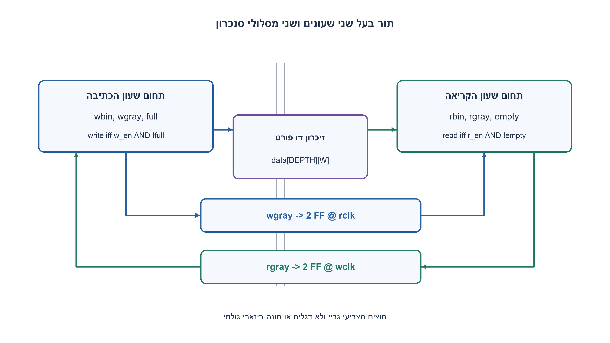
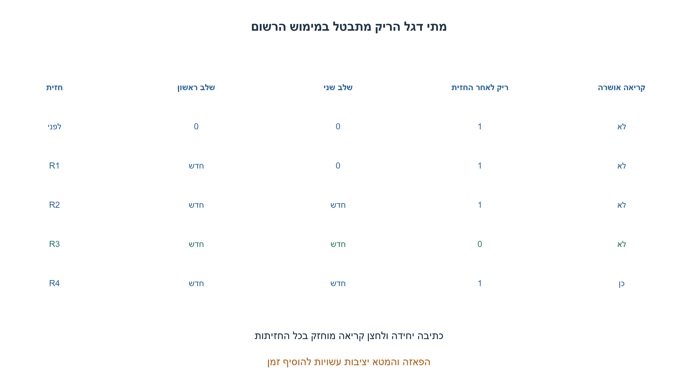
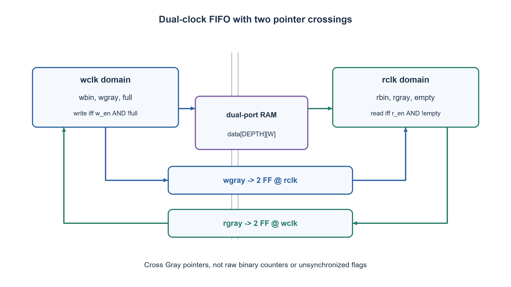
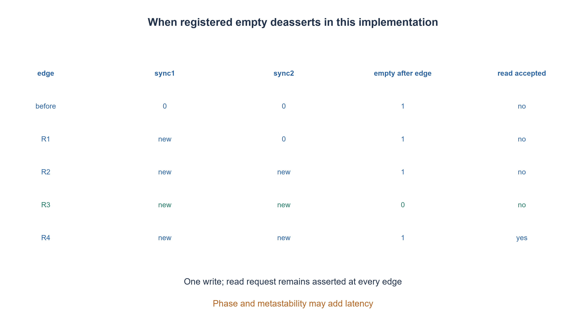

# PREP-264 — תור אסינכרוני עם מצביעי גריי ומועד ביטול empty

פתרון מוצע בסיוע AI; ביקורת מקצועית אנושית ממתינה. הקושי אינו מכויל.

[צילום מקור פרטי](../sources/2026-11-07-batch30-29.png)

ממש FIFO אסינכרוני עם Gray code. מתי מתקבל empty בצד הקריאה? כלומר מתי שעון הקריאה מקבל את הכתיבה הראשונה?

חברות לפי הדיווח בצילום בלבד: NVIDIA.

## עברית

ממשו FIFO בשני תחומי שעון נפרדים, עם מצביעי גריי. הסבירו מתי צד הקריאה רואה את הכתיבה הראשונה ומתי empty מתבטל. הבדילו בין כתיבה לזיכרון, סנכרון מצביע, שינוי דגל וקבלת נתון בקריאה.

חוזה מפורש שנוסף למקור: עומק D=2^AW עבור AW≥1 ורוחב מילה W≥1. הקריאה והכתיבה מקבלות בקשות מקומיות; ניסיון לכתוב כאשר full=1 או לקרוא כאשר empty=1 נדחה. מצביע בינארי מקומי ברוחב AW+1 מומר לגריי, ומועבר דרך שני דלגלגי סנכרון לתחום השני. full ו־empty רשומים באוגר מקומי ומשתמשים במצב הסנכרון הישן באותה חזית. אין bypass ואין first-word-fall-through: הנתון יוצא רשום רק לאחר קריאה שאושרה.

שני התחומים מאותחלים יחד לתור ריק. איפוס פעיל בנמוך רשאי להיכנס אסינכרונית, אך שחרורו חייב להיות מסונכרן לכל תחום; הקוד מניח שקווי האיפוס החיצוניים כבר עומדים בחוזה זה. אין כאן אסטרטגיה להתאוששות מאיפוס של צד אחד בלבד. הזיכרון עצמו אינו מתאפס.

1. מדוע אי אפשר להשוות ישירות מונה בינארי של צד אחד למונה מהצד השני?
2. כתיבה מזיזה מצביע מקומי. איזה מידע חוצה תחום, וכמה רכיבי מצב בצד הקריאה נמצאים בדרך לדגל?
3. ציירו שלוש חזיתות קריאה: בראשונה המצביע נכנס לשלב הראשון, בשנייה לשני, ובשלישית דגל רשום משתמש בו. בקשת קריאה באותה חזית עדיין רואה את empty הישן.

### המצביעים עוברים תחום; הנתונים עוברים דרך הזיכרון
שומרים בכל צד מצביע בינארי בן AW+1 סיביות: AW נמוכות לכתובת וביט גלישה להבחנה בין מלא לריק. בכל פעולה שאושרה המצביע גדל באחד modulo2D. המצביע הנשלח הוא `gray=bin XOR(bin>>1)`. בין שתי התקדמויות רצופות משתנה ביט גריי אחד, וכך אין מעבר רב־ביטי בינארי העלול להידגם כמילה מעורבת.

כל צד מעביר את מצביע הצד האחר דרך שני דלגלגים באותו תחום יעד. מסנכרן מפחית את ההסתברות שמטא־יציבות תזלוג ללוגיקה; הוא אינו מבטל אותה לחלוטין. נדרשים סימון מסנכרנים, מיקום מתאים ואילוצי skew/delay לקבוצת מצביעי גריי כך שדגימות לא יערבבו שינויים ממספר התקדמויות. שינוי של ביט אחד בלוגיקה אינו פטור מאילוצי תזמון פיזיים.

### חישוב הדגלים המקומיים
`wtake=w_en AND NOT full`, ו־`rtake=r_en AND NOT empty`. מחשבים את המצביעים **הבאים** לפי קבלת הפעולה, ואז את גריי שלהם. empty הבא הוא שוויון בין rgray הבא לבין מצביע הכתיבה המסונכרן הישן. כך קריאת הפריט האחרון מפעילה empty מיד אחרי אותה חזית.

מלא פירושו הפרש D בין המצביעים הבינאריים. בגריי המשוקף, זה מתקבל מהיפוך שתי הסיביות העליונות של מצביע הקריאה המסונכרן, לא מהיפוך ביט יחיד. לכן full הבא מתקבל מהשוואת wgray הבא אל rgray המסונכרן XOR מסכה שבה שתי העליונות1. הקוד משתמש במסכה ברוחב AW+1 ומתאים גם לעומק2.

המצביע המסונכרן עלול להיות ישן. הדבר גורם לדגל שמרני: צד קורא עשוי לחשוב שריק מעט אחרי כתיבה, וצד כותב עשוי להישאר מלא מעט אחרי קריאה. דחיית פעולה חוקית לזמן קצר עדיפה על קבלה שמוחקת נתון או קוראת תא שלא נכתב. טיעון הבטיחות מניח רצף מצביעי גריי תקין, קצב ושיהוי סנכרון התואמים לאילוצים הפיזיים והיעדר איפוס חלקי.

### הכתיבה הראשונה: באיזה מחזור רואים אותה?
נניח כתיבה יחידה שהושלמה לפני R1 בזמן מספיק לדגימת מצביע תקינה, והחזיקו r_en=1. לפני הכתיבה empty=1 ושני שלבי הסנכרון0.

|חזית קריאה|שלב ראשון אחרי החזית|שלב שני אחרי החזית|empty אחרי החזית|האם הקריאה אושרה באותה חזית?|
|---|---|---|---|---|
|R1|מצביע חדש|0|1|לא|
|R2|חדש|חדש|1|לא|
|R3|חדש|חדש|0|לא, empty הישן היה1|
|R4|חדש|חדש|1 אחרי הוצאת הפריט היחיד|כן|

R3 הוא מועד ביטול הדגל במימוש הזה; R4 הוא הקריאה הראשונה האפשרית בממשק הרשום הזה. אם empty היה השוואה צירופית לאחר שני שלבי הסנכרון הוא היה יכול להתבטל אחרי R2, אך זהו מימוש אחר. first-word-fall-through משנה את זמינות הנתונים, לא מעלים את חציית התחום.

אין תשובה פיזית אוניברסלית של ״בדיוק שני מחזורים״. הכתיבה עשויה להגיע לפני או אחרי חלון הדגימה, ומטא־יציבות עלולה לדחות את זיהויה. כאשר rclk עצר, אף שלב לא מתקדם, גם אם הנתון כבר בזיכרון. לכן מתארים מספר חזיתות לאחר **הדגימה המוצלחת הראשונה**, ולא מבטיחים חסם זמן מוחלט ללא מודל אמינות ותדרים.

### זיכרון ואיפוס
הנתונים נשמרים ב־RAM דו־פורט; אין להעביר כל ביט נתון דרך שני דלגלגים ולצפות לקבלת מילה עקבית. המצביע המסונכרן מאשר שהמילה נכתבה לפני הקריאה. בחומרה יש לבחור פרימיטיב RAM בעל חוזה קריאה/כתיבה ו־CDC מתאים. במימוש זה r_data ו־r_valid מתעדכנים רק לפי בקשת קריאה מקומית שאושרה; r_data מוחזק אחרת ו־r_valid=0. אין לנקות את כל ה־RAM כדי לרוקן תור: איפוס המצביעים והדגלים מגדיר שהתאים הישנים אינם תקפים.

שני תחומי האיפוס צריכים להשתייך לפרוטוקול משותף. איפוס צד אחד בזמן שהשני ממשיך להשתמש בתור יכול לגרום לפרשנות שגויה של מיקומים; הקוד אינו מבטיח התאוששות מכך. הסימולציה היא דיגיטלית אידאלית, אינה מדמה מטא־יציבות, ואינה תחליף ל־CDC/STA או למדידות שבב.

### קוד SystemVerilog; תוצאות סימולציה בדוח נפרד

```systemverilog
`timescale 1ns/1ps
// DEPTH=2**AW, AW>=1. Both domains must be reset together to flush safely.
// wrst_n/rrst_n assert asynchronously and must each deassert synchronously
// in their own clock domain. Memory is not reset. Read output is registered.
module prep264 #(parameter integer AW=2, W=8)
 (input wire wclk, wrst_n, w_en, input wire [W-1:0] w_data,
  output reg full,
  input wire rclk, rrst_n, r_en, output reg [W-1:0] r_data,
  output reg r_valid, empty);
  localparam integer DEPTH=(1<<AW);
  localparam [AW:0] FULL_MASK=(1<<AW)|(1<<(AW-1));
  reg [W-1:0] mem [0:DEPTH-1];
  reg [AW:0] wbin, wgray, rbin, rgray;
  (* async_reg = "true" *) reg [AW:0] wq1_rgray, wq2_rgray;
  (* async_reg = "true" *) reg [AW:0] rq1_wgray, rq2_wgray;
  wire wtake=w_en && !full;
  wire rtake=r_en && !empty;
  wire [AW:0] wnext=wbin+wtake;
  wire [AW:0] rnext=rbin+rtake;
  wire [AW:0] wg_next=(wnext>>1)^wnext;
  wire [AW:0] rg_next=(rnext>>1)^rnext;
  always @(posedge wclk or negedge wrst_n) begin
    if (!wrst_n) begin
      wbin<=0; wgray<=0; full<=0;
      wq1_rgray<=0; wq2_rgray<=0;
    end else begin
      wq1_rgray<=rgray; wq2_rgray<=wq1_rgray;
      if (wtake) mem[wbin[AW-1:0]]<=w_data;
      wbin<=wnext; wgray<=wg_next;
      full<=(wg_next==(wq2_rgray^FULL_MASK));
    end
  end
  always @(posedge rclk or negedge rrst_n) begin
    if (!rrst_n) begin
      rbin<=0; rgray<=0; empty<=1; r_valid<=0; r_data<=0;
      rq1_wgray<=0; rq2_wgray<=0;
    end else begin
      rq1_wgray<=wgray; rq2_wgray<=rq1_wgray;
      if (rtake) r_data<=mem[rbin[AW-1:0]];
      r_valid<=rtake;
      rbin<=rnext; rgray<=rg_next;
      empty<=(rg_next==rq2_wgray);
    end
  end
endmodule
```


### מודל Python שנבדק

```python
"""Ideal event-level model of the supplied two-clock registered-flag FIFO.

Calls represent separated clock edges. No metastability/analog delay is modeled.
Queue correctness must be checked by an independent accepted-operation oracle.
"""


class GrayFifo:
    def __init__(self, address_bits=2):
        if type(address_bits) is not int or address_bits < 1:
            raise ValueError('address_bits must be positive')
        self.aw = address_bits
        self.depth = 1 << address_bits
        self.mask = 2 * self.depth - 1
        self.memory = [None] * self.depth
        self.wbin = self.wgray = self.rbin = self.rgray = 0
        self.wq1 = self.wq2 = self.rq1 = self.rq2 = 0
        self.full, self.empty = False, True
        self.rdata, self.rvalid = None, False

    def write_edge(self, request=False, data=None):
        take = bool(request and not self.full)
        next_binary = (self.wbin + take) & self.mask
        next_gray = (next_binary >> 1) ^ next_binary
        next_full = next_gray == (self.wq2 ^ (self.depth | (self.depth >> 1)))
        if take:
            self.memory[self.wbin & (self.depth - 1)] = data
        self.wq2, self.wq1 = self.wq1, self.rgray
        self.wbin, self.wgray, self.full = next_binary, next_gray, next_full
        return take

    def read_edge(self, request=False):
        take = bool(request and not self.empty)
        next_binary = (self.rbin + take) & self.mask
        next_gray = (next_binary >> 1) ^ next_binary
        next_empty = next_gray == self.rq2
        if take:
            self.rdata = self.memory[self.rbin & (self.depth - 1)]
        self.rvalid = take
        self.rq2, self.rq1 = self.rq1, self.wgray
        self.rbin, self.rgray, self.empty = next_binary, next_gray, next_empty
        return take, self.rdata
```






### assumptions

```json
[
  "עומק חזקה של שתיים, AW≥1,W≥1; מצביעים ברוחבAW+1 ושני שלבי סנכרון לכל כיוון.",
  "דגלים רשומים, נתון קריאה רשום, ללא bypass; full/empty ישנים קובעים קבלת בקשה.",
  "איפוס שני הצדדים יחד ושחרור מסונכרן בכל תחום; RAM אינו מתאפס."
]
```

### optimality

זיכרון D·W ביטים, מצביעים ומסנכרנים O(log D); כל פורט מקבל לכל היותר פעולה בכל חזית מקומית שאינה חסומה. השהיית חציית תחום ודגלים יוצרת בועות שמרניות, ללא הבטחת מינימום שטח או זמן.

### verification

מודל אירועים Python מול deque עצמאי עבר500,056 בדיקות לרוחבי כתובת1..5, כולל250,000 אירועי שעון, גלישות, סדר נתונים וניסוי R1..R4. בדיקות RTL ונתוניהן נרשמות בנפרד; אין הדמיית מטא־יציבות או אישור CDC פיזי.

אימות RTL בפועל: ששת מימושי החומרה של האצווה קומפלו ב־Icarus Verilog12 עם ‎-g2012 -Wall והורצו ב־vvp בסביבה מבודדת ללא רשת. הרתמה המשולבת עברה172,128 בדיקות; רתמת FIFO נפרדת עברה15,729 בדיקות עם5,587 כתיבות ו־5,587 קריאות מאושרות. הכיסוי כולל שתי גרסאות SR, שני סדרי קלט טורי, כל קלטי BCD והסף, ותעבורת FIFO דיגיטלית מוגבלת. ראיה: checks/batch1107-native-verification.json. אין סינתזה, STA, סימולציית מטא־יציבות או אישור CDC פיזי.

### edge_cases

```json
[
  "ריק בתחילה, כתיבה ראשונה, פריט אחרון, תור מלא וגלישת מצביעים.",
  "יחסי שעון שונים, שעון קריאה שאינו מתקדם ושחרור מלא מאוחר.",
  "איפוס חלקי אינו נתמך; אין הבטחת זמן מרבי להתייצבות מטא־יציבות."
]
```

### common_mistakes

סנכרון בינארי רב־ביטי; היפוך רק ביט גריי אחד לזיהוי full; שימוש בנתון לפני אישור; טענה שתמיד שני מחזורים; איפוס צד אחד בלבד; התעלמות מאילוצי skew.

### interview_answer

אשתמש במצביעים בינאריים מקומיים ובקודי גריי מסונכרנים לשני הכיוונים. empty תלוי בארכיטקטורת הדגל: כאן הוא מתבטל בחזית השלישית אחרי קליטה ראשונה, והקריאה הרשומה הראשונה אפשרית בחזית הרביעית, בתנאי הדגימה שנקבעו.

### source_ambiguities

המקור אינו מגדיר פרוטוקול יציאה, דגל רשום או מספר מסנכרנים. הבחירות מפורשות; empty! פורש כביטול empty והפיכת התור ללא ריק.

### solution_extensions

```json
{
  "question": "האם FIFO בעומק שאינו חזקה של שתיים יכול להשתמש באותה השוואת גריי?",
  "direction": "לא מחליפים רק קבוע עומק: קוד גריי מחזורי וחסם מלא/ריק תלויים במחזור המצביעים. בוחרים שיטת חצייה או קיבולת פיזית מתאימה ומוכיחים אותה מחדש.",
  "tests": "זיהוי תלות בין קידוד, גלישה והוכחת CDC."
}
```

## English

Implement a dual-clock asynchronous FIFO using Gray-coded pointers. Explain when the read side observes the first write and when empty deasserts. Distinguish memory write, pointer synchronization, flag update and an accepted read result.

Explicit added contract: depth D=2^AW for AW>=1 and word width W>=1. Requests are local to their clock domains; reject writes when full1 and reads when empty1. Each AW+1-bit local binary pointer is Gray-encoded and crossed through two synchronizer flip-flops. Full and empty are locally registered and use the old synchronizer state at a sampling edge. There is no bypass or first-word-fall-through; read data becomes registered only after an accepted read.

Reset both domains together to empty. Active-low reset may assert asynchronously but must deassert synchronously in each local domain; the supplied RTL assumes its external reset inputs already meet that contract. Independent one-sided reset recovery is outside this design. The data RAM is not reset.

1. Why is it unsafe to directly compare one domain’s changing binary counter in the other domain?
2. A write advances a local pointer. Which information crosses domains, and how many read-domain registers lie on the flag path?
3. Draw three read edges: stage1 captures on the first, stage2 on the second, and a registered flag uses it on the third. A read request on that same third edge still sees old empty.

### Cross pointers; transfer words through RAM
Each domain keeps an AW+1-bit binary pointer: the low AW bits address memory and the extra bit distinguishes wraparound. Accepted operations increment modulo2D. Transmit `gray=bin XOR(bin>>1)`. Consecutive Gray increments change one bit, avoiding the incoherent multi-bit transitions of a raw binary counter.

Cross each remote pointer through two flip-flops in the receiving domain. A synchronizer reduces propagation of metastability; it does not eliminate it. Synchronizer attributes, placement and Gray-bus skew/delay constraints are still required so sampling cannot mix changes from multiple source advances. A one-bit logical transition is not an exemption from physical timing constraints.

### Local flag equations
Define `wtake=w_en AND NOT full` and `rtake=r_en AND NOT empty`. Compute next local binary/Gray pointers from accepted operations. Next empty compares next rgray with the old synchronized write pointer. Reading the last available word therefore asserts empty immediately after that read edge.

Full means a binary pointer difference of D. In reflected Gray code this corresponds to inverting the top two synchronized read-pointer bits, not just one. Compare next wgray with synchronized rgray XOR that top-two-bit mask. The supplied mask has width AW+1 and also supports depth2.

Synchronized pointers can be stale. Flags are conservative: the reader may still see empty just after a write, and the writer may still see full just after a read. Temporarily rejecting an available operation is preferable to overwriting or reading unwritten data. Safety assumes a valid Gray sequence, physical crossing constraints and coordinated reset rather than one-sided restart.

### First write: which read edge observes it?
Assume one write has completed sufficiently before R1 for a clean first pointer capture, with r_en held1. Initially empty1 and both synchronizer stages0.

|Read edge|Stage1 after edge|Stage2 after edge|empty after edge|Read accepted at that edge?|
|---|---|---|---|---|
|R1|new pointer|0|1|no|
|R2|new|new|1|no|
|R3|new|new|0|no: old empty was1|
|R4|new|new|1 after consuming the only word|yes|

R3 deasserts the flag in this particular registered implementation; R4 is the first possible accepted read with this registered-data interface. A combinational empty comparison after the two synchronization stages could deassert after R2, but that is another design. First-word-fall-through changes data presentation; it does not remove the crossing.

There is no universal physical answer of exactly two cycles. A write may arrive before or after the capture aperture, and metastability may delay observation. A stopped rclk advances no stages even though data is already in memory. Count edges after the first **successful capture**, rather than promise an absolute wall-clock bound without a clock/reliability model.

### Memory and reset
Store words in dual-port RAM; independently synchronizing each data bit does not guarantee a coherent word. The synchronized pointer establishes that writing preceded permission to read. Hardware needs an appropriate RAM primitive and clock/read/write contract. This interface registers r_data only on accepted reads and otherwise holds it, with r_valid indicating acceptance for the following cycle. Emptying the FIFO does not require clearing RAM: reset pointers/flags invalidate stale cells.

The domains require a common reset protocol. Restarting one pointer while the other continues can misinterpret occupancy; recovery from that is not promised. This ideal digital simulation does not model metastability and is not CDC/STA closure or silicon verification.

### SystemVerilog; simulation results are in a separate report

```systemverilog
`timescale 1ns/1ps
// DEPTH=2**AW, AW>=1. Both domains must be reset together to flush safely.
// wrst_n/rrst_n assert asynchronously and must each deassert synchronously
// in their own clock domain. Memory is not reset. Read output is registered.
module prep264 #(parameter integer AW=2, W=8)
 (input wire wclk, wrst_n, w_en, input wire [W-1:0] w_data,
  output reg full,
  input wire rclk, rrst_n, r_en, output reg [W-1:0] r_data,
  output reg r_valid, empty);
  localparam integer DEPTH=(1<<AW);
  localparam [AW:0] FULL_MASK=(1<<AW)|(1<<(AW-1));
  reg [W-1:0] mem [0:DEPTH-1];
  reg [AW:0] wbin, wgray, rbin, rgray;
  (* async_reg = "true" *) reg [AW:0] wq1_rgray, wq2_rgray;
  (* async_reg = "true" *) reg [AW:0] rq1_wgray, rq2_wgray;
  wire wtake=w_en && !full;
  wire rtake=r_en && !empty;
  wire [AW:0] wnext=wbin+wtake;
  wire [AW:0] rnext=rbin+rtake;
  wire [AW:0] wg_next=(wnext>>1)^wnext;
  wire [AW:0] rg_next=(rnext>>1)^rnext;
  always @(posedge wclk or negedge wrst_n) begin
    if (!wrst_n) begin
      wbin<=0; wgray<=0; full<=0;
      wq1_rgray<=0; wq2_rgray<=0;
    end else begin
      wq1_rgray<=rgray; wq2_rgray<=wq1_rgray;
      if (wtake) mem[wbin[AW-1:0]]<=w_data;
      wbin<=wnext; wgray<=wg_next;
      full<=(wg_next==(wq2_rgray^FULL_MASK));
    end
  end
  always @(posedge rclk or negedge rrst_n) begin
    if (!rrst_n) begin
      rbin<=0; rgray<=0; empty<=1; r_valid<=0; r_data<=0;
      rq1_wgray<=0; rq2_wgray<=0;
    end else begin
      rq1_wgray<=wgray; rq2_wgray<=rq1_wgray;
      if (rtake) r_data<=mem[rbin[AW-1:0]];
      r_valid<=rtake;
      rbin<=rnext; rgray<=rg_next;
      empty<=(rg_next==rq2_wgray);
    end
  end
endmodule
```


### Verified Python teaching model

```python
"""Ideal event-level model of the supplied two-clock registered-flag FIFO.

Calls represent separated clock edges. No metastability/analog delay is modeled.
Queue correctness must be checked by an independent accepted-operation oracle.
"""


class GrayFifo:
    def __init__(self, address_bits=2):
        if type(address_bits) is not int or address_bits < 1:
            raise ValueError('address_bits must be positive')
        self.aw = address_bits
        self.depth = 1 << address_bits
        self.mask = 2 * self.depth - 1
        self.memory = [None] * self.depth
        self.wbin = self.wgray = self.rbin = self.rgray = 0
        self.wq1 = self.wq2 = self.rq1 = self.rq2 = 0
        self.full, self.empty = False, True
        self.rdata, self.rvalid = None, False

    def write_edge(self, request=False, data=None):
        take = bool(request and not self.full)
        next_binary = (self.wbin + take) & self.mask
        next_gray = (next_binary >> 1) ^ next_binary
        next_full = next_gray == (self.wq2 ^ (self.depth | (self.depth >> 1)))
        if take:
            self.memory[self.wbin & (self.depth - 1)] = data
        self.wq2, self.wq1 = self.wq1, self.rgray
        self.wbin, self.wgray, self.full = next_binary, next_gray, next_full
        return take

    def read_edge(self, request=False):
        take = bool(request and not self.empty)
        next_binary = (self.rbin + take) & self.mask
        next_gray = (next_binary >> 1) ^ next_binary
        next_empty = next_gray == self.rq2
        if take:
            self.rdata = self.memory[self.rbin & (self.depth - 1)]
        self.rvalid = take
        self.rq2, self.rq1 = self.rq1, self.wgray
        self.rbin, self.rgray, self.empty = next_binary, next_gray, next_empty
        return take, self.rdata
```






### assumptions

```json
[
  "Power-of-two depth, AW>=1,W>=1; AW+1-bit pointers and two synchronizer stages per direction.",
  "Registered flags/data, no bypass; old full/empty determine request acceptance.",
  "Coordinate reset across both domains with per-domain synchronous release; RAM is not reset."
]
```

### optimality

D·W memory bits plus O(log D) pointer/synchronizer state. At most one accepted operation per unblocked local edge; pointer/flag crossing introduces conservative bubbles. No physical minimum is claimed.

### verification

The Python event model passed500,056 checks against an independent deque across address widths1..5, including250,000 clock events, wraparound, data ordering and the R1..R4 trace. RTL results are recorded separately; metastability and physical CDC closure are not simulated.

Executed RTL verification: the six batch hardware implementations were compiled with Icarus Verilog12 -g2012 -Wall and run with vvp in an isolated network-denied environment. The combined harness passed172,128 checks; the separate FIFO harness passed15,729 checks with5,587 accepted writes and5,587 accepted reads. Scope includes both SR priorities, both serial input orders, BCD/threshold inputs and bounded ideal FIFO traffic. Evidence: checks/batch1107-native-verification.json. No synthesis, STA, metastability simulation or physical CDC closure was performed.

### edge_cases

```json
[
  "Initial empty, first write, last read, full FIFO and pointer wrap.",
  "Different clock ratios, a stopped read clock and delayed full release.",
  "One-sided reset is unsupported; no maximum metastability-resolution time is promised."
]
```

### common_mistakes

Crossing raw binary pointers; inverting only one Gray bit for full; consuming before permission; claiming always two cycles; resetting one side alone; ignoring bus-skew constraints.

### interview_answer

Use local binary pointers and synchronized Gray pointers in both directions. Empty latency depends on flag architecture: here it deasserts on the third edge after first capture, and the first registered read can occur on the fourth, under the stated capture assumptions.

### source_ambiguities

The source omits read interface, registered-versus-combinational flags and synchronizer depth. These choices are explicit; empty! is interpreted as deassertion/nonempty visibility.

### solution_extensions

```json
{
  "question": "Can the same Gray full comparison be used at arbitrary non-power-of-two depth?",
  "direction": "Changing only the depth constant is insufficient: Gray wrap and pointer-distance comparisons depend on the pointer cycle. Choose a compatible crossing/capacity scheme and re-prove it.",
  "tests": "Relationships between encoding, wraparound and CDC correctness."
}
```
