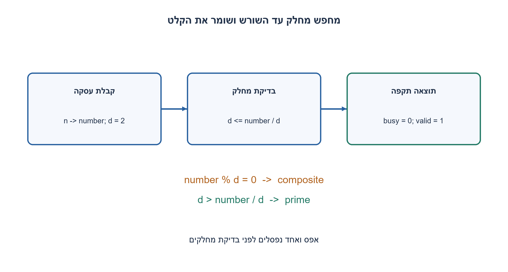
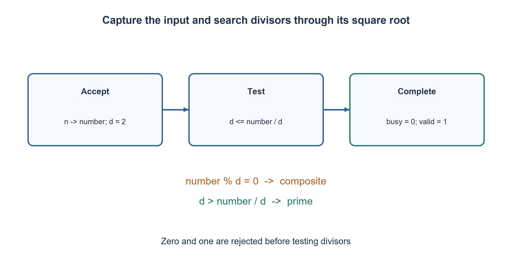

# PREP-265 — בדיקת ראשוניות: מחלקים מועמדים וחוזה חומרה סופי

פתרון מוצע בסיוע AI; ביקורת מקצועית אנושית ממתינה. הקושי אינו מכויל.

## עברית

תכננו מערכת שמחזירה 1 אם מספר הקלט ראשוני ו־ 0 אחרת. הסבירו את הרעיון, את הבדיקה עד שורש המספר ואת עלות המימוש.

המקור אינו מגדיר רוחב או תזמון. נבחר במפורש קלט unsigned ברוחב W≥2, שעון, reset סינכרוני, start ואותות busy/valid. start מתקבל רק כאשר busy=0; הקלט נשמר בעת הקבלה. valid הוא פולס של מחזור כשהתוצאה מוכנה, ו־ reset גובר על בקשה. אין דרישת תשובה במחזור יחיד. הציגו גם פונקציית תוכנה שקולה למספר טבעי. 0 ו־ 1 אינם ראשוניים.

1. אם המספר מורכב משני גורמים, האם שניהם יכולים להיות גדולים מהשורש שלו?
2. מספיק לבדוק מחלק עד השורש. איך תבדקו זאת בלי שהמכפלה של המחלק בעצמו תגלוש?
3. שללו מספרים קטנים מ־ 2. בדקו שארית עבור מחלקים כל עוד d≤n/d; מחלק ללא שארית מוכיח שאינו ראשוני, וסיום התחום מוכיח ראשוניות. בחומרה שמרו את n ואת d.

### למה לא צריך לבדוק את כל המספרים עד הקלט?
מספר ראשוני גדול מאחד מחולק רק ב־ 1 ובעצמו. אם n מורכב, אפשר לכתוב n=u·v עם 2≤u≤v. אז u²≤n, ולכן לפחות מחלק אחד אינו גדול משורש n. אם לא נמצא מחלק בתחום הזה, n ראשוני. זהו נימוק מתמטי לכל הקלטים, בנפרד מבדיקות התוכנית.

בתוכנה נשלול n<2, נטפל ב־ 2 ונפסול זוגיים אחרים. אחר כך ננסה 3,5,7 וכן הלאה. התנאי `d<=n//d` שקול לתנאי השורש עבור d חיובי ונמנע מחישוב d*d שעלול לגלוש בטיפוס סופי. לדוגמה 49 נפסל ב־ 7; אי אפשר לעצור לפני שוויון. 47 עובר כי אין מחלק ב־ 2..6. אין להסיק ש־ 1 ראשוני מכך שלא נכנסנו ללולאה.

### אותה החלטה בחומרה, לאורך כמה מחזורים
מימוש ה־ RTL המצורף שומר number ו־ divisor. בקבלה הוא לוכד את n ומאתחל d=2. בכל מחזור עסוק: קטן מ־ 2 מסיים ב־ 0; d>number/d מסיים ב־ 1; אחרת שארית אפס מסיימת ב־ 0, ובשאר המקרים מעלים d. הגרסה הזו בודקת גם מחלקים זוגיים כדי לפשט את הבקר; היא שקולה לתוכנה שמדלגת עליהם. שינויים בכניסה לאחר הקבלה אינם משנים את העסקה. busy דוחה בקשות חדשות, valid אינו נשאר דלוק, ותוצאת is_prime משמעותית בתום עסקה.

האינווריאנט: לפני כל בדיקה לא נמצא מחלק בטווח 2..d−1. הגדלת d משמרת זאת, שארית אפס היא עדות להרכבה, ומעבר לשורש שולל כל פירוק אפשרי. d גדל והתחום חסום ולכן החישוב עוצר. לא מחלקים באפס; d מתחיל ב־ 2 ואינו גולש לפני העצירה עבור W≥2.

יש O(√n) בדיקות מחלק במקרה הגרוע ומספר קבוע של מילות מצב, או O(W) ביטים. בחומרה הצעת `/` ו־`%` מחייבת לוגיקת חלוקה ושארית שהסינתזה תממש; ההשהיה והשטח אינם קבועים ואינם נמדדים כאן. ניתן לשתף יחידת חלוקה רב־מחזורית במחיר בקר נוסף. במונחי מספר ביטי הקלט W, √n עשוי להגיע לסדר גודל 2^(W/2): אין זו טענת אלגוריתם ראשוניות מיטבי. נפה שסופרת את כל הראשוניים עד n פותרת שאלה אחרת.

מודל התוכנה נבדק מול נפה עצמאית לכל 0..20,000 ובגבולות 32 ביט. קובצי RTL ורתמת 12 ביט מצורפים להרצה נפרדת; עצם הרצת Python אינה קימפול HDL.

```python
"""Exact predicate for a single nonnegative integer; word cost is width-dependent."""


def is_prime(n):
    if type(n) is not int or n < 0:
        raise ValueError("n must be a nonnegative integer")
    if n < 2:
        return False
    if n % 2 == 0:
        return n == 2
    divisor = 3
    while divisor <= n // divisor:
        if n % divisor == 0:
            return False
        divisor += 2
    return True
```


```systemverilog
`timescale 1ns/1ps
// Educational W-bit sequential predicate. W >= 2; unsigned inputs.
// start is accepted only while !busy. valid pulses on completion.
// rst is synchronous and overrides a simultaneous request.
module prep_265_primality #(parameter integer W = 8) (
    input wire clk, rst, start,
    input wire [W-1:0] n,
    output reg busy, valid, is_prime
);
    reg [W-1:0] number, divisor;
    always @(posedge clk) begin
        if (rst) begin
            number <= 0;
            divisor <= 2;
            busy <= 0;
            valid <= 0;
            is_prime <= 0;
        end else begin
            valid <= 0;
            if (!busy) begin
                if (start) begin
                    number <= n;
                    divisor <= 2;
                    busy <= 1;
                end
            end else if (number < 2) begin
                is_prime <= 0;
                valid <= 1;
                busy <= 0;
            end else if (divisor > number / divisor) begin
                is_prime <= 1;
                valid <= 1;
                busy <= 0;
            end else if (number % divisor == 0) begin
                is_prime <= 0;
                valid <= 1;
                busy <= 0;
            end else begin
                divisor <= divisor + 1'b1;
            end
        end
    end
endmodule
```




## English

Design a system returning 1 exactly when the input number is prime. Explain candidate divisors, the square-root bound and implementation cost.

The source omits width and timing. Explicitly choose an unsigned W-bit input, W≥2, a clock, synchronous reset, start and busy/valid signals. Accept start only while busy=0 and capture the input then. valid pulses for one cycle when the result is ready; reset overrides a request. No one-cycle result is required. Also show an equivalent software predicate on a nonnegative integer. Zero and one are not prime.

1. Can both factors of a composite exceed its square root?
2. Only divisors through the square root are needed. How can the stopping test avoid overflowing d*d?
3. Reject n<2. Test remainders while d≤n/d; an exact divisor rejects and exhausting the interval accepts. Hardware stores n and the current d.

### Why stop at the square root?
A prime exceeds one and has no positive divisors other than one and itself. For a composite n=u*v with 2≤u≤v, u²≤n. Therefore some divisor is no larger than sqrt(n); exhausting that interval proves primality. This argument applies to every valid input independently of finite tests.

The software rejects n<2, handles two, and rejects other even numbers. It then tries odd candidates 3,5,7, ... . For positive d, `d<=n//d` is the exact square-root bound without computing d*d, which may overflow a finite type. For 49 the divisor seven must still be checked; strict inequality would be wrong. For 47 no divisor from two through six exists. An empty loop is not enough to make one prime.

### A finite sequential hardware implementation
The RTL captures number and initializes divisor=2 when accepting a request. Each busy cycle rejects number<2, accepts when d>number/d, rejects when the remainder is zero, and otherwise increments d. This simpler controller tries all candidates, unlike the software's odd-only optimization, but computes the same predicate. Changing the external input after acceptance cannot change the transaction. Requests while busy are ignored. valid is a completion pulse, not a permanently asserted ready state; is_prime is meaningful at completion.

Invariant: no integer in 2..d−1 divides the captured number. Incrementing d preserves it, a zero remainder proves compositeness, and passing sqrt(number) rules out every possible factorization. The positive increasing candidate reaches the finite stopping boundary. The divisor never becomes zero or overflows before termination for W≥2.

Worst-case trial count is O(sqrt(n)), with a fixed number of state words, or O(W) state bits. RTL `/` and `%` require real division/remainder logic after synthesis; area and timing are neither free nor measured here. A multicycle shared divider trades latency for resources and needs additional control. In terms of W input bits, sqrt(n) can be on the order of 2^(W/2), so this is not a globally optimal primality algorithm. A sieve counting every prime through n has a different output contract.

The software was compared with an independent sieve for every 0..20,000 and selected 32-bit boundaries. RTL and a twelve-bit testbench are supplied for separate execution; running Python alone is not HDL compilation.

```python
"""Exact predicate for a single nonnegative integer; word cost is width-dependent."""


def is_prime(n):
    if type(n) is not int or n < 0:
        raise ValueError("n must be a nonnegative integer")
    if n < 2:
        return False
    if n % 2 == 0:
        return n == 2
    divisor = 3
    while divisor <= n // divisor:
        if n % divisor == 0:
            return False
        divisor += 2
    return True
```


```systemverilog
`timescale 1ns/1ps
// Educational W-bit sequential predicate. W >= 2; unsigned inputs.
// start is accepted only while !busy. valid pulses on completion.
// rst is synchronous and overrides a simultaneous request.
module prep_265_primality #(parameter integer W = 8) (
    input wire clk, rst, start,
    input wire [W-1:0] n,
    output reg busy, valid, is_prime
);
    reg [W-1:0] number, divisor;
    always @(posedge clk) begin
        if (rst) begin
            number <= 0;
            divisor <= 2;
            busy <= 0;
            valid <= 0;
            is_prime <= 0;
        end else begin
            valid <= 0;
            if (!busy) begin
                if (start) begin
                    number <= n;
                    divisor <= 2;
                    busy <= 1;
                end
            end else if (number < 2) begin
                is_prime <= 0;
                valid <= 1;
                busy <= 0;
            end else if (divisor > number / divisor) begin
                is_prime <= 1;
                valid <= 1;
                busy <= 0;
            end else if (number % divisor == 0) begin
                is_prime <= 0;
                valid <= 1;
                busy <= 0;
            end else begin
                divisor <= divisor + 1'b1;
            end
        end
    end
endmodule
```




## חומר משלים / Supporting material

```json
{
  "assumptions": {
    "he": "unsigned W≥2; תחום סופי בחומרה; תוצאה לפי busy/valid. אין מודל לתזמון פיזי.",
    "en": "Unsigned W≥2; finite hardware domain and busy/valid transaction contract; no physical timing model."
  },
  "optimality": {
    "he": "O(√n) בדיקות; O(W) ביטי מצב. חלוקה ושארית עולות שטח והשהיה; אין טענת מינימום.",
    "en": "O(sqrt(n)) trials and O(W) state bits; division/remainder have area/delay cost, with no minimum claim."
  },
  "verification": {
    "he": "Python מול נפה עצמאית עד 20,000 וגבולות 32 ביט; RTL דורש ריצת רתמה נפרדת.",
    "en": "Executed Python versus an independent sieve through 20,000 and 32-bit boundaries; RTL testbench execution is separate."
  },
  "edge_cases": {
    "he": "0,1,2; זוגיים; ריבוע ראשוני; שינוי n בזמן busy; reset בזמן עסקה.",
    "en": "0,1,2; even values; prime squares; changing n while busy; reset during a transaction."
  },
  "common_mistakes": {
    "he": "לספור ראשוניים במקום לבדוק אחד; להגדיר 1 כראשוני; להחמיץ שוויון בשורש; להניח שה־ RTL חינם.",
    "en": "Counting primes instead of testing one; calling one prime; omitting the square-root equality; treating division as free hardware."
  },
  "interview_answer": {
    "he": "אם יש פירוק יש מחלק עד השורש. אבדוק שאריות ואשמור מחלק נוכחי בבקר רב־מחזורי.",
    "en": "A composite has a divisor through its square root. Test remainders and store the current divisor in a multicycle controller."
  },
  "source_ambiguities": {
    "he": "רוחב, סימן, תזמון ואיפוס אינם במקור; חוזה W/start/busy/valid הוא בחירה עריכתית מפורשת.",
    "en": "Width, sign, timing and reset are absent from the source; W/start/busy/valid are explicit editorial choices."
  },
  "solution_extensions": {
    "he": [
      {
        "question": "כיצד מקטינים שטח כשהמחלק יקר?",
        "answer_direction": "משתפים יחידת חלוקה טורית ומוסיפים מצבי התחלה/המתנה/בדיקה; זמן הכולל מוכפל בעלות החלוקה.",
        "principle": "עלות פעולת נתיב הנתונים משפיעה על ארכיטקטורת הבקר."
      }
    ],
    "en": [
      {
        "question": "How can an expensive divider use less area?",
        "answer_direction": "Reuse a serial divider with launch/wait/check states; total latency includes each division latency.",
        "principle": "Datapath operation cost affects controller architecture."
      }
    ]
  }
}
```
