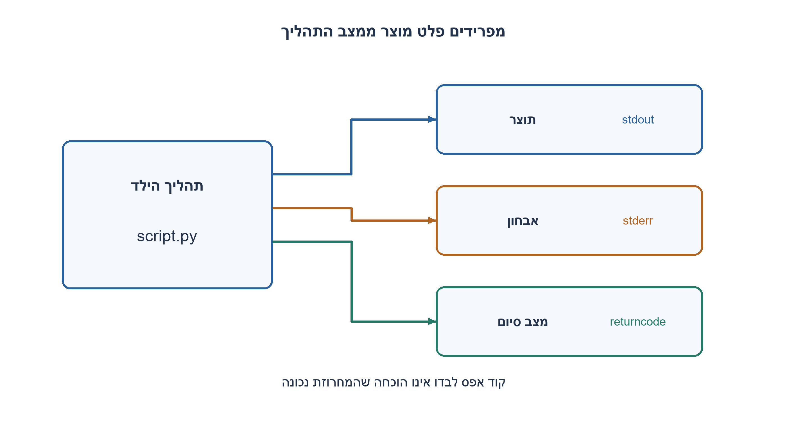
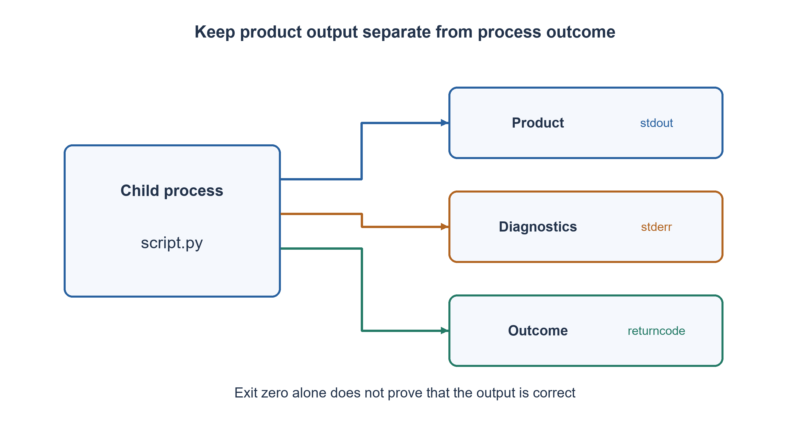

# PREP-266 — איך יודעים שסקריפט Python הסתיים בהצלחה כש־ stdout הוא תוצר?

פתרון מוצע בסיוע AI; ביקורת מקצועית אנושית ממתינה. הקושי אינו מכויל.

## עברית

משתמש קיבל סקריפט Python שמדפיס מחרוזת כחלק מהתוצר. איך יוכל לדעת שהסקריפט רץ בהצלחה בלי לערבב הודעת שגיאה בתוך המחרוזת? הציגו כמה דרכי תצפית וקוד של תוכנית קוראת.

הפרידו בין התחלת תהליך, סיום לפני deadline, קוד יציאה 0 ותקינות לוגית של התוצר. בהמחשה ההרצה היא של קובץ מקומי בשליטתנו; stdout נשמר כתוצר, stderr הוא ערוץ אבחון נפרד, והקורא משתמש ב־ timeout. אין צורך לממש sandbox או להריץ קוד לא מהימן.

1. מה מערכת ההפעלה מחזירה לתהליך שהפעיל תוכנית, מעבר לטקסט שהתוכנית הדפיסה?
2. יש ערוצים נפרדים ל־ stdout, ל־ stderr ולקוד סיום. מה קורה אם התהליך לא נגמר?
3. הפעילו subprocess.run עם רשימת ארגומנטים ו־ timeout, קלטו את שני הזרמים ובדקו returncode. אחר כך בדקו את התוצר מול הדרישה עצמה.

### הצלחה היא יותר ממילה שהודפסה
תוכנית יכולה להדפיס את המחרוזת ואז לקרוס, או להחזיר קוד 0 ולחשב תשובה שגויה. לכן תחילה מגדירים איזה סוג הצלחה בודקים. הפעלה תקינה פירושה שהילד התחיל; הצלחת תהליך פירושה שסיים בקוד המוסכם, לרוב 0; הצלחה פונקציונלית מחייבת שהתוצאה תקיים את החוזה. אין דרך להסיק את האחרונה רק מקוד היציאה.

בקורא נשתמש ב־`[sys.executable, path]`, בלי shell. אותו מפרש שמריץ את הקורא מפעיל את הקובץ. `capture_output=True` שומר stdout ו־ stderr בנפרד. סיום בקוד שאינו 0 הוא כישלון תהליך; `check=True` היה דרך חלופית לקבל CalledProcessError. TimeoutExpired מציין שהקורא הפסיק להמתין וה־ API מסיים את הילד הישיר לפני חזרה; זה אינו מבטיח סיום כל נכד אפשרי. OSError מציין כשל בהשקת המפרש. קובץ Python שאינו קיים שונה מכך: המפרש עצמו בדרך כלל מתחיל, מדווח שגיאה ומסיים בקוד לא אפס.

הפונקציה מחזירה מבנה תוצאה ואינה מדפיסה הודעות לתוך stdout של המוצר. stderr יכול להכיל אזהרות גם בהצלחה, ולכן אינו כלל הצלחה לבדו. מצד התוכנית אפשר לאפשר לחריגה לא מטופלת להסתיים בקוד לא אפס, או לטפל בכשל ולצאת במפורש בקוד מוסכם; לא מומלץ לבלוע חריגה ולהחזיר 0. לוג, קובץ תוצאה אטומי או API סטטוס הם אפשרויות נוספות כאשר מגדירים את החוזה.

הבדיקה המקומית מפעילה ילדים קטנים שלנו: הצלחה, קוד 7 אחרי אותו stdout, חריגה אחרי הדפסה, תשובה שגויה עם קוד 0, timeout וקובץ חסר. כשל השקה מוזרק בנפרד. אם הצלחה וכישלון מחזירים בדיוק אותן תצפיות בכל הערוצים, המשתמש לא יוכל להבדיל ביניהם בוודאות: דרוש שינוי חוזה או בדיקת התוצאה.

זמן כולל תלוי בילד; timeout מגביל את זמן ההמתנה הרגיל אך אינו SLA מדויק של מערכת ההפעלה. שמירת פלט באורך B צורכת O(B) זיכרון, ולכן capture_output אינו מתאים לפלט לא חסום. במקרה כזה כותבים לקבצים או קוראים בזרם עם גבולות. אין כאן טענה לבידוד אבטחתי או לבדיקת מוצר האתר.

```python
"""Caller-side process outcome; a successful exit is not proof of correct output."""
import subprocess
import sys


def run_python_file(path, timeout=5):
    try:
        result = subprocess.run(
            [sys.executable, str(path)], capture_output=True,
            text=True, encoding="utf-8", timeout=timeout, check=False,
        )
    except subprocess.TimeoutExpired:
        return {"state": "timeout", "returncode": None,
                "stdout": None, "stderr": None}
    except OSError as exc:
        return {"state": "launch_error", "returncode": None,
                "stdout": None, "stderr": str(exc)}
    except UnicodeError:
        return {"state": "output_encoding_error", "returncode": None,
                "stdout": None, "stderr": "child output is not valid UTF-8"}
    return {"state": "exited_zero" if result.returncode == 0 else "failed",
            "returncode": result.returncode,
            "stdout": result.stdout, "stderr": result.stderr}
```




## English

A user receives a Python script whose printed string is the product output. How can the user tell whether it ran successfully without mixing an error message into that string? Give observation options and caller code.

Separate process launch, termination before a deadline, exit code zero and semantic correctness of output. The example runs a controlled local file, preserves stdout as product output, uses stderr as a separate diagnostic channel and sets a timeout. No sandbox implementation or execution of untrusted code is required.

1. What does the operating system report to the caller besides printed text?
2. stdout, stderr and exit status are separate channels. What if the child never finishes?
3. Use subprocess.run with an argument list and timeout, capture both streams, inspect returncode, then validate output against the actual requirement.

### Success has several meanings
A script can print its string and then crash, or exit zero while computing the wrong answer. First define the property: launch means a child started; process success means termination with the agreed status, usually zero; functional success means the output satisfies its specification. Exit status alone cannot establish the last property.

Call `[sys.executable, path]` without a shell. The caller's interpreter launches the file; `capture_output=True` keeps stdout and stderr separate. A nonzero result is process failure. Alternatively, `check=True` raises CalledProcessError. TimeoutExpired means the caller stopped waiting; this API terminates and waits for its direct child before returning, but does not promise to terminate every possible descendant. OSError indicates interpreter-launch failure. A missing Python file is different: the interpreter normally starts, diagnoses the missing file and exits nonzero.

The supplied function returns structured outcome data instead of printing diagnostics into product stdout. stderr can contain warnings even on success and is not a sufficient success test. The child can leave an exception unhandled or explicitly return a documented nonzero code after handling an error. Swallowing an exception and returning zero conceals failure. Logs, an atomically written result file or a separate status API are additional options when included in the contract.

Deterministic local tests run our small children: success, exit seven after identical stdout, an exception after printing, wrong output with exit zero, timeout and a missing file. Launch failure is injected separately. If success and failure have identical observations on every available channel, no caller can distinguish them with certainty; add a status contract or validate the result.

Runtime depends on the child. A timeout limits ordinary waiting, not a precise operating-system SLA. Capturing B bytes costs O(B) memory; unbounded output should instead be streamed or directed to bounded files. This example is not a security sandbox or a live product test.

```python
"""Caller-side process outcome; a successful exit is not proof of correct output."""
import subprocess
import sys


def run_python_file(path, timeout=5):
    try:
        result = subprocess.run(
            [sys.executable, str(path)], capture_output=True,
            text=True, encoding="utf-8", timeout=timeout, check=False,
        )
    except subprocess.TimeoutExpired:
        return {"state": "timeout", "returncode": None,
                "stdout": None, "stderr": None}
    except OSError as exc:
        return {"state": "launch_error", "returncode": None,
                "stdout": None, "stderr": str(exc)}
    except UnicodeError:
        return {"state": "output_encoding_error", "returncode": None,
                "stdout": None, "stderr": "child output is not valid UTF-8"}
    return {"state": "exited_zero" if result.returncode == 0 else "failed",
            "returncode": result.returncode,
            "stdout": result.stdout, "stderr": result.stderr}
```




## חומר משלים / Supporting material

```json
{
  "assumptions": {
    "he": "קובץ מקומי בשליטתנו; stdout תוצר, stderr אבחון; קוד 0 מוסכם כהצלחת תהליך בלבד; פלט UTF-8 או סטטוס כשל קידוד מפורש.",
    "en": "Controlled local file; stdout is output and stderr diagnostics; zero is agreed process success only; UTF-8 output or explicit encoding-failure outcome."
  },
  "optimality": {
    "he": "זמן הילד ו־ O(B) זיכרון לפלט. אין טענה לזמן קבוע או להגבלת כל צאצא.",
    "en": "Child-dependent runtime and O(B) captured-output memory; no constant-time or process-tree termination claim."
  },
  "verification": {
    "he": "שישה ילדים מקומיים וכשל השקה מוזרק; נבדקה הפרדת זרמים ומקרה קוד 0 עם תוצאה שגויה.",
    "en": "Six local child cases and injected launch failure; stream separation and wrong-output/zero-exit counterexample checked."
  },
  "edge_cases": {
    "he": "חריגה אחרי הדפסה; stderr עם אזהרה; timeout; קובץ חסר; פלט גדול.",
    "en": "Exception after printing; warnings on stderr; timeout; missing file; large output."
  },
  "common_mistakes": {
    "he": "להסתמך על הודעת הצלחה; להחשיב stderr תמיד ככישלון; להציג קוד 0 כהוכחת נכונות.",
    "en": "Relying on a success string; treating every stderr byte as failure; equating exit zero with correctness."
  },
  "interview_answer": {
    "he": "אפריד מוצר מסטטוס: stdout לתוצאה, returncode להצלחת התהליך ו־ stderr לאבחון. נכונות התוצאה דורשת בדיקות.",
    "en": "Separate product and status: stdout for results, returncode for process outcome, stderr for diagnosis; correctness needs validation."
  },
  "source_ambiguities": {
    "he": "האיסור להדפיס שגיאה פורש כאיסור זיהום stdout. אם גם סטטוס וערוצי אבחון אסורים, אין אות כשל מובטח.",
    "en": "No error printing is interpreted as preserving stdout. If status and all diagnostic channels are forbidden too, no guaranteed failure signal exists."
  },
  "solution_extensions": {
    "he": [
      {
        "question": "איך מטפלים בפלט בגודל ג׳יגה?",
        "answer_direction": "הפניה לקובץ או קריאה בזרם עם מגבלות, במקום צבירה מלאה בזיכרון.",
        "principle": "תצפית על ריצה חייבת גם תקציב משאבים."
      }
    ],
    "en": [
      {
        "question": "How should gigabytes of output be handled?",
        "answer_direction": "Redirect to a file or stream with limits rather than capture everything in memory.",
        "principle": "Observability needs a resource budget too."
      }
    ]
  }
}
```
