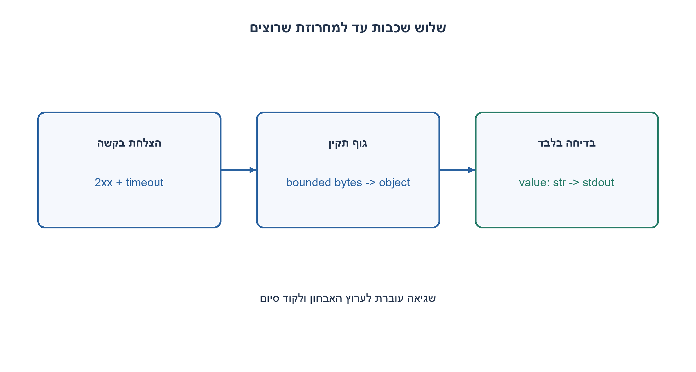
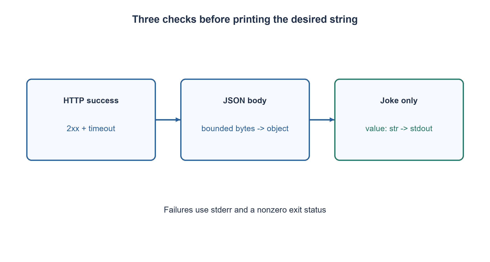

# PREP-267 — קריאת API לבדיחה אקראית: להחזיר רק את שדה התוכן

פתרון מוצע בסיוע AI; ביקורת מקצועית אנושית ממתינה. הקושי אינו מכויל.

## עברית

קיים API של בדיחות Chuck Norris שמחזיר בכל בקשה בדיחה אקראית ומידע נוסף. כתבו Python שמציג רק את הבדיחה והסבירו מה יכול להיכשל וכיצד מטפלים בכך.

להמחשה נבחר endpoint מתועד `https://api.chucknorris.io/jokes/random`, עם אובייקט JSON שהשדה value שלו הוא מחרוזת הבדיחה. הגדירו timeout וגבול לגודל תגובה. בהצלחה הדפיסו רק value; בכישלון השאירו stdout ריק, כתבו אבחון ל־ stderr והחזירו קוד יציאה לא אפס. הכינו בדיקות שניתנות להרצה בלי רשת.

1. איזה חלק מהתגובה הוא הבדיחה עצמה, ומה שייך לפרוטוקול או למטא־נתונים?
2. הצלחה ברשת אינה מבטיחה שהתקבל JSON תקין או שהשדה המבוקש קיים.
3. בדקו סטטוס HTTP, קראו תגובה מוגבלת, פענחו JSON ודרשו אובייקט עם value מסוג str. הזריקו transport כדי לבדוק כל כשל בלי שרת חיצוני.

### מפרידים את שלוש שכבות הבדיקה
התגובה אינה המחרוזת שרוצים להציג. יש תחילה תעבורת HTTP, בתוכה גוף JSON, ובתוכו שדה value. הדפסת response או כל המילון תציג מטא־נתונים שאינם נדרשים. נחלץ את השדה רק אחרי שבדקנו כל שכבה.

ניצור בקשת GET עם Accept: application/json ונשתמש ב־ HTTPS וב־ timeout של חמש שניות. כשל DNS, חיבור, TLS, timeout או קריאה הופך ל־ JokeError. סטטוס HTTP מחוץ ל־ 2xx אינו תוצאת בדיחה תקינה. הספרייה מעלה HTTPError עבור חלק מהסטטוסים; בנוסף נבדוק status כדי שהחוזה יהיה ברור גם מול transport מוזרק.

נקרא לכל היותר MAX_BYTES+1. הבייט הנוסף מאפשר לגלות חריגה מהגבול שנבחר, מגה־בייט אחד, בלי לקרוא תגובה בלתי מוגבלת. JSON פסול או קידוד שאינו מתקבל נפסלים. נדרוש dict ו־ value מסוג str, ולא נסתפק ב־`str(payload)` שיכול להסתיר שינוי סכימה. מחרוזת ריקה מתקבלת בחוזה זה; אם המוצר מחייב תוכן לא ריק, זו בדיקה נוספת שצריך להוסיף במפורש.

בהצלחה main מדפיסה את המחרוזת בלבד ומחזירה 0. בכישלון היא מדפיסה אבחון קצר ל־ stderr ומחזירה 1; אין אובייקט metadata ואין הודעת שגיאה ב־ stdout. אין לבצע retry אינסופי. אם מוסיפים ניסיונות חוזרים, קובעים תקציב, backoff ו־ jitter; שגיאת סכימה אינה מתוקנת בהכרח בניסיון נוסף.

כל בדיקות היחידה מזריקות opener מזויף: JSON תקין, תוכן ריק/Unicode, שגיאות HTTP/רשת, JSON פסול, value חסר או מטיפוס שגוי ותגובה גדולה מדי. נבדקו גם stdout/stderr וקוד החזרה של main. אלו בדיקות חוזה דטרמיניסטיות, לא בדיקת זמינות של השירות החיצוני. בדיחה אקראית אינה מתאימה להשוואה לטקסט קבוע. ה־ endpoint והסכימה נבדקו מול התיעוד הרשמי בזמן הכנת השאלה.

פענוח B בייטים דורש O(B) זמן וזיכרון, כשהמימוש חוסם B במפורש. timeout זה אינו deadline כולל קשיח לכל הזרם; שרת שממשיך לטפטף נתונים יכול להאריך את משך הבקשה. לתקציב כולל קשיח דרוש מנגנון deadline חיצוני. אין להריץ על ה־ API הציבורי בדיקות עומס או ניסיונות רבים כחלק מבדיקת התרגיל.

```python
"""Only the validated joke goes to stdout; diagnostics use stderr and exit code."""
import json
import sys
from http.client import HTTPException
from urllib.error import HTTPError, URLError
from urllib.request import Request, urlopen

ENDPOINT = "https://api.chucknorris.io/jokes/random"
MAX_BYTES = 1_048_576


class JokeError(Exception):
    pass


def fetch_joke(opener=urlopen, timeout=5):
    request = Request(ENDPOINT, headers={"Accept": "application/json"})
    try:
        with opener(request, timeout=timeout) as response:
            if not 200 <= response.status < 300:
                raise JokeError("HTTP status is not successful")
            body = response.read(MAX_BYTES + 1)
            if len(body) > MAX_BYTES:
                raise JokeError("response body exceeds the chosen limit")
    except (HTTPError, URLError, TimeoutError, OSError, HTTPException) as exc:
        raise JokeError("request failed or timed out") from exc
    try:
        payload = json.loads(body)
    except (ValueError, UnicodeError) as exc:
        raise JokeError("response is not valid JSON") from exc
    if not isinstance(payload, dict) or not isinstance(payload.get("value"), str):
        raise JokeError("expected a JSON object with a string value field")
    return payload["value"]


def main(fetch=fetch_joke):
    try:
        joke = fetch()
    except JokeError as exc:
        print(str(exc), file=sys.stderr)
        return 1
    print(joke)
    return 0


if __name__ == "__main__":
    raise SystemExit(main())
```




## English

A Chuck Norris API returns a random joke plus metadata for each request. Write Python that displays only the joke and explain possible failures and handling.

Use the documented endpoint `https://api.chucknorris.io/jokes/random` for illustration: its JSON object has a string value field containing the joke. Set a timeout and response-size limit. On success print only value; on failure leave stdout empty, diagnose to stderr and return a nonzero exit code. Make tests runnable without a network.

1. Which response part is the joke, and which parts are protocol or metadata?
2. A successful network exchange does not guarantee valid JSON or the required field.
3. Check HTTP status, read a bounded body, decode JSON and require an object with a string value. Inject transport to test failures without an external server.

### Validate three different layers
The response is not itself the string to display. HTTP carries a JSON body, and the body contains value. Printing the response object or entire dictionary exposes metadata; extract the field only after checking each layer.

Send an HTTPS GET with Accept: application/json and a five-second timeout. DNS, connection, TLS, timeout or read failures become JokeError. A status outside 2xx is not a valid joke result. urllib raises HTTPError for many statuses; explicitly checking status also documents the injected-transport contract.

Read at most MAX_BYTES+1. The extra byte detects overflow of the chosen one-megabyte body cap without reading an unbounded response. Reject malformed JSON or unacceptable encoding. Require a dict and a string value field; `str(payload)` could conceal a schema change. Empty strings are accepted by this contract; requiring nonempty content would be an additional explicit product rule.

main prints only the validated string and returns zero. On failure it emits a short diagnostic to stderr and returns one, leaving stdout empty. Do not retry forever. If retries are added, bound the budget and use backoff/jitter; repeated requests do not necessarily repair schema errors.

Unit tests inject a fake opener for valid JSON, empty/Unicode strings, HTTP/network errors, invalid JSON, absent/wrong-type value and an oversized response. main's streams and return status are checked too. These deterministic contract tests do not prove the external service is currently available. Random content must not be compared against a fixed joke. The endpoint/schema were checked against official documentation when preparing the exercise.

Parsing B bytes costs O(B) time and memory, with an explicit cap here. The socket timeout is not a hard overall deadline: a server slowly sending bytes may prolong the request. A strict total budget needs an external deadline mechanism. Do not use the public API for load tests or repeated exercise verification.

```python
"""Only the validated joke goes to stdout; diagnostics use stderr and exit code."""
import json
import sys
from http.client import HTTPException
from urllib.error import HTTPError, URLError
from urllib.request import Request, urlopen

ENDPOINT = "https://api.chucknorris.io/jokes/random"
MAX_BYTES = 1_048_576


class JokeError(Exception):
    pass


def fetch_joke(opener=urlopen, timeout=5):
    request = Request(ENDPOINT, headers={"Accept": "application/json"})
    try:
        with opener(request, timeout=timeout) as response:
            if not 200 <= response.status < 300:
                raise JokeError("HTTP status is not successful")
            body = response.read(MAX_BYTES + 1)
            if len(body) > MAX_BYTES:
                raise JokeError("response body exceeds the chosen limit")
    except (HTTPError, URLError, TimeoutError, OSError, HTTPException) as exc:
        raise JokeError("request failed or timed out") from exc
    try:
        payload = json.loads(body)
    except (ValueError, UnicodeError) as exc:
        raise JokeError("response is not valid JSON") from exc
    if not isinstance(payload, dict) or not isinstance(payload.get("value"), str):
        raise JokeError("expected a JSON object with a string value field")
    return payload["value"]


def main(fetch=fetch_joke):
    try:
        joke = fetch()
    except JokeError as exc:
        print(str(exc), file=sys.stderr)
        return 1
    print(joke)
    return 0


if __name__ == "__main__":
    raise SystemExit(main())
```




## חומר משלים / Supporting material

```json
{
  "assumptions": {
    "he": "GET ו־ JSON לפי endpoint מתועד; value מחרוזת; מגבלת גוף היא בחירה עריכתית.",
    "en": "Documented GET/JSON endpoint; string value field; body cap is an editorial choice."
  },
  "optimality": {
    "he": "O(B) פענוח ואחסון; timeout לרשת אינו deadline כולל קשיח.",
    "en": "O(B) parsing/storage; the network timeout is not a strict overall deadline."
  },
  "verification": {
    "he": "4 תגובות תקינות, 14 כשלים מוזרקים ושני חוזי CLI; בלי בקשות רשת בסקריפט האימות.",
    "en": "Four successes, fourteen injected failures and two CLI contracts; verification makes no network requests."
  },
  "edge_cases": {
    "he": "JSON שהוא רשימה; value=null; Unicode; תגובה גדולה; HTTP 503; timeout.",
    "en": "JSON array; null value; Unicode; oversized body; HTTP 503; timeout."
  },
  "common_mistakes": {
    "he": "להדפיס את כל JSON; להתעלם מסטטוס; לבלוע חריגה ולסמן הצלחה; retry ללא גבול.",
    "en": "Printing all JSON; ignoring status; swallowing failure as success; unbounded retries."
  },
  "interview_answer": {
    "he": "אבדוק HTTP, JSON וסכימה, ואז אדפיס רק value. שגיאות יופרדו ל־ stderr ולקוד יציאה.",
    "en": "Validate HTTP, JSON and schema, then print only value. Separate failures into stderr and exit status."
  },
  "source_ambiguities": {
    "he": "המקור לא סיפק URL; נבחר ה־ API הרשמי להמחשה. זו אינה תלות שצריך לפנות אליה בכל בדיקה.",
    "en": "The source supplied no URL; the official API was chosen for illustration, not as a dependency for every test."
  },
  "solution_extensions": {
    "he": [
      {
        "question": "מה עושים כשהתגובה HTTP 429?",
        "answer_direction": "מכבדים Retry-After כאשר קיים, עם תקציב מוגבל; אפשר להחזיר כשל ברור במקום retry אוטומטי.",
        "principle": "חוזה שגיאה נבדק בנפרד מחוזה תוכן."
      }
    ],
    "en": [
      {
        "question": "What changes for HTTP 429?",
        "answer_direction": "Respect Retry-After where supplied with a bounded budget; a clear failure may be preferable to automatic retry.",
        "principle": "Error and content contracts are tested separately."
      }
    ]
  },
  "technical_references": {
    "he": [
      "[התיעוד הרשמי של API הבדיחות: נקודת קצה אקראית וסכימת JSON](https://api.chucknorris.io/)"
    ],
    "en": [
      "[Official joke API documentation: random endpoint and JSON schema](https://api.chucknorris.io/)"
    ]
  }
}
```
