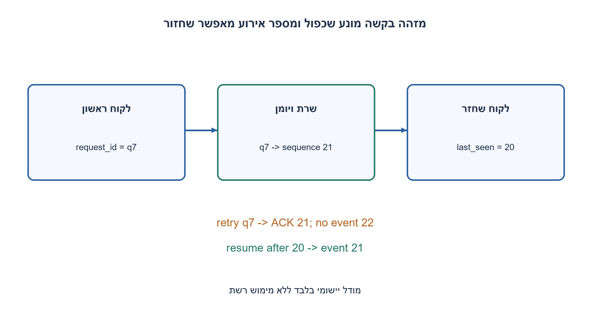
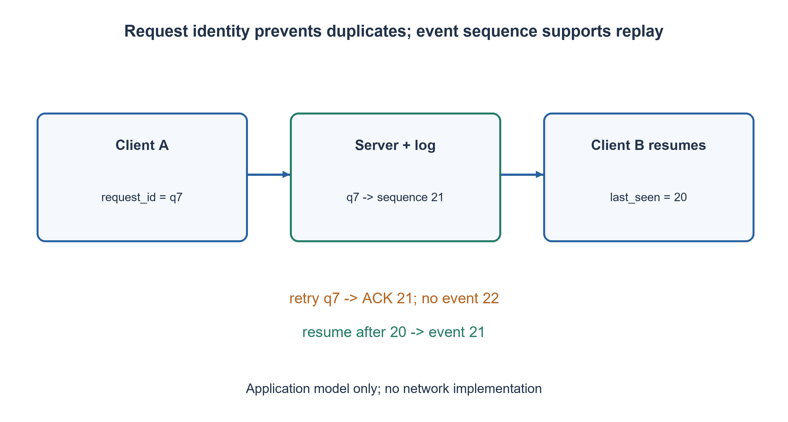

# PREP-268 — מודל לקוח–שרת דו־כיווני: איך בודקים לפני שקובעים שהוא תקין?

פתרון מוצע בסיוע AI; ביקורת מקצועית אנושית ממתינה. הקושי אינו מכויל.

## עברית

תארו דוגמה יומיומית למערכת client-server שבה לקוחות מתקשרים עם שרת מרכזי לשני הכיוונים. אילו בדיקות תבצעו לפני שתכריזו שהיא תקינה? תנו תוצאות צפויות ומקרי כשל, לא רק שמות של סוגי בדיקות.

כדוגמה עריכתית נבחר צ׳אט בחדר אחד: לקוח שולח הודעה עם request_id, השרת מאשר עם sequence עולה, ומפיץ הודעות ללקוחות. ניסיון חוזר עם אותו מזהה ואותו תוכן אינו יוצר הודעה נוספת; אותו מזהה עם תוכן שונה נפסל. בחיבור מחדש ניתן לבקש אירועים אחרי sequence אחרון, כל עוד הם נשמרו. זהו חוזה האפליקציה הנבחר, לא תכונה אוטומטית של TCP/WebSocket.

1. מה בדיוק פירוש ״תקין״ עבור כל אחד מהצדדים? כתבו מה אמור להופיע ומתי.
2. בדקו גם הודעה שמתחילה בשרת, שני לקוחות, ניתוק וניסיון חוזר. מי זוכר מה כבר התקבל?
3. הפרידו זיהוי בקשה, סדר אירועים והרשאה. הגדירו בדיקות שמאמתות שאישור חוזר אינו יוצר כפילות ושחיבור מחדש משחזר את החסר בלבד.

### קודם חוזה, אחר כך רשימת בדיקות
בחירה בצ׳אט נותנת פעולה מוחשית: א׳ שולח ״שלום״, השרת מאשר קבלה וב׳ מקבל הודעה בלי לשלוח בקשה חדשה. דו־כיווניות כוללת גם push מהשרת; בדיקה של בקשת HTTP יחידה אינה מכסה אותה. נרשום מראש איזה לקוח מורשה, מהו סדר הודעות מובטח, מתי נחשב אישור, ואילו הודעות נשמרות לאחר ניתוק.

נגדיר בדיקות עם תצפיות: חיבור עם זהות תקינה מקבל גישה וחיבור לא מורשה נדחה; הודעה תקינה יוצרת sequence אחד ושני הצדדים רואים אותו תוכן; שני לקוחות השולחים במקביל מקבלים מזהים שונים ועקביים; ניסיון חוזר עם אותו request_id חוזר לאותו sequence בלי אירוע נוסף. התנגשות מזהה עם תוכן אחר היא כשל מפורש. אלו דרישות יישומיות שצריך לממש; תעבורה אמינה לבדה אינה מבטיחה ״בדיוק פעם אחת״ בכל מצב קריסה.

ננתק לקוח אחרי sequence=20, נוסיף אירועים ונחבר אותו עם cursor=20: מצפים לקבל רק את 21 והלאה, לפי מדיניות השמירה. נבדוק בנפרד ניתוק לפני אישור, אחרי שמירת הודעה אך לפני האישור, cursor ישן מדי, ושינוי זהות. איבוד בקשת האישור אינו היתר לשכפל עבודה. שרת push עם לקוח איטי דורש תור מוגבל או backpressure; אין לתעדף צמיחה בלתי מוגבלת בזיכרון.

מקרי כשל נוספים: הודעה פגומה/גדולה מדי, סיום חיבור באמצע מסגרת, timeout, הרשאה לחדר זר, כשל תלות, restart, חיבורי לקוח רבים וניקוי משאבים. בדיקת עומס מבוצעת בסביבה ובתקציב ייעודיים, עם יעד latency וקצב מוסכמים; לא מריצים אותה על אתר חי אגב שאלת ראיון. מדדים ולוגים עם request_id/sequence מאפשרים לקשור מה שהלקוח ראה למה שהשרת שמר בלי להדליף תוכן פרטי.

הקוד המצורף הוא אורקל יישומי קטן לסדר, מניעת כפילות ושחזור. הוא אינו שרת, אינו transport ואינו מממש authentication, חדרים, התמדה או תחרות בין threads. בדיקות Python מאמתות רק את החוזה המוגבל הזה. בהמשך יחברו בדיקות אינטגרציה לשרת/transport אמיתיים, ובדיקות E2 E לשני ממשקים, עם תוצאת אמת שאפשר לבדוק. רשימת בדיקות שאינה כוללת תוצאות צפויות אינה עדות שהמוצר עובד.

במודל יש O(H) זיכרון ל־ H הודעות ואינדקס מזהים; שחזור סורק O(H). בדיקת מזהה במילון היא O(1) צפוי במודל המקובל. במערכת אמיתית קובעים מגבלת שמירה ואינדקס יעיל; אי אפשר לדרוש replay ללא גבול וגם מקום חסום בלי לשנות את החוזה.

```python
"""Small specified application model, NOT a network server/transport implementation."""


class ChatModel:
    def __init__(self):
        self.connected = set()
        self.events = []
        self.seen = {}

    def connect(self, client):
        self.connected.add(client)

    def disconnect(self, client):
        self.connected.discard(client)

    def send(self, client, request_id, text):
        if client not in self.connected:
            raise ValueError("client must be authenticated and connected")
        if type(request_id) is not str or type(text) is not str or not text:
            raise ValueError("nonempty text and string request identifier required")
        key = client, request_id
        if key in self.seen:
            sequence, original = self.seen[key]
            if text != original:
                raise ValueError("request identifier reused for another payload")
            return sequence
        sequence = len(self.events) + 1
        self.events.append((sequence, client, text))
        self.seen[key] = sequence, text
        return sequence

    def resume(self, client, last_sequence):
        if client not in self.connected or type(last_sequence) is not int:
            raise ValueError("connected client and integer cursor required")
        if not 0 <= last_sequence <= len(self.events):
            raise ValueError("cursor outside retained event history")
        return [event for event in self.events if event[0] > last_sequence]
```




## English

Describe an everyday client-server system with communication in both directions. What would you test before declaring it correct? Give expected outcomes and failure cases rather than only test-category names.

Choose a one-room chat as an editorial example: a client sends a request_id and text, the server acknowledges an increasing sequence and pushes events to clients. Retrying the same identifier/content creates no second message; reusing an identifier with different content is rejected. Reconnection can request events after a last sequence while history remains retained. This is the chosen application contract, not an automatic TCP/WebSocket property.

1. What does correct mean for each side? State what should appear and when.
2. Test server-initiated events, two clients, disconnection and retries. Who remembers acknowledged work?
3. Separate request identity, event order and authorization. Verify repeated acknowledgment creates no duplicate and reconnection replays only missing events.

### Define correctness before listing tests
Chat gives a concrete exchange: A sends hello, the server acknowledges it, and B receives a push without making another request. A single HTTP request does not cover bidirectionality. First specify authenticated identity, ordering, acknowledgment meaning and retention after disconnection.

Write observable tests: a valid identity connects while an unauthorized one is rejected; one valid message creates one sequence and both sides see identical text; simultaneous clients receive distinct, consistent event identifiers; retrying the same request_id returns the original sequence without another event. The same identifier with different content must fail explicitly. These are application requirements, not automatic exactly-once guarantees of TCP or WebSocket across crashes.

Disconnect a client after sequence twenty, add events, then resume from twenty: only twenty-one onward should be replayed under the retention policy. Separately test disconnect before acknowledgment, after persistence but before acknowledgment, an expired cursor and changed identity. Losing an acknowledgment must not authorize duplicate work. A slow push consumer needs bounded buffering or backpressure rather than unlimited memory growth.

Other cases include malformed/oversized messages, disconnect during a frame, timeout, access to another room, dependency failure, restart, many connections and resource cleanup. Load tests need a dedicated environment/budget and agreed latency/rate targets; do not run them against the live site as part of an interview exercise. request_id/sequence observability should correlate client outcomes with durable server actions without exposing private content.

The supplied code is a small application oracle for order, deduplication and replay. It is not a server or transport and does not implement authentication, rooms, durability or thread concurrency. Executed Python tests cover only that limited contract. Integration tests must next exercise a real server/transport, and E2 E tests must use two actual clients with verifiable outcomes. Test-category names without expected results are not evidence that a product works.

The model stores O(H) history and request identities for H messages; replay scans O(H). Dictionary deduplication uses expected O(1) lookup in the usual model. A real system needs an indexed retention policy; unlimited replay and bounded memory cannot both be promised without changing the contract.

```python
"""Small specified application model, NOT a network server/transport implementation."""


class ChatModel:
    def __init__(self):
        self.connected = set()
        self.events = []
        self.seen = {}

    def connect(self, client):
        self.connected.add(client)

    def disconnect(self, client):
        self.connected.discard(client)

    def send(self, client, request_id, text):
        if client not in self.connected:
            raise ValueError("client must be authenticated and connected")
        if type(request_id) is not str or type(text) is not str or not text:
            raise ValueError("nonempty text and string request identifier required")
        key = client, request_id
        if key in self.seen:
            sequence, original = self.seen[key]
            if text != original:
                raise ValueError("request identifier reused for another payload")
            return sequence
        sequence = len(self.events) + 1
        self.events.append((sequence, client, text))
        self.seen[key] = sequence, text
        return sequence

    def resume(self, client, last_sequence):
        if client not in self.connected or type(last_sequence) is not int:
            raise ValueError("connected client and integer cursor required")
        if not 0 <= last_sequence <= len(self.events):
            raise ValueError("cursor outside retained event history")
        return [event for event in self.events if event[0] > last_sequence]
```




## חומר משלים / Supporting material

```json
{
  "assumptions": {
    "he": "צ׳אט בחדר אחד הוא דוגמה שבחרנו; המודל מניח זהות מאומתת ומבצע פעולות בטור.",
    "en": "One-room chat is an editorial example; model operations are sequential and identity is assumed authenticated."
  },
  "optimality": {
    "he": "O(H) היסטוריה ושחזור; אין מימוש transport, התמדה או טיפול בתחרות בקוד הקטן.",
    "en": "O(H) history and replay; the small code does not implement transport, persistence or concurrency."
  },
  "verification": {
    "he": "30 הודעות, 30 ניסיונות חוזרים, 31 cursors ומקרי כשל במודל מקומי. אין רשת/E2 E/בדיקת עומס.",
    "en": "Thirty messages, thirty retries, thirty-one cursors and failure cases in a local model; no network/E2 E/load test."
  },
  "edge_cases": {
    "he": "ניתוק לפני אישור; retry; cursor ישן; משתמש זר; לקוח איטי; restart.",
    "en": "Disconnect before ack; retry; expired cursor; unauthorized user; slow consumer; restart."
  },
  "common_mistakes": {
    "he": "להסתפק בחיבור מצליח; לקרוא למודל שרת אמיתי; להבטיח exactly-once רק כי יש TCP.",
    "en": "Testing connection only; calling a model a real server; promising exactly-once simply because TCP is used."
  },
  "interview_answer": {
    "he": "אגדיר חוזה הודעה/אישור/push ושחזור, ואז אבדוק שני לקוחות, ניתוקים, retry, הרשאות ומשאבים עם תוצאות צפויות.",
    "en": "Specify message/ack/push/replay, then test two clients, disconnects, retries, authorization and resources against expected outcomes."
  },
  "source_ambiguities": {
    "he": "הצילום אינו מגדיר יישום או פרוטוקול מסוים; צ׳אט וחוזה מזהים נבחרו לצורך תשובה שניתן לאמת.",
    "en": "The source specifies no application/protocol; chat and identifier rules make the answer testable."
  },
  "solution_extensions": {
    "he": [
      {
        "question": "מה קורה אם השרת קורס אחרי שמירה ולפני ACK?",
        "answer_direction": "הלקוח מנסה שוב עם אותו מזהה. מנגנון מניעת הכפילות חייב להתמיד באותה טרנזקציה עם העבודה, אחרת המודל לא מספיק.",
        "principle": "הצלחה עסקית, אישור ותעבורה הם שלוש שכבות נפרדות."
      }
    ],
    "en": [
      {
        "question": "What if the server crashes after persistence but before ACK?",
        "answer_direction": "The client retries the same ID. Deduplication must be durably committed with the work; the in-memory model alone is insufficient.",
        "principle": "Business completion, acknowledgment and transport are separate layers."
      }
    ]
  }
}
```
