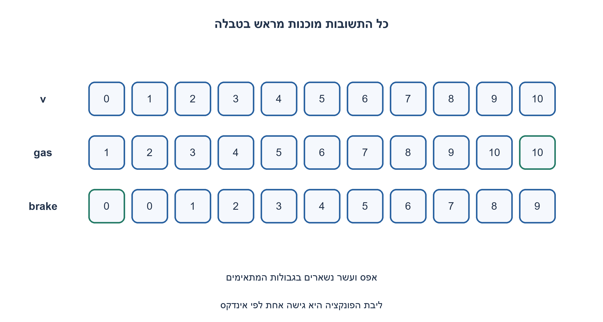
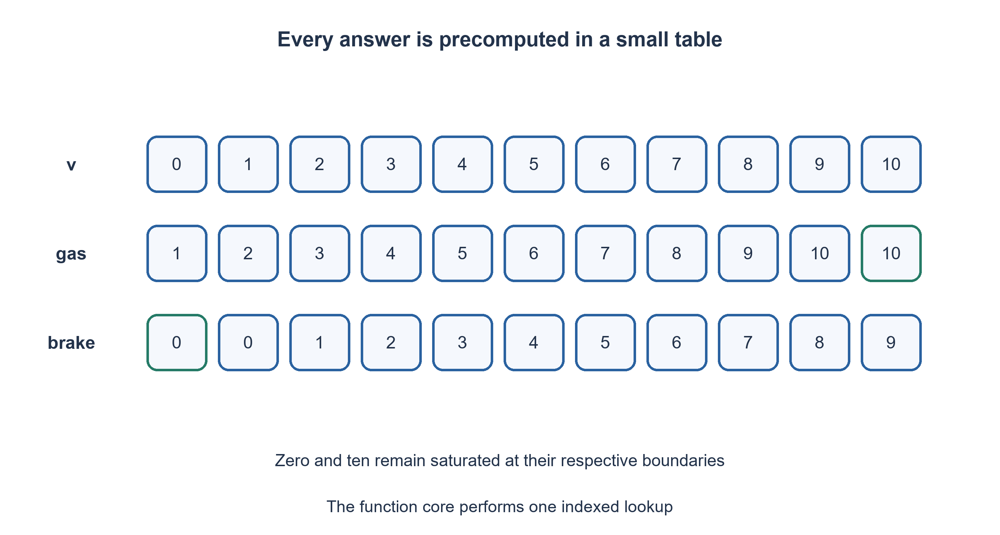

# PREP-269 — גז וברקס בלי תנאים: מהירות חסומה בין אפס לעשר

פתרון מוצע בסיוע AI; ביקורת מקצועית אנושית ממתינה. הקושי אינו מכויל.

## עברית

הנחת עריכה מפורשת: המקור מגדיר את טווח המהירות ואת הרוויה בגבולות, אך אינו מציין את גודל השינוי בכל קריאה. לצורך התרגיל נבחר צעד יחידה: גז מוסיף 1 וברקס מחסיר 1, בכפוף לרוויה.

ממשו שתי פונקציות המקבלות מהירות שלמה בטווח 0..10: gas מעלה אותה ב־ 1 אך משאירה 10 כפי שהוא; brake מורידה ב־ 1 אך משאירה 0 כפי שהוא. אסור להשתמש ב־ if, ב־ while או בתנאי אחר.

נבחר מימוש באמצעות טבלאות קבועות. הטווח מובטח על ידי הקורא; אין דרישה לטפל בקלט לא תקין בתוך הליבה נטולת התנאים. הבדילו בין איסור תנאים ברמת קוד המקור לבין הבטחת זמן קבוע או היעדר קפיצות בקוד המכונה.

1. התחום קטן וקבוע. האם אפשר לשמור מראש מה צריכה להיות כל אחת מ־ 11 התשובות?
2. בכניסת 0 לברקס ובכניסת 10 לגז התשובה שונה מהחשבון הרגיל.
3. הכינו שתי טבלאות באורך 11. החזירו את איבר הטבלה באינדקס speed; בתאי הגבול שימו 0 או 10 בהתאם.

### מחליפים החלטה בחיפוש בטבלה קטנה
לא צריך לבדוק בזמן הריצה אם המהירות היא בקצה: אפשר להכין מראש את הפלט לכל קלט אפשרי. טבלת הגז היא 1,2,3,4,5,6,7,8,9,10,10. טבלת הברקס היא 0,0,1,2,3,4,5,6,7,8,9. הפונקציה משתמשת במהירות כאינדקס ומחזירה את הערך המתאים. אין if, ביטוי תנאי, השוואה או לולאה בליבה.

למשל gas(9)=10 ו־ gas(10)=10; brake(1)=0 ו־ brake(0)=0. לכל תא פנימי 1..9 התשובה היא בדיוק v±1, ובשני הגבולות היא הערך הרווי. בדיקה של כל 22 הזוגות פונקציה/קלט היא בדיקה ממצה של החוזה הסופי, בעוד רשימת הטבלאות עצמה מספקת גם נימוק ישיר לכל קלט.

מותר לחלופין לכתוב `v+(v<10)` ו־`v-(v>0)` רק אם המראיין מאשר השוואות שערכן מומר ל־ 0/1; אלו תנאים לוגיים גם בלי if. גם min/max עלולים להסתיר מימוש מותנה, ולכן אינם תשובה לאיסור המילולי בלי הבהרה. הטבלה מונעת את העמימות ברמת קוד המקור.

עלות הגישה O(1) במודל מערך, והטבלאות מכילות יחד 22 ערכים קבועים. זה אינו איסור על זיכרון עזר: לא היה איסור כזה במקור. ל־ K רמות מהירות ההכללה דורשת O(K) מקום. Python עדיין בודקת גבולות וגישה לאובייקט; אין מכאן הבטחה שאין קפיצות במפרש, שהזמן חסר תלות או שהפתרון מתאים לערוץ צד קריפטוגרפי.

טווח הקלט הוא חלק מהחוזה. Python מאפשרת אינדקס שלילי ו־ bool הוא תת־טיפוס של int; לכן בדיקת הקלט, אם צריך, שייכת לעטיפה רגילה מחוץ לליבה. בפרט gas(-1) אינו טיפול תקין במהירות שלילית. תוצאות מחוץ לתחום אינן חלק מההוכחה. נבדקו כל הקריאות התקינות, מסלולים חוזרים עד רוויה, ו־ AST ללא תנאים/השוואות/לולאות.

```python
"""Branch-free core for promised integer speed in [0,10]."""
GAS = (1, 2, 3, 4, 5, 6, 7, 8, 9, 10, 10)
BRAKE = (0, 0, 1, 2, 3, 4, 5, 6, 7, 8, 9)


def gas(speed):
    return GAS[speed]


def brake(speed):
    return BRAKE[speed]


def speed_controls(speed):
    """Runtime adapter: return [gas(speed), brake(speed)] for one promised speed."""
    return [gas(speed), brake(speed)]
```




## English

Explicit editorial assumption: the source specifies the speed range and endpoint saturation but not the change per call. For this exercise choose a unit step: gas adds one and brake subtracts one, subject to saturation.

Implement gas and brake for an integer speed in inclusive 0..10. gas adds one except that ten remains ten; brake subtracts one except that zero remains zero. Do not use if, while or another conditional.

Choose constant lookup tables. The caller promises the input domain; invalid-input handling is outside the conditional-free core. Distinguish a source-code restriction from a constant-time or branch-free machine-code guarantee.

1. The domain is small and fixed. Could all eleven answers be stored in advance?
2. Brake at zero and gas at ten differ from ordinary arithmetic.
3. Build two eleven-entry tables and return entry speed; place the saturated values at the endpoints.

### Replace a decision with a small table
There is no need to check an endpoint at runtime if the answer for every possible input is stored. GAS is 1,2,3,4,5,6,7,8,9,10,10; BRAKE is 0,0,1,2,3,4,5,6,7,8,9. Index by the current speed. The core contains no if, conditional expression, comparison or loop.

For example gas(9)=10 and gas(10)=10; brake(1)=0 and brake(0)=0. Every interior entry 1..9 equals v±1, while the endpoints contain saturated values. Testing all twenty-two function/input pairs exhausts this finite contract; the table entries also give a direct case-by-case correctness argument.

`v+(v<10)` and `v-(v>0)` are alternatives only if comparisons and Boolean-to-integer conversion are explicitly permitted. They still express logical conditions despite omitting if. min/max can hide conditional implementation too; they do not resolve the literal prohibition without clarification. The table avoids that source-level ambiguity.

Array indexing costs O(1) in the usual model, and the tables store twenty-two fixed values. The source did not forbid auxiliary memory. Generalizing to K speed levels costs O(K) storage. Python's interpreter still performs indexing/object checks; this does not prove branch-free machine code, data-independent timing or cryptographic side-channel resistance.

The promised domain matters. Python allows negative indices and bool subclasses int, so input validation, if required, belongs to a separate ordinary wrapper. gas(-1) is not valid negative-speed handling. Values outside the contract are not covered by the proof. Verification exhausts all valid calls, repeated saturation traces and an AST check excluding conditions/comparisons/loops.

```python
"""Branch-free core for promised integer speed in [0,10]."""
GAS = (1, 2, 3, 4, 5, 6, 7, 8, 9, 10, 10)
BRAKE = (0, 0, 1, 2, 3, 4, 5, 6, 7, 8, 9)


def gas(speed):
    return GAS[speed]


def brake(speed):
    return BRAKE[speed]


def speed_controls(speed):
    """Runtime adapter: return [gas(speed), brake(speed)] for one promised speed."""
    return [gas(speed), brake(speed)]
```




## חומר משלים / Supporting material

```json
{
  "assumptions": {
    "he": "הקורא מבטיח int בין 0 ל־ 10; מותרות טבלאות קבועות; אין תנאים בליבה. גודל הצעד אינו במקור; נבחר במפורש שינוי של 1 לכל קריאה.",
    "en": "Caller promises integer 0..10; constant tables are allowed; no conditions in the core. The source omits step size; a unit change per call is explicitly chosen."
  },
  "optimality": {
    "he": "22 ערכי טבלה קבועים וגישה O(1). אין טענת constant-time למפרש.",
    "en": "Twenty-two fixed table values and O(1) indexing; no interpreter constant-time claim."
  },
  "verification": {
    "he": "כל 22 הקריאות, 660 צעדי רוויה ובדיקת AST. קלט מחוץ לחוזה לא חלק מהמימוש.",
    "en": "All twenty-two calls, 660 saturation steps and AST inspection; out-of-contract input is not handled by the core."
  },
  "edge_cases": {
    "he": "0 ו־ 10; gas חוזר ב־ 10; brake חוזר ב־ 0; אינדקס שלילי מחוץ לחוזה.",
    "en": "Zero and ten; repeated gas at ten; repeated brake at zero; negative index is outside the contract."
  },
  "common_mistakes": {
    "he": "להחזיר 11 או ‎−1; להסתיר if בתוך פונקציה; לטעון שאין קפיצות במעבד רק לפי Python.",
    "en": "Returning eleven or minus one; hiding if in a helper; inferring CPU branch absence from Python source."
  },
  "interview_answer": {
    "he": "התחום כולל רק 11 אפשרויות, לכן אבחר טבלה לכל פעולה ואחזיר לפי אינדקס המהירות.",
    "en": "There are only eleven possible inputs, so each operation indexes its precomputed answer table."
  },
  "source_ambiguities": {
    "he": "״בלי תנאים״ אינו מגדיר אם השוואות מותרות. הטבלה היא בחירה שעומדת באיסור ברמת המקור. המקור אינו קובע בכמה גז מגדיל או ברקס מקטין את המהירות; צעד היחידה הוא הנחת העריכה שנבחרה, ולא פרט מהצילום.",
    "en": "The no-conditionals wording does not specify comparisons; a table satisfies the literal source-level restriction. The source does not say how much gas increases or brake decreases speed; the unit step is the chosen editorial assumption, not a screenshot fact."
  },
  "solution_extensions": {
    "he": [
      {
        "question": "מה משתנה כשהמהירות היא מספר ממשי?",
        "answer_direction": "הטבלה הסופית אינה מכסה תחום רציף; נדרש חוזה אחר, למשל פעולת clamp שמותר להשתמש בה.",
        "principle": "גודל תחום הקלט קובע האם טבלת תשובות היא פתרון."
      }
    ],
    "en": [
      {
        "question": "What changes for real-valued speed?",
        "answer_direction": "A finite table cannot cover a continuous domain; choose another contract, such as an allowed clamp operation.",
        "principle": "Input-domain size determines whether a lookup table is viable."
      }
    ]
  }
}
```
