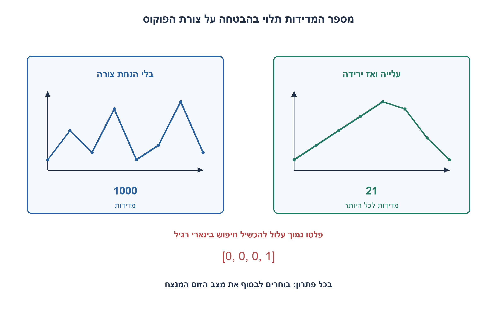
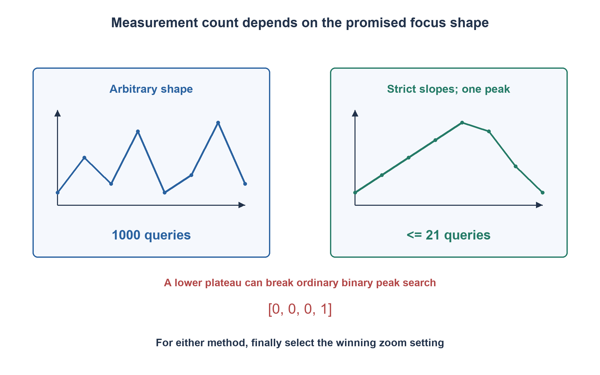

# PREP-270 — מקסימום פוקוס ב־1,000 מצבי זום: אילו הנחות מותרות?

פתרון מוצע בסיוע AI; ביקורת מקצועית אנושית ממתינה.

[מקור פרטי](../sources/2026-11-07-batch30-23.png)

יש לך מקרו עם זום. יש 1000 אפשרויות שבהן אפשר לשים את הזום. יש שתי פונקציות set,get לקביעת זום וקבלת הפוקוס. צריך להגיע לנקודה שבה ערך הפוקוס הגבוה ביותר. מה היו ההנחות בפתרון?

## עברית

למכשיר יש 1,000 מצבי זום בדידים, שממוספרים 0..999. ניתן לקרוא `set(i)` לבחירת מצב ולקרוא `get()` למדידת הפוקוס במצב הנוכחי. מצאו מצב בעל פוקוס מרבי והחזירו את המכשיר אליו בסוף. אילו הנחות דרושות לפתרון?

א. תחילה אין שום הבטחה על צורת פונקציית הפוקוס. בהנחת מדידות סופיות, יציבות וללא רעש, תנו פתרון מובטח וחסם תחתון למספר המדידות במקרה הגרוע.
ב. כווריאציה מפורשת, נניח שהפוקוס עולה ממש עד למקסימום, עשוי להיות קבוע על רצף מצבי מקסימום, ואז יורד ממש. הציעו חיפוש מהיר יותר והסבירו מדוע ההבטחה חשובה.
ג. מה משתנה כאשר יש רעש, כמה פסגות, השהיית התייצבות או עלות להזזת הזום? בשוויון בחרו את האינדקס הקטן ביותר. הניתוח סופר מדידות בנפרד מתנועה וזמן פיזי. אין גישה ישירה למערך ערכים סמוי.

1. אם לא מדדתם מצב מסוים, מה מונע ממנו להיות המקסימום היחיד? הדוגמה צריכה להיכשל גם מול ערך גבוה שנמצא בקצה.
2. בגרסה עם פסגה יחידה השוו שני מצבים סמוכים באמצע הטווח. איזה חצי בטוח אינו מכיל את המקסימום השמאלי?
3. סריקה מלאה אופטימלית ללא הנחת צורה. תחת עלייה ממשית ואז ירידה ממשית, m מול m+1 מצמצם טווח; שוויון מותר רק בפלטו המקסימום. בסוף צריך set לתוצאה.

### בלי הבטחת צורה צריך לבדוק כל מצב
שומרים את הזוג הטוב ביותר שנמדד עד כה וסורקים i=0..999. לכל i מבצעים set, ממתינים להתייצבות אם החוזה דורש זאת ואז get. מעדכנים רק אם הערך גדול ממש, כדי לשמור אינדקס ראשון בשוויון. לאחר הסריקה מבצעים set לאינדקס המנצח: המצב האחרון שנמדד אינו בהכרח המנצח. הסריקה משתמשת ב־1,000 מדידות ובמספר קבוע של משתנים. עבור n מצבים: Θ(n) מדידות ו־O(1) זיכרון עזר, מעבר לממשק המכשיר.

זהו גם חסם תחתון למובטחות במקרה הגרוע: אם נשאר מצב שלא נמדד, אפשר לבנות שני מכשירים שנותנים בדיוק את אותן תוצאות בכל המדידות שנעשו, אך באחד הערך הלא־נמדד נמוך ובשני הוא גדול מכל המדודים. אין דרך להבחין ביניהם. גם החזרת אינדקס שלא נמדד אינה פותרת זאת: אפשר לתת לו ערך נמוך במקום גבוה. לכן אלגוריתם שמבטיח מקסימום גלובלי לפונקציה שרירותית חייב במקרה הגרוע למדוד את כל המצבים. אין צורך במיון הערכים.

### חיפוש לוגריתמי דורש הבטחה חזקה ומוגדרת
בגרסת הפסגה היחידה, נשמור טווח [left,right] שמכיל את המקסימום השמאלי. נגדיר m באמצע ונמדוד f(m),f(m+1). אם `f(m)<f(m+1)`, m נמצא בעלייה והפסגה השמאלית מימינו, ולכן מעדכנים left=m+1. אחרת הפסגה השמאלית אינה מימין ל־m: בירידה היא משמאל, ובשוויון המותר m כבר בפלטו המקסימום. לכן right=m. בכל צעד הטווח מתקצר, ובטווח יחיד מודדים ומחזירים את האינדקס שנותר. גם פסגה בקצה עובדת.

הקוד מבצע לכל היותר `2*ceil(log2(n))+1` מדידות, ולכן עד 21 עבור n=1,000, וזיכרון קבוע. חלק מהמצבים עשויים להימדד יותר מפעם אחת; cache יכול לחסוך קריאות במחיר זיכרון נוסף. החסם כאן מתאר את המימוש והבטחתו, ולא הוכחה למספר המדידות המינימלי המדויק בין כל שיטות האופטימיזציה. בדיקת ההבטחה עצמה עבור פונקציה שרירותית מחזירה בדרך כלל את הצורך לסרוק; אין לאלגוריתם יכולת לאמת אותה בחינם.

״חד־שיאית״ במובן חלש עם פלטו נמוך אינה מספיקה לכלל הזה. למשל `[0,0,0,1]` אינה יורדת ואז עולה, אך שוויון באמצע יכול להשליך את הצד שבו נמצא 1. ההבטחה שלנו דורשת שוויון רק בין מצבי מקסימום סמוכים. לחלופין אפשר לטפל בשוויון בסריקה זהירה, אך אז הגבול עלול לחזור להיות לינארי. כמה פסגות מבטלות גם הן את ההוכחה; טיפוס מקומי או חיפוש שלישוני אינם הבטחה למקסימום גלובלי ללא הנחות מתאימות.

### מכשיר פיזי מוסיף חוזה מדידה
אם יש רעש, get יחיד אינו ערך הפונקציה המדויק. אפשר לחזור על מדידות ולאמוד אי־ודאות, אבל מספר דגימות או רמת ביטחון דורשים מודל רעש, הפרדה בין ערכי הפוקוס ויעד דיוק. אם שתי פסגות כמעט שוות אין הבטחה לזהות בוודאות מי גבוהה במספר קבוע של דגימות רעש. תנועה והשתהות הן עלות אחרת: סריקה רציפה עשויה להיות זולה בתנועה מחיפוש שקופץ מרחקים גדולים, אף שיש בו פחות מדידות. יש גם אפשרות לפוקוס שמשתנה עם הזמן או לכיוון התנועה; אז צריך להגדיר מחדש מה ממקסמים.

19,322 מקרים נבדקו מול מכשיר callback מדומה: כל הרצפים הקצרים מעל שלושה ערכים לסריקה, משפחות עלייה/פסגה/ירידה לחיפוש המהיר, מוני מדידות והמצב הסופי. דוגמת הפלטו הנמוך נשמרה כדוגמה מחוץ לחוזה. לא נעשתה בדיקת מערכת אופטית אמיתית.

```python
"""Zoom-only black-box queries: values are never read from a hidden array.

Callbacks: set_zoom(i) selects a valid setting; get_focus() measures it.
The instrument must be deterministic, settled and noiseless during the search.
Return (index, measured_focus); leave the instrument at the returned index.
"""
from math import isfinite


def _count(n):
    if type(n) is not int or n <= 0:
        raise ValueError("a positive number of settings is required")


def _measure(index, set_zoom, get_focus):
    set_zoom(index)
    value = get_focus()
    if (isinstance(value, bool) or not isinstance(value, (int, float))
            or isinstance(value, float) and not isfinite(value)):
        raise ValueError("focus must be a finite real number")
    return value


def scan_global_maximum(n, set_zoom, get_focus):
    """Guaranteed for arbitrary finite values; choose the lowest index on ties."""
    _count(n)
    best_index = 0
    best = _measure(0, set_zoom, get_focus)
    for index in range(1, n):
        candidate = _measure(index, set_zoom, get_focus)
        if candidate > best:
            best_index, best = index, candidate
    set_zoom(best_index)
    return best_index, best


def unimodal_maximum(n, set_zoom, get_focus):
    """Requires strict increase, optional maximum plateau, then strict decrease.

    A lower/nonmaximal plateau violates this contract. The algorithm does not
    certify unimodality: doing so in general requires examining all settings.
    """
    _count(n)
    left, right = 0, n - 1
    while left < right:
        middle = (left + right) // 2
        here = _measure(middle, set_zoom, get_focus)
        following = _measure(middle + 1, set_zoom, get_focus)
        if here < following:
            left = middle + 1
        else:
            right = middle
    return left, _measure(left, set_zoom, get_focus)
```


הוכחות הסריקה והאינווריאנט ניתנות כאן; קוד הבדיקה משתמש באורקל שאינו חלק מממשק המכשיר.



## English

An instrument has1,000 discrete zoom settings0..999. `set(i)` selects one; `get()` measures focus at the current setting. Find a maximum-focus setting and leave the instrument there. Which assumptions does the solution require?

(a) With no promise about focus shape, but finite stable noiseless measurements, give a guaranteed method and worst-case measurement lower bound.
(b) As an explicit variant, assume strict increase up to a maximum, an optional contiguous maximum plateau, then strict decrease. Give a faster search and explain why the promise matters.
(c) Discuss noise, multiple peaks, settling delay and movement cost. Choose the lowest index on ties. Count measurements separately from mechanical travel/elapsed time; no hidden array is directly available.

1. If one setting is unmeasured, what prevents it from being the unique maximum? Consider a high value hidden at an endpoint.
2. Under the single-peak promise, compare neighboring settings near the midpoint. Which half cannot contain the leftmost maximum?
3. A full scan is optimal without shape assumptions. With strict slopes and only a maximum plateau, compare m and m+1 to shrink the range; finally set the returned setting.

### No shape promise means measuring every setting
Scan0..999 while retaining the best measured pair. Select each setting, allow settling when required, then measure. Update only for a strictly larger value to keep the first tie. Finally set the winning index: the last measured setting need not be best. This uses1,000 measurements and constant auxiliary state; for n settings the cost is Θ(n) measurements and O(1) space beyond the device interface.

This worst-case guarantee is optimal. If a setting remains unmeasured, two instruments can agree on every observation so far but assign that setting either a low value or a value larger than everything observed. The algorithm cannot distinguish them. Returning an unmeasured index does not help: an adversary can make it low instead. Therefore arbitrary global maximization requires every setting in the worst case. Sorting is unnecessary.

### Logarithmic search needs a precise stronger promise
For the declared single-peak variant, retain an interval containing the leftmost maximum. Measure f(m),f(m+1) at its middle. If `f(m)<f(m+1)`, the leftmost maximum lies right of m, so set left=m+1. Otherwise it is at or left of m: a decreasing pair lies after the maximum, and an equal pair can only be within the maximum plateau. Set right=m. The interval shrinks until one index remains; measure and return it. Endpoint maxima are supported.

The code uses at most `2*ceil(log2(n))+1` measurements, hence at most21 for n=1,000, and O(1) auxiliary memory. It may remeasure some settings; caching trades memory for calls. This is a bound for the given implementation, not an exact minimum among every possible search method. Certifying the shape promise itself for arbitrary values generally needs a scan; it is not a free capability.

Weak unimodality with a lower plateau is insufficient for this tie rule. For example `[0,0,0,1]` can cause equality to discard the side containing1. Our contract allows equal neighboring values only at the maximum plateau. Conservative equality handling can restore correctness more broadly but may require linear work. Multiple peaks likewise invalidate the proof; local hill-climbing or ternary search is not a guaranteed global optimizer without suitable assumptions.

### A physical instrument adds a measurement contract
Noisy get calls are not exact function values. Repeated measurements can estimate uncertainty, but sample counts/confidence require a noise model, accuracy objective and separation of candidate values. Arbitrarily close peaks cannot generally be distinguished with certainty from a fixed number of noisy samples. Travel and settling are separate costs: a sequential sweep may move less than a jumping search even while making more measurements. Time variation or direction-dependent hysteresis changes the optimization problem again.

19,322 cases used a simulated callback instrument:exhaustive short arbitrary sequences for scanning, increasing/maximum-plateau/decreasing families for the fast method, query counts and final position. A low-plateau counterexample is explicitly outside the fast contract. No physical optical system was tested.

```python
"""Zoom-only black-box queries: values are never read from a hidden array.

Callbacks: set_zoom(i) selects a valid setting; get_focus() measures it.
The instrument must be deterministic, settled and noiseless during the search.
Return (index, measured_focus); leave the instrument at the returned index.
"""
from math import isfinite


def _count(n):
    if type(n) is not int or n <= 0:
        raise ValueError("a positive number of settings is required")


def _measure(index, set_zoom, get_focus):
    set_zoom(index)
    value = get_focus()
    if (isinstance(value, bool) or not isinstance(value, (int, float))
            or isinstance(value, float) and not isfinite(value)):
        raise ValueError("focus must be a finite real number")
    return value


def scan_global_maximum(n, set_zoom, get_focus):
    """Guaranteed for arbitrary finite values; choose the lowest index on ties."""
    _count(n)
    best_index = 0
    best = _measure(0, set_zoom, get_focus)
    for index in range(1, n):
        candidate = _measure(index, set_zoom, get_focus)
        if candidate > best:
            best_index, best = index, candidate
    set_zoom(best_index)
    return best_index, best


def unimodal_maximum(n, set_zoom, get_focus):
    """Requires strict increase, optional maximum plateau, then strict decrease.

    A lower/nonmaximal plateau violates this contract. The algorithm does not
    certify unimodality: doing so in general requires examining all settings.
    """
    _count(n)
    left, right = 0, n - 1
    while left < right:
        middle = (left + right) // 2
        here = _measure(middle, set_zoom, get_focus)
        following = _measure(middle + 1, set_zoom, get_focus)
        if here < following:
            left = middle + 1
        else:
            right = middle
    return left, _measure(left, set_zoom, get_focus)
```


The scan lower bound and interval invariant are proved here; the independent test oracle is not part of the instrument interface.



## Supporting material / חומר משלים

```json
{
  "assumptions": {
    "he": "מדידות סופיות, דטרמיניסטיות וללא רעש; מצב נקבע לפני get. החיפוש המהיר דורש עלייה ממש, פלטו מקסימום אפשרי וירידה ממש.",
    "en": "Finite deterministic noiseless measurements; set before get. Fast search requires strict increase, optional maximum plateau, strict decrease."
  },
  "optimality": {
    "he": "ללא צורה: Θ(n) מדידות אופטימלי במקרה הגרוע ו־O(1) זיכרון. עם החוזה החזק: O(log n) מדידות ו־O(1) מקום; עלות תנועה נפרדת.",
    "en": "Arbitrary shape:optimal worst-case Θ(n) measurements and O(1) space. Strong single-peak contract:O(log n) measurements/O(1) space; motion cost is separate."
  },
  "verification": {
    "he": "9,840 רצפים שרירותיים, מקרה שלמים גדולים ועוד 9,481 משפחות בעלות חוזה הפסגה נבדקו מול מקסימום עצמאי, ספירת get ומצב הסיום. אין ניסוי מכשיר אמיתי.",
    "en": "9,840 arbitrary sequences, one large-integer case and9,481 promised peak families checked against an independent maximum, get counts and final setting. No physical instrument test."
  },
  "edge_cases": {
    "he": "n=1; מקסימום בקצה; ערכים שווים כולם; פלטו מקסימום; פלטו נמוך שמפר חוזה מהיר; NaN; רעש; מצב סופי שאינו האחרון שנמדד.",
    "en": "n=1; endpoint peak; all equal; maximum plateau; lower plateau violating the fast contract; NaN; noise; final setting differs from last measured."
  },
  "common_mistakes": {
    "he": "להשתמש בחיפוש בינארי בלי חד־שיאיות; שוויון על פלטו נמוך; לשכוח set סופי; לאמוד מהירות לפי מספר מדידות בלבד; לטעון שההבטחה אומתה בלי סריקה.",
    "en": "Binary search without a peak promise; low-plateau ties; forgetting final set; equating query count with elapsed time; claiming free promise verification."
  },
  "interview_answer": {
    "he": "בלי הנחת צורה אסרוק את כל המצבים; מצב לא מדוד יכול להיות הטוב ביותר. אם מובטחת פסגה עם מדרונות ממשיים, השוואת שכנים באמצע מצמצמת טווח לוגריתמית.",
    "en": "Without shape assumptions I scan all settings:an unmeasured one could be best. With a strict-slope peak promise, midpoint-neighbor comparison shrinks the range logarithmically."
  },
  "source_ambiguities": {
    "he": "המקור כתב ״מיקרו עם זום״ ללא סוג מכשיר ברור. הנוסח הערוך משתמש במכשיר כללי; חד־שיאיות, רעש וזמני התייצבות אינם נתוני מקור.",
    "en": "The source says “micro with zoom” without a clear instrument type. The edited problem uses a generic instrument; unimodality, noise and settling are not supplied source facts."
  },
  "solution_extensions": {
    "he": "אם מדידה יקרה פי100 מתזוזה, מתי cache משתלם? אם יש רעש גאוסי ידוע, הגדירו יעד שגיאה וביטחון לפני חישוב מספר חזרות.",
    "en": "If a measurement costs100times a move, when is caching useful? With known Gaussian noise, specify error/confidence goals before deciding repeat counts."
  },
  "technical_references": {
    "he": [
      "הוכחות הסריקה והאינווריאנט ניתנות כאן; קוד הבדיקה משתמש באורקל שאינו חלק מממשק המכשיר."
    ],
    "en": [
      "The scan lower bound and interval invariant are proved here; the independent test oracle is not part of the instrument interface."
    ]
  }
}
```
