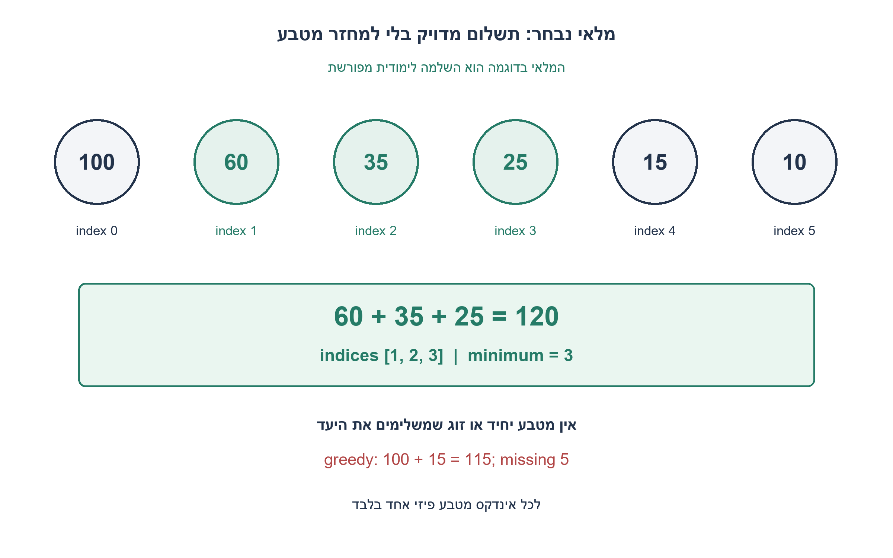
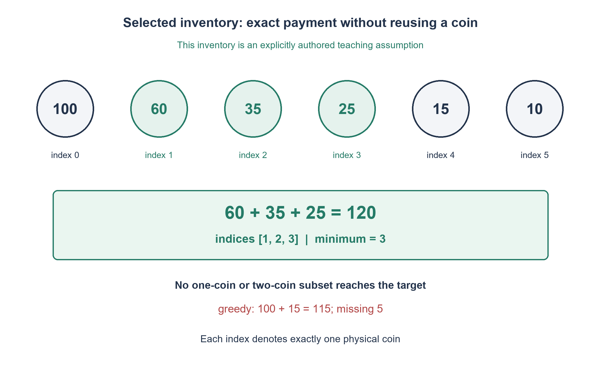

# PREP-271 — מלאי נבחר לתשלום מאה ועשרים

השלמה לימודית ערוכה; פתרון מוצע וביקורת מקצועית אנושית ממתינה.

## עברית

### תרגיל מספרי מלא: מלאי מטבעות שנבחר לצורך הלימוד
**המלאי הבא הוא השלמה לימודית שלנו, ולא נתון שהיה בצילום הראיון.** הניתוח הקודם והאלגוריתם לרשימת מטבעות כללית נשמרים.

ברשותכם בדיוק שישה מטבעות פיזיים, לפי אינדקסים 0..5: `coins=[100,60,35,25,15,10]`. לכל אינדקס עותק אחד בלבד. יש לשלם בדיוק 120 יחידות, ללא עודף, תשלום יתר, פירוק מטבע או מטבעות נוספים. מצאו מספר מינימלי של מטבעות, החזירו את האינדקסים שנבחרו והוכיחו שהמספר מינימלי. בדקו גם מה עושה חמדנות שבכל שלב לוקחת את המטבע הגדול שנותר ושאינו עולה על היתרה.

אפשר להשתמש בתכנות הדינמי הכללי שהוצג קודם. ציינו במפורש מדוע אסור להשתמש פעמיים בערך 60 במלאי הזה.

1. בדקו אם מטבע יחיד מספיק, ואז אילו זוגות יכולים להשלים את 120. האם יש במלאי עותק שני של 60?
2. נסו להשלים 60 בעזרת שני מטבעות אחרים. שימו לב ל־35 ול־25 ולזהויות הפיזיות שלהם.
3. אם מצאתם שלישייה חוקית והוכחתם שאין יחיד או זוג, הוכחתם מינימום. לחמדנות עקבו אחרי היתרה אחרי בחירת 100 ואז 15.

### התשובה היא שלושה מטבעות, עם הוכחת מינימום קצרה
נבחרים האינדקסים `[1,2,3]`, שערכיהם `60+35+25=120`. כל אינדקס מופיע פעם אחת, ולכן זהו פתרון חוקי בן שלושה מטבעות.

כדי להוכיח מינימום אין צורך לסמוך רק על פלט התוכנית. אין מטבע יחיד בערך 120. עבור זוג, מטבע 100 דורש 20 שאינו במלאי; מטבע 60 דורש עותק שני של 60 שאינו קיים; שני מטבעות שאינם 100 או 60 אינם יכולים להגיע ל־120, כי שני הגדולים מביניהם הם 35 ו־25. לכן אין פתרון בגודל אחד או שניים. שלישייה חוקית קיימת, ומכאן שהמינימום הוא בדיוק 3.

מניית כל 64 תתי־הקבוצות של שש הזהויות מראה שזו גם השלישייה המינימלית היחידה. זו בדיקה סופית עצמאית, לא הנחת קלט. לא ממחזרים את המטבע באינדקס 1 כדי ליצור 60+60.

### חמדנות גדולה־תחילה דווקא נכשלת כאן
לוקחים 100, ונשאר 20. המטבע הגדול שנותר שמתאים הוא 15, ואז נשאר 5. אין מטבע מתאים ולכן האלגוריתם נתקע עם 115, אף שקיים פתרון מדויק. אין להוסיף מטבע 5 או לתת עודף כדי להציל את השיטה: הם אינם בחוזה.

התכנות הדינמי נשאר נכון: כל החלטה לוקחת מטבע פעם אחת או מדלגת עליו, ובשני הענפים משתמשים רק בשורה הקודמת. הזמן והמקום עם שחזור הם O(n(T+1)) במודל מילים; במופע הזה n=6 ו־T=120. אורקל של תתי־קבוצות מתאים לאימות שישה מטבעות, אך אינו תחליף יעיל ל־DP כשמספר המטבעות גדל.

7,854 מקרי מלאי ויעד קטנים נבדקו מול מניית תתי־קבוצות בלתי תלויה. במופע הנבחר נבדקו כל 64 תתי־הקבוצות, האינדקסים המדויקים, היעדר פתרון קצר יותר וכישלון החמדנות.

```python
"""A fully supplied physical-coin instance, explicitly chosen for teaching.

COINS contains one physical coin at each index; 60 cannot be used twice.
The supplied screenshot did not supply this inventory.
"""
COINS = (100, 60, 35, 25, 15, 10)
TARGET = 120


def minimum_indices(coins, target):
    if type(target) is not int or target < 0:
        raise ValueError("target must be a nonnegative integer")
    if any(type(value) is not int or value <= 0 for value in coins):
        raise ValueError("coin values must be positive integers")
    count = len(coins)
    unreachable = count + 1
    rows = [[0] + [unreachable] * target]
    for value in coins:
        previous = rows[-1]
        current = previous.copy()
        for amount in range(value, target + 1):
            current[amount] = min(previous[amount], previous[amount - value] + 1)
        rows.append(current)
    if rows[-1][target] == unreachable:
        return None
    result, amount = [], target
    for i in range(count, 0, -1):
        if rows[i][amount] < rows[i - 1][amount]:
            result.append(i - 1)
            amount -= coins[i - 1]
    assert amount == 0
    return list(reversed(result))


def completed_payment():
    return minimum_indices(COINS, TARGET)
```



## English

### Complete numerical exercise: an explicitly selected coin inventory
**The inventory below is our authored teaching completion, not data supplied by the interview screenshot.** The earlier specification analysis and general physical-inventory algorithm remain available.

You own exactly six physical coins, at indices 0..5: `coins=[100,60,35,25,15,10]`. There is exactly one coin at each index. Pay exactly 120 units, without change, overpayment, splitting coins or extra inventory. Minimize the number of coins, return the selected indices and prove optimality. Also test greedy selection that repeatedly takes the largest remaining coin not exceeding the unpaid amount.

You may use the earlier general dynamic program. Explain explicitly why value 60 cannot be used twice in this inventory.

1. Check one coin, then possible two-coin complements to 120. Is a second 60 coin available?
2. Try completing 60 with two other coins; inspect 35 and 25 and their physical indices.
3. A legal triple plus proof that no single or pair works proves optimality. For greedy, track the remainder after taking 100 and then 15.

### Three coins, with a short optimality proof
Select indices `[1,2,3]`, whose values are `60+35+25=120`. Each physical index occurs once, so this is a legal three-coin payment.

Optimality need not rely solely on program output. No single coin is worth 120. A pair involving 100 needs an unavailable 20; a pair involving 60 needs a second unavailable 60; a pair containing neither 100 nor 60 cannot reach 120 because its two largest possible values are 35 and 25. Thus no one-coin or two-coin solution exists. Since a legal triple exists, the minimum is exactly 3.

Enumerating all 64 subsets of the six identities also shows that this is the only optimal triple. That is an independent finite check, not an input assumption. Reusing index 1 to form 60+60 is illegal.

### Largest-first greedy fails on this inventory
Take 100, leaving 20. The largest remaining fitting coin is 15, leaving 5. No coin fits, so greedy stops at 115 even though exact payment exists. Adding a 5 coin or accepting change would change the contract and cannot rescue this algorithm here.

The general dynamic program remains valid: take the current coin once or skip it, with both branches using only the previous row. Reconstruction uses O(n(T+1)) word time/space; this instance has n=6 and T=120. Exhaustive subsets are a useful oracle for six coins but not an efficient replacement for DP as inventory grows.

7,854 small inventory/target cases were checked against independent subset enumeration. For the selected instance all 64 subsets, exact indices, absence of shorter solutions and greedy failure were verified.

```python
"""A fully supplied physical-coin instance, explicitly chosen for teaching.

COINS contains one physical coin at each index; 60 cannot be used twice.
The supplied screenshot did not supply this inventory.
"""
COINS = (100, 60, 35, 25, 15, 10)
TARGET = 120


def minimum_indices(coins, target):
    if type(target) is not int or target < 0:
        raise ValueError("target must be a nonnegative integer")
    if any(type(value) is not int or value <= 0 for value in coins):
        raise ValueError("coin values must be positive integers")
    count = len(coins)
    unreachable = count + 1
    rows = [[0] + [unreachable] * target]
    for value in coins:
        previous = rows[-1]
        current = previous.copy()
        for amount in range(value, target + 1):
            current[amount] = min(previous[amount], previous[amount - value] + 1)
        rows.append(current)
    if rows[-1][target] == unreachable:
        return None
    result, amount = [], target
    for i in range(count, 0, -1):
        if rows[i][amount] < rows[i - 1][amount]:
            result.append(i - 1)
            amount -= coins[i - 1]
    assert amount == 0
    return list(reversed(result))


def completed_payment():
    return minimum_indices(COINS, TARGET)
```



## Supporting material

```json
{
  "assumptions": {
    "he": [
      "מלאי שנבחר במפורש: [100,60,35,25,15,10], אינדקסים 0..5 ועותק פיזי אחד לכל אינדקס.",
      "יעד מדויק 120, בלי עודף, תשלום יתר, פירוק או מטבע נוסף."
    ],
    "en": [
      "Explicitly selected inventory: [100,60,35,25,15,10], indices 0..5 and one physical coin per index.",
      "Exact target 120; no change, overpayment, splitting or additional coin."
    ]
  },
  "optimality": {
    "he": "המינימום הוא 3: [1,2,3]. שלישייה חוקית משיגה 120, ואין יחיד או זוג אפשרי; אין צורך בהנחה שחמדנות מיטבית.",
    "en": "Minimum 3, at indices [1,2,3]. A legal triple achieves 120 and no single/pair can; greedy optimality is not assumed."
  },
  "verification": {
    "he": "7,854 מקרי מלאי/יעד מול אורקל תתי־קבוצות; כל 64 תתי־הקבוצות של המופע הנבחר מאשרות מינימום 3 ושלישייה יחידה [1,2,3].",
    "en": "7,854 inventory/target cases against a subset oracle; all 64 subsets of the selected instance confirm minimum 3 and unique optimal indices [1,2,3]."
  },
  "edge_cases": {
    "he": [
      "60 יחיד אינו שני מטבעות; שוויון עריך אינו זהות פיזית.",
      "חמדנות בוחרת 100+15 ונתקעת ביתרה 5.",
      "הכללה ליעד 0 מחזירה קבוצה ריקה; מלאי שאינו מאפשר יעד מחזיר None."
    ],
    "en": [
      "One 60 coin is not two coins; denomination and physical identity differ.",
      "Greedy takes 100+15 and stalls with unpaid 5.",
      "The general zero target returns an empty subset; unreachable targets return None."
    ]
  },
  "common_mistakes": {
    "he": [
      "שימוש ב־60 פעמיים, או הוספת מטבע 5 שלא ניתן.",
      "הצגת שלישייה בלי להוכיח שאין זוג.",
      "ייחוס המלאי הלימודי למקור הראיון."
    ],
    "en": [
      "Using 60 twice or inventing an unavailable 5 coin.",
      "Showing a triple without excluding pairs.",
      "Attributing the teaching inventory to the interview source."
    ]
  },
  "interview_answer": {
    "he": "במלאי הנבחר אבחר 60,35,25 באינדקסים 1,2,3. אין 120 יחיד ואין זוג משלים, ולכן 3 מינימלי. חמדנות נתקעת ב־100+15 למרות הפתרון.",
    "en": "Choose 60,35,25 at indices 1,2,3. No single 120 or completing pair exists, proving minimum 3. Greedy stalls at 100+15 despite this solution."
  },
  "source_ambiguities": {
    "he": "המלאי המספרי הוא השלמה לימודית ערוכה שנבחרה כאן. הוא אינו משוחזר מהצילום; הדיון המקורי בחוסר נתונים והבעיה הפרמטרית נשמרו.",
    "en": "The numerical inventory is an explicitly authored teaching completion, not reconstructed screenshot data. The original insufficiency analysis and parameterized problem remain intact."
  },
  "solution_extensions": {
    "he": {
      "question": "מה משתנה אם נוסף מטבע פיזי נוסף בערך 60?",
      "direction": "60+60 נותן כעת פתרון בשני אינדקסים שונים; כל מטבע עדיין חד־פעמי. האלגוריתם אינו משתנה, רק המלאי.",
      "status": "המשך לימודי נפרד."
    },
    "en": {
      "question": "What changes if another physical 60 coin is added?",
      "direction": "60+60 now gives two distinct indices; each coin remains single-use. The algorithm is unchanged, only inventory changes.",
      "status": "Separate teaching follow-up."
    }
  }
}
```
