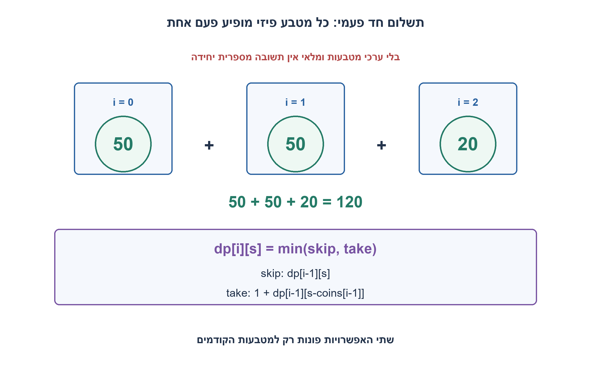
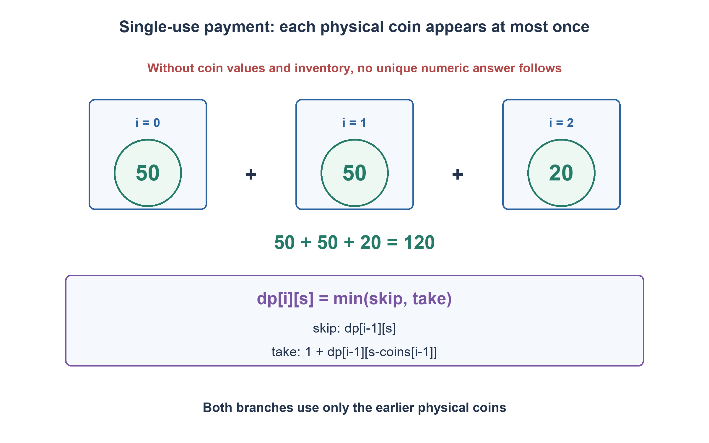

# PREP-271 — תשלום 120 במטבעות חד־פעמיים: מה חסר בשאלה?

פתרון מוצע בסיוע AI; ביקורת מקצועית אנושית ממתינה.

[מקור פרטי](../sources/2026-11-07-batch30-28.png)

סוחר מציע סחורה במחיר 120 מטבעות. מצא מספר מטבעות מינימלי לתשלום 120 בלי להשתמש במטבע פעמיים.

## עברית

סוחר מבקש תשלום מדויק של 120 יחידות. יש למצוא מספר מזערי של מטבעות לתשלום, בלי להשתמש באותו מטבע פעמיים.

א. הסבירו מדוע אין תשובה מספרית יחידה ללא ערכי המטבעות וכמותם. הבדילו בין מטבע פיזי חד־פעמי לבין עריך שמותר לקבל ממנו עותקים רבים.
ב. כהשלמה פרמטרית מפורשת, קבלו רשימה `coins` של מטבעות פיזיים זמינים בעלי ערכים שלמים חיוביים. ערכים שווים מותרים אם מדובר במטבעות שונים. החזירו אינדקסים של קבוצה בעלת מינימום מטבעות שסכומה בדיוק 120, או ציינו שאין פתרון. כל אינדקס מותר פעם אחת לכל היותר. הכלילו ליעד T>=0.
ג. תנו נימוק נכונות, סיבוכיות ומקרה שבו בחירה חמדנית של המטבע הגדול אינה מספיקה. אין להניח בשקט מטבעות בערכי חזקות שתיים או צורך לייצג כל סכום שבין 1 ל־120: אלה דרישות אחרות.

1. מה תהיה התשובה אם ברשותכם מטבע120 אחד, לעומת120 מטבעות שערכם1? שתי האפשרויות מתאימות לנוסח הקצר.
2. אחרי שמחליטים אם לקחת את המטבע ה־i, מה נשאר לפתור בעזרת המטבעות שקדמו לו בלבד?
3. הגדירו dp[i][s] כמינימום לתשלום s בעזרת i המטבעות הראשונים. בשני הענפים משתמשים בשורה i−1, כדי שלא למחזר את אותו מטבע.

### קודם מבררים מה באמת נתון
המילים ״120״ ו״בלי להשתמש במטבע פעמיים״ אינן קובעות מלאי או עריכים. מטבע יחיד שערכו120 נותן תשובה1; רק120 מטבעות שערכם1 נותנים120; מטבע60 יחיד אינו מאפשר תשלום. אם מותר לבחור כל עריך מלכתחילה, בוחרים מטבע120 ומסיימים. אין בסיס לתשובה אוניברסלית כמו7 בלי דרישה נוספת, כגון ייצוג כל הסכומים1..120. נפתור את ההשלמה המוצהרת שבה רשימת המטבעות הפיזיים היא קלט.

### מחלקים להחלטה על מטבע אחרון
נגדיר `dp[i][s]` כמספר המטבעות המינימלי לסכום s מתוך i המטבעות הראשונים, או INF אם אי אפשר. האתחול הוא `dp[0][0]=0` ו־INF לכל s>0. למטבע c שבאינדקס i−1 יש שתי אפשרויות ממצות:

```text
skip = dp[i-1][s]
take = 1 + dp[i-1][s-c]   # only if s>=c and the remainder is reachable
dp[i][s] = min(skip, take)
```

משתמשים בשורה הקודמת גם בלקיחה. לכן המטבע הנוכחי לא יכול להיכנס שוב לתת־הבעיה, וכל אינדקס נבחר לכל היותר פעם אחת. אם שני מטבעות הם60, שני אינדקסים נפרדים מאפשרים120; אם יש רק אינדקס60 יחיד, אין למחזרו. קוד המימוש משתמש ב־INF=n+1, גדול ממספר המטבעות האפשרי בכל פתרון.

אחרי מילוי הטבלה, ערך INF ב־dp[n][T] משמעו שאין פתרון. אחרת הולכים אחורה: אם הערך שווה לערך בשורה הקודמת, לא לוקחים את המטבע; אם קטן ממנו, לוקחים ומחסרים את ערכו מהסכום. בשוויון מותר לבחור כל פתרון מינימלי, והקוד מעדיף דילוג. בטבלה המלאה השורות הקודמות אינן נדרסות, ולכן השחזור אינו עוקב אחר מצביעים שעודכנו מאוחר יותר ועלולים למחזר מטבע בטעות.

### נכונות ועלות
באינדוקציה על i: בלי מטבעות ניתן רק0. לכל תת־קבוצה של i המטבעות, המטבע האחרון חסר או נוכח. במקרה הראשון פתרונה לפחות dp[i−1][s], ובשני הסרתו משאירה תת־קבוצה חוקית של המטבעות הקודמים בסכום s−c ולכן העלות לפחות1+dp[i−1][s−c]. שני הענפים ניתנים למימוש בלי חזרה, ולקיחת המינימום משיגה בדיוק את האופטימום. השחזור עובר לענף ששמר את המינימום ולכן נותן קבוצה באותו גודל ובסכום הנכון.

הזמן הוא `O(n(T+1))` והמקום `O(n(T+1))` במודל מילים עבור הטבלה המאפשרת שחזור. עבורT=120 קבוע שניהם לינאריים ב־n. עבור T כללי זהו אלגוריתם פסאודו־פולינומי בערך היעד, לא פולינומי באורך הייצוג הבינארי שלו. אם מבקשים רק את המספר ולא את המטבעות, אפשר לצמצם ל־O(T+1) מקום ולעדכן סכומים בסדר יורד; עדכון עולה הופך בטעות את החוזה לשימוש חוזר.

חמדנות נכשלת עבור `[6,5,5]` ויעד10: בחירת6 אינה ניתנת להשלמה, אך שני מטבעות5 כן. עבור `[50,50,20]` ויעד120 מוחזרים שלושה מטבעות. יעד0 נותן קבוצה ריקה. אין תשלום ביתר, עודף, ערכים שליליים או מטבעות נוספים מחוץ לרשימה בחוזה הזה.

51,060 מקרי תשלום הושוו לאורקל שמונה תת־קבוצות של אינדקסים פיזיים, כולל מלאים עם כפילויות, אפס יעד, אין פתרון ואיסור מחזור. האימות אינו ממציא אילו מטבעות היו במקור; הוא בודק את הבעיה הפרמטרית המוגדרת.

```python
"""Minimum exact payment from a supplied physical-coin inventory.

Each list index is one physical coin and may appear at most once. Coin values
are positive integers. Equal denominations at different indices are allowed.
Return indices of a minimum-cardinality subset, or None when impossible.
No denomination set or availability is invented from the original prompt.
"""


def minimum_payment_indices(coins, target=120):
    if type(target) is not int or target < 0:
        raise ValueError("target must be a nonnegative integer")
    if any(type(value) is not int or value <= 0 for value in coins):
        raise ValueError("physical coins must have positive integer values")
    n = len(coins)
    impossible = n + 1
    # Keep prior rows immutable so backtracking cannot accidentally reuse a coin.
    rows = [[0] + [impossible] * target]
    for value in coins:
        prior = rows[-1]
        current = prior.copy()
        for amount in range(value, target + 1):
            current[amount] = min(prior[amount], prior[amount - value] + 1)
        rows.append(current)
    if rows[n][target] == impossible:
        return None
    result = []
    amount = target
    for count in range(n, 0, -1):
        if rows[count][amount] != rows[count - 1][amount]:
            result.append(count - 1)
            amount -= coins[count - 1]
    assert amount == 0
    result.reverse()
    return result
```


הוכחת התכנות הדינמי ואורקל תת־הקבוצות מצורפים; אין מקור שסיפק עריכים חסרים.



## English

A merchant requires an exact payment of120 units. Minimize the number of coins without using the same coin twice.

(a) Explain why no unique numerical answer follows without denominations and inventory. Distinguish a single physical coin from unlimited copies of one denomination.
(b) As an explicit parameterized completion, receive a list `coins` of available physical coins with positive integer values. Equal values may appear at distinct indices. Return indices of a minimum-cardinality subset summing exactly to120, or report impossibility. Use each index at most once. Generalize to T>=0.
(c) Prove correctness, analyze cost and give a greedy-failure example. Do not silently assume powers-of-two denominations or a requirement to represent every amount1..120; those are different problems.

1. Compare one120-value coin with120unit coins. Both inventories fit the short source but give different answers.
2. After choosing whether to take coin i, what remains using only earlier physical coins?
3. Let dp[i][s] be the minimum for amount s using the first i coins. Both take/skip branches must use row i−1 to prevent reuse.

### Determine what is actually given
“120” and “do not use a coin twice” specify neither denominations nor inventory. A single120coin needs one coin;120unit coins need120; one60coin cannot pay exactly. If arbitrary denominations can be chosen, one120coin suffices. A universal answer such as seven needs an extra requirement, for example covering every amount1..120. We solve the explicit completion where physical inventory is supplied as input.

### Split on whether the last coin is used
Let `dp[i][s]` be the minimum number for exact amount s from the first i coins, or INF if unreachable. Initialize `dp[0][0]=0`, all positive amounts INF. For current coin value c at index i−1:

```text
skip = dp[i-1][s]
take = 1 + dp[i-1][s-c]   # only if s>=c and the remainder is reachable
dp[i][s] = min(skip, take)
```

The take branch also uses the previous row, so the current index cannot be reused. Two distinct60coins can pay120; a single60coin cannot. INF=n+1 exceeds the size of any legitimate subset.

If dp[n][T] is INF, return impossibility. Otherwise backtrack:if the value matches the previous row, skip this coin; if smaller, take it and subtract its value. Ties may choose any optimal subset; the code prefers skipping. Keeping full prior rows avoids reconstruction pointers later overwritten into an invalid reused-coin chain.

### Correctness and cost
Induct on i. With no coins only0 is possible. Every subset either excludes the final coin, with cost at least dp[i−1][s], or includes it, leaving a legal earlier-coin subset of amount s−c and cost at least1+dp[i−1][s−c]. Both branches are achievable without reuse, so their minimum is exactly optimal. Backtracking follows an attaining branch and reconstructs an optimal exact subset.

Time and space are `O(n(T+1))` in a word model for the full reconstruction table. At fixedT=120 both are linear in n. For variable T the algorithm is pseudopolynomial in target value, not polynomial in its binary encoding length. Count-only DP can use O(T+1) memory with descending amount updates; ascending updates would accidentally allow coin reuse.

Greedy fails for `[6,5,5]`, target10:choosing6 cannot finish, while5+5 succeeds. `[50,50,20]` pays120 with three coins. Target0 returns an empty subset. Overpayment, change, negative values and additional inventory are outside the contract.

51,060 payment cases were compared against independent enumeration of physical-index subsets, including duplicate denominations, zero target, impossibility and forbidden reuse. This validates the declared parameterized problem without inventing the source inventory.

```python
"""Minimum exact payment from a supplied physical-coin inventory.

Each list index is one physical coin and may appear at most once. Coin values
are positive integers. Equal denominations at different indices are allowed.
Return indices of a minimum-cardinality subset, or None when impossible.
No denomination set or availability is invented from the original prompt.
"""


def minimum_payment_indices(coins, target=120):
    if type(target) is not int or target < 0:
        raise ValueError("target must be a nonnegative integer")
    if any(type(value) is not int or value <= 0 for value in coins):
        raise ValueError("physical coins must have positive integer values")
    n = len(coins)
    impossible = n + 1
    # Keep prior rows immutable so backtracking cannot accidentally reuse a coin.
    rows = [[0] + [impossible] * target]
    for value in coins:
        prior = rows[-1]
        current = prior.copy()
        for amount in range(value, target + 1):
            current[amount] = min(prior[amount], prior[amount - value] + 1)
        rows.append(current)
    if rows[n][target] == impossible:
        return None
    result = []
    amount = target
    for count in range(n, 0, -1):
        if rows[count][amount] != rows[count - 1][amount]:
            result.append(count - 1)
            amount -= coins[count - 1]
    assert amount == 0
    result.reverse()
    return result
```


The dynamic-programming proof and independent subset oracle are included; no source supplied the missing denominations.



## Supporting material / חומר משלים

```json
{
  "assumptions": {
    "he": "רשימת מטבעות פיזיים נתונה, ערכים שלמים חיוביים, כל אינדקס חד־פעמי; יעד שלם לא־שלילי ותשלום מדויק, ללא עודף.",
    "en": "Supplied physical inventory, positive integer values, each index used once; nonnegative integer target, exact payment, no change."
  },
  "optimality": {
    "he": "מינימום מספר המטבעות מוכח ברקורסיית שתי אפשרויות. מימוש עם שחזור O(n(T+1)) זמן ומקום; יעד120 קבוע, אך יעד משתנה פסאודו־פולינומי.",
    "en": "Minimum cardinality is proved by the take/skip recurrence. Reconstruction uses O(n(T+1)) time/space;120 is fixed, variable T gives pseudopolynomial cost."
  },
  "verification": {
    "he": "51,060 מקרי מלאי/יעד מול מניית תת־קבוצות בלתי תלויה; אינדקסים ייחודיים, סכום מדויק, מספר מיטבי, כישלון חמדנות ואי־מחזור.",
    "en": "51,060 inventory/target cases against independent subset enumeration; unique indices, exact sums, optimal counts, greedy failure and no reuse."
  },
  "edge_cases": {
    "he": "רשימה ריקה; יעד0; מטבע גדול מהיעד; עריכים שווים; אין פתרון; ערך לא חיובי; יעד גדול וצריכת זיכרון; פתרונות מינימליים רבים.",
    "en": "Empty inventory; zero target; oversized coin; duplicate denominations; impossible target; invalid value; large-target memory; multiple minimum subsets."
  },
  "common_mistakes": {
    "he": "להניח עריכים; להחזיר7 בלי דרישה לכל סכום; לעדכן DP עולה; למחזר60 יחיד; להבטיח חמדנות; לשחזר דרך הורים שנדרסו.",
    "en": "Inventing denominations; answering seven without all-amount coverage; ascending DP; reusing one60coin; assuming greedy; backtracking through overwritten parents."
  },
  "interview_answer": {
    "he": "ללא מלאי אין מספר יחיד. עם מטבעות פיזיים נתונים אבחר מינימום בין דילוג ולקיחה פעם אחת; שתי האפשרויות משתמשות רק במטבעות הקודמים.",
    "en": "Without inventory there is no unique number. Given physical coins, minimize skip versus take-once, with both branches using only earlier coins."
  },
  "source_ambiguities": {
    "he": "הצילום אינו נותן עריכים, מלאי או דרישת כיסוי כל סכום. ההשלמה היא בעיה פרמטרית מוצהרת, לא שחזור של נתון חסר.",
    "en": "The source omits denominations, inventory and all-amount coverage. The completion is explicitly parameterized, not reconstruction of missing facts."
  },
  "solution_extensions": {
    "he": "אם צריך רק מספר מטבעות, צמצמו לשורה אחת ועדכנו בסדר יורד. אם נדרשת מערכת שמכסה כל סכום0..120, זו בעיה אחרת:7 משקולות בינאריות מספיקות וחסם2^m≥121 הכרחי.",
    "en": "For count only, use one row updated descending. Designing coins covering every amount0..120 is different:seven binary weights suffice and2^m≥121 is necessary."
  },
  "technical_references": {
    "he": [
      "הוכחת התכנות הדינמי ואורקל תת־הקבוצות מצורפים; אין מקור שסיפק עריכים חסרים."
    ],
    "en": [
      "The dynamic-programming proof and independent subset oracle are included; no source supplied the missing denominations."
    ]
  }
}
```
