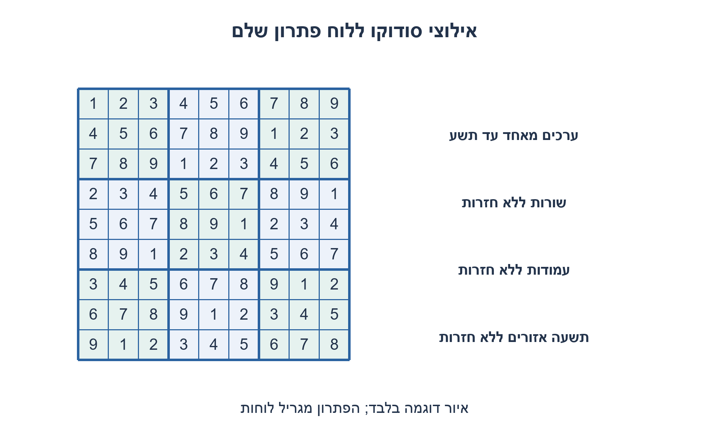
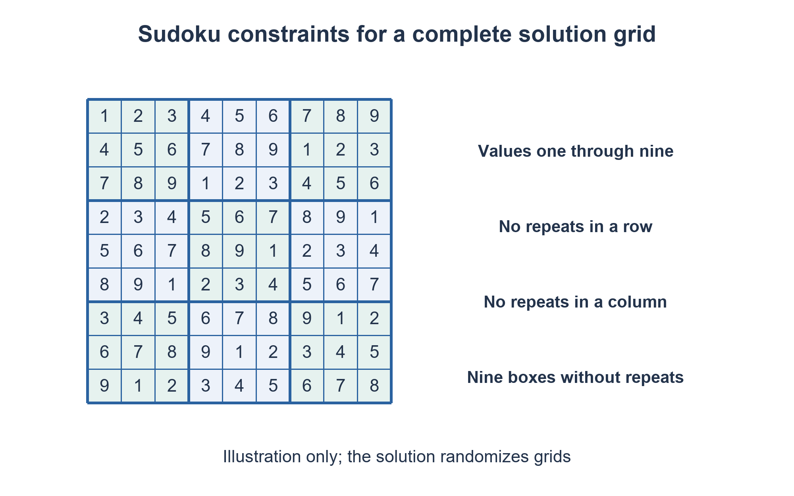

# PREP-272 — אילוצי SystemVerilog להגרלת לוח סודוקו

פתרון מוצע בסיוע AI; ביקורת מקצועית אנושית ממתינה. הקושי אינו מכויל.

[צילום מקור פרטי](../sources/2026-11-07-batch10-09.png)

Write SystemVerilog constraint(s) to generate a 9x9 array of integers with Sudoku rules.

חברות לפי הדיווח בצילום בלבד: Broadcom.

## עברית

כתבו מחלקת SystemVerilog שמגרילה מערך מספרים שלמים9×9 לפי חוקי הסודוקו. הגדירו אילוצי תחום, שורות, עמודות וריבועי3×3, והדגימו טיפול בכישלון randomize ובדיקה עצמאית של התוצאה.

הבהרות שהוספנו: נדרש לוח פתרון מלא, ובו ספרות1..9 ללא חזרות בכל שורה, בכל עמודה ובכל אחד מתשעת האזורים. אין כאן יצירת חידה עם תאים ריקים או דרישת פתרון יחיד לחידה. אין ספרות קבועות מראש ואין דרישה להתפלגות אחידה על פני כל הפתרונות. יש להשתמש באילוצים הצהרתיים; מילוי לוח קבוע בפונקציה רגילה אינו פותר את הדרישה.

1. הגבלת כל תא ל־1..9 אינה מבטיחה תקינות שורה. איזה יחס חייב להתקיים בין תאים החולקים קבוצה?
2. אפשר לעבור על זוגות תאים ולחייב אי־שוויון כאשר הם באותה שורה, עמודה או אזור. איך מונעים השוואת תא לעצמו?
3. סדרו את אינדקסי התאים לפי9r+c והשוו רק כשהראשון קטן מהשני. שני תאים באותו אזור אם r/3 שווה וגם c/3 שווה.

### מגדירים מה חוקי, וה־solver בוחר ערכים
המערך הוא `rand int unsigned board[9][9]`. אילוץ התחום מחייב שכל תא יהיה בין1 ל־9. שני תאים הם שכנים לאילוץ אם הם חולקים שורה, עמודה או אזור3×3; לכל זוג כזה מחייבים ערכים שונים.

אינדקס שטוח `9r+c` מאפשר להשוות רק זוגות בסדר עולה. כך לא משווים תא לעצמו ולא מכפילים את אותו זוג. החברות באזור נבדקת על ידי חילוק שלם: `r/3==r2/3 && c/3==c2/3`. לא נדרשים אופרטור unique או מתודות הפחתה שאיכות התמיכה בהן תלויה בכלי.

לכל תא יש20 שכנים שונים:8 בשורה,8 בעמודה ו־4 נוספים באזור. לכן קיימים81·20/2=810 זוגות שכנים שונים, בנוסף81 אילוצי תחום. לולאות foreach בוחנות81² זוגות, אך תנאי הסדר והשכנות משאיר את810 הזוגות הנדרשים. לכל שורה תשעה ערכים שונים מתוך תשעה מספרים אפשריים, לכן היא מכילה את כל1..9 בדיוק פעם אחת; אותו נימוק מוכיח גם עמודות ואזורים.

הדוגמה קוראת `randomize()` ובודקת את ערך ההחזרה. כישלון יכול לנבוע מאילוצים סותרים או מבעיית כלי/solver; אין להציג לוח קודם כאילו הוגרל בהצלחה. בודק חיצוני יוצר בנפרד את27 הקבוצות ומשווה כל אחת לקבוצה{1..9}; הוא אינו מסתפק בסכום45, שאינו שולל חזרות.

המחלקה מכילה אילוצים סינתטיים עבור testbench, ואינה RTL בר־סינתזה של פותר סודוקו. נדרש סימולטור התומך במחלקות, randomization ו־constraint solving; יכולת קומפילציה של RTL ב־Icarus אינה מספיקה. בהרצה המצורפת השתמשנו ב־Verilator וב־Z3 מקומי. שישה לוחות תקינים מוכיחים שהמימוש רץ בסביבה שנבדקה; הם אינם מוכיחים בחירה אחידה מכל הלוחות או זמן פתרון חסום לכל אילוץ עתידי.

לוח מלא אינו בהכרח חידה מעניינת: כדי ליצור חידה מסירים מספרים ובודקים בנפרד יחידות פתרון. זו הרחבה אחרת. PREP-245 מקבל חידה ומחפש פתרון; כאן מגדירים מרחב לוחות חוקיים להגרלה.

### קוד SystemVerilog; תוצאות סימולציה בדוח נפרד

```systemverilog
// Complete 9x9 solution grids, not partially filled puzzles.
class sudoku_board_batch1107b10;
 rand int unsigned board[9][9];
 constraint domain {
   foreach(board[r,c]) board[r][c] inside {[1:9]};
 }
 constraint peers {
   foreach(board[r,c]) foreach(board[r2,c2])
     if ((r*9+c < r2*9+c2) &&
         ((r==r2) || (c==c2) ||
          ((r/3==r2/3) && (c/3==c2/3))))
       board[r][c] != board[r2][c2];
 }
endclass

module prep272_sudoku_tb_batch1107b10;
 sudoku_board_batch1107b10 item;
 integer sample,r,c;
 initial begin
   item=new;
   for(sample=0;sample<2;sample=sample+1) begin
     if(item.randomize()==0) $fatal(1,"Sudoku constraint solver failed");
     $display("BOARD %0d",sample);
     for(r=0;r<9;r=r+1) begin
       for(c=0;c<9;c=c+1) $write("%0d ",item.board[r][c]);
       $write("\n");
     end
   end
   $display("PASS generated 2 boards");
   $finish;
 end
endmodule
```




### assumptions

```json
[
  "מערך9×9 של int unsigned; תחום1..9; ללא תאים נתונים מראש.",
  "לוח פתרון מלא, בלי דרישת אחידות או יצירת חידה יחידה."
]
```

### optimality

81 משתני מספר שלם,81 אילוצי תחום ו־810 זוגות שכנים שונים. הרחבת הלולאות בוחנת6561 זוגות. זמן פתרון תלוי ב־solver; אין הבטחת O(1) רק מפני שגודל הלוח קבוע.

### verification

אימות ממשי: הקוד קומפל ב־Verilator5.032 ונקרא solver מקומי Z3 4.13.3, במכונה מבודדת עם רשת חסומה. הוגרלו שישה לוחות, שניים לכל seed11,37,101; בודק Python בלתי תלוי אימת לכל לוח9 שורות,9 עמודות ו־9 אזורים,162 קבוצות בסך הכול. בודק התקינות עצמו עבר82 מקרי קבלה/דחייה. Icarus שימש לתרגילי RTL האחרים, לא לפתרון אילוצי המחלקה. ראיה: checks/batch1107b10-native-verification.json. שישה לוחות אינם הוכחת אחידות סטטיסטית ואינם בדיקה של כל הלוחות האפשריים.

### edge_cases

```json
[
  "לוח חוקי מול ערך0/10, כפילות שורה, עמודה או אזור.",
  "כישלון randomize; כמה הגרלות; seed זהה לעומת שונה."
]
```

### common_mistakes

אילוץ סכום45 בלבד; השוואת תא לעצמו; אזור לפי שארית בחלוקה3 במקום חלוקה שלמה; התעלמות מערך randomize; טענה שהלוחות אחידים.

### interview_answer

אגריל81 תאים בתחום1..9 ואחייב אי־שוויון לכל זוג באותה שורה, עמודה או קופסה. אבדוק randomize ואז אאמת27 קבוצות באופן עצמאי.

### source_ambiguities

המקור אומר רק ליצור מערך לפי חוקי סודוקו. בחירת לוח פתרון מלא, היעדר נתונים קבועים וטיפול בכישלון הוגדרו כהשלמות לימודיות.

### solution_extensions

```json
{
  "question": "איך מכניסים מספרים קבועים של חידה?",
  "direction": "הוסיפו אילוצי שוויון לתאים הנתונים ובדקו אם יש פתרון; הצלחת randomize אינה מוכיחה יחידות פתרון.",
  "tests": [
    "נתונים סותרים באותה שורה",
    "חידה בעלת כמה פתרונות",
    "חידה בעלת פתרון יחיד"
  ]
}
```

## English

Write a SystemVerilog class that randomizes a9×9 integer array satisfying Sudoku rules. Constrain the domain, rows, columns and3×3 boxes, and demonstrate randomize failure handling plus independent result validation.

Added clarifications: generate a complete solution grid with digits1..9 appearing without repetition in every row, column and box. This is not a partially filled puzzle generator or a unique-puzzle requirement. There are no givens and no uniform-distribution requirement over all solutions. Use declarative constraints; procedurally filling a fixed grid does not satisfy the request.

1. A1..9 domain alone does not make a valid row. What relation must hold between peer cells?
2. Constrain unequal values for cell pairs sharing a row, column or box. How do you avoid comparing a cell with itself?
3. Order cells by9r+c and constrain only increasing pairs. A shared box means equal integer row/3 and column/3 indices.

### Describe legality; let the solver choose values
Declare `rand int unsigned board[9][9]`. Domain constraints require every cell to lie in1..9. Two cells are peers when they share a row, column or3×3 box; each peer pair must have different values.

The flat index `9r+c` orders pairs, eliminating self-comparisons and duplicate constraints. Integer division identifies a shared box: `r/3==r2/3 && c/3==c2/3`. No unique operator or reduction method with tool-dependent support is needed.

Each cell has20 distinct peers:8 row peers,8 column peers and4 additional box peers. Thus there are81·20/2=810 unique inequalities plus81 domain constraints. The foreach loops consider81² pairs, but order and peer conditions retain the810 required pairs. Nine distinct values from the nine permitted digits imply each row contains exactly1..9; the same proof covers columns and boxes.

Check the return from `randomize()`. Failure can result from contradictory constraints or a tool/solver problem; never present a stale board as successfully randomized. An external checker independently constructs27 groups and compares each to{1..9}; sum45 alone is insufficient to reject repetitions.

The class is testbench constraint code, not synthesizable Sudoku-solving RTL. It needs class, randomization and constraint-solving support; Icarus RTL compilation is insufficient. The recorded execution used Verilator with local Z3. Six valid boards demonstrate execution in that environment, not uniform sampling of all boards or a bounded solving time for arbitrary added constraints.

A full board is not a puzzle-generation algorithm: removing givens and checking uniqueness requires a separate solver. PREP-245 accepts a puzzle and searches for a solution; here we declare the legal solution space for random generation.

### SystemVerilog; simulation results are in a separate report

```systemverilog
// Complete 9x9 solution grids, not partially filled puzzles.
class sudoku_board_batch1107b10;
 rand int unsigned board[9][9];
 constraint domain {
   foreach(board[r,c]) board[r][c] inside {[1:9]};
 }
 constraint peers {
   foreach(board[r,c]) foreach(board[r2,c2])
     if ((r*9+c < r2*9+c2) &&
         ((r==r2) || (c==c2) ||
          ((r/3==r2/3) && (c/3==c2/3))))
       board[r][c] != board[r2][c2];
 }
endclass

module prep272_sudoku_tb_batch1107b10;
 sudoku_board_batch1107b10 item;
 integer sample,r,c;
 initial begin
   item=new;
   for(sample=0;sample<2;sample=sample+1) begin
     if(item.randomize()==0) $fatal(1,"Sudoku constraint solver failed");
     $display("BOARD %0d",sample);
     for(r=0;r<9;r=r+1) begin
       for(c=0;c<9;c=c+1) $write("%0d ",item.board[r][c]);
       $write("\n");
     end
   end
   $display("PASS generated 2 boards");
   $finish;
 end
endmodule
```




### assumptions

```json
[
  "A9×9 unsigned integer array; domain1..9; no givens.",
  "A complete solution grid, with no uniformity or unique-puzzle requirement."
]
```

### optimality

81 integer variables,81 domain constraints and810 unique peer inequalities. Loop expansion considers6561 pairs. Solving time depends on the solver; a fixed board size does not justify a practical constant-time guarantee.

### verification

Executed verification: Verilator5.032 compiled the code and invoked local Z3 4.13.3 in a network-denied isolated VM. Six grids were generated, two each for seeds11,37,101. An independent Python validator checked all nine rows, nine columns and nine boxes per board,162 groups total. The validator itself passed82 acceptance/rejection cases. Icarus ran the other RTL exercises, not this class-constraint solver. Evidence: checks/batch1107b10-native-verification.json. Six grids do not prove uniform sampling or exhaust all possible solutions.

### edge_cases

```json
[
  "Valid boards versus0/10 values and row, column or box duplicates.",
  "Randomize failure, repeated draws and equal/different seeds."
]
```

### common_mistakes

Only constraining sum45; self-inequality; using modulo3 instead of integer division for boxes; ignoring randomize failure; claiming uniform output.

### interview_answer

Randomize81 cells in1..9 and constrain every row/column/box peer pair unequal. Check randomize, then independently validate27 groups.

### source_ambiguities

The source only requests a Sudoku array. A complete solution grid, no givens and explicit failure handling are added teaching assumptions.

### solution_extensions

```json
{
  "question": "How can puzzle givens be added?",
  "direction": "Constrain the specified cells equal to their givens and check satisfiability; a successful randomize does not prove uniqueness.",
  "tests": [
    "Conflicting row givens",
    "Multiple-solution puzzle",
    "Unique-solution puzzle"
  ]
}
```
