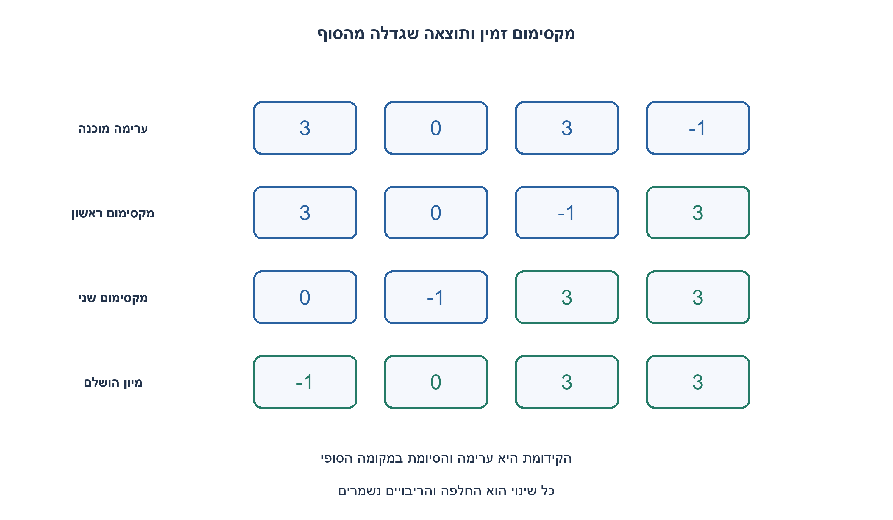
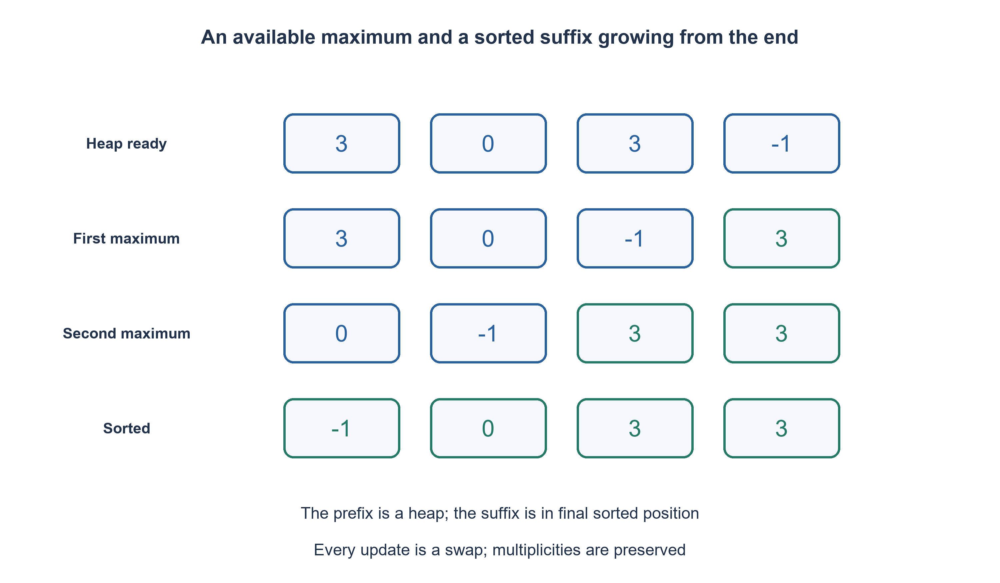

# PREP-273 — מיון מערך של מספרים: פונקציה כללית, נכונות ועלות

פתרון מוצע בסיוע AI; ביקורת מקצועית אנושית ממתינה. הקושי אינו מכויל.

## עברית

ממשו פונקציה הממיינת מערך של מספרים, והסבירו כיצד היא עובדת, למה היא נכונה ומה העלות שלה.

המקור אינו מפרט שפה, סדר, זיכרון או סוג ערכים. נבחר חוזה מפורש: רשימת מספרים שלמים, כולל שליליים, אפסים וכפילויות; מיון בסדר לא יורד בתוך אותה רשימה והחזרתה. אין להשתמש ב־ sort או sorted או במערך עזר בגודל הקלט. נדרש O(n log n) זמן במקרה הגרוע ו־ O(1) מילות עזר, ללא רקורסיה. אין דרישת יציבות. טיב הערכים מובטח על ידי הקורא.

1. אם אפשר להביא את הגדול ביותר לתחילת אזור העבודה, לאן כדאי להעביר אותו בתוצאה הסופית?
2. שמרו את האזור שעוד לא מוין כמבנה שבו כל הורה גדול או שווה לילדיו. הגדול יהיה בשורש.
3. בנו max-heap בתוך המערך. החליפו את השורש עם סוף אזור העבודה, הקטינו את האזור ותקנו את השורש בירידה איטרטיבית. הסיומת הממוינת גדלה בכל סיבוב.

### שומרים את המקסימום זמין בלי למיין מחדש הכול
נייצג עץ בינארי בתוך הרשימה: לילדיו של אינדקס i יש אינדקסים 2 i+1 ו־ 2 i+2. ב־ max-heap כל הורה גדול או שווה לילדיו. לכן השורש מחזיק מקסימום, גם כשהאחים ושאר תת־העצים אינם ממוינים זה מול זה.

תחילה בונים heap מלמטה: העלים כבר תקינים, ולכל הורה מבצעים sift_down אחרי שילדיו תוקנו. בירידה בוחרים את הילד הגדול, ואם ההורה קטן ממנו מחליפים וממשיכים אל הילד. ההחלפה מתקנת את הרמה הנוכחית ומשאירה לכל היותר הפרה אחת בהמשך הנתיב; כשהירידה מסתיימת תת־העץ הוא heap. אין רקורסיה או רשימת צמתים נוספת.

כעת מחליפים את המקסימום בשורש עם האיבר האחרון באזור הפעיל. האיבר שהוצא נמצא במקום הסופי שלו; מוציאים אותו מאזור ה־ heap ומתקנים רק את השורש החדש. חוזרים עד שנותר איבר אחד. למשל [3, −1,3,0] נעשה תחילה heap כמו [3,0,3, −1]; הוצאת המקסימום שוב ושוב נותנת [−1,0,3,3]. הערכים החוזרים אינם נעלמים: כל פעולה היא החלפה בלבד.

האינווריאנט בשלב ההוצאה: הקידומת הפעילה היא heap, הסיומת ממוינת בסדר לא יורד, וכל ערך בקידומת אינו גדול מהערכים שכבר בסיומת. הוצאת המקסימום הבא משמרת את שלושת התנאים. כשאזור העבודה נגמר, כל הרשימה ממוינת ושומרת בדיוק על ריבויי הקלט. זהות אובייקט הרשימה נשמרת, אך סדר מופעים שווי־ערך אינו מובטח.

בניית heap מלמטה עולה O(n): מספר הצמתים בגובה h קטן בסדר גודל n/2^(h+1), וסכום עבודות הירידה פרופורציוני ל־ n·Σh/2^(h+1). כל אחת מעד n−1 הוצאות עולה O(log n), ולכן זמן גרוע־ביותר O(n log n). מספר המשתנים והעומק האיטרטיבי קבועים: O(1) מילות עזר. זה אופטימלי אסימפטוטית למיון כללי המבוסס על השוואות, כי עבור n ערכים שונים יש n! סדרים להבחין ביניהם, ונדרשות Ω(log(n!))=Ω(n log n) השוואות במקרה הגרוע. אין טענה שזה מהיר מכל מימוש בכל קלט או אופטימלי תחת טווח ערכים קטן שמאפשר מיון ספירה.

רשימה ריקה או יחידנית חוזרת כפי שהיא. נבדקו 10,085 קלטים מול מיון עצמאי, לרבות כל 9,841 הרשימות באורכים 0..8 מעל שלושה ערכים, כפילויות, סדר הפוך ושלמים גדולים. בדיקות הפלט אינן מחליפות את הוכחת העלות. בחישוב על שלמים בלתי חסומים גם עלות ההשוואה גדלה עם רוחבם.

```python
"""In-place ascending comparison sort; integer inputs promised, not stable."""


def sort_array(values):
    def sift_down(root, end):
        while 2 * root + 1 < end:
            child = 2 * root + 1
            if child + 1 < end and values[child + 1] > values[child]:
                child += 1
            if values[root] >= values[child]:
                break
            values[root], values[child] = values[child], values[root]
            root = child

    n = len(values)
    for root in range(n // 2 - 1, -1, -1):
        sift_down(root, n)
    for end in range(n - 1, 0, -1):
        values[0], values[end] = values[end], values[0]
        sift_down(0, end)
    return values
```




## English

Implement a function that sorts an array of numbers. Explain its operation, correctness and cost.

The source does not specify language, order, memory or numeric type. Choose an explicit contract: a list of integers, including negatives, zeroes and duplicates; sort nondecreasingly in the same list and return it. Do not call sort/sorted or allocate an input-sized auxiliary array. Require worst-case O(n log n) time and O(1) auxiliary words without recursion. Stability is not required. Integer validity is promised by the caller.

1. If the largest remaining value is available at the front, where should it go in the final array?
2. Maintain the unsorted region so each parent is at least its children; the root is then largest.
3. Build an in-array max-heap. Swap the root with the active region's end, shrink that region and sift the root down iteratively. The sorted suffix grows each round.

### Keep the maximum available without repeatedly sorting everything
Represent a binary tree inside the list: index i has children 2 i+1 and 2 i+2. A max-heap has every parent at least as large as its children. The root is therefore a maximum, even though siblings and separate subtrees are not globally ordered.

Build the heap bottom-up. Leaves are already heaps; sift each parent down after its children have been repaired. Choose the larger child and swap when it exceeds the parent. This repairs the current level and leaves at most one violation farther down the path. At termination the whole subtree is a heap. No recursion or additional node array is used.

Swap the root maximum with the last active element. That extracted value is in its final position; exclude it from the heap and repair only the new root. Repeat until one active element remains. For example [3, -1,3,0] can first become heap [3,0,3, -1], and successive extractions produce [-1,0,3,3]. Repeated values are preserved because every operation is a swap.

Extraction invariant: the active prefix is a heap, the suffix is nondecreasing, and no active value exceeds the already extracted suffix values. Moving the next maximum to the suffix preserves all three properties. When no work remains, the entire list is sorted with exactly the original multiplicities. The same list object is returned, but equal-valued occurrences are not promised stable order.

Bottom-up heap construction costs O(n): the number of nodes at height h is on the order of n/2^(h+1), so total sift work is bounded by n times a convergent sum of h/2^(h+1). Each of at most n−1 extractions costs O(log n), for worst-case O(n log n) overall. A fixed number of variables and iterative depth give O(1) auxiliary words. This is asymptotically optimal for general comparison sorting: n distinct values have n! possible orders, requiring Omega(log(n!))=Omega(n log n) worst-case comparisons. It does not mean this implementation is fastest on every input or optimal when a small numeric domain permits counting sort.

Empty and singleton lists return unchanged. Executed checks compare 10,085 inputs with an independent sort, including all 9,841 short three-value lists, duplicates, reversed order and large integers. Output checks do not replace the complexity proof. Comparing unbounded integers also has width-dependent cost.

```python
"""In-place ascending comparison sort; integer inputs promised, not stable."""


def sort_array(values):
    def sift_down(root, end):
        while 2 * root + 1 < end:
            child = 2 * root + 1
            if child + 1 < end and values[child + 1] > values[child]:
                child += 1
            if values[root] >= values[child]:
                break
            values[root], values[child] = values[child], values[root]
            root = child

    n = len(values)
    for root in range(n // 2 - 1, -1, -1):
        sift_down(root, n)
    for end in range(n - 1, 0, -1):
        values[0], values[end] = values[end], values[0]
        sift_down(0, end)
    return values
```




## חומר משלים / Supporting material

```json
{
  "assumptions": {
    "he": "השלמות שבחרנו: רשימת שלמים, סדר עולה, שינוי במקום, בלי builtin וללא יציבות; התחום אינו מצומצם ל־ 0/1/2.",
    "en": "Chosen completions: integer list, ascending in-place mutation, no built-in sort and no stability; values are not restricted to 0/1/2."
  },
  "optimality": {
    "he": "O(n log n) גרוע־ביותר ו־ O(1) מילים; אופטימלי אסימפטוטית במודל השוואות, לא בכל מודל ערכים.",
    "en": "Worst-case O(n log n), O(1) words; asymptotically optimal in the comparison model, not every numeric model."
  },
  "verification": {
    "he": "10,085 קלטים מול sorted כאורקל בדיקה בלבד, זהות הרשימה ובדיקת AST שאין sort/sorted במימוש.",
    "en": "10,085 inputs versus sorted as a test-only oracle, list identity and AST absence of sort/sorted in the implementation."
  },
  "edge_cases": {
    "he": "ריק; יחיד; כל הערכים זהים; מספרים שליליים; סדר הפוך; שלמים גדולים.",
    "en": "Empty; singleton; homogeneous; negatives; reversed; large integers."
  },
  "common_mistakes": {
    "he": "להשתמש ב־ heap חיצוני למרות מגבלת המקום; להשאיר את סוף הרשימה בתוך אזור התיקון; לטעון ליציבות.",
    "en": "Allocating an external heap despite the space constraint; repairing through the sorted suffix; claiming stability."
  },
  "interview_answer": {
    "he": "אבנה max-heap בתוך הרשימה ואוציא בכל פעם את המקסימום לסופה. תיקון איטרטיבי שומר על המקום הקבוע.",
    "en": "Build an in-array max-heap and repeatedly move its maximum to the end; iterative repair preserves constant extra words."
  },
  "source_ambiguities": {
    "he": "הצילום אומר רק לממש מיון בפונקציה. סדר, טיפוס, מגבלת מקום והיעדר built-in הם בחירת תרגול מפורשת.",
    "en": "The screenshot only asks for a sorting function; order, type, space and no-built-in constraints are explicit exercise choices."
  },
  "solution_extensions": {
    "he": [
      {
        "question": "מה אם נדרשת יציבות?",
        "answer_direction": "אפשר לבחור merge sort עם מערך עזר לינארי, או לדון באלגוריתם יציב במקום ובמחירו; אין להציג heapsort רגיל כיציב.",
        "principle": "אופטימליות תלויה במודל ההשוואה ובאילוצי הזיכרון."
      }
    ],
    "en": [
      {
        "question": "What if stability is required?",
        "answer_direction": "Choose merge sort with linear auxiliary storage or analyze a stable in-place alternative and its cost; ordinary heapsort is not stable.",
        "principle": "Optimality depends on the comparison model and memory constraints."
      }
    ]
  }
}
```
