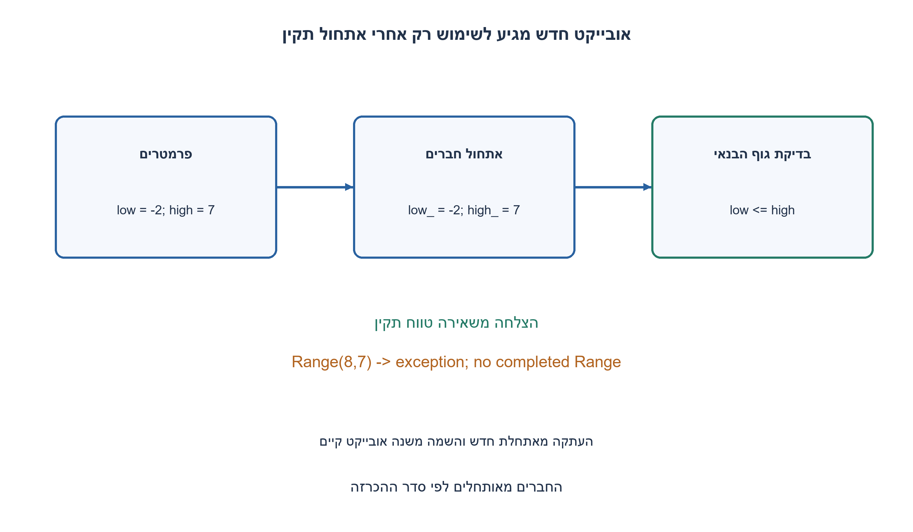
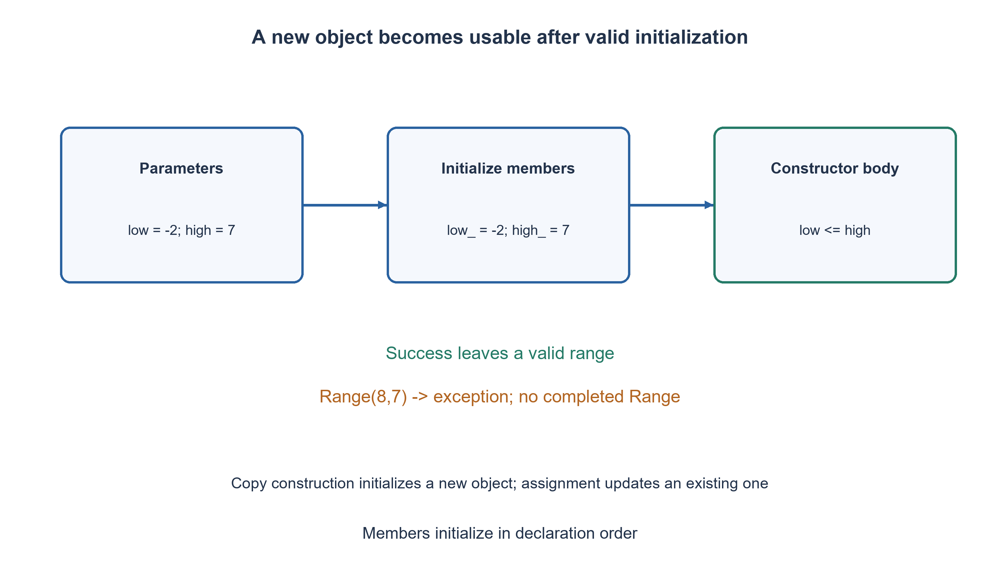

# PREP-274 — מהו בנאי ב־ C++ ואיך הוא יוצר אובייקט במצב תקין?

פתרון מוצע בסיוע AI; ביקורת מקצועית אנושית ממתינה. הקושי אינו מכויל.

## עברית

מהו constructor ולמה הוא משמש? הסבירו מתי הוא מופעל, מה ההבדל בין אתחול להשמה ואיך מבטיחים שאובייקט מתחיל במצב תקין. הציגו בנאי ברירת מחדל ובנאי עם פרמטרים, ודונו בכישלון בנייה.

בחוזה התרגיל נבחר במפורש constructor בשפת C++17. לדוגמה נשתמש בטווח עם שני קצוות int32_t שחייבים לקיים low≤high. בנאי הפרמטרים דוחה טווח הפוך באמצעות חריגה; ברירת המחדל היא [0,0]. אין דרישה להקצאת זיכרון ידנית.

1. איזה תנאי חייב להתקיים ברגע שאפשר להתחיל להשתמש באובייקט?
2. אתחלו את השדות לפני גוף הבנאי, ואל תתנו לבנייה להסתיים בהצלחה אם התנאי אינו מתקיים.
3. השתמשו ברשימת אתחול ל־ low_, high_, בבנאי ברירת מחדל שמאציל ל־ Range(0,0), ובחריגה כש־ low>high. הבדילו בין Range b(a) לבין b=a.

### בנאי הוא שלב האתחול של אובייקט חדש
ב־ C++ לבנאי יש שם המחלקה ואין לו טיפוס החזרה, אפילו לא void. הוא נקרא כאשר נוצר אובייקט מהמחלקה, גם כמשתנה מקומי וגם כחלק מאובייקט אחר; בנאי אינו שם נרדף ל־ new. את הקצאת האחסון ואת אתחול האובייקט צריך להבדיל. כמה בנאים יכולים לקבל פרמטרים שונים, והקומפיילר בוחר לפי כללי overload.

נבחר תנאי פשוט שאפשר לבדוק: Range שומר קצה תחתון ועליון, וכל אובייקט שבנייתו הסתיימה חייב לקיים low≤high. רשימת האתחול `: low_(low), high_(high)` מאתחלת את החברים לפני גוף הבנאי. הגוף בודק את היחס וזורק invalid_argument אם הוא שגוי. ברירת המחדל מאצילה ל־ Range(0,0), ולכן אינה משכפלת את כללי האתחול.

לדוגמה Range a(-2,7) נבנה ומחזיר span=9; Range b(a) מאתחל אובייקט חדש בעזרת בנאי העתקה שנוצר אוטומטית עבור שדות הערך. לעומת זאת b=a היא השמה לאובייקט שכבר קיים. Range(8,7) זורק ולא מתקבל אובייקט Range שהושלם במצב פסול. כאשר בנאי הפרמטרים הלא־מאציל הזה זורק, אין קריאת destructor של Range שלם; תתי־אובייקטים שכבר נבנו מנוקים במסגרת unwinding. לכן מנהלים משאבים באמצעות חברי RAII, במקום לסמוך על cleanup ידני בגוף בנאי שעלול להיכשל.

### סדר אתחול אינו סדר כתיבת הרשימה
בסיסים וחברי מחלקה נבנים לפני גוף הבנאי. חברים נבנים לפי סדר הכרזתם במחלקה, לא לפי הסדר שבו נכתבו ברשימת האתחול. לכן נכתוב את הרשימה באותו סדר ונימנע מתלות בחבר שעוד לא אותחל. חברי const והפניות דורשים אתחול מתאים, ואינם ניתנים לתיקון מאוחר באמצעות השמה רגילה. בנאי ברירת מחדל אינו מבטיח שכל מספר פרימיטיבי אופס: צריך default member initializer או אתחול מפורש בהתאם למקרה. הכרזת בנאי עם פרמטרים אינה מבטיחה שנוצר גם בנאי ברירת מחדל לשימוש ללא ארגומנטים.

בקוד זה span מחשב את ההפרש לאחר הרחבה ל־ int64_t, כך שגם שני קצוות int32_t קיצוניים נותנים 4,294,967,295 בלי חיסור int32_t שגולש. העלות בדוגמה קבועה: שני שדות ובדיקה אחת. אין כלל שכל בנאי הוא O(1): בנאי שמעתיק n איברים או מקצה מבנה עשוי לעלות O(n) ומעלה. המחלקה אינה מחזיקה הקצאה, ולכן אינה צריכה destructor ידני; העתקה והשמה לפי ערך מתאימות לה. בנאי אינו יכול להיות virtual, וקריאה למתודה וירטואלית בזמן בניית בסיס אינה מפעילה התנהגות של תת־מחלקה שטרם נבנתה.

רתמת C++17 מצורפת ובודקת בנייה תקינה, דחיית טווחים הפוכים, ברירת מחדל, העתקה, השמה וגבולות int32_t. תוצאות הידור והרצה נשמרות בנפרד מבדיקות מודל Python. זוהי שאלה על אתחול כללי; שאלת Copy Constructor המקושרת מרחיבה בנפרד על בעלות משאבים.

```cpp
#ifndef PREP_274_CONSTRUCTOR_BATCH1107B10_HPP
#define PREP_274_CONSTRUCTOR_BATCH1107B10_HPP
#include <cstdint>
#include <stdexcept>

// Every successfully constructed Range has low() <= high(). No heap ownership.
class Range {
public:
    Range() : Range(0, 0) {}

    Range(std::int32_t low, std::int32_t high) : low_(low), high_(high) {
        if (low > high) {
            throw std::invalid_argument("low must not exceed high");
        }
    }

    std::int32_t low() const noexcept { return low_; }
    std::int32_t high() const noexcept { return high_; }
    std::int64_t span() const noexcept {
        return static_cast<std::int64_t>(high_) - static_cast<std::int64_t>(low_);
    }

private:
    std::int32_t low_;
    std::int32_t high_;
};
#endif
```




## English

What is a constructor and what is it for? Explain when it runs, initialization versus assignment, and how it establishes a valid initial object state. Show default and parameterized constructors and discuss construction failure.

For this exercise explicitly choose a constructor in C++17. Use a Range with int32_t endpoints requiring low≤high. A parameterized constructor rejects a reversed interval by exception; the default is [0,0]. Manual memory allocation is not required.

1. What must already be true when an object becomes usable?
2. Initialize fields before the constructor body and do not let construction succeed if its invariant fails.
3. Use a member initializer list for low_/high_, delegate the default to Range(0,0), and throw for low>high. Distinguish Range b(a) from b=a.

### A constructor initializes a new object
In C++, a constructor has the class name and no return type, not even void. It runs when a class object is created, including local variables and members of another object; constructor does not mean new. Distinguish allocating storage from initializing the object. Constructors may be overloaded for different parameters, selected by overload resolution.

Choose a checkable invariant: every successfully constructed Range has low≤high. The member initializer list `: low_(low), high_(high)` initializes both members before the body. The body rejects a reversed interval with invalid_argument. The default constructor delegates to Range(0,0), avoiding duplicated initialization rules.

Range a(-2,7) succeeds and span returns nine. Range b(a) initializes a new object using the implicitly generated copy constructor for these value members; b=a instead assigns an already existing object. Range(8,7) throws, so no completed Range with an invalid invariant is produced. When this nondelegating parameterized constructor throws, no complete Range destructor runs; already constructed subobjects are cleaned up during unwinding. Resource-owning members should therefore use RAII rather than rely on manual cleanup in a constructor body that may throw.

### Initialization follows declarations, not initializer-list spelling
Bases and members are initialized before the body. Members follow their declaration order in the class, regardless of the order written in the member initializer list. Write both consistently and avoid depending on a not-yet-initialized member. Const and reference members need appropriate initialization rather than later ordinary assignment. A default constructor does not by itself guarantee primitive numeric members are zero: use suitable default member initializers or explicit initialization. Declaring a parameterized constructor does not guarantee an available no-argument default constructor.

span widens operands to int64_t before subtraction, so the extreme int32_t endpoints yield 4,294,967,295 without int32_t overflow. This example has constant cost: two fields and one comparison. Constructors in general are not O(1); copying n elements or allocating a data structure can cost O(n) or more. This class owns no allocation and needs no handwritten destructor; value copying/assignment are suitable. Constructors cannot be virtual, and a virtual call during base construction does not dispatch to behavior in a derived object that has not yet been constructed.

The C++17 harness checks valid construction, rejection of reversed intervals, defaults, copying, assignment and int32_t boundaries. Native compilation/execution evidence is separate from Python model checks. This general initialization question is distinct from the linked copy-constructor ownership exercise.

```cpp
#ifndef PREP_274_CONSTRUCTOR_BATCH1107B10_HPP
#define PREP_274_CONSTRUCTOR_BATCH1107B10_HPP
#include <cstdint>
#include <stdexcept>

// Every successfully constructed Range has low() <= high(). No heap ownership.
class Range {
public:
    Range() : Range(0, 0) {}

    Range(std::int32_t low, std::int32_t high) : low_(low), high_(high) {
        if (low > high) {
            throw std::invalid_argument("low must not exceed high");
        }
    }

    std::int32_t low() const noexcept { return low_; }
    std::int32_t high() const noexcept { return high_; }
    std::int64_t span() const noexcept {
        return static_cast<std::int64_t>(high_) - static_cast<std::int64_t>(low_);
    }

private:
    std::int32_t low_;
    std::int32_t high_;
};
#endif
```




## חומר משלים / Supporting material

```json
{
  "assumptions": {
    "he": "פירוש מפורש: C++17, טווח עם קצוות int32_t, חריגה בכישלון; זו דוגמה נבחרת ולא נתונים מהמקור.",
    "en": "Explicit interpretation: C++17, int32_t Range endpoints and exception on failure; this example is chosen, not source-supplied."
  },
  "optimality": {
    "he": "בדוגמה O(1) זמן ואחסון לשני שדות; בנאים כלליים אינם בהכרח בעלי עלות קבועה.",
    "en": "The two-field example uses O(1) time/storage; constructors in general need not have constant cost."
  },
  "verification": {
    "he": "רתמת C++17 בודקת 627 מקרי ברירת מחדל/קצוות/טווחים/העתקה/השמה. ראיות הידור בנפרד.",
    "en": "A C++17 harness covers 627 default/boundary/range/copy/assignment cases; native execution evidence is separate."
  },
  "edge_cases": {
    "he": "low=high; טווח הפוך; בנאי חסר ללא ארגומנטים; חברים שלא אותחלו; כשל בניית חבר משאב.",
    "en": "Equal endpoints; reversed range; unavailable default constructor; uninitialized members; failure while constructing a resource member."
  },
  "common_mistakes": {
    "he": "לכתוב void לפני הבנאי; לחשוב שבנאי הוא הקצאה; להניח סדר אתחול לפי הרשימה; לערבב העתקה והשמה.",
    "en": "Giving a constructor return type void; equating construction with allocation; trusting initializer-list order; conflating copy initialization and assignment."
  },
  "interview_answer": {
    "he": "בנאי מאתחל אובייקט חדש ומבסס את האינווריאנט שלו. אתחול חברים מתרחש לפני הגוף; כישלון יכול למנוע השלמת אובייקט פסול.",
    "en": "A constructor initializes a new object and establishes its invariant. Members initialize before the body; failure can prevent completion of an invalid object."
  },
  "source_ambiguities": {
    "he": "constractor פורש כ־ constructor. השפה, המחלקה והמדיניות בכישלון נבחרו במפורש משום שלא הופיעו בצילום.",
    "en": "The misspelling constractor is interpreted as constructor; language, class and failure policy are explicit completions absent from the screenshot."
  },
  "solution_extensions": {
    "he": [
      {
        "question": "איך משתנה התשובה למחלקה שמחזיקה קובץ פתוח?",
        "answer_direction": "חבר RAII רוכש בעלות ומשתחרר אוטומטית; בנאי כושל מנקה חברים שכבר נבנו. יש להגדיר העתקה/הזזה לפי סוג הבעלות.",
        "principle": "תנאי תקינות ובעלות מתחילים בזמן האתחול."
      }
    ],
    "en": [
      {
        "question": "What changes for a class owning an open file?",
        "answer_direction": "An RAII member owns/releases the file; failed construction cleans completed members. Define copying/moving according to ownership semantics.",
        "principle": "Invariants and ownership begin during initialization."
      }
    ]
  },
  "technical_references": {
    "he": [
      "[Microsoft: בנאים ב־ C++ ורשימות אתחול](https://learn.microsoft.com/en-us/cpp/cpp/constructors-cpp)",
      "[טיוטת תקן C++: סדר אתחול בסיסים וחברים](https://eel.is/c++draft/class.base.init)"
    ],
    "en": [
      "[Microsoft: C++ constructors and member initializer lists](https://learn.microsoft.com/en-us/cpp/cpp/constructors-cpp)",
      "[C++ working draft: base/member initialization order](https://eel.is/c++draft/class.base.init)"
    ]
  }
}
```
