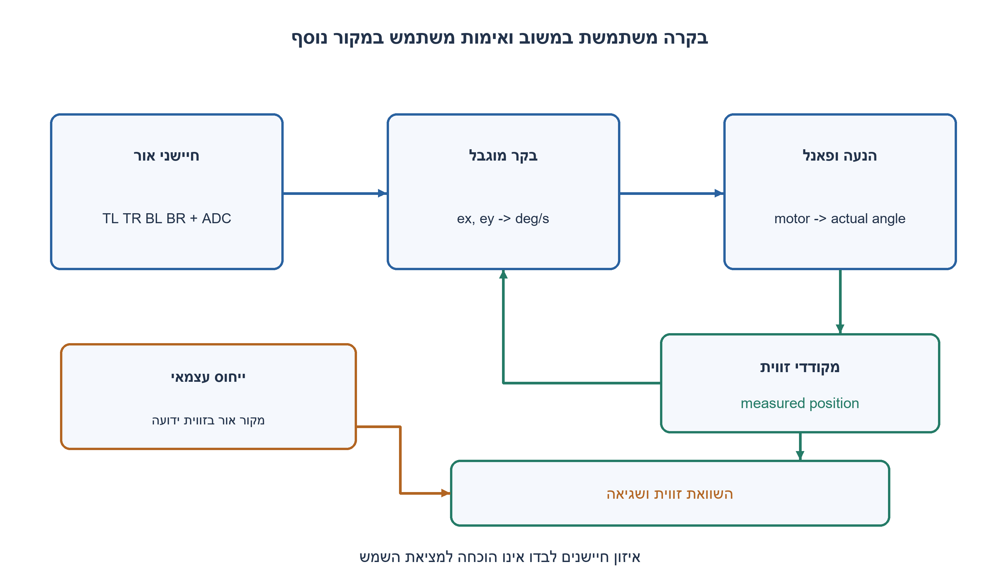
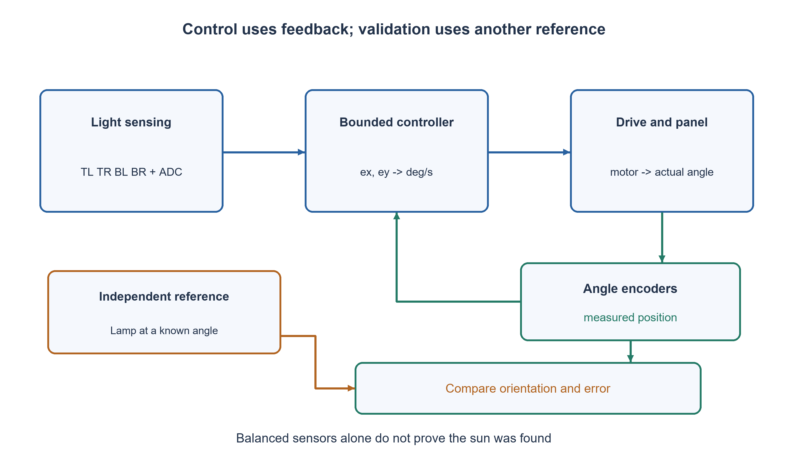

# PREP-275 — מעקב אחרי השמש: חיישנים, בקרה פיזיקלית ובדיקה עצמאית

פתרון מוצע בסיוע AI; ביקורת מקצועית אנושית ממתינה. הקושי אינו מכויל.

## עברית

תכננו מערכת העוקבת אחרי השמש ומפיקה פלט בעל משמעות פיזיקלית. פרטו שיטות גילוי ורכיבי חומרה, בעיות אפשריות וטיפול בהן, דרך לבדוק שהתוצאה נכונה ופסאודו־קוד למערכת.

המקור אינו בוחר התקן או פלט. נבחר במפורש פאנל פוטו־וולטאי בשני צירים: ארבע פוטודיודות מאחורי צלב הצללה, מנועים עם דרייברים, מקודדי זווית עצמאיים וחיישני קצה. הפלט הוא פקודת מהירות זוויתית בכל ציר במעלות לשנייה; הזווית בפועל נמדדת בנפרד. נדרש גם להבדיל בין יישור גיאומטרי לשמש לבין הספק חשמלי. בחרו גבולות, כיול, תחום תפיסה ודרישות בדיקה; אין דרישה להפעיל ציוד פיזי.

1. מהו הגודל הפיזיקלי שרוצים לשלוט בו, ואיזה חיישן באמת מודד אם הוא השתנה?
2. הפרש אור בין ימין לשמאל ובין מעלה למטה נותן כיוון תיקון מקומי. האם ארבע קריאות שוות תמיד אומרות שהפאנל מול השמש?
3. שלבו לולאה מקומית מנורמלת עם deadband, הגבלת קצב וגבולות תנועה. בחוסר ביטחון עוצרים; למציאת השמש מחוץ לתחום נדרשים חיפוש/חיזוי, ולאימות נדרש מקור זווית עצמאי.

### מגדירים מה המערכת מפיקה ומה מוכיח שהפלט נכון
במודל שנבחר, המטרה היא שכיוון הניצב לפאנל יתקרב לכיוון אור השמש הישיר. הפוטודיודות מפיקות זרם שתלוי באור, מעגל המרה ו־ ADC נותנים דגימות, והבקר מבקש מהירות זוויתית מהדרייבר. פקודת מנוע אינה מדידה של זווית: מקודד בכל ציר מודד מה קרה בפועל. ההספק P=V·I הוא תצפית נוספת, אך ענן יכול להפחית אותו גם כשהיישור נכון, ולכן הוא אינו אורקל יחיד לדיוק זוויתי.

שיטת גילוי מקומית משתמשת בארבעה רבעים TL, TR, BL, BR עם מחיצת הצללה. אחרי כיול היסט ורגישות נגדיר S כסכומם, ונחשב `ex=((TR+BR)−(TL+BL))/S`, `ey=((TL+TR)−(BL+BR))/S`. נחשב רק כש־ S גדול מספיק, המדידות טריות ותקינות ויש ביטחון באור ישיר ובתחום התפיסה המכויל. בחרנו סימן צירים שבו שגיאה חיובית מבקשת תנועה ימינה/למעלה; יש לבדוק זאת פיזית בכיול, ולא להניח שכל חיבור חיישנים מתאים.

שיטת חיזוי אחרת מחשבת אזימוט והגבהה לפי זמן, תאריך ומיקום באמצעות מודל אסטרונומי, למשל SOLPOS. היא יכולה לעזור ברכישה גסה ובאימות, אבל תלויה בשעון, מיקום, יישור צירים ודיוק המקודדים. אפשר לשלב חיזוי עם תיקון אופטי. לא העתקנו או הרצנו כאן את ספריית החיזוי. ארבע קריאות שוות בחושך, באור מפוזר או עם חיישן תקוע אינן מוכיחות שהשמש נמצאה; מחוץ לתחום התפיסה נדרש ACQUIRE מוגבל, ולא הבטחה שהלולאה המקומית תמצא מקסימום גלובלי.

### בקרה ופערי המודל
הליבה המצורפת מדגימה deadband של 0.02 בשגיאה מנורמלת, הגבר 4 ומגבלת 2 מעלות לשנייה, עם זווית מקומית בציר האופקי בין ‎−90 ל־ 90 והגבהה בין 0 ל־ 90. אלה ערכי דוגמה, לא תכנון מכני מאושר. היא חוסמת פקודה שממשיכה החוצה בגבול, עוצרת בחושך או בחוסר ביטחון, ונועלת FAULT במדידה פסולה/ישנה או זווית מחוץ לתחום. reset הוא פעולה מפורשת אחרי בדיקה. הקריאה confident מגיעה משכבת האבחון; הליבה אינה יודעת להסיק לבדה מאור מאוזן אם השמש ישירה.

פסאודו־הקוד המערכתי מוסיף כיול, רכישה, watchdog, מגבלות קשיחות ובדיקת פקודה מול תנועת מקודד לאורך זמן. מנוע תקוע, כיוון דרייבר הפוך, backlash, חיישן מלוכלך, החלפת ערוצים, רוח ורעידות מטופלים לפי דרישות וריג ניסוי, לא לפי קבוע אוניברסלי. הליבה הקטנה אינה מממשת את כל אלה ואינה שולחת PWM או מתח לציוד.

### איך מאמתים בלי להשתמש באותו חיישן כאמת מידה?
תחילה מאמתים תוכנה עם אורקל מספרי, כיול סימנים, מגבלות ואירועי תקלה. אחר כך בריג מודדים את כיוון הפאנל עם מקודדים ומקור אור בזווית ידועה, או משווים לכיוון שמש מחושב על בסיס נתוני זמן/מיקום מאומתים. מגדירים מראש שגיאה זוויתית מותרת, זמן התייצבות, overshoot, תנאי אובדן מעקב ותגובה לתקלה. בודקים בוקר/צהריים/ערב, עננים, חושך ותחומי קצה. חייבים גם תרחיש שבו החיישנים מאוזנים אך היעד שגוי, כדי לגלות בדיקה מעגלית.

נבדקו 1,681 תגובות רבעים, 16 מקרי עצירה/נעילת תקלה/גבולות ו־ 2,000 צעדי צמח לינארי סינתטי בתוך תחום התפיסה. בצמח זה סימן הפקודה מקטין שגיאה מקומית, וה־ deadband מאפשר שארית קטנה; אין בכך הוכחת יציבות של מנוע אמיתי, הרצת חיזוי או בדיקת שטח. כל צעד ליבה צורך זמן ומספר מילים קבועים; עלות חיזוי, תקשורת, סינון והפעלת מנוע תלויה במימוש המלא.

```python
"""Educational local tracking core, not a complete or qualified motor controller.

Quadrants: top-left, top-right, bottom-left, bottom-right. Positive azimuth
command moves the panel normal toward the sensor's right side; positive
elevation moves upward. Real wiring/calibration must establish these signs.
Outputs are requested angular rates in degrees/second, not GPIO/PWM writes.
"""
from math import isfinite


class TrackingCore:
    def __init__(self):
        self.fault = False

    def reset_after_check(self):
        self.fault = False

    def step(self, sample, now):
        stop = {"mode": "FAULT", "az_rate": 0.0, "el_rate": 0.0}
        if self.fault:
            return stop
        try:
            stamp = sample["stamp"]
            azimuth, elevation = sample["angles"]
            tl, tr, bl, br = sample["light"]
            confident = sample["confident"]
            scalars = (now, stamp, azimuth, elevation, tl, tr, bl, br)
            if (any(type(v) not in (int, float) or not isfinite(v) for v in scalars)
                    or type(confident) is not bool
                    or not 0 <= now - stamp <= 0.5
                    or not -90 <= azimuth <= 90 or not 0 <= elevation <= 90
                    or min(tl, tr, bl, br) < 0):
                raise ValueError("invalid or stale measurement")
            total = tl + tr + bl + br
            if not isfinite(total):
                raise ValueError("sensor total overflow")
        except (KeyError, TypeError, ValueError, OverflowError):
            self.fault = True
            return stop
        if total < 1.0:
            return {"mode": "HOLD_DARK", "az_rate": 0.0, "el_rate": 0.0}
        if not confident:
            return {"mode": "HOLD_UNCERTAIN", "az_rate": 0.0, "el_rate": 0.0}
        ex = ((tr + br) - (tl + bl)) / total
        ey = ((tl + tr) - (bl + br)) / total

        def rate(error):
            return 0.0 if abs(error) <= 0.02 else max(-2.0, min(2.0, 4.0 * error))

        az_rate, el_rate = rate(ex), rate(ey)
        if (azimuth <= -90 and az_rate < 0) or (azimuth >= 90 and az_rate > 0):
            az_rate = 0.0
        if (elevation <= 0 and el_rate < 0) or (elevation >= 90 and el_rate > 0):
            el_rate = 0.0
        return {"mode": "TRACK_LOCAL", "az_rate": az_rate, "el_rate": el_rate}
```


```text
Assumed device: two-axis photovoltaic panel with shadow-cross quadrant sensors,
independent axis encoders, bounded motor drives and hard travel-limit inputs.
The complete system below is design pseudocode, not deployed actuator code.

INIT:
  calibrate sensor gains/offsets and axis direction with a known light source
  verify limit switches and encoder/drive response at low test speed
  enter HOLD until references and measurements are valid

EVERY CONTROL TICK:
  read monotonic time, timestamped quadrants, encoders and limit/fault inputs
  if stale, nonfinite, out-of-range, overcurrent, limit conflict or watchdog failure:
      request zero drive; latch FAULT; require inspection and explicit reset
  else if direct-sun confidence is inadequate:
      request zero tracking rate; HOLD (night parking is a separate verified plan)
  else if sun is outside the calibrated sensor capture cone:
      ACQUIRE with bounded ephemeris/coarse-search targets and verified travel limits
  else:
      compute normalized right-minus-left and top-minus-bottom errors
      apply calibrated direction, deadband/filtering, rate and travel limits
      request angular rates in degrees/second through the motor-drive interface
      compare commanded motion with independent encoder motion over a dwell window
      if commanded movement persists without measured progress: stop and latch FAULT

INDEPENDENT VALIDATION:
  compare encoder-derived panel normal with a known lamp/sun direction reference
  check signed angular error, settling time, overshoot, limits and tracking loss
  separately measure electrical output power; clouds alone can change power
  inject stale/stuck/swapped sensors and jammed-drive faults on a controlled rig
  record pass/fail against declared tolerances; software simulation is not a rig test
```




## English

Design a sun-tracking system with a physically meaningful output. Describe detection methods and hardware, possible faults and handling, independent correctness checks and system pseudocode.

The source chooses no device/output. Explicitly choose a two-axis photovoltaic panel with four photodiodes behind a shadow cross, driven motors, independent angle encoders and travel-limit sensors. Output is requested angular velocity per axis in degrees per second; actual angle is measured separately. Distinguish geometric alignment from electrical power. Declare calibration, limits, capture range and verification targets; physical equipment need not be operated.

1. Which physical quantity is controlled, and which independent sensor confirms it actually changed?
2. Right-minus-left and top-minus-bottom light differences give a local correction. Do equal readings always prove sun alignment?
3. Use normalized local feedback with deadband, rate/travel limits and hold on inadequate confidence. Acquisition outside the capture cone needs search/prediction; validation needs an independent angular reference.

### Define the physical output and independent evidence
The chosen objective is to align the panel normal with direct sunlight. Photodiodes produce light-dependent current, conditioning/ADC produces samples, and the controller requests angular velocity from a drive. A motor command does not measure actual angle; independent axis encoders do. Electrical power P=V*I is another observation, but clouds can reduce it while geometry remains correct, so power alone is not an angular-accuracy oracle.

Local optical sensing uses quadrants TL, TR, BL, BR behind a shadow cross. After offset/gain calibration let S be their sum and compute `ex=((TR+BR)−(TL+BL))/S`, `ey=((TL+TR)−(BL+BR))/S`. Use this only with adequate total signal, valid fresh samples and confidence in direct sunlight within the calibrated capture cone. The chosen axes make positive error request rightward/upward motion; real calibration must verify those signs rather than assume every wiring arrangement matches.

An alternative predicts solar azimuth/elevation from date, time and location, using an astronomical model such as SOLPOS. Prediction can aid coarse acquisition and independent checks but depends on clock/location accuracy, axis alignment and encoders. Hybrid prediction plus optical correction is possible. The prediction library is neither copied nor executed here. Equal quadrant readings in darkness, diffuse light or a stuck sensor do not establish correct alignment. Outside the capture cone, use a bounded ACQUIRE plan; do not claim local feedback finds a global maximum.

### Control and model boundaries
The attached core illustrates normalized-error deadband 0.02, gain four and a two-degree/second rate limit. Local azimuth is limited to −90..90 degrees and elevation to 0..90. These are example values, not a qualified mechanical design. It blocks outward motion at a boundary, holds in darkness or uncertainty, and latches FAULT for stale/invalid samples or out-of-range angles. Reset is explicit after checking. confident comes from a diagnostic layer; the core cannot infer direct sunlight from balanced readings alone.

System pseudocode additionally covers calibration, acquisition, watchdog, hard limits and commanded-motion versus encoder-progress checks over time. Jammed drives, reversed direction, backlash, dirty/swapped sensors, wind and vibration require declared requirements and a controlled test rig, not a universal constant. The small core does not implement all these features or write PWM/voltage to hardware.

### Validate without using the same sensor as ground truth
First test software numerically for signs, limits and injected faults. Then on a rig compare encoder-derived panel normal with a lamp at a known direction, or with independently checked solar position using verified date/time/location. Declare angular tolerance, settling time, overshoot, loss-of-track conditions and fault response before testing. Cover morning/noon/evening, clouds, darkness and travel boundaries. Include a case with balanced sensors but the wrong target to expose circular validation.

Executed tests cover 1,681 quadrant-response cases, sixteen stop/fault/limit cases and 2,000 steps of an explicitly synthetic linear plant inside its capture cone. In that model command signs reduce local error, with a small deadband residual. This is not proof of real-drive stability, an ephemeris execution or field validation. Each core step uses constant work/state; prediction, communication, filtering and motor costs belong to the full implementation.

```python
"""Educational local tracking core, not a complete or qualified motor controller.

Quadrants: top-left, top-right, bottom-left, bottom-right. Positive azimuth
command moves the panel normal toward the sensor's right side; positive
elevation moves upward. Real wiring/calibration must establish these signs.
Outputs are requested angular rates in degrees/second, not GPIO/PWM writes.
"""
from math import isfinite


class TrackingCore:
    def __init__(self):
        self.fault = False

    def reset_after_check(self):
        self.fault = False

    def step(self, sample, now):
        stop = {"mode": "FAULT", "az_rate": 0.0, "el_rate": 0.0}
        if self.fault:
            return stop
        try:
            stamp = sample["stamp"]
            azimuth, elevation = sample["angles"]
            tl, tr, bl, br = sample["light"]
            confident = sample["confident"]
            scalars = (now, stamp, azimuth, elevation, tl, tr, bl, br)
            if (any(type(v) not in (int, float) or not isfinite(v) for v in scalars)
                    or type(confident) is not bool
                    or not 0 <= now - stamp <= 0.5
                    or not -90 <= azimuth <= 90 or not 0 <= elevation <= 90
                    or min(tl, tr, bl, br) < 0):
                raise ValueError("invalid or stale measurement")
            total = tl + tr + bl + br
            if not isfinite(total):
                raise ValueError("sensor total overflow")
        except (KeyError, TypeError, ValueError, OverflowError):
            self.fault = True
            return stop
        if total < 1.0:
            return {"mode": "HOLD_DARK", "az_rate": 0.0, "el_rate": 0.0}
        if not confident:
            return {"mode": "HOLD_UNCERTAIN", "az_rate": 0.0, "el_rate": 0.0}
        ex = ((tr + br) - (tl + bl)) / total
        ey = ((tl + tr) - (bl + br)) / total

        def rate(error):
            return 0.0 if abs(error) <= 0.02 else max(-2.0, min(2.0, 4.0 * error))

        az_rate, el_rate = rate(ex), rate(ey)
        if (azimuth <= -90 and az_rate < 0) or (azimuth >= 90 and az_rate > 0):
            az_rate = 0.0
        if (elevation <= 0 and el_rate < 0) or (elevation >= 90 and el_rate > 0):
            el_rate = 0.0
        return {"mode": "TRACK_LOCAL", "az_rate": az_rate, "el_rate": el_rate}
```


```text
Assumed device: two-axis photovoltaic panel with shadow-cross quadrant sensors,
independent axis encoders, bounded motor drives and hard travel-limit inputs.
The complete system below is design pseudocode, not deployed actuator code.

INIT:
  calibrate sensor gains/offsets and axis direction with a known light source
  verify limit switches and encoder/drive response at low test speed
  enter HOLD until references and measurements are valid

EVERY CONTROL TICK:
  read monotonic time, timestamped quadrants, encoders and limit/fault inputs
  if stale, nonfinite, out-of-range, overcurrent, limit conflict or watchdog failure:
      request zero drive; latch FAULT; require inspection and explicit reset
  else if direct-sun confidence is inadequate:
      request zero tracking rate; HOLD (night parking is a separate verified plan)
  else if sun is outside the calibrated sensor capture cone:
      ACQUIRE with bounded ephemeris/coarse-search targets and verified travel limits
  else:
      compute normalized right-minus-left and top-minus-bottom errors
      apply calibrated direction, deadband/filtering, rate and travel limits
      request angular rates in degrees/second through the motor-drive interface
      compare commanded motion with independent encoder motion over a dwell window
      if commanded movement persists without measured progress: stop and latch FAULT

INDEPENDENT VALIDATION:
  compare encoder-derived panel normal with a known lamp/sun direction reference
  check signed angular error, settling time, overshoot, limits and tracking loss
  separately measure electrical output power; clouds alone can change power
  inject stale/stuck/swapped sensors and jammed-drive faults on a controlled rig
  record pass/fail against declared tolerances; software simulation is not a rig test
```




## חומר משלים / Supporting material

```json
{
  "assumptions": {
    "he": "השלמה: פאנל דו־צירי, ארבעה רבעים מכוילים, מקודדים עצמאיים ופקודות במעלות לשנייה; confident מסופק משכבת אבחון.",
    "en": "Completion: two-axis panel, calibrated quadrants, independent encoders and degree/second commands; confidence is supplied by diagnostics."
  },
  "optimality": {
    "he": "ליבה O(1) זמן ומקום לדגימה; אין טענת שטח, דיוק או יציבות פיזית למערכת השלמה.",
    "en": "Core O(1) time/state per sample; no full-system physical accuracy, area or stability claim."
  },
  "verification": {
    "he": "1,681 תגובות, 16 מקרי עצירה ו־ 2,000 צעדי צמח סינתטי; ללא ציוד, חיזוי, ריג או בדיקת שטח.",
    "en": "1,681 responses, sixteen stop cases and 2,000 synthetic-plant steps; no equipment, ephemeris, rig or field test."
  },
  "edge_cases": {
    "he": "חושך; אור מפוזר; timestamp ישן; חיישן תקוע/מלוכלך; גבולות; מנוע תקוע; כיוון הפוך.",
    "en": "Darkness; diffuse light; stale timestamp; stuck/dirty sensor; limits; jammed drive; reversed direction."
  },
  "common_mistakes": {
    "he": "להוכיח הצלחה רק מאיזון אותם חיישנים; לקרוא לפקודת מנוע זווית נמדדת; לחלק ב־ S≈0; להציג סימולציה כבדיקת חומרה.",
    "en": "Using balanced feedback as the sole correctness proof; calling a motor command a measured angle; dividing by near-zero S; calling simulation a hardware test."
  },
  "interview_answer": {
    "he": "אגדיר זווית יעד ופלט עם יחידות, אסגור לולאה עם גבולות ואבחון, ואאמת זווית בפועל מול מקור עצמאי.",
    "en": "Define target orientation and physical units, close a bounded diagnostic loop, and compare measured orientation with an independent reference."
  },
  "source_ambiguities": {
    "he": "במקור אין התקן, צירים, חיישנים או ספי ביצועים. כולם נבחרו במפורש לדוגמת תכנון; פרמטרי הליבה אינם כיול של ציוד קיים.",
    "en": "The source supplies no device, axes, sensors or performance thresholds; these are explicit design choices, not calibration of existing equipment."
  },
  "solution_extensions": {
    "he": [
      {
        "question": "האם איזון ארבעת החיישנים מספיק גם ביום מעונן?",
        "answer_direction": "לא. אור מפוזר עלול להיות מאוזן בכיוונים שונים; יש להוריד ביטחון, להחזיק מצב או להסתמך על חיזוי/מקור נוסף לפי החוזה.",
        "principle": "משוב ובדיקת נכונות צריכים תצפיות שאינן זהות."
      }
    ],
    "en": [
      {
        "question": "Are equal quadrant readings sufficient under cloud cover?",
        "answer_direction": "No. Diffuse light can be balanced at different orientations; reduce confidence, hold or use prediction/another reference according to the contract.",
        "principle": "Feedback and correctness validation need distinct observations."
      }
    ]
  },
  "technical_references": {
    "he": [
      "[NLR SOLPOS: מיקום השמש לפי תאריך, זמן ומיקום](https://www.nlr.gov/grid/solar-resource/solpos)"
    ],
    "en": [
      "[NLR SOLPOS: solar position from date, time and location](https://www.nlr.gov/grid/solar-resource/solpos)"
    ]
  }
}
```
