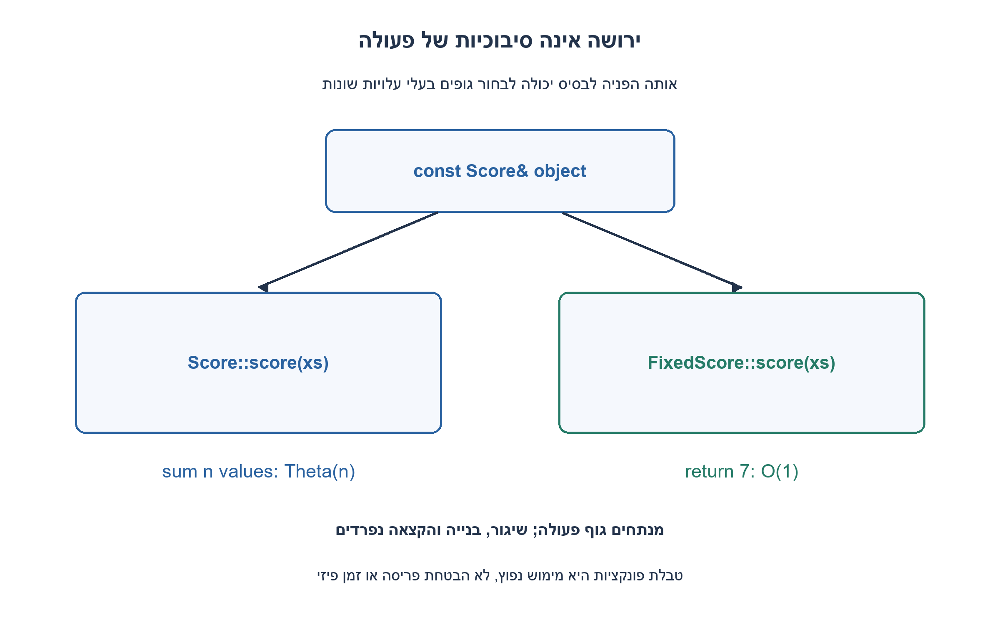
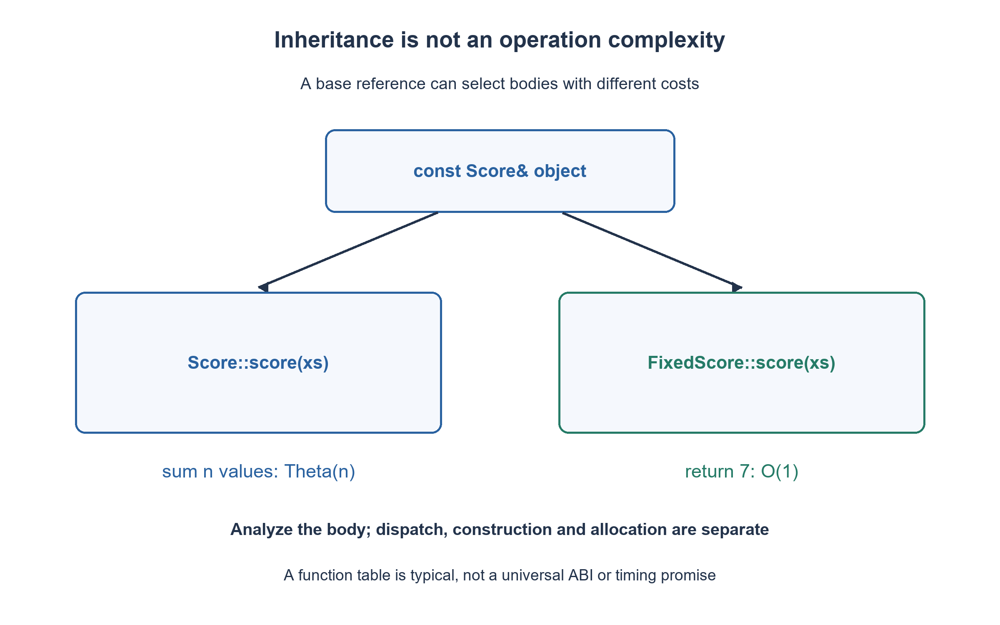

# PREP-276 — ירושה ב־ C++: משמעות, שיגור ועלות הפעולה

פתרון מוצע בסיוע AI; ביקורת מקצועית אנושית ממתינה. הקושי אינו מכויל.

## עברית

הסבירו מהי ירושה ומה משמעותה. המקור מבקש גם סיבוכיות זמן בלי להגדיר פעולה או גודל קלט; אין לירושה כשלעצמה פונקציית זמן אחת.

נבחר תרגיל מפורש ב־ C++17: ירושה ציבורית יחידה, מחלקת בסיס Score ומתודה וירטואלית score, ומתודה לא־וירטואלית kind. במימוש הבסיס score סורקת n שלמים ומחזירה סכום; במחלקה הנגזרת FixedScore היא מחזירה תמיד 7. החוזה הכללי של score הוא ציון המוגדר לפי סוג האובייקט, לא הבטחה שכל סוג מחזיר סכום. הסכום במימוש הבסיס נכנס ב־ int64_t.

תארו מה מתקבל בקריאה דרך הפניה לבסיס, בקריאה למתודה הלא־וירטואלית, בהעתקת נגזרת לאובייקט בסיס ובקריאה מוסמכת ל־ Score::score. נתחו בנפרד את גוף כל פעולה, שיגור וירטואלי, בנייה והקצאה. הסבירו למה דרוש destructor וירטואלי כאשר מוחקים נגזרת באמצעות מצביע לבסיס. אין צורך לנתח ירושה מרובה או להבטיח פריסת זיכרון מסוימת.

1. האם ״ירושה״ היא לולאה על קלט, או קשר בין טיפוסים? איזו פעולה צריך לבחור כדי לדבר על n?
2. הפרידו בין הטיפוס הסטטי של ההפניה לבין הטיפוס הדינמי של האובייקט; רק הפונקציה הווירטואלית נבחרת דינמית.
3. בקריאה דרך Score& לאובייקט FixedScore מתקבל 7, אך kind הלא־וירטואלית מחזירה Score. העתקה לערך Score מבצעת slicing, וקריאה מוסמכת לבסיס עוקפת את השיגור. את העלות קובעים לפי הגוף שנבחר.

### קשר בין טיפוסים, לא אלגוריתם אחד
בירושה ציבורית לנגזרת יש תת־אובייקט בסיס, והיא יכולה לשמש דרך מצביע או הפניה לבסיס כאשר ההמרה נגישה וחד־משמעית. כך מגדירים ממשק משותף ומחליפים התנהגות. זה אינו אומר שכל שדה פרטי בבסיס נעשה נגיש לנגזרת, ואין צורך להעתיק טקסט של קוד הבסיס אל הנגזרת. ירושה אינה הבחירה היחידה לשימוש חוזר; כאשר הקשר הוא ״מכיל״ ולא ״הוא סוג של״, הרכבה עשויה להתאים יותר. תאימות תחבירית אינה מחליפה קיום של חוזה התנהגותי.

במימוש המצורף Score::score מסכמת את הקלט, ואילו FixedScore::score מחזירה 7. דרך `const Score& through_base=fixed` נקראת הגרסה הנגזרת הווירטואלית. דרך אותה הפניה `kind()` נשארת Score, כי היא אינה וירטואלית; ההצהרה באותו שם בנגזרת מסתירה אותה ואינה override. מילת override מאפשרת למהדר לזהות חתימה שגויה. `fixed.Score::score(xs)` בוחרת במפורש בגוף הבסיס. `Score sliced=fixed` יוצרת אובייקט בסיס חדש: לא נשמר בה האובייקט הנגזר השלם, והקריאה הבאה משתמשת ב־ Score. כדי לשמר פולימורפיזם משתמשים בהפניות או במצביעים עם בעלות ברורה.

### מגדירים קודם מה סופרים
כאשר n הוא מספר האיברים, גוף הסכימה עובר על n איברים: Θ(n) פעולות מילת־מכונה ו־ O(1) זיכרון עזר. הגוף שמחזיר 7 מבצע O(1) עבודה. בדוגמה הקלט כבר קיים, וההקצאה של vector ברתמת הבדיקה אינה חלק מהמתודה. אל תסיקו שהירושה עצמה O(n), או שקריאה וירטואלית הופכת גוף לינארי לקבוע.

ב־ ABI נפוץ השיגור משתמש בטבלת פונקציות ומוסיף מספר חסום של גישות/קריאה עקיפה. זו דרך מימוש טיפוסית, לא הבטחת סיבוכיות נורמטיבית של C++ או התחייבות למספר ננו־שניות; המהדר יכול גם לבצע devirtualization. חיפוש שמות ו־ overload הם ענייני קומפילציה. עלות בנאי תלויה בבסיסים ובחברים שהוא בונה; חבר שמעתיק n פריטים עשוי לעלות Θ(n). עלות allocator, התאמה, פינוי ו־ cache תלויה במימוש. גם sizeof אינו בהכרח סכום נאיבי של שדות בגלל ריפוד ופרטי ABI. בחרנו כאן היררכיה קבועה, ואין מדידה של עומק ירושה משתנה.

### משך חיים ובדיקה
ל־ Score יש destructor וירטואלי, ולכן unique_ptr<Score> שמחזיק LifetimeProbe מפעיל גם את destructor הנגזרת. אין להריץ דוגמה שמוחקת נגזרת דרך בסיס ללא destructor מתאים ואז להסיק מהפלט שהתנהגות לא־מוגדרת ״עובדת״. הקוד מצרף רתמת C++17 עם 521 טענות סמנטיות: 129 אורכי קלט, קריאות וירטואליות, slicing, קריאה מוסמכת, הסתרת שם וניקוי פולימורפי. עצם שמירת הרתמה אינה ראיית הידור; תוצאות הידור והרצה מקוריות נשמרות בנפרד. הבדיקות אינן benchmark ואינן הוכחת עלות allocator.

```cpp
// C++17 educational example. score has type-specific semantics, not a sum contract.
#include <cassert>
#include <cstdint>
#include <iostream>
#include <memory>
#include <string_view>
#include <vector>

class Score {
public:
    virtual ~Score() = default;
    // Precondition: the mathematical sum fits int64_t.
    virtual std::int64_t score(const std::vector<std::int32_t>& xs) const {
        std::int64_t result = 0;
        for (const auto value : xs) result += value;
        return result;
    }
    std::string_view kind() const noexcept { return "Score"; }
};

class FixedScore final : public Score {
public:
    std::int64_t score(const std::vector<std::int32_t>&) const override {
        return 7;
    }
    // This hides a nonvirtual function; it does not override it.
    std::string_view kind() const noexcept { return "FixedScore"; }
};

class LifetimeProbe final : public Score {
public:
    explicit LifetimeProbe(bool& destroyed) : destroyed_(destroyed) {}
    ~LifetimeProbe() override { destroyed_ = true; }
private:
    bool& destroyed_;
};

int main() {
    unsigned checks = 0;
    const Score ordinary;
    const FixedScore fixed;
    const Score& through_base = fixed;
    const Score sliced = fixed;
    for (std::size_t n = 0; n <= 128; ++n) {
        const std::vector<std::int32_t> ones(n, 1);
        assert(ordinary.score(ones) == static_cast<std::int64_t>(n)); ++checks;
        assert(through_base.score(ones) == 7); ++checks;
        assert(sliced.score(ones) == static_cast<std::int64_t>(n)); ++checks;
        assert(fixed.Score::score(ones) == static_cast<std::int64_t>(n)); ++checks;
    }
    assert(fixed.kind() == "FixedScore"); ++checks;
    assert(through_base.kind() == "Score"); ++checks;
    assert(ordinary.score({-3, 0, 8, -2}) == 3); ++checks;
    bool destroyed = false;
    {
        std::unique_ptr<Score> owned = std::make_unique<LifetimeProbe>(destroyed);
        assert(!destroyed); ++checks;
    }
    assert(destroyed); ++checks;
    std::cout << "PREP-276: " << checks << " semantic assertions passed\n";
}
```




## English

Explain inheritance and its meaning. The source also requests time complexity without naming an operation or input size; inheritance itself has no single running-time function.

Choose an explicit C++17 exercise: single public inheritance, base Score with virtual score and nonvirtual kind. Base score scans n integers and returns their sum; derived FixedScore always returns seven. The general score contract permits a type-specific score; it does not promise that every subtype computes a sum. The base implementation's sum fits int64_t.

Explain calls through a base reference, the nonvirtual member, copying a derived value into a base object, and explicitly qualified Score::score. Analyze each method body separately from virtual dispatch, construction and allocation. Explain the virtual destructor when deleting a derived object through a base pointer. Multiple inheritance and a particular memory layout need not be analyzed.

1. Is inheritance a loop over input, or a relationship between types? Which operation must be chosen before n has meaning?
2. Separate the reference's static type from the object's dynamic type; only the virtual function is selected dynamically.
3. A Score& bound to FixedScore returns seven from score but Score from nonvirtual kind. Copying into a Score value slices; a qualified base call bypasses dispatch. Analyze the selected body.

### A type relationship, not one algorithm
Public inheritance provides a base subobject and permits use through an accessible, unambiguous base pointer/reference. A common interface can select different behavior. It does not grant derived code access to private base members or require textual copying of base code. Composition may better express a has-a relationship; syntactic substitutability alone does not establish a behavioral contract.

Score::score sums its input, whereas FixedScore::score returns seven. Calling score through `const Score& through_base=fixed` selects the derived virtual override. Through that same reference, nonvirtual kind returns Score. The derived declaration hides the name; it does not override a nonvirtual member. override lets the compiler reject an incorrect overriding signature. `fixed.Score::score(xs)` explicitly selects the base body. `Score sliced=fixed` constructs a new base value and does not preserve the complete derived object; its subsequent call uses Score. References or pointers with explicit ownership preserve polymorphic use.

### Define the operation before its complexity
With n input elements, the summing body performs Theta(n) word operations and O(1) auxiliary storage; the body returning seven performs O(1) work. The vector already exists at method entry. Allocating it in the harness is outside the method cost. Inheritance is therefore not intrinsically O(n), and virtual dispatch cannot turn a linear method body into constant work.

A typical ABI dispatches through a function table with bounded lookup/indirect-call overhead. That is an implementation model, not a normative C++ complexity or nanosecond guarantee; devirtualization is also possible. Member lookup and overload resolution occur during compilation. Construction cost depends on constructed bases/members; copying n owned items may cost Theta(n). Allocator cost, caches and cleanup are separate implementation concerns. Padding and ABI details also prevent a universal naive sizeof sum. The example fixes the hierarchy rather than measuring growing inheritance depth.

### Lifetime and evidence
Score has a virtual destructor, so unique_ptr<Score> owning LifetimeProbe executes the derived destructor too. Do not delete a derived object through an unsuitable nonvirtual base destructor and interpret undefined behavior as a valid experiment. The attached C++17 harness contains 521 semantic assertions over 129 lengths, virtual calls, slicing, qualification, hidden nonvirtual members and polymorphic cleanup. Saving the harness is not compilation evidence; actual native results are recorded separately. These checks are not a benchmark or an allocator complexity proof.

```cpp
// C++17 educational example. score has type-specific semantics, not a sum contract.
#include <cassert>
#include <cstdint>
#include <iostream>
#include <memory>
#include <string_view>
#include <vector>

class Score {
public:
    virtual ~Score() = default;
    // Precondition: the mathematical sum fits int64_t.
    virtual std::int64_t score(const std::vector<std::int32_t>& xs) const {
        std::int64_t result = 0;
        for (const auto value : xs) result += value;
        return result;
    }
    std::string_view kind() const noexcept { return "Score"; }
};

class FixedScore final : public Score {
public:
    std::int64_t score(const std::vector<std::int32_t>&) const override {
        return 7;
    }
    // This hides a nonvirtual function; it does not override it.
    std::string_view kind() const noexcept { return "FixedScore"; }
};

class LifetimeProbe final : public Score {
public:
    explicit LifetimeProbe(bool& destroyed) : destroyed_(destroyed) {}
    ~LifetimeProbe() override { destroyed_ = true; }
private:
    bool& destroyed_;
};

int main() {
    unsigned checks = 0;
    const Score ordinary;
    const FixedScore fixed;
    const Score& through_base = fixed;
    const Score sliced = fixed;
    for (std::size_t n = 0; n <= 128; ++n) {
        const std::vector<std::int32_t> ones(n, 1);
        assert(ordinary.score(ones) == static_cast<std::int64_t>(n)); ++checks;
        assert(through_base.score(ones) == 7); ++checks;
        assert(sliced.score(ones) == static_cast<std::int64_t>(n)); ++checks;
        assert(fixed.Score::score(ones) == static_cast<std::int64_t>(n)); ++checks;
    }
    assert(fixed.kind() == "FixedScore"); ++checks;
    assert(through_base.kind() == "Score"); ++checks;
    assert(ordinary.score({-3, 0, 8, -2}) == 3); ++checks;
    bool destroyed = false;
    {
        std::unique_ptr<Score> owned = std::make_unique<LifetimeProbe>(destroyed);
        assert(!destroyed); ++checks;
    }
    assert(destroyed); ++checks;
    std::cout << "PREP-276: " << checks << " semantic assertions passed\n";
}
```




## חומר משלים / Supporting material

```json
{
  "assumptions": {
    "he": "בחירות שלנו: C++17, ירושה ציבורית יחידה, n כאורך הקלט, סכום שנכנס ב־ int64_t; אין הבטחת ABI או השוואת ביצועים פיזית.",
    "en": "Our choices: C++17, single public inheritance, n as input length, sum fitting int64_t; no ABI or physical benchmark promise."
  },
  "optimality": {
    "he": "גוף הסכימה Θ(n), גוף הקבוע O(1), כל אחד עם O(1) עזר. עלות שיגור/בנייה/הקצאה נידונה בנפרד ובהתאם למימוש.",
    "en": "Summing body Theta(n), constant body O(1), each O(1) auxiliary space; dispatch/construction/allocation analyzed separately."
  },
  "verification": {
    "he": "רתמת C++17 מכילה 521 טענות; ראיית הידור והרצה תירשם בנפרד. אין benchmark או בדיקה של כל ABI.",
    "en": "C++17 harness contains 521 assertions; native compilation/execution is recorded separately. No benchmark or all-ABI validation."
  },
  "edge_cases": {
    "he": "קלט ריק; הפניה לבסיס; slicing; קריאה מוסמכת; פונקציה מוסתרת שאינה וירטואלית; ניקוי דרך בעלות לבסיס.",
    "en": "Empty input; base reference; slicing; qualified call; hidden nonvirtual member; destruction through base ownership."
  },
  "common_mistakes": {
    "he": "לתת O(1) ל״ירושה״ בלי להגדיר פעולה; לבלבל override והסתרה; לספור הקצאת קלט כחלק ממתודה; להסיק פריסה אוניברסלית.",
    "en": "Giving inheritance an intrinsic O(1); confusing overriding with hiding; charging caller input allocation to the method; assuming a universal layout."
  },
  "interview_answer": {
    "he": "ירושה היא קשר טיפוסים. אגדיר את הפעולה ואת n, אזהה איזה גוף נבחר ואנתח אותו; שיגור והקצאה אינם אותו דבר.",
    "en": "Inheritance is a type relationship. Define the operation and n, identify the selected body, and analyze it separately from dispatch/allocation."
  },
  "source_ambiguities": {
    "he": "המקור לא ציין שפה או פעולה לניתוח. C++17 והדוגמה הן השלמה לימודית מוצהרת.",
    "en": "The source names no language or operation. C++17 and the example are explicit teaching completions."
  },
  "solution_extensions": {
    "he": [
      {
        "question": "מה משתנה אם score עצמה אינה virtual?",
        "answer_direction": "דרך Score& תיבחר פונקציית הבסיס לפי הטיפוס הסטטי; יש להסיר override מהנגזרת. אין להציג זאת כפולימורפיזם דינמי.",
        "principle": "הפרדה בין סמנטיקת שפה, גוף אלגוריתמי ופרטי מימוש."
      }
    ],
    "en": [
      {
        "question": "What changes if score is not virtual?",
        "answer_direction": "A Score& call selects the base member by static type; remove override from the derived declaration. This is not dynamic polymorphism.",
        "principle": "Separate language semantics, algorithm body and implementation details."
      }
    ]
  },
  "technical_references": {
    "he": [
      "[טיוטת C++: מחלקות נגזרות](https://eel.is/c++draft/class.derived)",
      "[טיוטת C++: פונקציות וירטואליות](https://eel.is/c++draft/class.virtual)",
      "[טיוטת C++: מחיקה פולימורפית](https://eel.is/c++draft/expr.delete)"
    ],
    "en": [
      "[C++ draft: derived classes](https://eel.is/c++draft/class.derived)",
      "[C++ draft: virtual functions](https://eel.is/c++draft/class.virtual)",
      "[C++ draft: polymorphic deletion](https://eel.is/c++draft/expr.delete)"
    ]
  }
}
```
