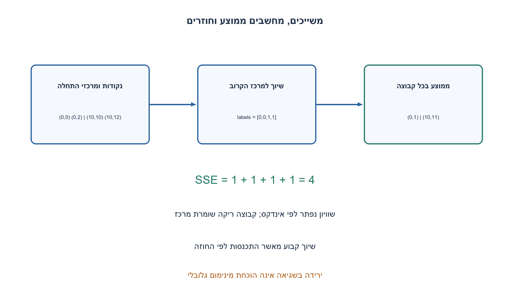
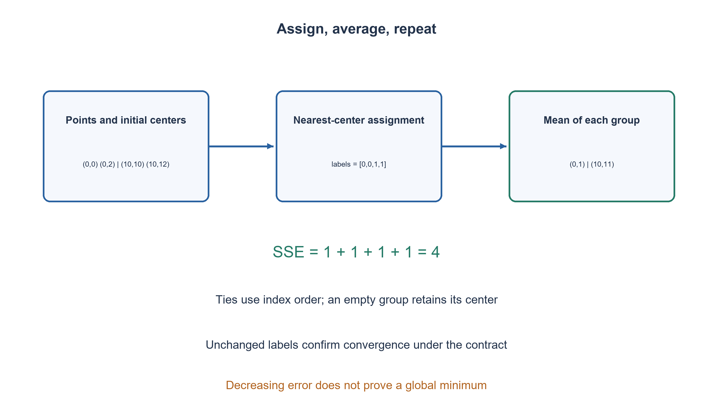

# PREP-277 — זיהוי והסבר של Direct k-means: שיוך ואז עדכון מרכזים

פתרון מוצע בסיוע AI; ביקורת מקצועית אנושית ממתינה. הקושי אינו מכויל.

## עברית

מופיעים n וקטורים, k אבות־טיפוס ופונקציית שגיאה E שהיא סכום ריבועי המרחקים מכל וקטור למרכז האשכול שלו. בכל סיבוב משייכים וקטורים למרכז הקרוב, מחליפים מרכז בממוצע חברי האשכול, וחוזרים. זהו את האלגוריתם, הסבירו את מטרתו, כתבו פסאודו־קוד ומימוש ונתחו עלות ומגבלות.

השלמת חוזה: נבחר אלגוריתם Lloyd במרחב אוקלידי, עם k קבוע בין 1 ל־ n. מקבלים אינדקסי אתחול שונים מתוך הקלט; בשוויון מרחקים נבחר האשכול בעל האינדקס הנמוך. אשכול ריק שומר את מרכזו. עוצרים כשהשיוכים זהים לסיבוב הקודם או כשנגמר תקציב max_iter חיובי. מחזירים שיוכים, מרכזים, SSE, מספר סיבובים ודגל converged; כשנגמר התקציב אין הבטחת התכנסות. במימוש ההדגמה 1≤n≤10000, מימד 1..64, k≤64 וקואורדינטות סופיות שערכן המוחלט לכל היותר 10^100. לא נדרשת מציאת מינימום גלובלי.

1. האם הלמידה מקבלת תוויות נכונות, או שעליה לבנות קבוצות בעצמה?
2. כאשר המרכזים קבועים בוחרים את הקרוב ביותר; כאשר הקבוצות קבועות איזה מרכז מקטין סכום מרחקים בריבוע?
3. בצעו שיוך לכל נקודה ואז ממוצע בכל קבוצה. שמרו כלל לשוויון ולקבוצה ריקה ותקציב סיבובים.

### שתי בעיות קלות במקום חיפוש בכל החלוקות
זהו k-means לאשכולות, למידה לא מונחית. k ידוע; האלגוריתם אינו מסיק אותו מן השרטוט. אבות־הטיפוס הם מרכזים, לא בהכרח נקודות קלט לאחר העדכון. למרכזים קבועים כל נקודה בוחרת את הקרוב ביותר ולכן סכום הריבועים אינו גדל. לשיוך קבוע, הממוצע מקטין את סכום ריבועי המרחקים בתוך כל אשכול לא ריק. לכן מחליפים בין שתי הפעולות.

פסאודו־קוד: אתחול מרכזים מהאינדקסים; חזרה עד התקציב: לכל נקודה חשבו מרחק בריבוע לכל מרכז ובחרו מינימום; סכמו וקטורים ומספר חברים בכל קבוצה; חשבו ממוצעים לקבוצות לא ריקות; חשבו SSE; אם רשימת השיוכים לא השתנתה הכריזו converged, אחרת המשיכו. אין צורך בשורש לרכיב המרחק, משום שריבוע שומר על סדר מרחקים לא שליליים.

### דוגמה ותוצאה
לנקודות (0,0), (0,2), (10,10), (10,12) ומרכזי התחלה באינדקסים 0 ו־ 2 מתקבל שיוך [0,0,1,1], מרכזים (0,1), (10,11) ו־ SSE=4. סיבוב שני מאשר שהשיוך לא השתנה. לשני מרכזים זהים עשוי להישאר אשכול ריק; שימור מרכזו מונע חילוק באפס ואינו ממציא נקודה חדשה.

### למה הממוצע נכון ומה לא הוכחנו
לכל קבוצה בעלת ממוצע μ מתקיים sum||x−c||² = sum||x−μ||² + m||c−μ||². האיבר הנוסף אינו שלילי, ולכן μ מיטבי כאשר השיוך קבוע. בשתי הפעולות יחד SSE אינו גדל באריתמטיקה מדויקת. מכאן לא נובע מינימום גלובלי: אתחולים שונים יכולים להוביל לתוצאות שונות. גם מספר האשכולות והסקאלה של כל ציר משפיעים על התוצאה.

הקוד מחזיר בכל סיבוב מרכזים שהם ממוצעי השיוך המוחזר (ובקבוצה ריקה את המרכז הקודם). אם max_iter נגמר, אין לטעון שכל נקודה כבר קרובה ביותר למרכז המוחזר: השיוך נבחר לפני עדכון המרכזים. converged אמת רק אחרי שוויון לשיוך הקודם; עם תקציב 1 הוא יכול להיות שקר גם אם במקרה כבר הגענו לנקודה קבועה. שימוש ב־ float דורש סבילויות בבדיקות; אין הבטחת זהות ביטים מול חשבון ממשי.

העלות היא O(t·n·k·d) עבור t סיבובים, n נקודות ומימד d, ומקום נוסף O(n+k·d). אם n, d, k חסומים במימוש זה, אלה עדיין הפרמטרים הנכונים לניתוח ההכללה.

```python
"""Deterministic bounded Lloyd steps; no global optimality guarantee."""
from math import isfinite


def lloyd(points, initial_indices, max_iter=100):
    if type(points) is not list or not points or type(initial_indices) is not list:
        raise ValueError("nonempty point list and initial indices required")
    dimension = len(points[0])
    if dimension < 1 or any(len(point) != dimension for point in points):
        raise ValueError("all points must have the same positive dimension")
    if any(type(v) not in (int, float) or not isfinite(v) or abs(v) > 1e100
           for point in points for v in point):
        raise ValueError("finite coordinates with magnitude at most 1e100 required")
    if (not initial_indices or len(initial_indices) > len(points)
            or len(set(initial_indices)) != len(initial_indices)
            or any(type(i) is not int or not 0 <= i < len(points) for i in initial_indices)
            or type(max_iter) is not int or max_iter < 1):
        raise ValueError("distinct valid initial indices and positive iteration budget required")
    # The demonstration bounds practical allocation and sum magnitude explicitly.
    if len(points) > 10000 or dimension > 64 or len(initial_indices) > 64:
        raise ValueError("demonstration size limit exceeded")
    centers = [[float(v) for v in points[i]] for i in initial_indices]
    previous = None
    for iteration in range(1, max_iter + 1):
        labels = []
        for point in points:
            best, best_distance = 0, float("inf")
            for j, center in enumerate(centers):
                distance = sum((point[d] - center[d]) ** 2 for d in range(dimension))
                if distance < best_distance:  # Exact ties retain lower index.
                    best, best_distance = j, distance
            labels.append(best)
        sums = [[0.0] * dimension for _ in centers]
        counts = [0] * len(centers)
        for point, label in zip(points, labels):
            counts[label] += 1
            for d in range(dimension):
                sums[label][d] += point[d]
        updated = [([v / counts[j] for v in sums[j]] if counts[j] else center[:])
                   for j, center in enumerate(centers)]
        objective = sum(sum((point[d] - updated[label][d]) ** 2 for d in range(dimension))
                        for point, label in zip(points, labels))
        converged = labels == previous
        centers, previous = updated, labels
        if converged:
            break
    return {"labels": labels, "centers": centers, "sse": objective,
            "iterations": iteration, "converged": converged}
```




## English

There are n vectors, k prototypes and error E equal to the sum of squared distances from each vector to its cluster center. Each round assigns vectors to the nearest center and replaces each center by its members’ mean. Identify the algorithm, explain its objective, implement it and analyze cost and limitations.

Chosen contract: use Lloyd k-means in Euclidean space, with fixed 1≤k≤n. Distinct initial input indices are supplied; equal distances choose the lowest cluster index. An empty cluster retains its center. Stop when labels equal the preceding round or a positive max_iter budget expires. Return labels, centers, SSE, iteration count and converged; budget exhaustion does not imply convergence. The demonstration bounds 1≤n≤10000, dimension 1..64, k≤64 and finite coordinate magnitudes at most 10^100. Global minimization is not required.

1. Are correct labels supplied, or must the algorithm discover groups?
2. With centers fixed choose the closest; with memberships fixed which center minimizes squared distances?
3. Alternate point assignment and per-cluster means. Define ties, empty clusters and an iteration budget.

### Two easy subproblems instead of searching all partitions
This is k-means clustering, an unsupervised method. k is supplied; the plot does not determine it automatically. Prototypes are centers and need not remain input points. For fixed centers, choosing the nearest one independently minimizes each point’s contribution. For fixed memberships, the mean minimizes the squared-distance sum of each nonempty cluster. Alternate these operations.

Pseudocode: initialize centers from input indices; repeat within budget: assign each point to the smallest-index nearest center; accumulate vectors and counts; replace nonempty centers by their means and retain empty centers; compute SSE; stop with converged if labels equal the previous labels. Squared distances suffice without square roots because squaring preserves order for nonnegative distances.

### Example
For (0,0), (0,2), (10,10), (10,12), initialized at input indices 0 and 2, labels are [0,0,1,1], centers are (0,1), (10,11), and SSE=4. A second round confirms unchanged labels. Duplicate center coordinates can leave a cluster empty; retaining that center avoids division by zero without inventing an observation.

### Correctness of an update and its limits
For a group with mean μ, sum||x−c||² = sum||x−μ||² + m||c−μ||². The additional term is nonnegative, proving the mean optimal for fixed memberships. Consequently each assignment/update round cannot increase SSE in exact arithmetic. This does not prove a global optimum: different initializations can yield different local outcomes. k and coordinate scales also matter.

Returned centers are means of the returned labels, or retained previous centers for empty groups. If the budget expires, a point need not yet be nearest to the returned center: its label was chosen before the center update. converged is true only after equality to preceding labels; with budget one it may be false even at a fixed point. Floating computation requires comparison tolerances and is not claimed bit-identical to real arithmetic.

For t rounds, n points, k centers and d coordinates, time is O(t·n·k·d) and auxiliary storage O(n+k·d). The finite demonstration limits do not remove these meaningful parameters from the general analysis.

```python
"""Deterministic bounded Lloyd steps; no global optimality guarantee."""
from math import isfinite


def lloyd(points, initial_indices, max_iter=100):
    if type(points) is not list or not points or type(initial_indices) is not list:
        raise ValueError("nonempty point list and initial indices required")
    dimension = len(points[0])
    if dimension < 1 or any(len(point) != dimension for point in points):
        raise ValueError("all points must have the same positive dimension")
    if any(type(v) not in (int, float) or not isfinite(v) or abs(v) > 1e100
           for point in points for v in point):
        raise ValueError("finite coordinates with magnitude at most 1e100 required")
    if (not initial_indices or len(initial_indices) > len(points)
            or len(set(initial_indices)) != len(initial_indices)
            or any(type(i) is not int or not 0 <= i < len(points) for i in initial_indices)
            or type(max_iter) is not int or max_iter < 1):
        raise ValueError("distinct valid initial indices and positive iteration budget required")
    # The demonstration bounds practical allocation and sum magnitude explicitly.
    if len(points) > 10000 or dimension > 64 or len(initial_indices) > 64:
        raise ValueError("demonstration size limit exceeded")
    centers = [[float(v) for v in points[i]] for i in initial_indices]
    previous = None
    for iteration in range(1, max_iter + 1):
        labels = []
        for point in points:
            best, best_distance = 0, float("inf")
            for j, center in enumerate(centers):
                distance = sum((point[d] - center[d]) ** 2 for d in range(dimension))
                if distance < best_distance:  # Exact ties retain lower index.
                    best, best_distance = j, distance
            labels.append(best)
        sums = [[0.0] * dimension for _ in centers]
        counts = [0] * len(centers)
        for point, label in zip(points, labels):
            counts[label] += 1
            for d in range(dimension):
                sums[label][d] += point[d]
        updated = [([v / counts[j] for v in sums[j]] if counts[j] else center[:])
                   for j, center in enumerate(centers)]
        objective = sum(sum((point[d] - updated[label][d]) ** 2 for d in range(dimension))
                        for point, label in zip(points, labels))
        converged = labels == previous
        centers, previous = updated, labels
        if converged:
            break
    return {"labels": labels, "centers": centers, "sse": objective,
            "iterations": iteration, "converged": converged}
```




## חומר משלים / Supporting material

```json
{
  "assumptions": {
    "he": [
      "מרחב אוקלידי, מרכזי התחלה נתונים, שוויון לאינדקס נמוך וקבוצה ריקה שומרת מרכז."
    ],
    "en": [
      "Euclidean distance, supplied initialization, lowest-index ties and retained empty centers."
    ]
  },
  "optimality": {
    "he": "O(tnkd) זמן ו־ O(n+kd) מקום נוסף; אין טענת אופטימום גלובלי.",
    "en": "O(tnkd) time and O(n+kd) auxiliary space; no global optimum claim."
  },
  "verification": {
    "he": "35 צעדי שיוך/ממוצע מול אורקל שברים מדויק; 280 בדיקות מסלול בתקציבים 1..8 ובדיקת הדוגמה. מודל מספרי סופי בלבד.",
    "en": "35 assignment/mean steps compared with a rational oracle; 280 trajectory checks for budgets 1..8 and an exact example. Finite numerical model only."
  },
  "edge_cases": {
    "he": [
      "k=1, k=n, נקודות כפולות, מרחק שווה, קבוצה ריקה ותקציב שנגמר."
    ],
    "en": [
      "k=1, k=n, duplicate points, ties, empty clusters and budget exhaustion."
    ]
  },
  "common_mistakes": {
    "he": [
      "לא לחלק באפס בקבוצה ריקה; לא להבטיח מינימום גלובלי; לא להתבלבל בין ממוצע לבין נקודת קלט."
    ],
    "en": [
      "Do not divide by zero for empty groups, promise global optimality, or require every mean to remain an input point."
    ]
  },
  "interview_answer": {
    "he": "משייכים למרכז הקרוב ומחשבים ממוצעים לסירוגין; כל שלב מקטין או משמר SSE אך התוצאה תלויה באתחול.",
    "en": "Alternate nearest-center assignment and means; each step decreases or preserves SSE, but the result depends on initialization."
  },
  "source_ambiguities": {
    "he": "המקור אינו מגדיר שוויון, אשכול ריק, תקציב או נתוני בדיקה. החוזה הראשי משלים אותם במפורש.",
    "en": "The source omits ties, empty clusters, budget and test data; the primary contract explicitly completes them."
  },
  "solution_extensions": {
    "he": [
      {
        "question": "כיצד לשפר את האתחול?",
        "answer_direction": "השוו כמה אתחולים או k-means++ לפי SSE, בלי להבטיח אופטימום גלובלי.",
        "principle": "הבחנה בין החוזה לבין הרחבה שלו"
      }
    ],
    "en": [
      {
        "question": "How can initialization be improved?",
        "answer_direction": "Compare multiple starts or k-means++ by SSE without promising global optimality.",
        "principle": "Distinguish the contract from an extension"
      }
    ]
  }
}
```
