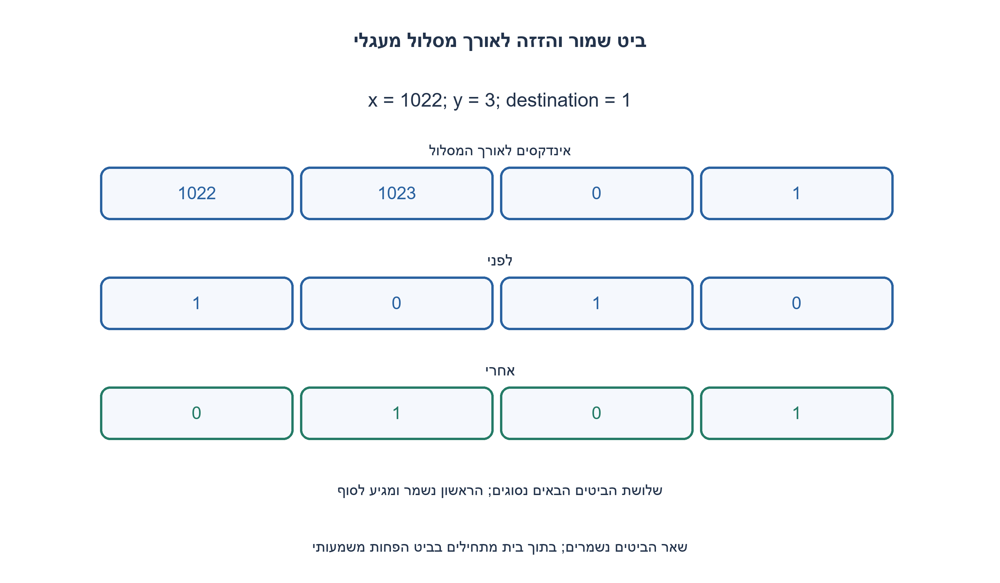
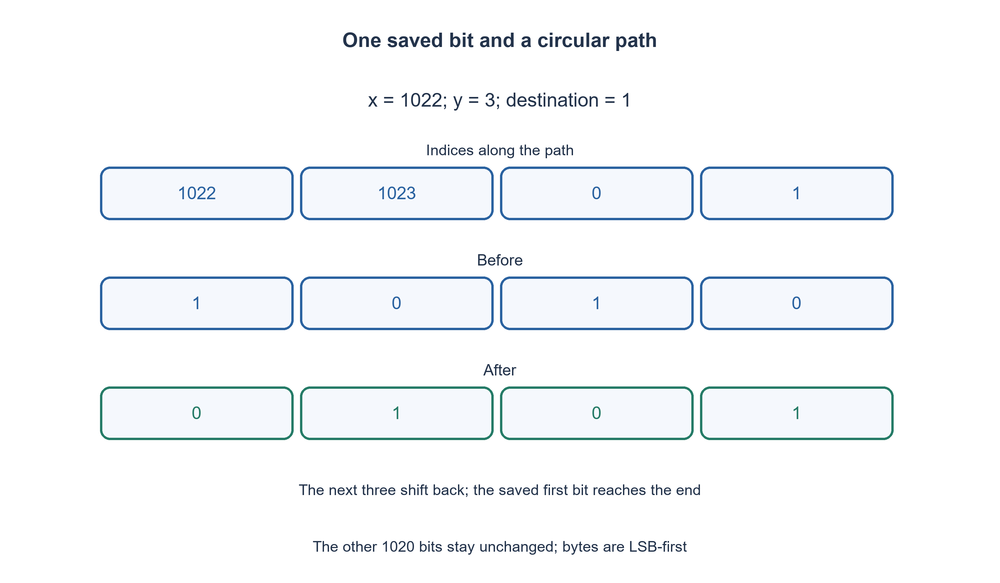

# PREP-278 — העברה יציבה של ביט במאגר ארוז מעגלי

פתרון מוצע בסיוע AI; ביקורת מקצועית אנושית ממתינה. הקושי אינו מכויל.

## עברית

המקור מתאר מערך בן 1024 ביטים ופעולה func(A, x, y) שמזיזה מיקום וחוזרת להתחלה אחרי הקצה, בלי להגדיר במדויק מה קורה לביטים שבדרך. נבחרת כאן השלמת חוזה: A הוא רשימה של 128 בתים שערכיהם 0..255; הביט באינדקס i הוא הביט i%8 בבית i//8, כלומר LSB-first.

ממשו move_bit(A, x, y): הוציאו את הביט שהיה ב־ x, העבירו אותו ל־(x+y)%1024, והזיזו את y הביטים שבדרך צעד אחד אחורה לאורך המסלול המעגלי. כל ביט מחוץ למסלול נשאר כפי שהיה. x ו־ y הם שלמים ב־ 0..1023; y=0 אינו משנה דבר. הפעולה משנה את אותה רשימה ומחזירה אותה, עם O(1) מילות עזר וללא פתיחת כל המאגר למערך ביטים. זהו פירוש עריכתי נבחר של העברה יציבה, לא סיבוב של כל המאגר ולא העתקה שדורסת ביטים.

1. בדקו איזה מידע יאבד אם תדרסו את המיקום הראשון בלי לשמור אותו.
2. שמרו ביט יחיד. אחר כך אפשר להזיז את הביט הבא לתא הקודם וללכת בכיוון המסלול.
3. חזרו y פעמים: קראו את (x+j+1)%1024 לפני כתיבה ל־(x+j)%1024; בסוף כתבו את הביט ששמרתם. עדכנו רק ביט אחד בכל בית באמצעות מסכה.

### חור אחד שנע לאורך המעגל
שומרים את הביט ב־ x במשתנה יחיד. כעת מקומו הוא חור לוגי: מעתיקים אליו את הביט הבא במסלול, ממשיכים לתא הבא, ובסוף ממלאים את החור האחרון בביט השמור. למשל במעגל קטן [A, B, C, D, E], העברת אינדקס 1 קדימה בשלושה צעדים נותנת [A, C, D, E, B]. זהו איור של אותו חוזה, לא פענוח של A כערך מספרי. במעבר דרך הקצה משתמשים באינדקס מודולו 1024.

### קריאה וכתיבה של ביט ארוז
get(i) מחזירה (A[i>>3]>>(i&7))&1. כדי לכתוב b יוצרים mask=1<<(i&7), מנקים רק אותו ביט ומכניסים b לאותו מיקום. שאר שבעת הביטים בבית אינם משתנים. אין להשתמש בהשמה A[byte]=b, שהייתה מוחקת את השכנים.

### נכונות גם בחפיפה
אחרי j העברות, j המיקומים הראשונים במסלול מכילים את הביטים המקוריים מהמיקומים הבאים. כל הביטים שעוד צריך לקרוא נמצאים קדימה במסלול וטרם נכתבו; הביט המקורי הראשון שמור בנפרד. מפני ש־ y≤1023, מסלול x..x+y אינו מבקר באותו מיקום פעמיים. לכן אין דריסה של מקור עתידי, גם אם המסלול עובר דרך 1023 אל 0. לאחר y צעדים כתיבת הביט השמור מסיימת את הסיבוב המקומי. הביטים מחוץ למסלול אינם יעד כתיבה.

עלות ההעברה עצמה Θ(y+1) פעולות ביט ו־ O(1) מילות עזר. בדיקת תקינות הרשימה קוראת 128 בתים; בהכללה ל־ B ביטים עלותה Θ(B/8), ולכן העלות הכוללת של הגרסה המתגוננת היא Θ(B/8+y+1). עבור מאגר 1024 קבוע הכול חסום, אך אין להסתיר את עבודת האימות בניתוח הכללי. y=0 עדיין מחזיר אותה רשימה.

מימושים אחרים כגון העתקת סיומת ליעד, איפוס מקומות שפונו או סיבוב כל המאגר נותנים תוצאות שונות, ולכן אינם החלפות שקטות של החוזה שנבחר.

```python
"""Stable clockwise move of one bit in 1024 LSB-first packed bits."""


def move_bit(data, x, y):
    if (type(data) is not list or len(data) != 128
            or any(type(v) is not int or not 0 <= v <= 255 for v in data)):
        raise ValueError("data must contain exactly 128 unsigned bytes")
    if type(x) is not int or type(y) is not int or not 0 <= x < 1024 or not 0 <= y < 1024:
        raise ValueError("x and y must be integers in 0..1023")

    def get(index):
        return (data[index >> 3] >> (index & 7)) & 1

    def put(index, bit):
        byte, mask = index >> 3, 1 << (index & 7)
        data[byte] = (data[byte] & (255 ^ mask)) | (bit << (index & 7))

    saved = get(x)
    for step in range(y):
        put((x + step) & 1023, get((x + step + 1) & 1023))
    put((x + y) & 1023, saved)
    return data
```




## English

The source describes 1024 bits and func(A, x, y) with wraparound, but does not fully specify intervening bits. We choose an explicit completion: A is a list of 128 bytes in 0..255; bit i is bit i%8 of byte i//8, LSB-first.

Implement move_bit(A, x, y): remove the bit originally at x, place it at (x+y)%1024, and shift the y intervening bits backward by one position along the circular path. Every bit outside that path stays unchanged. x and y are integers in 0..1023; y=0 is a no-op. Mutate and return the same list using O(1) auxiliary words, without unpacking the whole buffer into bits. This is an explicitly chosen stable-move interpretation, not a global rotation or an overwriting copy.

1. What information is lost if the first position is overwritten before saving it?
2. Save one bit. Then move the next bit into the previous position while following the path.
3. For y steps read (x+j+1)%1024 before writing (x+j)%1024; finally store the saved bit. Use a mask to update only one bit of its byte.

### A single logical hole moves around the ring
Save the bit at x. Its position becomes a logical hole: copy the next path bit into it, continue to the next location, and finally fill the last hole with the saved bit. On a small illustrative ring [A, B, C, D, E], moving index 1 forward three places yields [A, C, D, E, B]. Labels denote bit identities, not numeric inputs. Use indices modulo 1024 across the boundary.

### Access packed bits without damaging neighbors
get(i) is (A[i>>3]>>(i&7))&1. For a write, mask=1<<(i&7); clear only that position and insert b there. The other seven bits of the byte remain unchanged. Assigning A[byte]=b would erase neighbors.

### Correctness despite overlap
After j copies, the first j path positions contain the original bits from their successors. Every not-yet-read bit is still farther along the path and has not been overwritten, while the original first bit is saved separately. Because y≤1023, the path visits no location twice. This remains true when crossing 1023 to 0. After y copies, storing the saved bit completes a local rotation. Outside bits are never write targets.

The movement takes Θ(y+1) bit operations and O(1) auxiliary words. Validating all 128 byte entries also reads the buffer; generalized to B bits its cost is Θ(B/8), making the defensive routine Θ(B/8+y+1) overall. A fixed 1024-bit domain is bounded, but validation work must not vanish from the generalized analysis. y=0 returns the same unchanged list.

Suffix overwriting, clearing vacated positions and global rotation implement different contracts and must not silently replace the chosen one.

```python
"""Stable clockwise move of one bit in 1024 LSB-first packed bits."""


def move_bit(data, x, y):
    if (type(data) is not list or len(data) != 128
            or any(type(v) is not int or not 0 <= v <= 255 for v in data)):
        raise ValueError("data must contain exactly 128 unsigned bytes")
    if type(x) is not int or type(y) is not int or not 0 <= x < 1024 or not 0 <= y < 1024:
        raise ValueError("x and y must be integers in 0..1023")

    def get(index):
        return (data[index >> 3] >> (index & 7)) & 1

    def put(index, bit):
        byte, mask = index >> 3, 1 << (index & 7)
        data[byte] = (data[byte] & (255 ^ mask)) | (bit << (index & 7))

    saved = get(x)
    for step in range(y):
        put((x + step) & 1023, get((x + step + 1) & 1023))
    put((x + y) & 1023, saved)
    return data
```




## חומר משלים / Supporting material

```json
{
  "assumptions": {
    "he": [
      "128 בתים, LSB-first, מסלול קדימה עם y≤1023; ההעברה יציבה ומשנה במקום."
    ],
    "en": [
      "128 bytes, LSB-first, clockwise path with y≤1023; stable in-place movement."
    ]
  },
  "optimality": {
    "he": "ליבה Θ(y+1), אימות כולל Θ(128+y+1), O(1) מילות עזר; אין טענת מינימום הוראות.",
    "en": "Core Θ(y+1), with validation Θ(128+y+1), O(1) auxiliary words; no minimum-instruction claim."
  },
  "verification": {
    "he": "155 מקרי מודל מול אורקל שפורס את הביטים ומסובב צילום של המסלול; 4 קלטים שגויים ללא שינוי.",
    "en": "155 model cases against an unpacked snapshot-arc oracle; 4 invalid inputs rejected without mutation."
  },
  "edge_cases": {
    "he": [
      "y=0, y=1023, מעבר בית, מעבר הקצה, כל הביטים אפס או אחד."
    ],
    "en": [
      "y=0, y=1023, byte boundaries, ring boundary, all-zero and all-one data."
    ]
  },
  "common_mistakes": {
    "he": [
      "לא לדרוס בית שלם; לא לקרוא מקור שכבר הוזז; לא להניח שפעולה מעגלית היא תמיד סיבוב גלובלי."
    ],
    "en": [
      "Do not overwrite a whole byte, read an already-moved source, or equate every circular operation with global rotation."
    ]
  },
  "interview_answer": {
    "he": "שומרים ביט אחד ומעבירים את החור לאורך המסלול; מסכות משמרות את השכנים ומודולו מטפל במעבר הקצה.",
    "en": "Save one bit and propagate the hole along the path; masks preserve neighbors and modulo handles wraparound."
  },
  "source_ambiguities": {
    "he": "המקור אינו קובע מה קורה לביטים שבין המקור ליעד. העברה יציבה היא השלמה שלנו; המקור נשמר בנפרד.",
    "en": "The source omits intervening-bit semantics. Stable movement is our explicit completion; the original is retained separately."
  },
  "solution_extensions": {
    "he": [
      {
        "question": "מה משתנה אם מעבירים מקטע של k ביטים?",
        "answer_direction": "הגדירו קודם חפיפה, סדר ופינוי; אפשר לשמור סדר באמצעות סיבובי תתי־מקטעים.",
        "principle": "הבחנה בין החוזה לבין הרחבה שלו"
      }
    ],
    "en": [
      {
        "question": "What changes when moving a block of k bits?",
        "answer_direction": "First define overlap, order and vacated positions; subrange rotations can preserve order.",
        "principle": "Distinguish the contract from an extension"
      }
    ]
  }
}
```
