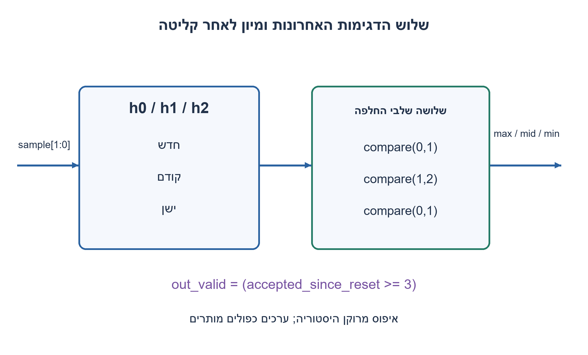
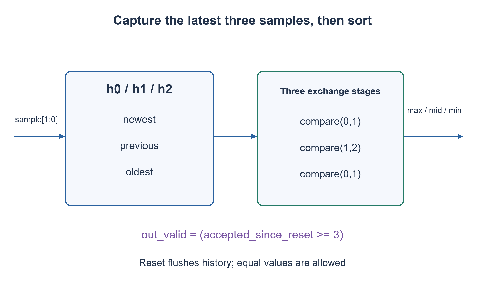

# PREP-279 — שלוש דגימות בנות שתי סיביות: מקסימום, אמצע ומינימום

פתרון מוצע בסיוע AI; ביקורת מקצועית אנושית ממתינה. הקושי אינו מכויל.

[צילום מקור פרטי](../sources/2026-11-07-batch20-04.png)

ממש רכיב סינכרוני שמקבל מידע של 2 סיביות, וממקם את המידע הזה ב-3 יציאות כאשר היציאות הן מהמספר המקסימלי שהתקבל עד המינימלי שהתקבל.

חברות לפי הדיווח בצילום בלבד: Apple.

## עברית

תכננו רכיב סינכרוני המקבל בכל דגימה מספר בן שתי סיביות ומציג בשלוש יציאות את המספרים בסדר יורד.

השלמה שנבחרה: שומרים את שלוש הדגימות התקפות האחרונות לפי סדר קבלתן, ולא את שלושת הגדולים בכל ההיסטוריה. כל דגימה היא unsigned בתחום0..3; כפילויות מותרות. בעליית שעון עם sample_valid=1 נקלטת דגימה, ו־0 משהה. איפוס סינכרוני מוחק את ההיסטוריה וגובר על קליטה. out_valid עולה רק לאחר שלוש דגימות מאז האיפוס. לאחר התייצבות, maximum,middle,minimum מציגים מיון של שלוש הדגימות; לפני התקפות אין לצרוך את הערכים. אין צורך בשמירת שוויון לפי זהות או בהוכחת מינימום רכיבים.

1. צריך להפריד בין זיכרון הדגימות לבין פעולת המיון. איך נדע שכבר התקבלו שלוש?
2. שלושה אוגרים מוזזים שומרים את החדשה ושתי קודמותיה; מונה רווי שומר את מצב המילוי.
3. השוו והחליפו לפי הסדר זוג0/1, זוג1/2 ושוב זוג0/1. לבסוף קראו את השלישייה מהגדול לקטן.

### היסטוריה ומיון הם שתי משימות שונות
שומרים h0 החדש ביותר, h1 הקודם ו־h2 הישן ביותר. בקבלה תקפה כל העדכונים קוראים את המצב הישן: `h2←h1; h1←h0; h0←sample`. מונה fill מתקדם עד3. איפוס קובע את שלושתם ואת fill לאפס; sample_valid0 משאיר אותם ללא שינוי.

מחוץ לרכיב הזיכרון ממיינים עותק צירופי a,b,c של h0,h1,h2 בסדר עולה: משווים0/1 ומחליפים אם נחוץ, אחר כך1/2 ואז0/1. אחרי ההשוואה הראשונה b הוא הגדול בזוג הראשון; אחרי השנייה c הוא הגדול בכל השלושה. ההשוואה האחרונה מסדרת את שני הנותרים בלי לשנות את c. לכן `(a,b,c)` ממוין וגם מכיל בדיוק את אותן דגימות. מחברים minimum=a,middle=b,maximum=c.

לדוגמה, הדגימות3,1,2 נותנות יציאות3,2,1 לאחר השלישית. דגימה נוספת0 מוציאה את3 מההיסטוריה, ולכן היציאות נעשות2,1,0. זה אינו מאגר של שיאים היסטוריים. הדגימות2,2,1 נותנות2,2,1: אין להעלים כפילויות.

שישה FF שומרים את הנתונים ועוד שניים את fill. המיון משתמש בשלוש יחידות compare/exchange בנות שתי סיביות; זה פתרון קטן עם עומק של שלושה שלבים, בלי טענת מינימום שערים. היציאות הן לוגיקה צירופית אחרי אוגרי ההיסטוריה, ולכן משתנות לאחר השעון וזמן ההתפשטות. יש לעמוד בתזמון הרכיב הקולט; אי אפשר להניח השהיה אפס.

כל64 השלשות האפשריות נבדקות מול sort בלתי תלוי. תרחישי ההמשך צריכים לכלול איפוס לאחר היסטוריה מלאה, בועות sample_valid, סדר עולה/יורד וכל הערכים שווים. out_valid הוא חוזה המילוי; ערכי האפס שהאיפוס משאיר אינם שלוש דגימות אמיתיות.

### קוד SystemVerilog; תוצאות סימולציה בדוח נפרד

```systemverilog
`timescale 1ns/1ps
// Capture history first; combinational outputs sort the three latest values.
module prep279_latest_three_batch1107b20(
 input wire clk,rst,sample_valid,input wire [1:0] sample,
 output wire out_valid,output reg [1:0] minimum,middle,maximum);
 reg [1:0] h0,h1,h2,fill;
 reg [1:0] a,b,c,t;
 always @(posedge clk) begin
   if(rst) begin h0<=0;h1<=0;h2<=0;fill<=0;end
   else if(sample_valid) begin
     h2<=h1;h1<=h0;h0<=sample;
     if(fill<3) fill<=fill+1'b1;
   end
 end
 assign out_valid=(fill==3);
 always @* begin
   a=h0;b=h1;c=h2;t=0;
   if(a>b)begin t=a;a=b;b=t;end
   if(b>c)begin t=b;b=c;c=t;end
   if(a>b)begin t=a;a=b;b=t;end
   minimum=a;middle=b;maximum=c;
 end
endmodule
```




### assumptions

שלוש האחרונות בלבד; unsigned; כפילויות חוקיות; תקפות אחרי שלוש קבלות.

### optimality

שמונה ביטי מצב ושלושה compare/exchange בני שתי סיביות. זמן עדכון קבוע לעומק3; אין טענת שטח מינימלי.

### verification

בדיקות Python עצמאיות עברו:64 שלשות למיון,4 שורות אמת, שלילת18 רשתות NOR בנות שני שערים,4,094 מילים טוריות עם40,962 קידומות ו־161 לוחות זמנים של פייפליין. ראיה: checks/batch1107b20-hardware-model-verification.json. קוד RTL ומודל מתגי MOS הם חומר נפרד מהמודל; קומפילציה וסימולציה נרשמות בדוח native של האצווה. מודל המתגים אינו מדמה מתח סף או שולי רעש; לא בוצעו סינתזה או אישור תזמון.

### edge_cases

```json
[
  "איפוס,0/1/2 דגימות, שלוש שוות, החלפת הישנה והשהיית קליטה."
]
```

### common_mistakes

מיון היסטוריה במקום שמירת סדר הקבלה; אובדן כפילויות; סימון תקפות לפני שלוש דגימות.

### interview_answer

אשמור שלוש דגימות לפי זמן הקבלה, ואמיין עותק שלהן בשלוש השוואות. מונה מילוי יבדיל בין דגימות אמיתיות לאיפוס.

### source_ambiguities

הצילום אינו מגדיר אם מתייחסים לכל ההיסטוריה או לשלוש האחרונות. בחרנו שלוש אחרונות והוספנו תקפות ואיפוס מפורשים.

### solution_extensions

```json
{
  "question": "מה משתנה אם רוצים את שלושת השיאים בכל ההיסטוריה?",
  "direction": "ממיינים את הרשימה המדורגת עם הדגימה החדשה; אין מוציאים לפי גיל. זה חוזה אחר.",
  "tests": [
    "3,1,2,0 משאיר3,2,1",
    "ערכים שווים"
  ]
}
```

## English

Design a synchronous component that receives a two-bit number per sample and shows three numbers in descending order.

Chosen completion: retain the three most recently accepted samples, rather than the historical top three. Inputs are unsigned0..3 and duplicates are allowed. A rising edge with sample_valid1 accepts a sample; zero pauses. Synchronous reset flushes history and overrides acceptance. out_valid becomes one after three accepted samples since reset. After settling, maximum,middle,minimum sort those three samples; outputs before validity must not be consumed. Stable identity ordering for ties and a minimum-component proof are not required.

1. Separate sample retention from sorting. How will you know three samples have arrived?
2. Shift three registers to retain the newest and two preceding samples; use a saturating fill count.
3. Compare/exchange positions0/1, then1/2, then0/1 again. Read the resulting triple in descending order.

### Retention and sorting are separate jobs
Let h0 be newest, h1 previous and h2 oldest. An accepted sample performs simultaneous old-state updates `h2←h1; h1←h0; h0←sample`. Saturate fill at3. Reset clears all registers; sample_valid0 holds them.

Sort a combinational copy a,b,c ascending by compare/exchange0/1, then1/2, then0/1. After the first comparison b is the larger of the initial pair; after the second c is the largest of all three. The final comparison orders the two remaining values without changing c. Thus `(a,b,c)` is sorted and preserves the input multiset. Connect minimum=a,middle=b,maximum=c.

Samples3,1,2 produce3,2,1 after the third acceptance. A fourth sample0 evicts3, producing2,1,0. This is not a historical-record collection. Samples2,2,1 produce2,2,1; duplicates are retained.

Six data flip-flops plus two fill bits suffice. Three two-bit compare/exchange units form three combinational stages, with no globally minimum gate claim. Outputs are combinational after the history registers and settle after the active edge; the receiving logic must meet timing rather than assume zero delay.

All64 triples are checked against independent sorting. Further scenarios include reset after a full history, sample_valid bubbles, monotone orders and equal values. out_valid expresses actual filling; reset zeros do not count as received samples.

### SystemVerilog; simulation results are in a separate report

```systemverilog
`timescale 1ns/1ps
// Capture history first; combinational outputs sort the three latest values.
module prep279_latest_three_batch1107b20(
 input wire clk,rst,sample_valid,input wire [1:0] sample,
 output wire out_valid,output reg [1:0] minimum,middle,maximum);
 reg [1:0] h0,h1,h2,fill;
 reg [1:0] a,b,c,t;
 always @(posedge clk) begin
   if(rst) begin h0<=0;h1<=0;h2<=0;fill<=0;end
   else if(sample_valid) begin
     h2<=h1;h1<=h0;h0<=sample;
     if(fill<3) fill<=fill+1'b1;
   end
 end
 assign out_valid=(fill==3);
 always @* begin
   a=h0;b=h1;c=h2;t=0;
   if(a>b)begin t=a;a=b;b=t;end
   if(b>c)begin t=b;b=c;c=t;end
   if(a>b)begin t=a;a=b;b=t;end
   minimum=a;middle=b;maximum=c;
 end
endmodule
```




### assumptions

Latest three only; unsigned; legal duplicates; validity after three acceptances.

### optimality

Eight state bits and three two-bit compare/exchange stages; fixed work at depth3, without a minimum-area claim.

### verification

Independent Python checks passed:64 sorting triples,4 truth-table rows, exclusion of18 two-NOR networks,4,094 serial words with40,962 prefixes and161 pipeline schedules. Evidence: checks/batch1107b20-hardware-model-verification.json. RTL and the MOS switch abstraction are separate from these models; compilation and simulation are recorded in the batch native report. Digital switches do not model threshold loss or noise margin; no synthesis or timing signoff is claimed.

### edge_cases

```json
[
  "Reset,0/1/2 samples, equal triples, evicting the oldest and paused acceptance."
]
```

### common_mistakes

Sorting the retained chronological state in place; discarding duplicates; asserting validity before three samples.

### interview_answer

Keep three chronological samples, sort a copy with three comparisons and use a fill count to distinguish real samples from reset values.

### source_ambiguities

The source omits whether all history or just three latest values count; latest-three retention, reset and validity are explicit additions.

### solution_extensions

```json
{
  "question": "What changes for the historical top three?",
  "direction": "Merge the new value into retained ranked records instead of evicting by age; this is a different contract.",
  "tests": [
    "3,1,2,0 retains3,2,1",
    "Tied values"
  ]
}
```


## Native verification

אימות native נוסף: חמש יחידות ה־RTL/מתגים ורתמת האצווה קומפלו ב־Icarus Verilog12.0-3 והורצו בפועל ב־Ubuntu26.04.1 בסביבה מבודדת עם רשת חסומה. עברו96,555 בדיקות:4,094 מילים טוריות,40,962 קידומות,5,256 מחזורי היסטוריה ו־4 שורות אמת. ראיה וחתימות קבצים: checks/batch1107b20-native-verification.json. הבדיקה של המעגל בן ארבעת הטרנזיסטורים היא מתגים לוגיים אידאליים בלבד, ללא מתח סף, SPICE או אישור רעש/תזמון.

Additional native execution: the five RTL/switch units and batch harness were compiled with Icarus Verilog12.0-3 and executed on Ubuntu26.04.1 in an isolated network-denied environment. All96,555 checks passed:4,094 serial words,40,962 prefixes,5,256 history cycles and4 truth rows. Evidence and source hashes: checks/batch1107b20-native-verification.json. The four-transistor check uses ideal digital switches only, without MOS threshold, SPICE or noise/timing qualification.
