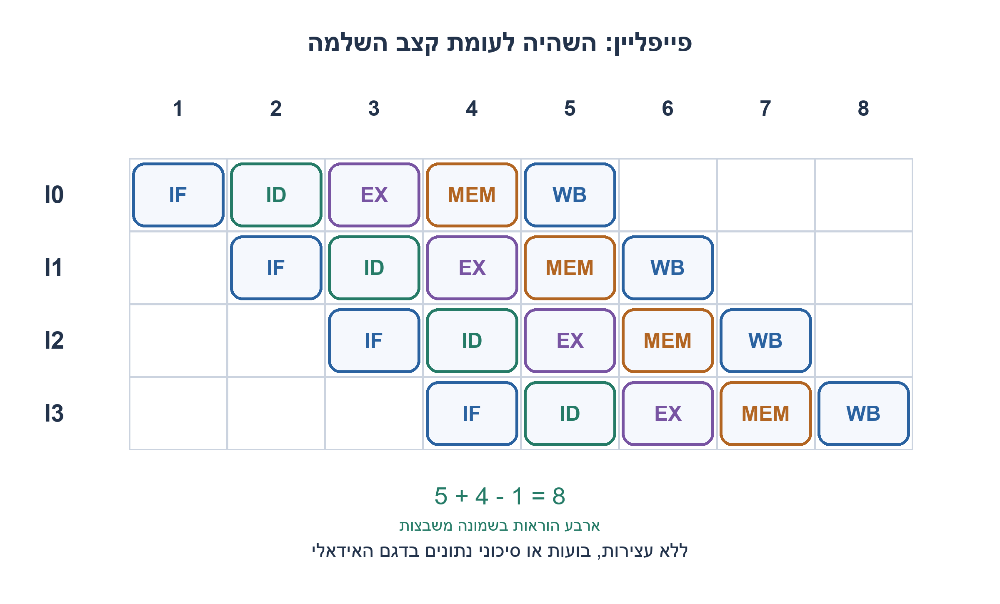
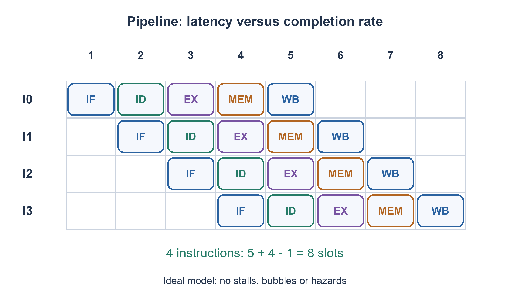

# PREP-280 — פייפליין של מעבד: זמן תגובה, מחזורי שעון וקצב השלמה

פתרון מוצע בסיוע AI; ביקורת מקצועית אנושית ממתינה. הקושי אינו מכויל.

[צילום מקור פרטי](../sources/2026-11-07-batch20-06.png)

הסבר את אופן הפעולה של מעבד פייפליין. מה מספר מחזורי השעון הנדרשים כדי לקבל מידע במוצא?

חברות לפי הדיווח בצילום בלבד: Apple.

## עברית

הסבירו כיצד עובד מעבד pipeline וכמה מחזורי שעון נדרשים כדי לקבל מידע במוצא.

השלמה לימודית: בחרו מודל אידאלי בן חמישה שלבים IF,ID,EX,MEM,WB, כל שלב נמשך משבצת שעון אחת. הוראה נכנסת בתחילת משבצת1, ותוצאת WB נרשמת בסוף משבצת5. ללא תלות בין הוראות, עצירות, החטאות או הסתעפויות אפשר להתחיל הוראה בכל משבצת. חשבו זמני השלמה להוראה אחת ולארבע הוראות, הסבירו תקופת שעון והרחיבו לעצירות. אין לממש ISA מלא ואין להציג חמישה מחזורים כנתון שנמסר במקור.

1. הבחינו בין זמן שעוברת הוראה יחידה במערכת לבין הזמן בין שתי הוראות שמסתיימות.
2. הכינו טבלה: כל הוראה מתקדמת שלב אחד בכל משבצת, אבל הוראות שונות נמצאות בשלבים שונים יחד.
3. ל־K שלבים ו־n הוראות רצופות ללא עצירות נדרשות K+n−1 משבצות. חשבו את השורה הראשונה ואת הקצב לאחר מילוי הצינור.

### מחלקים עבודה כדי לחפוף הוראות
במודל הנבחר IF מביא הוראה, ID מפענח וקורא אוגרים, EX מחשב, MEM ניגש לזיכרון כשנדרש ו־WB רושם תוצאה. אוגרי שלבים מפרידים את הנתיבים. בזמן שהוראה אחת ב־EX, אחרת יכולה להיות ב־ID ושלישית ב־IF. אלו תפקידים של מודל הוראה פשוט; מעבדים אמיתיים אינם חייבים להשתמש באותם חמישה שלבים.

הוראה ראשונה מעסיקה את משבצות1..5 ומסתיימת בסוף5. ארבע הוראות רצופות מסתיימות בסוף5,6,7,8, ולכן סך הזמן הוא8 תקופות. בכלליות, עבור n>0 מתקבל `K+n−1`; עבור n=0 אין עבודה. אחרי המילוי מסתיימת לכל היותר הוראה אחת למשבצת במודל, אך השהיית כל הוראה עדיין K משבצות. משפרים throughput, ולא מבטיחים שהוראה בודדת נעשית מהירה יותר.

ספירת חזיתות חייבת לציין נקודת התחלה: עיבוד IF מתרחש לפני חזית סיום משבצת1. בין אוגר תוצאת IF בחזית1 לאוגר תוצאת WB בחזית5 יש ארבע תקופות, ואילו מתחילת עיבוד IF ועד סוףWB יש חמש. שתי הספירות עקביות; אי אפשר להחליף ביניהן בלי לציין מה פירוש ״נכנס״ ו״מוצא״.

תקופת השעון מוגבלת על ידי השלב האיטי ביותר, בתוספת CQ, setup, חיווט ואי־ודאות לפי חוזה השעון. לדוגמה, אם חמש השהיות הלוגיקה הן2,1,3,2,1ns ותקורת אוגרים/אי־ודאות נבחרת0.5ns, נדרש T≥3.5ns במודל אפס־skew, לא סכום9ns. ההשהיה הכוללת להוראה היא אז17.5ns; זו דוגמה, לא תדר של מעבד מסוים. hold נבדק בנפרד דרך השהיות מינימום.

תלות נתונים, זיכרון איטי, משאב משותף והסתעפות יכולים להוסיף בועות או לבטל עבודה. forwarding עשוי לקצר תלות אך אינו מעלים כל עצירה. המודל המצורף מאפשר עצירה גלובלית המקפיאה את כל השלבים ואוסרת קבלת הוראה חדשה; אין בו קבלה אבודה או השלמה כפולה. עבור A,B, שתי משבצות עצירה ואז C, ההשלמות הן בסוף7,8,9. זה דגם לוחות זמנים, לא סימולציה של ISA או של מעבד עם backpressure עצמאי לכל שלב.

### מודל Python שנבדק

```python
"""Stage-completion teaching schedule, not an ISA implementation.

An offered token is processed by stage1 during a slot and enters its result
register at that slot's ending edge. Stage5 completion is visible at edge5.
Each slot has one period; a global stall freezes the entire toy machine.
"""

def schedule(offers, stalls=(), stages=5):
    if type(stages) is not int or stages < 1:
        raise ValueError("positive stage count required")
    state = [None] * stages
    blocked = set(stalls)
    result = []
    for cycle, offered in enumerate(offers, 1):
        if cycle in blocked:
            if offered is not None:
                raise ValueError("no new token may be accepted during global stall")
            result.append((cycle, tuple(state), None))
        else:
            state = [offered] + state[:-1]
            result.append((cycle, tuple(state), state[-1]))
    return result


def ideal_cycles(instructions, stages=5):
    if type(instructions) is not int or instructions < 0 or type(stages) is not int or stages < 1:
        raise ValueError("nonnegative instruction count and positive stages required")
    return 0 if instructions == 0 else stages + instructions - 1
```




### assumptions

חמישה שלבים אידאליים; תחילת/סיום משבצת מוגדרים; עצירה גלובלית בלבד בדגם.

### optimality

ללא עצירות K+n−1 משבצות; throughput מרבי הוראה לתקופה, והשהיית הוראה K תקופות. הדגם שומר K אסימונים.

### verification

בדיקות Python עצמאיות עברו:64 שלשות למיון,4 שורות אמת, שלילת18 רשתות NOR בנות שני שערים,4,094 מילים טוריות עם40,962 קידומות ו־161 לוחות זמנים של פייפליין. ראיה: checks/batch1107b20-hardware-model-verification.json. קוד RTL ומודל מתגי MOS הם חומר נפרד מהמודל; קומפילציה וסימולציה נרשמות בדוח native של האצווה. מודל המתגים אינו מדמה מתח סף או שולי רעש; לא בוצעו סינתזה או אישור תזמון.

### edge_cases

```json
[
  "אין הוראות, הוראה אחת, K=1, בועות, שתי עצירות ומילוי/ריקון."
]
```

### common_mistakes

אמירה שכל מעבד דורש5 מחזורים; בלבול בין latency ל־throughput; קבלת נתון בעת freeze; התעלמות מתקורת אוגרים.

### interview_answer

מספר השלבים קובע השהיה רק אחרי הגדרת נקודות הזמן. במודל חמישה שלבים התוצאה הראשונה בסוף משבצת5 ואחריה אחת למשבצת, ללא עצירות.

### source_ambiguities

המקור אינו מציין מספר שלבים או ISA. המודל וחמש ההשהיות המספריות הם השלמות מפורשות.

### solution_extensions

```json
{
  "question": "האם חלוקה לעוד שלבים תמיד עוזרת?",
  "direction": "לוגיקה קצרה יותר מול תקורת אוגרים, ענישות הסתעפות ומורכבות forwarding; אין שיפור חופשי.",
  "tests": [
    "שלב קצר מתקורת האוגר",
    "הסתעפות מתגלה מאוחר"
  ]
}
```

## English

Explain how a pipelined processor works and how many clock cycles are needed to obtain output.

Teaching completion: use an ideal five-stage IF,ID,EX,MEM,WB pipeline, one clock slot per stage. An instruction enters at the beginning of slot1; its WB result is registered at the end of slot5. With no dependencies, stalls, misses or branches, one instruction can start per slot. Calculate completion for one and four instructions, explain clock period and discuss stalls. A complete ISA implementation is not required, and five stages must not be attributed to the source.

1. Distinguish one instruction’s end-to-end delay from the gap between completed instructions.
2. Build a table: each instruction advances one stage per slot while different instructions occupy different stages concurrently.
3. K stages and n consecutive instructions without stalls need K+n−1 slots. Compare first completion with steady-state rate.

### Split work to overlap instructions
In the chosen model IF fetches, ID decodes and reads registers, EX computes, MEM accesses memory when needed and WB writes the result. Pipeline registers separate paths. While one instruction is in EX, another may occupy ID and a third IF. Real processors need not have these exact five stages.

The first instruction occupies slots1..5 and completes at the end of5. Four consecutive instructions complete at ends5,6,7,8, requiring eight periods total. Generally, for n>0 the count is `K+n−1`; zero instructions need no slots. Once filled, at most one instruction completes per slot in this model, but each instruction still spends K slots in the pipe. Throughput improves without guaranteeing a faster individual instruction.

Name the timing endpoints. IF processing precedes the edge ending slot1. Between its registered result at edge1 and the WB register at edge5 there are four periods; from the start of IF processing through completed WB there are five. Both counts are consistent, but “input” and “output” cannot silently change meanings.

The slowest stage limits the period after adding clock-to-Q, setup, wiring and uncertainty for the clock contract. For example, stage logic delays2,1,3,2,1ns and an explicitly chosen0.5ns register/uncertainty overhead require T≥3.5ns under zero skew, not the9ns sum. End-to-end latency is then17.5ns. These are illustrative parameters, not specifications of a particular processor. Hold uses minimum delays and is checked separately.

Data dependencies, slow memory, shared resources and branches can insert bubbles or discard work. Forwarding reduces some dependencies but does not remove every stall. The attached model has a global freeze: no stage advances and no new token is accepted. A,B, two stalled slots, then C complete at ends7,8,9. This is a scheduling model, not an ISA simulator or a pipeline with independent per-stage backpressure.

### Verified Python teaching model

```python
"""Stage-completion teaching schedule, not an ISA implementation.

An offered token is processed by stage1 during a slot and enters its result
register at that slot's ending edge. Stage5 completion is visible at edge5.
Each slot has one period; a global stall freezes the entire toy machine.
"""

def schedule(offers, stalls=(), stages=5):
    if type(stages) is not int or stages < 1:
        raise ValueError("positive stage count required")
    state = [None] * stages
    blocked = set(stalls)
    result = []
    for cycle, offered in enumerate(offers, 1):
        if cycle in blocked:
            if offered is not None:
                raise ValueError("no new token may be accepted during global stall")
            result.append((cycle, tuple(state), None))
        else:
            state = [offered] + state[:-1]
            result.append((cycle, tuple(state), state[-1]))
    return result


def ideal_cycles(instructions, stages=5):
    if type(instructions) is not int or instructions < 0 or type(stages) is not int or stages < 1:
        raise ValueError("nonnegative instruction count and positive stages required")
    return 0 if instructions == 0 else stages + instructions - 1
```




### assumptions

Five ideal stages, explicit slot endpoints and only global freeze in the model.

### optimality

Without stalls K+n−1 slots; at most one completion per period and K-period instruction latency. The toy model stores K tokens.

### verification

Independent Python checks passed:64 sorting triples,4 truth-table rows, exclusion of18 two-NOR networks,4,094 serial words with40,962 prefixes and161 pipeline schedules. Evidence: checks/batch1107b20-hardware-model-verification.json. RTL and the MOS switch abstraction are separate from these models; compilation and simulation are recorded in the batch native report. Digital switches do not model threshold loss or noise margin; no synthesis or timing signoff is claimed.

### edge_cases

```json
[
  "No instructions, one instruction, K=1, bubbles, two stalls and filling/draining."
]
```

### common_mistakes

Claiming every processor needs five cycles; confusing latency with throughput; accepting work during freeze; ignoring register overhead.

### interview_answer

Stage count determines latency only after naming endpoints: first completion ends slot5, then one per slot in the unstalled five-stage model.

### source_ambiguities

The source gives no stage count or ISA; the chosen model and numerical delay example are explicit additions.

### solution_extensions

```json
{
  "question": "Do more stages always help?",
  "direction": "Balance shorter logic against register overhead, branch penalties and forwarding complexity.",
  "tests": [
    "Logic shorter than register overhead",
    "Late branch resolution"
  ]
}
```
