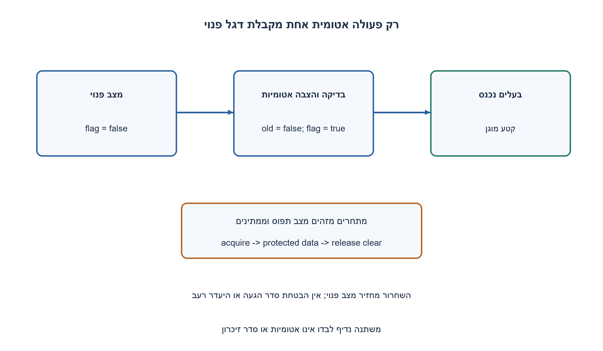
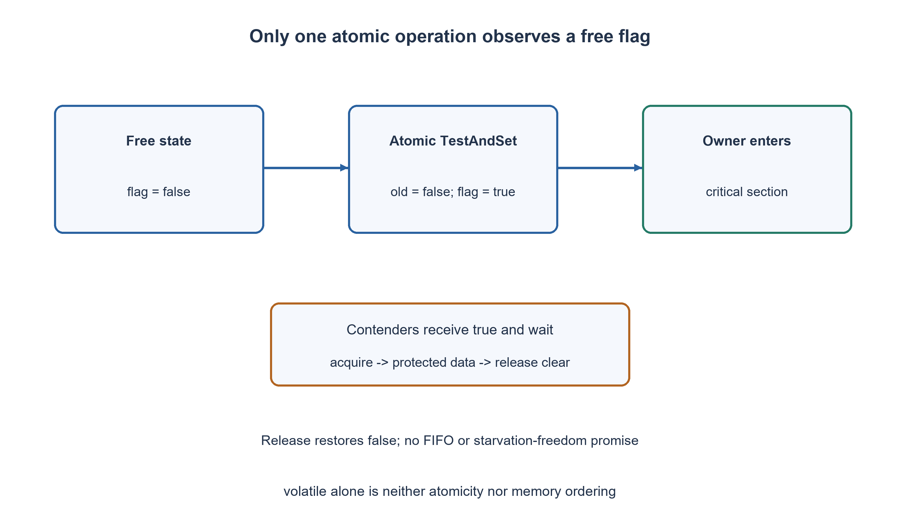

# PREP-281 — מנעול סחרור באמצעות TestAndSet אטומי

פתרון מוצע בסיוע AI; ביקורת מקצועית אנושית ממתינה. הקושי אינו מכויל.

## עברית

ממשו spinlock באמצעות Test_and_Set והסבירו נעילה, שחרור ונכונות.

השלמת חוזה: נבחר C11 עם כמה threads החולקים זיכרון. TestAndSet הוא פעולה אטומית שמציבה true ומחזירה את הערך הקודם של דגל אחד, שמתחיל ב־ false. השתמשו ב־ atomic_flag, נעילה בסדר acquire ושחרור ב־ release. רק בעל המנעול משחרר אותו, ואין נעילה חוזרת של אותו thread לפני שחרור. הקטע המוגן קצר ואינו ממתין למשאב אחר. הסבירו מה המנעול אינו מבטיח ומה משתנה במערכת חד־ליבתית או כשבעל המנעול נעצר. אין צורך לממש primitive אטומי בעזרת קריאה וכתיבה רגילות.

1. אם שני threads קוראים דגל רגיל לפני שכל אחד כותב אליו, האם שניהם עשויים לחשוב שהמנעול פנוי?
2. השתמשו בתוצאה הישנה של פעולה אחת אטומית: רק מי שקיבל false רשאי להיכנס.
3. חזרו כל עוד atomic_flag_test_and_set_explicit מחזירה true, עם acquire. ביציאה בצעו atomic_flag_clear_explicit עם release.

### בדיקה והצבה חייבות להיות פעולה אחת
קוד מסוג if (!locked) locked=true אינו מנעול: שני threads יכולים לראות false לפני שאחד מציב true. TestAndSet מאחד את שתיהן לפעולה אטומית. גם אם כמה threads מתחרים, רק פעולה אחת רואה את המעבר מ־ false ל־ true. היא מקבלת false ונכנסת; כל האחרות מקבלות true וממשיכות להסתחרר.

הדגל אינו מונה. הוא מתחיל משוחרר באמצעות ATOMIC_FLAG_INIT. כשהבעלים מסיים, clear עם release מחזיר אותו ל־ false; אין לשחרר בעזרת TestAndSet, שמציב true. אם thread מנסה לנעול פעמיים בעצמו הוא ימתין לעצמו, ולכן החוזה אוסר כניסה חוזרת.

### ההוכחה מחולקת לשניים
לבלעדיות: בין שתי פעולות clear לכל היותר TestAndSet אחד מחזיר false. רק קריאה כזאת מאפשרת כניסה, ורק הבעלים מבצע clear בסוף הקטע; לכן שני קטעים מוגנים אינם פעילים בו זמנית.

לנראות זיכרון: clear ב־ release מסדר את כתיבות הקטע המוגן לפני השחרור. הרכישה הבאה ב־ acquire שקוראת את המצב המשוחרר מסנכרנת את הגישה לנתונים המוגנים. דגל אטומי בלי סדר הזיכרון המתאים אינו הסבר מלא להגנת נתונים רגילים; volatile לבדו אינו מספק אטומיות או יחס happens-before. יש להגן על כל הגישות המתחרות לאותו מידע באותו מנגנון.

### עלות ומגבלות
רכישה ללא תחרות דורשת ניסיון אטומי אחד, ושחרור פעולה אטומית אחת; מקום הדגל קבוע. תחת תחרות אין חסם למספר הניסיונות, אין FIFO ואין הבטחת היעדר רעב. כל ניסיון כותב את הדגל ועלול לייצר תעבורת coherence. הוספת pause מתאים לארכיטקטורה או backoff עשויה להפחית עומס, אך לא מוכיחה הוגנות.

אם בעל המנעול אינו מתוזמן, האחרים שורפים זמן CPU עד שיוכל לשחרר. חד־ליבה עם preemption אפשרית אך יקרה; בקוד interrupt או כשמונעים מן הבעלים לרוץ, הסחרור עלול לא להסתיים. עבור המתנה ארוכה מנעול שחוסם thread עשוי להתאים יותר. אין לקרוא לכל spinlock פתרון מיטבי.

ה־ harness מריץ ארבעה pthreads שמגדילים מונה מוגן 25,000 פעמים כל אחד, ומצפה ל־ 100,000. זהו ניסוי תחרות סופי; ההוכחה נשענת על חוזה האטומיות וה־ memory ordering של C11, לא על כך שדוגמת הסחרור הצליחה פעם אחת.

```c
#ifndef JOBRUN_PREP281_SPINLOCK_H
#define JOBRUN_PREP281_SPINLOCK_H
#include <stdatomic.h>

typedef struct { atomic_flag flag; } prep281_lock;
#define PREP281_LOCK_INITIALIZER { ATOMIC_FLAG_INIT }

static inline void prep281_lock_acquire(prep281_lock *lock) {
    /* TestAndSet is atomic and returns the previous value. */
    while (atomic_flag_test_and_set_explicit(&lock->flag, memory_order_acquire)) {
        /* Busy wait; no fairness or bounded waiting is promised. */
    }
}

static inline void prep281_lock_release(prep281_lock *lock) {
    atomic_flag_clear_explicit(&lock->flag, memory_order_release);
}
#endif
```




## English

Implement a spinlock using Test_and_Set and explain acquisition, release and correctness.

Chosen contract: C11 shared-memory threads. Atomic TestAndSet sets one initially false flag to true and returns its old value. Use atomic_flag, acquire ordering when locking and release ordering when unlocking. Only the owner unlocks, and the lock is not recursively acquired by its owner. The protected section is short and does not wait for another resource. Explain missing guarantees and the effects of one CPU or a descheduled owner. You need not build the atomic primitive from ordinary loads/stores.

1. If two threads separately read then write an ordinary flag, can both believe they acquired the lock?
2. Use the old result of one atomic operation; only the caller receiving false may enter.
3. Loop while atomic_flag_test_and_set_explicit returns true, using acquire. Unlock with atomic_flag_clear_explicit using release.

### The test and the set must be one operation
Code such as if (!locked) locked=true is not a lock: two threads can observe false before either writes true. Atomic TestAndSet combines the steps. Among competing operations, only one sees the transition from false to true. It returns false and acquires; others return true and spin.

The flag is not a counter. Initialize it clear with ATOMIC_FLAG_INIT. The owner clears with release after finishing. TestAndSet cannot unlock because it sets true. Recursive locking makes the owner wait for itself, so the contract prohibits it.

### Two parts of correctness
Mutual exclusion: between clears, at most one TestAndSet returns false. Only that result admits a thread, and only the owner clears after leaving its protected section. Thus protected sections cannot overlap.

Memory visibility: a release clear orders protected writes before unlocking. A subsequent acquire that reads the released state synchronizes access to protected ordinary data. Atomicity alone without appropriate ordering is an incomplete explanation; volatile does not provide atomicity or happens-before. All conflicting access to the protected data must follow the same synchronization discipline.

### Cost and limitations
An uncontended acquisition takes one atomic attempt and release one atomic operation; flag storage is constant. Under contention attempts are unbounded: there is no FIFO or starvation-freedom guarantee. Every failed attempt writes the flag and can create coherence traffic. Architecture-specific pause or backoff can reduce pressure without proving fairness.

If the owner is descheduled, other threads waste CPU until it can release. A preemptive single-core system can use this lock but may do so inefficiently; in interrupt code or when the owner cannot run, spinning may never terminate. A blocking mutex can be preferable for long waits. No blanket optimality claim is made.

The native harness starts four pthreads, each performing 25,000 increments of one protected counter, expecting 100,000. This is finite contention stress; correctness relies on C11 atomicity and memory-order semantics, not on one successful run.

```c
#ifndef JOBRUN_PREP281_SPINLOCK_H
#define JOBRUN_PREP281_SPINLOCK_H
#include <stdatomic.h>

typedef struct { atomic_flag flag; } prep281_lock;
#define PREP281_LOCK_INITIALIZER { ATOMIC_FLAG_INIT }

static inline void prep281_lock_acquire(prep281_lock *lock) {
    /* TestAndSet is atomic and returns the previous value. */
    while (atomic_flag_test_and_set_explicit(&lock->flag, memory_order_acquire)) {
        /* Busy wait; no fairness or bounded waiting is promised. */
    }
}

static inline void prep281_lock_release(prep281_lock *lock) {
    atomic_flag_clear_explicit(&lock->flag, memory_order_release);
}
#endif
```




## חומר משלים / Supporting material

```json
{
  "assumptions": {
    "he": [
      "C11, דגל משותף אטומי, false בהתחלה, בעלים יחיד משחרר וללא reentrancy."
    ],
    "en": [
      "C11, shared atomic flag initially false, owner-only release and no reentrancy."
    ]
  },
  "optimality": {
    "he": "O(1) אחסון; ניסיון מוצלח ללא תחרות קבוע. מספר ניסיונות ההמתנה אינו חסום.",
    "en": "O(1) storage; constant uncontended successful attempt. Waiting attempts have no finite bound."
  },
  "verification": {
    "he": "קומפל והורץ עם GCC 15.2 ב־ Vercel Sandbox: ארבעה threads השלימו 100,000 הגדלות מוגנות. פירוט וחתימות מקור בדוח native. אין טענה שנבדקו כל השזירות.",
    "en": "Compiled and executed with GCC 15.2 in Vercel Sandbox: four threads completed 100,000 protected increments. Source hashes and details are in the native report. Not every interleaving is tested."
  },
  "edge_cases": {
    "he": [
      "תחרות, בעלים שלא מתוזמן, נעילה חוזרת אסורה, שחרור בידי thread שגוי."
    ],
    "en": [
      "Contention, descheduled owner, forbidden recursion and non-owner release."
    ]
  },
  "common_mistakes": {
    "he": [
      "volatile אינו תחליף לאטומי; TestAndSet מחזיר ערך קודם; clear משחרר; אין הבטחת הוגנות."
    ],
    "en": [
      "volatile is not atomicity; TestAndSet returns the old value; clear unlocks; fairness is not promised."
    ]
  },
  "interview_answer": {
    "he": "רק TestAndSet שמחזיר false מקנה בעלות; release בשחרור ו־ acquire ברכישה מסדרים את הנתונים המוגנים.",
    "en": "Only TestAndSet returning false acquires ownership; release and acquire order protected data."
  },
  "source_ambiguities": {
    "he": "המקור לא מגדיר שפה, סדר זיכרון או תזמון. נבחר C11 וההנחות מוצגות במפורש.",
    "en": "The source omits language, memory ordering and scheduling; C11 and explicit assumptions complete it."
  },
  "solution_extensions": {
    "he": [
      {
        "question": "איך להפחית תעבורת כתיבה בזמן המתנה?",
        "answer_direction": "Test-test-and-set, backoff או מנעול תורים; לכל חלופה חוזה ועלות משלה.",
        "principle": "הבחנה בין החוזה לבין הרחבה שלו"
      }
    ],
    "en": [
      {
        "question": "How can spinning cause less write traffic?",
        "answer_direction": "Consider test-test-and-set, backoff or a queue lock, each with its own contract and costs.",
        "principle": "Distinguish the contract from an extension"
      }
    ]
  }
}
```
