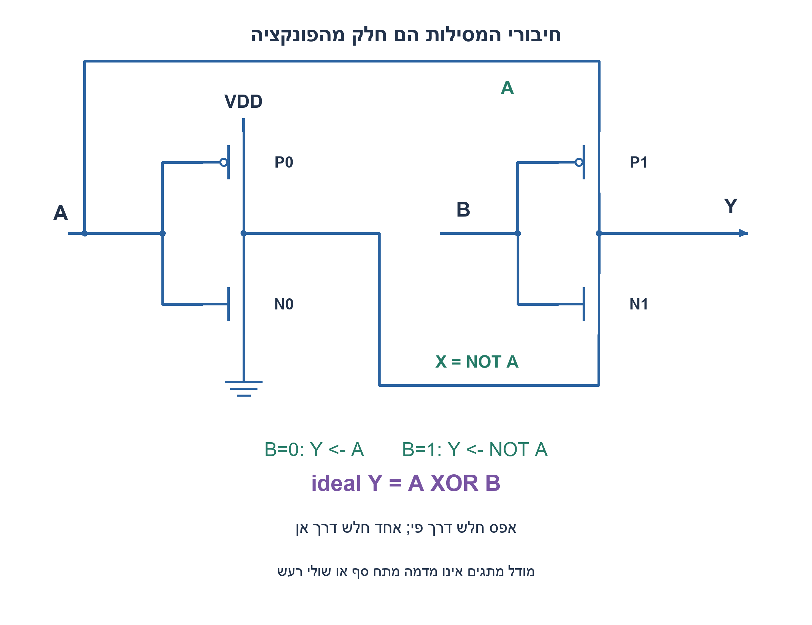
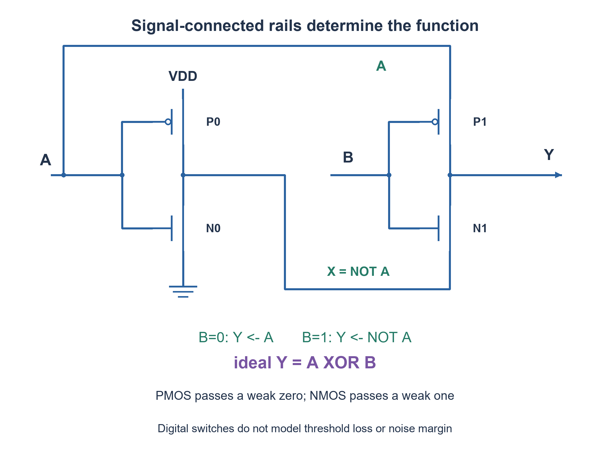

# PREP-282 — ארבעה טרנזיסטורים ומסילות אות: איזו פונקציה מתקבלת?

פתרון מוצע בסיוע AI; ביקורת מקצועית אנושית ממתינה. הקושי אינו מכויל.

[צילום מקור פרטי](../sources/2026-11-07-batch20-09.png)

איזה שער לוגי מהווה המעגל הזה? השרטוט המקורי כולל שני זוגות טרנזיסטורים משלימים; יש לנתח את החיווט כפי שמופיע בתמונה.

חברות לפי הדיווח בצילום בלבד: Marvell, Actelis Networks.

## עברית

נתון המעגל המשורטט מחדש מן המקור. זוג השמאל הוא מהפך רגיל המחשב X=NOT A. בזוג הימני שני השערים נשלטים על ידי B, אך הדיפוזיה העליונה של PMOS מחוברת ל־A והתחתונה של NMOS מחוברת ל־X. המוצא Y הוא צומת הזוג הימני.

זהו את הפונקציה במודל מתגים אידאלי, כתבו טבלת אמת ונתחו מה מגביל את רמות המתח במעגל אמיתי.

השלמות: כניסות יציבות0/VDD; בועה מסמנת PMOS. לצורך הדיון האנלוגי מניחים באר PMOS קשורה ל־VDD וגוף NMOS לאדמה; חיבורי גוף אינם מופיעים במקור. אין נתוני תהליך, סף, עומס או תזמון. אין לשנות את A למסילת VDD קבועה או את X לאדמה, ואין להציג סימולציית מתגים כאימות SPICE.

1. עקבו קודם אחרי כל חוט; האם הזוג הימני מחובר למסילות קבועות?
2. כאשר B=0 רק ה־PMOS הימני פעיל; כאשר B=1 רק ה־NMOS. לאיזה אות כל אחד מחבר את Y?
3. במודל האידאלי B=0 בוחר A ו־B=1 בוחר NOT A. אחר כך בדקו איזה סוג טרנזיסטור צריך להעביר אפס ואיזה צריך להעביר אחד.

### לא כל שני זוגות PMOS/NMOS הם שרשרת מהפכים רגילה
הזוג הראשון מייצר X=NOT A ברמות אספקה רגילות. הזוג השני בוחר נתיב: ב־B=0, ה־PMOS מחבר את Y ל־A; ב־B=1, ה־NMOS מחבר אותו ל־X. לכן במודל אידאלי `Y=NOT B·A + B·NOT A = A XOR B`.

|A|B|נתיב נבחר|Y אידאלי|הערת רמה אמיתית|
|---|---|---|---|---|
|0|0|PMOS אל A=0|0|אפס חלש|
|0|1|NMOS אל X=1|1|אחד חלש|
|1|0|PMOS אל A=1|1|אחד חזק|
|1|1|NMOS אל X=0|0|אפס חזק|

NMOS מעביר אפס היטב, אך כשהוא טוען מוצא לאחד, VGS קטן עד שההולכה נחלשת סביב מתח סף. PMOS טוב בהעברת אחד, אך העברת אפס נחלשת באותו אופן משלים. בקירוב לימודי פשוט האחד החלש נעצר סביב VDD−VTN והאפס החלש סביב |VTP|; אלו אינם ערכים מדויקים במעגל הזה. אפקט גוף, עומס, מטען התחלתי, זליגה ודינמיקת המהפך הראשון משפיעים. מסופי מקור וניקוז פיזיקליים אינם נקבעים רק על ידי מיקומם בציור.

זו אינה רשת CMOS סטטית רגילה שבה pull-up מחובר תמיד ל־VDD ו־pull-down תמיד לאדמה. אין להסיק אוטומטית רמות rail-to-rail, שולי רעש או אפשרות לשרשר ללא שחזור. במעבר של B ייתכנו שני נתיבים פעילים זמנית וזרם בין האותות; חסרים פרמטרים להערכתו. גם הוספת מהפך משחזר דורשת לבדוק שהרמות החלשות עומדות בספי הכניסה שלו; מהפך יחיד גם הופך את הפונקציה ל־XNOR.

בקוד ארבעה מתגי pmos/nmos שמדגימים בדיוק את החיבורים. הבדיקה משווה ארבע כניסות יציבות מול XOR; היא בודקת טופולוגיה לוגית בלבד. אין בקוד ספי MOS, קיבולים, השהיות או רמות מתח, ולכן אין בו הוכחה שהמעגל יעבוד בטכנולוגיה נתונה. מספר הטרנזיסטורים המצויר הוא4; אין זו הוכחת מינימום למימוש XOR תקין בדרישות פיזיות כלשהן.

### קוד SystemVerilog; תוצאות סימולציה בדוח נפרד

```systemverilog
`timescale 1ns/1ps
// IDEAL digital switch abstraction only: no threshold loss or analog signoff.
module prep282_ideal_switch_xor_batch1107b20(
 input wire a,b,output wire y,output wire x);
 pmos first_p(x,1'b1,a);
 nmos first_n(x,1'b0,a);
 // These are signal-connected diffusion terminals, not fixed VDD/GND rails.
 pmos second_p(y,a,b);
 nmos second_n(y,x,b);
endmodule
```




### assumptions

יציבות קלט ורמות אספקה; חיבורי A/X נשמרים; קשרי גוף נוספו כהנחה בלבד.

### optimality

ארבעה טרנזיסטורים בציור; צורך במהפך ליצירת NOT A. אין טענת שטח/השהיה מינימליים או רמות מלאות.

### verification

בדיקות Python עצמאיות עברו:64 שלשות למיון,4 שורות אמת, שלילת18 רשתות NOR בנות שני שערים,4,094 מילים טוריות עם40,962 קידומות ו־161 לוחות זמנים של פייפליין. ראיה: checks/batch1107b20-hardware-model-verification.json. קוד RTL ומודל מתגי MOS הם חומר נפרד מהמודל; קומפילציה וסימולציה נרשמות בדוח native של האצווה. מודל המתגים אינו מדמה מתח סף או שולי רעש; לא בוצעו סינתזה או אישור תזמון.

### edge_cases

```json
[
  "כל ארבעת הקלטים;00/01 חלשים לעומת10/11 חזקים.",
  "מעבר B, קיבול עומס ורגישות למתח סף שייכים למודל אנלוגי נפרד."
]
```

### common_mistakes

קריאת שני הזוגות כמהפכים רגילים; תשובת XNOR בלי לעקוב אחרי המסילות; הנחה שמודל pmos/nmos דיגיטלי מדמה אובדן סף.

### interview_answer

ב־B=0 מוציאים A וב־B=1 מוציאים NOT A, לכן זה XOR אידאלי. אך כאן PMOS נדרש להעביר אפס ו־NMOS אחד, ולכן שתי שורות אינן רמות חזקות.

### source_ambiguities

חיבורי הספק הימניים הם אותות במקור. סימון חיבורי הגוף והערכת רמות איכותית הם השלמות; אין ערכי תהליך.

### solution_extensions

```json
{
  "question": "איך בונים XOR בעל רמות מלאות?",
  "direction": "שקלו CMOS סטטי או transmission gates ושחזור; הגדירו ספריית רכיבים ועלות לפני השוואה.",
  "tests": [
    "ארבע שורות תחת עומס",
    "ספי כניסה ושלבי שרשור"
  ]
}
```

## English

Use the redrawn source circuit. The left pair is an ordinary inverter computing X=NOT A. Both right-hand gates are controlled by B, but the upper PMOS diffusion connects to A and the lower NMOS diffusion connects to X. Y is their common output node.

Identify its ideal-switch Boolean function, give a truth table and explain limits of real output voltage levels.

Added assumptions: stable0/VDD inputs and a bubble indicating PMOS. For analog discussion assume the PMOS well is tied to VDD and NMOS body to ground; body ties are absent from the source. No process, threshold, load or timing parameters are supplied. Do not replace A with fixed VDD or X with ground, or call a digital switch simulation SPICE verification.

1. Trace the wires first. Does the right pair really use fixed supply rails?
2. B0 activates only the right PMOS; B1 activates only the NMOS. Which signal can each pass to Y?
3. Ideally B0 selects A and B1 selects NOT A. Then identify which device is asked to pass zero and which to pass one.

### Two PMOS/NMOS pairs are not necessarily cascaded inverters
The first pair produces X=NOT A with ordinary rails. The second selects a path: B0 lets its PMOS pass A to Y; B1 lets its NMOS pass X. Thus the ideal function is `Y=NOT B·A + B·NOT A = A XOR B`.

|A|B|Selected path|Ideal Y|Real-level caveat|
|---|---|---|---|---|
|0|0|PMOS to A0|0|Weak zero|
|0|1|NMOS to X1|1|Weak one|
|1|0|PMOS to A1|1|Strong one|
|1|1|NMOS to X0|0|Strong zero|

An NMOS passes zero well, but while charging a high output its VGS falls until conduction weakens near threshold. A PMOS passes one well but passes zero poorly in the complementary way. A simple teaching approximation places weak high near VDD−VTN and weak low near|VTP|; these are not precise voltages for this circuit. Body effect, load, initial charge, leakage and the first inverter’s dynamics matter. Physical source/drain roles do not follow drawing position alone.

This is not conventional static CMOS with the pull-up always connected to VDD and the pull-down to ground. Rail-to-rail levels, noise margin and arbitrary cascading cannot be assumed. During B transitions both paths may conduct briefly, creating signal-to-signal current; parameters are missing to quantify it. A restoring inverter still needs valid input noise margins, and a single inverter changes the Boolean function to XNOR.

The attached four pmos/nmos switches model the exact connectivity. Four stable input combinations are compared with XOR, checking only ideal Boolean topology. MOS thresholds, capacitance, delay and voltage levels are absent, so this does not prove operation in any process. The drawing contains four transistors; that is not a minimum proof for physically qualified XOR logic.

### SystemVerilog; simulation results are in a separate report

```systemverilog
`timescale 1ns/1ps
// IDEAL digital switch abstraction only: no threshold loss or analog signoff.
module prep282_ideal_switch_xor_batch1107b20(
 input wire a,b,output wire y,output wire x);
 pmos first_p(x,1'b1,a);
 nmos first_n(x,1'b0,a);
 // These are signal-connected diffusion terminals, not fixed VDD/GND rails.
 pmos second_p(y,a,b);
 nmos second_n(y,x,b);
endmodule
```




### assumptions

Stable rail-valued inputs; retain A/X connectivity; body ties are assumptions only.

### optimality

Four drawn devices, including the inverter producing NOT A; no minimum area/delay or full-swing guarantee.

### verification

Independent Python checks passed:64 sorting triples,4 truth-table rows, exclusion of18 two-NOR networks,4,094 serial words with40,962 prefixes and161 pipeline schedules. Evidence: checks/batch1107b20-hardware-model-verification.json. RTL and the MOS switch abstraction are separate from these models; compilation and simulation are recorded in the batch native report. Digital switches do not model threshold loss or noise margin; no synthesis or timing signoff is claimed.

### edge_cases

```json
[
  "All four inputs; weak00/01 versus strong10/11.",
  "B switching, capacitive load and threshold sensitivity require separate analog models."
]
```

### common_mistakes

Reading both pairs as ordinary inverters; answering XNOR without tracing rails; treating digital switch primitives as threshold-loss simulation.

### interview_answer

B0 selects A and B1 selects NOT A, giving ideal XOR. But the PMOS must pass zero and the NMOS one, making two cases degraded.

### source_ambiguities

The source’s right-hand supply terminals carry signals. Body ties and qualitative level analysis are additions; no process values are supplied.

### solution_extensions

```json
{
  "question": "How can full-swing XOR be built?",
  "direction": "Consider static CMOS or transmission gates with restoration; declare library and costs before comparing.",
  "tests": [
    "All rows under load",
    "Input thresholds and cascading"
  ]
}
```


## Native verification

אימות native נוסף: חמש יחידות ה־RTL/מתגים ורתמת האצווה קומפלו ב־Icarus Verilog12.0-3 והורצו בפועל ב־Ubuntu26.04.1 בסביבה מבודדת עם רשת חסומה. עברו96,555 בדיקות:4,094 מילים טוריות,40,962 קידומות,5,256 מחזורי היסטוריה ו־4 שורות אמת. ראיה וחתימות קבצים: checks/batch1107b20-native-verification.json. הבדיקה של המעגל בן ארבעת הטרנזיסטורים היא מתגים לוגיים אידאליים בלבד, ללא מתח סף, SPICE או אישור רעש/תזמון.

Additional native execution: the five RTL/switch units and batch harness were compiled with Icarus Verilog12.0-3 and executed on Ubuntu26.04.1 in an isolated network-denied environment. All96,555 checks passed:4,094 serial words,40,962 prefixes,5,256 history cycles and4 truth rows. Evidence and source hashes: checks/batch1107b20-native-verification.json. The four-transistor check uses ideal digital switches only, without MOS threshold, SPICE or noise/timing qualification.
