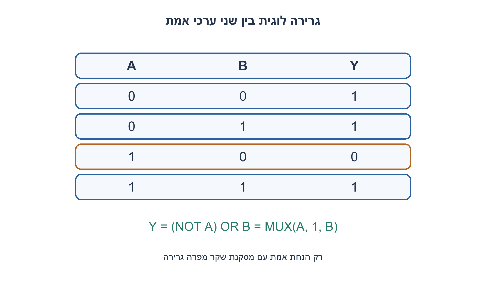
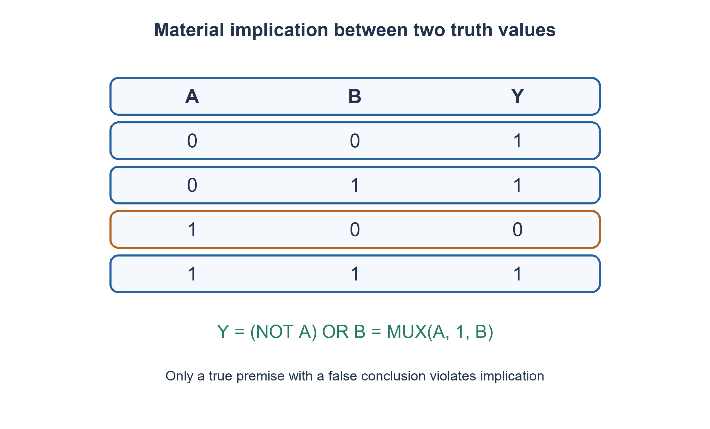

# PREP-283 — מימוש גרירה בוליאנית: אם A אז B

פתרון מוצע בסיוע AI; ביקורת מקצועית אנושית ממתינה. הקושי אינו מכויל.

[צילום מקור פרטי](../sources/2026-11-07-batch20-11.png)

מימוש יחס גרירה (אם-אז).

חברות לפי הדיווח בצילום בלבד: Intel.

## עברית

ממשו יחס גרירה ״אם A אז B״. הציגו טבלת אמת, ביטוי בוליאני ומימוש באמצעות שערים.

הבהרה שנבחרה: A,B הם שני ביטים יציבים באותו רגע והיציאה מייצגת גרירה חומרית בוליאנית. אין שעון, סיבתיות או התחייבות על אירוע בעתיד. הציגו מימוש NOT+OR, בוחר MUX2:1 ומימוש NAND בלבד, עם קבועים וחיווט מותרים בבוחר. הגדירו אם דרוש NOT זמין; אין לספק משלים קלט בחינם בפתרון NAND.

1. מתי בדיוק הטענה ״אם A אז B״ מופרת?
2. היא מופרכת רק כשההנחה A אמת והמסקנה B שקר. מהו המשלים של מצב זה?
3. שללו את A AND NOT B; לפי דה־מורגן מתקבל NOT A OR B. בבוחר A, בחרו1 כש־A=0 ואת B כש־A=1.

### מחפשים דוגמה נגדית יחידה
כאשר A=1, ההתחייבות מחייבת B=1; לכן1,0 הוא המצב היחיד שמחזיר0. כש־A=0 ההתחייבות אינה מופרת, בלי תלות ב־B. אין פירוש הדבר ש־B אמת או ש־A גורם ל־B.

|A|B|A גורר B|
|---|---|---|
|0|0|1|
|0|1|1|
|1|0|0|
|1|1|1|

מכאן `Y=NOT(A AND NOT B)=NOT A OR B`. מימוש ישיר: מהפך ל־A ושער OR עם B. במונחי `MUX(S,D0,D1)`, מקבלים `Y=MUX(A,1,B)` — רכיב בוחר אחד אם1 זמין כקבוע.

למימוש NAND בלבד, מייצרים קודם `NB=NAND(B,B)=NOT B`, ואחר כך `Y=NAND(A,NB)`. זה שני שערים, בלי מהפך חופשי. שער NAND יחיד המקבל רק A,B, לרבות חיבור כניסות יחד, נותן NOT A,NOT B אוNAND(A,B), ואף אחד אינו הגרירה בכל ארבע השורות; לכן שניים הם מינימום במודל זה.

גרירה אינה שקילות: כש־A=0,B=1 הגרירה אמת אך XNOR שקר. גם הגרירה ההפוכה B⇒A אינה זהה: היא נכשלת דווקא ב־0,1. לעומת זאת הניגוד ההפוך NOT B⇒NOT A שקול ל־A⇒B לפי אותו ביטוי. בדיקה של ארבע השורות מונעת בלבול בין המונחים.

זהו רכיב צירופי, ולכן אין מצב או FF. עלות NOT+OR היא שני רכיבים, עלות הבוחר אחד ועלות NAND שני שערים לפי הספרייה המוצהרת; אין להשוות שטח טרנזיסטורים בלי ספריית תאים. אופרטור implication של טענות SystemVerilog עשוי לתאר זמן ודגימה; הוא אינו שער זה רק מפני שהשם דומה.

### קוד SystemVerilog; תוצאות סימולציה בדוח נפרד

```systemverilog
`timescale 1ns/1ps
module prep283_implication_batch1107b20(
 input wire a,b,output wire by_or,by_mux,by_nand);
 wire not_b;
 assign by_or=(~a)|b;
 assign by_mux=a?b:1'b1;
 nand n0(not_b,b,b);
 nand n1(by_nand,a,not_b);
endmodule
```




### assumptions

שני ביטים בו־זמנית; גרירה חומרית; קבוע1 מותר בבוחר; אין מהפכים חופשיים ב־NAND.

### optimality

NOT+OR בשני רכיבים, MUX אחד או שני NAND; עלויות הספריות שונות.

### verification

בדיקות Python עצמאיות עברו:64 שלשות למיון,4 שורות אמת, שלילת18 רשתות NOR בנות שני שערים,4,094 מילים טוריות עם40,962 קידומות ו־161 לוחות זמנים של פייפליין. ראיה: checks/batch1107b20-hardware-model-verification.json. קוד RTL ומודל מתגי MOS הם חומר נפרד מהמודל; קומפילציה וסימולציה נרשמות בדוח native של האצווה. מודל המתגים אינו מדמה מתח סף או שולי רעש; לא בוצעו סינתזה או אישור תזמון.

### edge_cases

```json
[
  "כל ארבע השורות; הנחה שקרית בשתי אפשרויות B;1,0 ככשל יחיד."
]
```

### common_mistakes

החלפה ב־AND או XNOR; הסקת סיבתיות; בלבול עם הגרירה ההפוכה או עם SVA בזמן.

### interview_answer

גרירה נכשלת רק כש־A אמת ו־B שקר, לכן אשלול A AND NOT B ואקבל NOT A OR B.

### source_ambiguities

המקור קצר; בחרנו במפורש גרירה בוליאנית ולא טענת זמן או משמעות סיבתית.

### solution_extensions

```json
{
  "question": "מה משתנה בטענה ״אם req אז ack במחזור הבא״?",
  "direction": "זו תכונת עקבה הדורשת שעון, איפוס והגדרת חפיפה; אין להחליפה ב־NOT req OR ack באותו רגע.",
  "tests": [
    "ack במחזור הבא",
    "ack רק באותו מחזור",
    "req בזמן איפוס"
  ]
}
```

## English

Implement “if A then B.” Give its truth table, Boolean expression and gate realizations.

Chosen clarification: A and B are simultaneous stable bits and the output is Boolean material implication. No clock, causality or promise about a future event is implied. Show NOT+OR, a MUX2:1 and NAND-only realizations; constants and wires are allowed for the MUX. State inversion requirements instead of giving a free complemented input to the NAND construction.

1. Exactly which assignment violates “if A then B”?
2. It fails only for a true premise and a false conclusion. Complement that condition.
3. Negate A AND NOT B to obtain NOT A OR B. A MUX selected by A chooses1 for A0 and B for A1.

### Find its single counterexample
When A1 the claim requires B1, making1,0 its only false case. For A0 the implication is not violated regardless of B. This does not assert B is true or that A causes B.

|A|B|A implies B|
|---|---|---|
|0|0|1|
|0|1|1|
|1|0|0|
|1|1|1|

Thus `Y=NOT(A AND NOT B)=NOT A OR B`. Direct realization uses an inverter on A followed by OR with B. With `MUX(S,D0,D1)`, write `Y=MUX(A,1,B)`: one multiplexer when constant1 is available.

For NAND-only logic first generate `NB=NAND(B,B)=NOT B`, then `Y=NAND(A,NB)`. Two gates suffice with no free inversion. A single NAND using only A,B, including tied pins, yields NOT A,NOT B or NAND(A,B); none equals implication on all four rows, so two is minimal in this library model.

Implication is not equivalence: at A0,B1 implication is true and XNOR false. The converse B⇒A differs, failing at0,1 instead. The contrapositive NOT B⇒NOT A is equivalent to A⇒B by the same expression. Enumerating the four assignments separates these concepts.

The component is combinational and stores no state. NOT+OR uses two primitives, MUX one and NAND two under their respective libraries; this does not compare transistor area without cell costs. A SystemVerilog assertion implication may express sampled temporal behavior and is not this gate merely because its name is similar.

### SystemVerilog; simulation results are in a separate report

```systemverilog
`timescale 1ns/1ps
module prep283_implication_batch1107b20(
 input wire a,b,output wire by_or,by_mux,by_nand);
 wire not_b;
 assign by_or=(~a)|b;
 assign by_mux=a?b:1'b1;
 nand n0(not_b,b,b);
 nand n1(by_nand,a,not_b);
endmodule
```




### assumptions

Simultaneous Boolean bits; material implication; constant1 for MUX; no free NAND inversions.

### optimality

Two NOT/OR primitives, one MUX or two NAND gates; library costs differ.

### verification

Independent Python checks passed:64 sorting triples,4 truth-table rows, exclusion of18 two-NOR networks,4,094 serial words with40,962 prefixes and161 pipeline schedules. Evidence: checks/batch1107b20-hardware-model-verification.json. RTL and the MOS switch abstraction are separate from these models; compilation and simulation are recorded in the batch native report. Digital switches do not model threshold loss or noise margin; no synthesis or timing signoff is claimed.

### edge_cases

```json
[
  "All four rows, both false-premise cases and1,0 as the sole failure."
]
```

### common_mistakes

Substituting AND or XNOR; inferring causality; confusing converse or temporal SVA implication.

### interview_answer

Only a true A with false B violates implication; negate A AND NOT B to obtain NOT A OR B.

### source_ambiguities

The terse source is completed as Boolean material implication, not a temporal or causal claim.

### solution_extensions

```json
{
  "question": "What changes for “req implies ack next cycle”?",
  "direction": "This is a trace property requiring clock, reset and overlap semantics; NOT req OR ack at one instant is insufficient.",
  "tests": [
    "Ack next cycle",
    "Ack only this cycle",
    "Req during reset"
  ]
}
```


## Native verification

אימות native נוסף: חמש יחידות ה־RTL/מתגים ורתמת האצווה קומפלו ב־Icarus Verilog12.0-3 והורצו בפועל ב־Ubuntu26.04.1 בסביבה מבודדת עם רשת חסומה. עברו96,555 בדיקות:4,094 מילים טוריות,40,962 קידומות,5,256 מחזורי היסטוריה ו־4 שורות אמת. ראיה וחתימות קבצים: checks/batch1107b20-native-verification.json. הבדיקה של המעגל בן ארבעת הטרנזיסטורים היא מתגים לוגיים אידאליים בלבד, ללא מתח סף, SPICE או אישור רעש/תזמון.

Additional native execution: the five RTL/switch units and batch harness were compiled with Icarus Verilog12.0-3 and executed on Ubuntu26.04.1 in an isolated network-denied environment. All96,555 checks passed:4,094 serial words,40,962 prefixes,5,256 history cycles and4 truth rows. Evidence and source hashes: checks/batch1107b20-native-verification.json. The four-transistor check uses ideal digital switches only, without MOS threshold, SPICE or noise/timing qualification.
