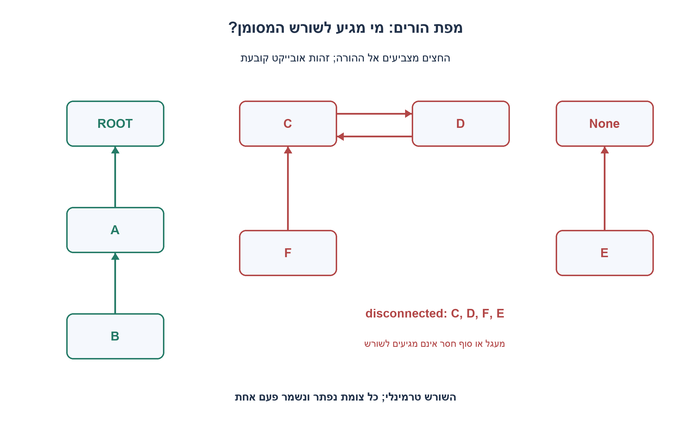
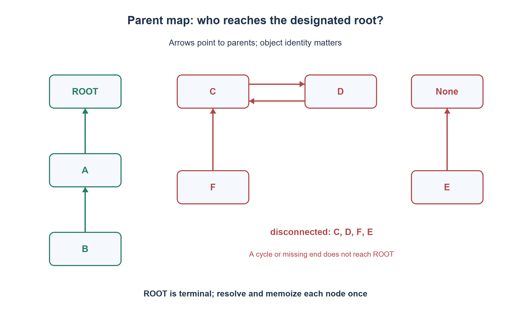

# PREP-284 — אילו צמתים אינם מגיעים לשורש דרך מצביעי ההורים?

פתרון מוצע בסיוע AI; ביקורת מקצועית אנושית ממתינה. הקושי אינו מכויל.

## עברית

נתונה רשימה סופית של אובייקטי צמתים. לכל צומת פעולות get_parent() ו־ is_root(). מצאו את כל הצמתים שאינם מחוברים לשורש.

נבחר חוזה שמכסה גם נתונים שאינם עץ: כל אובייקט מופיע פעם אחת לפי זהות, בדיוק צומת אחד מסומן is_root=True, וכל הורה הוא None או אובייקט מאותה רשימה. parent והסימון יציבים לאורך הפעולה, וקריאת כל פעולה עולה O(1). ברכיבים אחרים מותרות לולאות, הורה עצמי ושרשראות שמסתיימות ב־ None.

״מחובר״ פירושו שהליכה חוזרת אל ההורה מגיעה לצומת המסומן. השורש הוא נקודת סיום גם אם ההורה השמור שלו אינו None; בכל זאת יש לאמת שהמפה סגורה. החזירו את האובייקטים הלא מחוברים בסדר הופעתם בקלט, ללא שינוי הקלט. זהויות שונות עשויות להיות שוות בערכן ואפילו לא hashable. קלט ריק, סימון שורש שאינו bool, מספר שורשים שונה מאחד, אובייקט חוזר או הורה מחוץ לרשימה הם שגיאה. הציעו פתרון שאינו הולך מחדש בכל שרשרת ואינו משתמש ברקורסיה עמוקה.

1. הליכה נפרדת מכל צומת עשויה לחזור שוב ושוב על אותה שרשרת. מה אפשר לשמור אחרי ששרשרת נפתרה?
2. למסלול יש שלוש אפשרויות סיום: השורש, סוף None או מעגל שאינו מגיע לשורש. תוצאה ידועה של צומת קודם יכולה לסיים מסלול חדש.
3. שמרו צבעים לפי זהות: לבן טרם נבדק, אפור במסלול הנוכחי, שחור עם תוצאה שמורה. צומת אפור מסמן מעגל; שחור נותן תוצאה. סיימו את כל המסלול באותה תוצאה ושמרו אותה לפעמים הבאות.

### פותרים כל שרשרת פעם אחת
כיוון שיש לכל צומת לכל היותר הורה אחד, יציאה מצומת קובעת מסלול יחיד. בקלט תקין השורש המסומן מחובר לעצמו. שרשרת שמסתיימת ב־ None לפני השורש אינה מחוברת; שרשרת שנכנסת למעגל בלי השורש גם אינה מחוברת, וכך גם כל הצמתים שמובילים אליה. אין להניח שכל None הוא שורש נוסף או שכל מעגל הוא קלט פסול: החוזה בחר לאפשר רכיבים כאלו ולסווג אותם.

תחילה מצלמים את ההורים ואת סימון השורש, מאמתים את המפה וממפים id(node) לאובייקט. משתמשים בזהות ולא ב־==, כי שתי חוליות שונות יכולות להכיל אותו ערך או להגדיר השוואה מותאמת; אין צורך שהאובייקט עצמו יהיה מפתח hash. כל האובייקטים נשמרים בחיים ברשימה, ולכן זהותם אינה ממוחזרת בזמן הפעולה. האימות קורא לכל ממשק פעם אחת ושומר מצב יציב; אין כתיבה לאובייקט כלשהו.

מסמנים את השורש כשחור עם תוצאה True. מכל צומת לבן מתקדמים באיטרציה, מסמנים אותו אפור ומוסיפים למסלול. מפסיקים כשמגיעים ל־ None, לצומת שחור או לצומת אפור. שחור נותן את תוצאתו; None ואפור נותנים False. אפור בהכרח שייך למסלול הנוכחי: לאחר כל מסלול אנו צובעים את כל צמתיו שחור, ולכן לא נשאר מסלול אפור ישן. מפיצים את התוצאה לאחור במסלול וממשיכים לצומת הבא. כשהכול שחור מחזירים את האובייקטים עם False לפי סדר הרשימה.

נכונות: תוצאה של מסלול שמסתיים בשורש או בצומת פתור נכונה לפי ההגדרה/תוצאתו השמורה. מסלול ל־ None אינו יכול להמשיך לשורש. חזרה לאפור מייצרת מחזור סגור; מאחר שהשורש כבר שחור, המחזור לא מכיל אותו. לכל קודמי המסלול אותו יעד, ולכן הפצת התוצאה נכונה. כל צומת עובר מלבן לאפור לשחור לכל היותר פעם אחת; כל קשת הורה נקראת מהתצלום לכל היותר פעם אחת במהלך פתרון המסלולים. מתקבלים O(N) קריאות ממשק ועבודת מילון צפויה, ו־ O(N) עזר ופלט. תחת מודל טבלת זהויות עם גישה קבועה זו סיבוכיות לינארית; מילוני Python נותנים את מודל הגישה הצפוי, ולא הבטחת חסינות לכל התנגשות hash. דרושה Ω(N) קריאה כדי להחזיר תשובה לכל הרשימה במקרה הכללי.

בדוגמה שורש R, ‏A→R ו־ B→A מחוברים; ‏C→D→C, ‏F→C ו־ E→None אינם מחוברים. גם אם R עצמו מצביע ל־ C הוא נשאר נקודת סיום מסומנת לפי החוזה. נבדקו כל מפות ההורים עד חמישה צמתים מול אורקל עצמאי שמתחיל מחדש מכל צומת, וכן שרשרת של 5,000 צמתים, אובייקטים שווים ולא hashable וקלטים פסולים. זהו ניתוח גרף בזיכרון; אין בכך ניחוש של חוליות שלא נמסרו.

```python
"""Classify a finite, closed, stable parent map by identity; never mutate nodes."""


def disconnected_nodes(nodes):
    nodes = list(nodes)
    by_identity = {id(node): node for node in nodes}
    if len(by_identity) != len(nodes):
        raise ValueError('duplicate node identity')
    parents, roots = {}, []
    for node in nodes:
        try:
            parent = node.get_parent()
            marked = node.is_root()
        except AttributeError as error:
            raise TypeError('nodes must provide get_parent() and is_root()') from error
        if type(marked) is not bool:
            raise TypeError('is_root() must return bool')
        if parent is not None and id(parent) not in by_identity:
            raise ValueError('parent is outside the supplied node collection')
        identity = id(node)
        parents[identity] = None if parent is None else id(parent)
        if marked:
            roots.append(identity)
    if len(roots) != 1:
        raise ValueError('exactly one node must be marked as the root')
    # White=unseen, gray=current unresolved path, black=resolved.
    colors = {roots[0]: 2}
    reaches_root = {roots[0]: True}  # Designated root is terminal.
    for node in nodes:
        start = id(node)
        if colors.get(start, 0) == 2:
            continue
        path, cursor = [], start
        while cursor is not None and colors.get(cursor, 0) == 0:
            colors[cursor] = 1
            path.append(cursor)
            cursor = parents[cursor]
        connected = cursor is not None and colors[cursor] == 2 and reaches_root[cursor]
        for identity in reversed(path):
            colors[identity] = 2
            reaches_root[identity] = connected
    return [node for node in nodes if not reaches_root[id(node)]]
```




## English

Given a finite list of node objects supporting get_parent() and is_root(), return every node not connected to its root.

Choose a contract that also covers non-tree data: every object occurs once by identity, exactly one node has is_root=True, and every parent is None or an object in the supplied list. Parent links/markers remain stable and each interface call costs O(1). Other components may contain cycles, self-parents or chains ending in None.

Connected means repeatedly following parents reaches the marked node. The root is terminal even if its stored parent is not None; the closed-map input still requires validation. Return disconnected objects in input order without mutation. Distinct identities may compare equal and need not be hashable. Empty input, non-Boolean root markers, a root count other than one, repeated identities or out-of-list parents are errors. Avoid repeatedly walking the same chain or relying on deep recursion.

1. Separate walks may revisit the same chain repeatedly. What can be cached after a chain is solved?
2. A walk ends at the root, None, a nonroot cycle or a previously solved node. A known outcome can terminate the new walk.
3. Use identity-keyed colors: white unseen, gray on the current path, black resolved. Gray detects a cycle; black supplies its cached result. Resolve every node on the path with that result.

### Solve each chain once
At most one parent gives each node a unique outgoing walk. The designated root reaches itself. A chain ending at None before the root is disconnected; a nonroot cycle and every predecessor feeding it are disconnected too. Do not silently treat every None as another root or reject cycles: this contract explicitly allows and classifies those components.

Snapshot parents and root markers, validate the collection and map id(node) to objects. Identity rather than == distinguishes equal-valued nodes and supports unhashable objects. Keeping every object alive prevents identity reuse during the call. Each interface is called once; no node is mutated.

Mark the root black with True. Starting at any white node, iteratively mark nodes gray and append them to the current path. Stop at None, black or gray. A black node supplies its cached result; None or gray supplies False. Gray must belong to the current path because every completed path is fully blackened. Propagate the result backward along that path. Finally return False-classified objects in original order.

Correctness follows from the four termination cases. The root is terminal. A solved node has an inductively correct result. None cannot lead farther. Reaching gray closes a cycle which cannot contain the already black root. Every predecessor on a single-parent path has the same eventual outcome, so resolving the whole path is valid. Each node becomes white→gray→black at most once and each snapshotted parent edge is traversed at most once while resolving paths. The algorithm makes O(N) interface calls, expected O(N) Python dictionary work and O(N) auxiliary/output storage. With constant identity-table access this is linear; Python hash tables provide the expected-access model rather than an adversarial-collision guarantee. Returning classifications of a general collection requires Omega(N) input inspection in the worst case.

For root R, A→R and B→A are connected. C→D→C, F→C and E→None are disconnected. Even a stored R→C link does not change R's declared terminal role. Checks enumerate all parent maps through five nodes against an independent fresh-walk oracle, plus a 5,000-node chain, equal unhashable objects and invalid inputs. This analyzes supplied memory objects rather than inventing missing nodes.

```python
"""Classify a finite, closed, stable parent map by identity; never mutate nodes."""


def disconnected_nodes(nodes):
    nodes = list(nodes)
    by_identity = {id(node): node for node in nodes}
    if len(by_identity) != len(nodes):
        raise ValueError('duplicate node identity')
    parents, roots = {}, []
    for node in nodes:
        try:
            parent = node.get_parent()
            marked = node.is_root()
        except AttributeError as error:
            raise TypeError('nodes must provide get_parent() and is_root()') from error
        if type(marked) is not bool:
            raise TypeError('is_root() must return bool')
        if parent is not None and id(parent) not in by_identity:
            raise ValueError('parent is outside the supplied node collection')
        identity = id(node)
        parents[identity] = None if parent is None else id(parent)
        if marked:
            roots.append(identity)
    if len(roots) != 1:
        raise ValueError('exactly one node must be marked as the root')
    # White=unseen, gray=current unresolved path, black=resolved.
    colors = {roots[0]: 2}
    reaches_root = {roots[0]: True}  # Designated root is terminal.
    for node in nodes:
        start = id(node)
        if colors.get(start, 0) == 2:
            continue
        path, cursor = [], start
        while cursor is not None and colors.get(cursor, 0) == 0:
            colors[cursor] = 1
            path.append(cursor)
            cursor = parents[cursor]
        connected = cursor is not None and colors[cursor] == 2 and reaches_root[cursor]
        for identity in reversed(path):
            colors[identity] = 2
            reaches_root[identity] = connected
    return [node for node in nodes if not reaches_root[id(node)]]
```




## חומר משלים / Supporting material

```json
{
  "assumptions": {
    "he": "מפה סופית וסגורה, זהויות ייחודיות, שורש מסומן אחד, ממשק יציב O(1), השורש טרמינלי ופלט בסדר הקלט.",
    "en": "Finite closed map, unique identities, one marked root, stable O(1) interface, terminal root and input-order output."
  },
  "optimality": {
    "he": "O(N) קריאות ממשק ועבודת מילון צפויה, O(N) מקום; Ω(N) קריאה במקרה הגרוע. אין הליכה ריבועית או רקורסיה עמוקה.",
    "en": "O(N) interface calls/expected dictionary work, O(N) space; Omega(N) worst-case inspection, without repeated-chain quadratic work or recursion depth."
  },
  "verification": {
    "he": "כל מפות ההורים עד חמישה צמתים; שרשרת 5,000; השוואה לאורקל הליכה חדשה וקלטים פסולים.",
    "en": "Every parent map through five nodes; a 5,000-node chain; independent fresh-walk oracle and invalid inputs."
  },
  "edge_cases": {
    "he": "השורש לבדו; root.parent שאינו None; מעגל עצמי; זנב למעגל; כמה חוליות בעלות ערך שווה; הורה חיצוני.",
    "en": "Root alone; non-None root.parent; self-cycle; cycle tail; equal-valued distinct nodes; external parent."
  },
  "common_mistakes": {
    "he": "להשתמש בערך כמזהה; להתחיל מכל חוליה מחדש; לזהות כל None כשורש; להשאיר אפורים בין מסלולים; להיתקע במעגל.",
    "en": "Using value as identity; restarting every chain; treating every None as root; leaving gray nodes between paths; looping forever."
  },
  "interview_answer": {
    "he": "אצלם ואאמת הורים לפי זהות, אסווג כל מסלול פעם אחת ואשמור תוצאה לכל חוליה. השורש פותר True, ומעגל או None פותרים False.",
    "en": "Snapshot/validate identities, resolve each path once and memoize every node. Root gives True; a nonroot cycle or None gives False."
  },
  "source_ambiguities": {
    "he": "המקור מכנה את המבנה עץ אך מאפשר רכיבים מנותקים. אושר מודל הורים כללי עם מעגלים; לא הונח שכל הורה חסר הוא שורש.",
    "en": "The source calls it a tree while allowing disconnected components. The chosen general parent map permits cycles; missing parents are not additional roots."
  },
  "solution_extensions": {
    "he": [
      {
        "question": "מה אם הרשימה כוללת ילדים אבל חלק מההורים מחוץ לה?",
        "answer_direction": "זה מפר את החוזה הסגור ונזרקת שגיאה. בחוזה אחר אפשר לגלות אבות נוספים, אך העלות תהיה לפי כל האובייקטים שהתגלו ולא רק N המקורי.",
        "principle": "זהות, סגירות וגבול הסריקה הם חלק מהגדרת הבעיה."
      }
    ],
    "en": [
      {
        "question": "What if some parent objects are outside the list?",
        "answer_direction": "Reject under the closed-map contract. Another contract could discover external ancestors, but its cost depends on all discovered objects, not only original N.",
        "principle": "Identity, closure and traversal boundaries are part of the problem definition."
      }
    ]
  }
}
```
