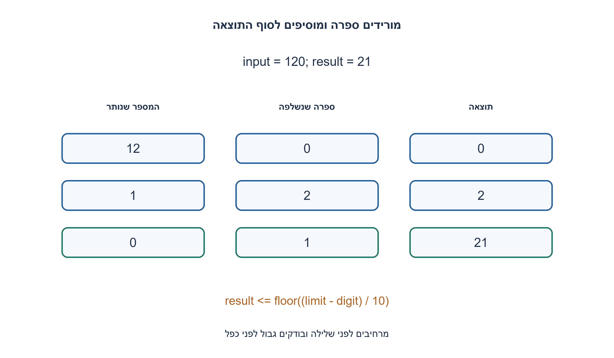
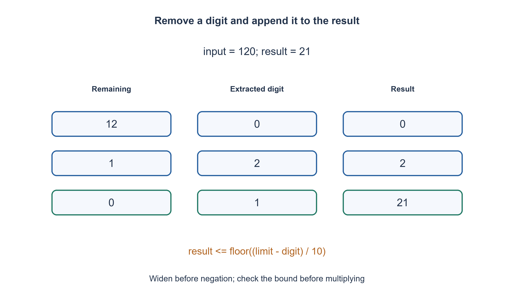

# PREP-285 — היפוך ספרות עשרוניות של מספר signed int32

פתרון מוצע בסיוע AI; ביקורת מקצועית אנושית ממתינה. הקושי אינו מכויל.

## עברית

כתבו פונקציה שהופכת את סדר הספרות העשרוניות במספר שלם: 12345 הופך ל־ 54321. אין מדובר בהיפוך סדר הביטים.

השלמת חוזה: הקלט signed int32 בטווח ‎−2^31..2^31−1; שומרים על הסימן, ולכן ‎−120 הופך ל־‎−21 ו־ 0 נשאר 0. אפסים שיופיעו בתחילת הייצוג ההפוך אינם נשמרים במספר. אם התוצאה ההפוכה חורגת מטווח int32 מחזירים 0. מותר טיפוס int64_t לחישובי ביניים במימוש C, ואין להשתמש במחרוזת למימוש הראשי. הסבירו כיצד מטפלים ב־ INT32_MIN בלי גלישה ובדקו לפני פעולת הכפל והחיבור.

1. איך אפשר להפריד את ספרת האחדות באמצעות שארית וחילוק?
2. בכל שלב הוסיפו ספרה לסוף תוצאה: result*10+digit. השאלה היא מתי פעולה זו תחרוג מהגבול.
3. עבדו עם ערך מוחלט שהורחב קודם ל־ int64_t, בחרו גבול לפי הסימן ובדקו result>(limit−digit)/10 לפני העדכון.

### מפרקים מימין ומרכיבים משמאל
שומרים את סימן הקלט ועובדים על גודלו הלא שלילי. בכל צעד digit=n%10 היא הספרה האחרונה, n/=10 מסיר אותה, ו־ result=result*10+digit מוסיף אותה לסוף המספר שנבנה. למשל 120 נותן ספרות 0,2,1 ותוצאות 0,2,21. אפס בתחילת מספר אינו מחזיק מיקום נוסף, ולכן מתקבל 21.

### הגודל של INT32_MIN דורש הרחבה
הגודל של ‎−2147483648 הוא 2147483648, שאינו נכנס ב־ int32_t חיובי. ב־ C מרחיבים את הקלט ל־ int64_t ורק אחר כך מבצעים שלילה. אסור לחשב קודם ‎−input ב־ int32_t או לקרוא abs על INT32_MIN ולהניח שהכול תקין. Python אינו גולש בשלמים, אך שומר במפורש את אותו חוזה קלט ופלט.

גבול הגודל הוא 2147483647 לקלט חיובי ו־ 2147483648 לשלילי. לפני הוספת digit בודקים result≤floor((limit−digit)/10). אי־השוויון שקול בדיוק ל־ 10·result+digit≤limit, כי result והספרה אינם שליליים. אם התנאי נכשל, מחזירים 0 לפני הכפל. אחרת מבצעים את העדכון. בסוף מחילים את הסימן ומחזירים int32_t.

### למה כל ספרה נכנסת פעם אחת
אחרי j צעדים result מכיל, בסדר הפוך, את j הספרות שהוסרו מן הסוף; n מכיל בדיוק את השאר. החילוק ב־ 10 מקטין n חיובי ולכן הלולאה מסתיימת. כשהוא אפס אין ספרות נוספות, והאינווריאנט נותן את ההיפוך המבוקש. בדיקת הגבול מבטיחה שכל תוצאה שמוחזרת בהצלחה נמצאת בטווח.

דוגמאות: 12345→54321; ‎−120→‎−21; 1463847412→2147483641; 1534236469→0 בגלל גלישה. גם INT32_MIN ו־ INT32_MAX מחזירים 0 בחוזה זה. 0 משמש גם תוצאה תקינה וגם סימון גלישה; אם צריך להבחין ביניהן, שאלת המשך יכולה להחזיר זוג success, value.

מספר הצעדים Θ(D) עבור D ספרות עשרוניות, ומקום עזר O(1) מילים. בתחום int32 יש לכל היותר עשר ספרות ולכן העלות חסומה. אין להסיק שמספר שלם בלתי חסום דורש זמן קבוע: אז גם עלות החילוק תלויה ברוחב.

```python
"""Signed int32 decimal reversal; 0 is also the overflow sentinel."""


def reverse_int32(n):
    if type(n) is not int or not -(1 << 31) <= n < (1 << 31):
        raise ValueError("n must be signed int32")
    negative = n < 0
    remaining = -n if negative else n  # Python magnitude is unbounded.
    limit = 1 << 31 if negative else (1 << 31) - 1
    result = 0
    while remaining:
        digit = remaining % 10
        remaining //= 10
        if result > (limit - digit) // 10:
            return 0
        result = result * 10 + digit
    return -result if negative else result
```


```c
#include <stdint.h>

/* int64_t can represent the magnitude of every int32_t, including INT32_MIN. */
int32_t reverse_int32_c(int32_t input) {
    int64_t n = input;
    const int negative = n < 0;
    if (negative) n = -n;
    const int64_t limit = negative ? INT64_C(2147483648) : INT64_C(2147483647);
    int64_t result = 0;
    while (n != 0) {
        const int64_t digit = n % 10;
        n /= 10;
        if (result > (limit - digit) / 10) return 0;
        result = result * 10 + digit;
    }
    return (int32_t)(negative ? -result : result);
}
```




## English

Reverse an integer’s decimal digit order: 12345 becomes 54321. This is not binary bit reversal.

Chosen contract: signed int32 input in −2^31..2^31−1; preserve the sign, so −120 becomes −21 and zero stays zero. Leading zeros in the reversed representation disappear in an integer. Return 0 if the reversed result overflows int32. A C implementation may use int64_t intermediates, and the main implementation must not convert to a string. Explain safe handling of INT32_MIN and check before multiplication/addition.

1. How can remainder and division separate the final decimal digit?
2. Append each digit with result*10+digit. Determine when that would exceed the limit.
3. Widen to int64_t before taking the magnitude, choose a sign-dependent limit, and reject result>(limit−digit)/10 before updating.

### Remove digits from the right and append them to the result
Save the sign and process a nonnegative magnitude. At each step digit=n%10 extracts the last digit, n/=10 removes it, and result=result*10+digit appends it. For 120 the digits are 0,2,1 and intermediate results 0,2,21. Leading zeros do not preserve extra places in an integer.

### Widen before negating INT32_MIN
The magnitude of −2147483648 is 2147483648, outside positive int32_t. In C convert the input to int64_t first, then negate it. Negating the int32_t input first, or assuming abs(INT32_MIN) is valid, is unsafe. Python integers do not overflow but the reference enforces the same int32 input/output contract.

The allowed magnitude is 2147483647 for a positive input and 2147483648 for a negative one. Before appending digit, require result≤floor((limit−digit)/10). For nonnegative result and digit this is exactly equivalent to 10·result+digit≤limit. On failure return zero before multiplying; otherwise update. Apply the sign at the end and convert to int32_t.

### Invariant and termination
After j steps, result reverses the j removed trailing digits, while n holds exactly the unprocessed prefix. Division by ten strictly decreases positive n, so the loop terminates. When n becomes zero no digits remain and the invariant gives the reversal. The bound check guarantees every successfully returned result fits.

Examples: 12345→54321; −120→−21; 1463847412→2147483641; 1534236469→0 due to overflow. Both INT32_MIN and INT32_MAX reverse out of range and return zero. Zero denotes both a legitimate result and overflow; a follow-up can return success, value to distinguish them.

Time is Θ(D) for D decimal digits and auxiliary space O(1) words. int32 has at most ten digits, hence bounded work. Arbitrary-precision integers do not imply constant time: division itself then depends on width.

```python
"""Signed int32 decimal reversal; 0 is also the overflow sentinel."""


def reverse_int32(n):
    if type(n) is not int or not -(1 << 31) <= n < (1 << 31):
        raise ValueError("n must be signed int32")
    negative = n < 0
    remaining = -n if negative else n  # Python magnitude is unbounded.
    limit = 1 << 31 if negative else (1 << 31) - 1
    result = 0
    while remaining:
        digit = remaining % 10
        remaining //= 10
        if result > (limit - digit) // 10:
            return 0
        result = result * 10 + digit
    return -result if negative else result
```


```c
#include <stdint.h>

/* int64_t can represent the magnitude of every int32_t, including INT32_MIN. */
int32_t reverse_int32_c(int32_t input) {
    int64_t n = input;
    const int negative = n < 0;
    if (negative) n = -n;
    const int64_t limit = negative ? INT64_C(2147483648) : INT64_C(2147483647);
    int64_t result = 0;
    while (n != 0) {
        const int64_t digit = n % 10;
        n /= 10;
        if (result > (limit - digit) / 10) return 0;
        result = result * 10 + digit;
    }
    return (int32_t)(negative ? -result : result);
}
```




## חומר משלים / Supporting material

```json
{
  "assumptions": {
    "he": [
      "signed int32, הסימן נשמר, גלישה מחזירה 0; C רשאי להרחיב ל־ int64_t."
    ],
    "en": [
      "signed int32, preserved sign, overflow returns 0; C may widen to int64_t."
    ]
  },
  "optimality": {
    "he": "Θ(D) פעולות ספרה, O(1) מילים; תחום int32 קבוע.",
    "en": "Θ(D) digit operations, O(1) words; int32 is a fixed domain."
  },
  "verification": {
    "he": "165 מקרי Python מול אורקל מחרוזת עצמאי; בנוסף מימוש C קומפל והורץ עם GCC 15.2 ועבר שמונה מקרי גבול.",
    "en": "165 Python cases against an independent string oracle; the C implementation additionally compiled and ran with GCC 15.2, passing eight boundary cases."
  },
  "edge_cases": {
    "he": [
      "0, מספר שלילי, אפסים בסוף, INT32_MIN, מספר שההיפוך שלו גולש."
    ],
    "en": [
      "Zero, negatives, trailing zeros, INT32_MIN and reversal overflow."
    ]
  },
  "common_mistakes": {
    "he": [
      "לא להפוך ביטים במקום ספרות; לא לשלל INT32_MIN לפני הרחבה; לא לבדוק גלישה אחרי שכבר קרתה."
    ],
    "en": [
      "Do not reverse bits, negate INT32_MIN before widening, or check overflow after causing it."
    ]
  },
  "interview_answer": {
    "he": "מוציאים ספרה עם %10, מצרפים עם כפל ב־ 10 ובודקים גבול לפני העדכון.",
    "en": "Extract with %10, append by multiplying by ten, and pre-check the bound."
  },
  "source_ambiguities": {
    "he": "המקור לא קובע סימן, רוחב או תגובת גלישה; הבחירות מוצגות במפורש.",
    "en": "The source omits signedness, width and overflow behavior; these choices are explicit."
  },
  "solution_extensions": {
    "he": [
      {
        "question": "כיצד להבחין בין גלישה לבין היפוך של אפס?",
        "answer_direction": "החזירו הצלחה וערך בנפרד, או השתמשו בתוצאה אופציונלית.",
        "principle": "הבחנה בין החוזה לבין הרחבה שלו"
      }
    ],
    "en": [
      {
        "question": "How can overflow be distinguished from reversing zero?",
        "answer_direction": "Return success separately from the value, or use an optional result.",
        "principle": "Distinguish the contract from an extension"
      }
    ]
  }
}
```
