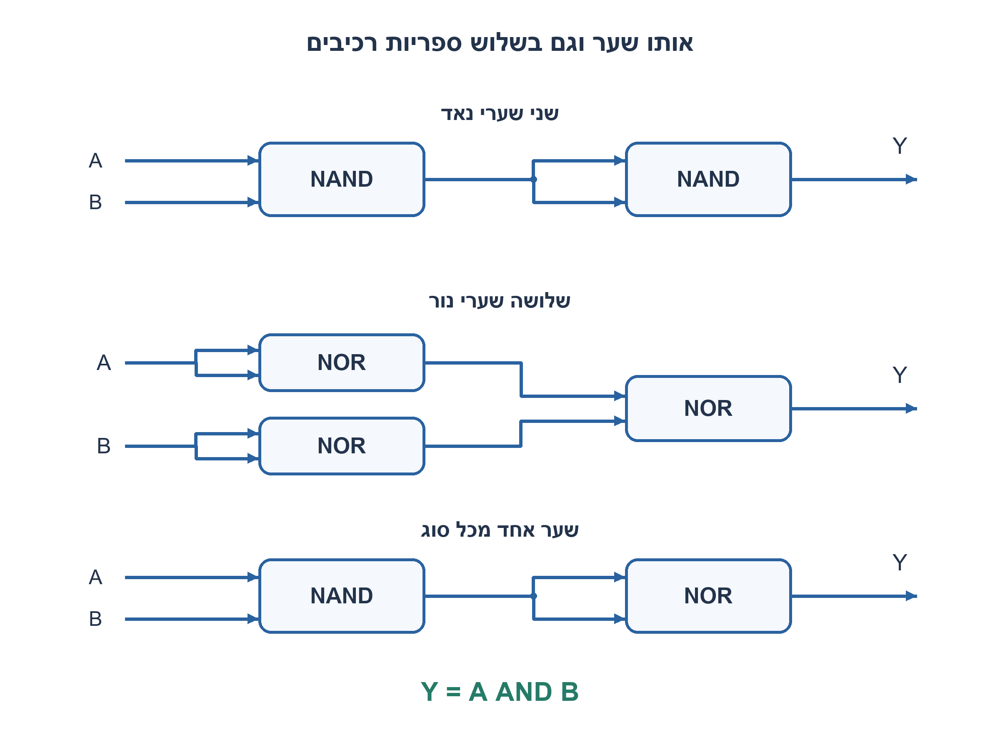
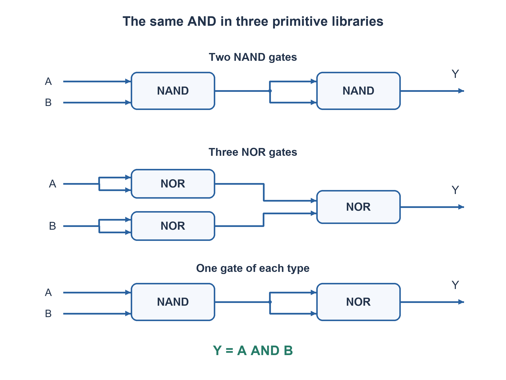

# PREP-286 — שער AND באמצעות NAND, NOR ושילוב שניהם

פתרון מוצע בסיוע AI; ביקורת מקצועית אנושית ממתינה. הקושי אינו מכויל.

[צילום מקור פרטי](../sources/2026-11-07-batch20-15.png)

צריך לממש AND באמצעות שערי NAND ו-NOR.

חברות לפי הדיווח בצילום בלבד: Apple.

## עברית

ממשו AND באמצעות שערי NAND ו־NOR. הציגו חיבורים, טבלת אמת והסבר.

כדי להגדיר את המקור הקצר, פתרו שלוש ספריות בנפרד: NAND בלבד; NOR בלבד; ושילוב של שני הסוגים שבו יש לפחות שער אחד מכל סוג. כל רכיב בעל שתי כניסות, הקלטים A,B זמינים ללא משלימים. מותר לחבר שתי כניסות של שער לאותו חוט ולפצל אות; אין מהפך חופשי, מצב או משוב. מדד העלות הוא מספר רכיבים, לא שטח או השהיה פיזית. הוכיחו מינימום במדד זה.

1. איך משתמשים בשער בעל שתי כניסות כדי ליצור היפוך של חוט יחיד?
2. NAND כבר נותן NOT(A AND B). מה חסר? ל־NOR חשבו על חוק דה־מורגן.
3. NAND כפול הקשור לעצמו מחזיר AND; NOR על NOT A ו־NOT B מחזיר AND. בשילוב אפשר להפוך את מוצא NAND בעזרת NOR עם כניסות קשורות.

### כניסות קשורות הן מהפך בתשלום
לכל אות X מתקיים `NAND(X,X)=NOT X` וגם `NOR(X,X)=NOT X`. ההיפוך עולה רכיב אחד ואינו מגיע בחינם.

**NAND בלבד:** מחשבים `n=NAND(A,B)` ואז `Y=NAND(n,n)`. שני שערים נותנים NOT של NOT(A AND B), כלומר AND. אי אפשר בשער אחד: האפשרויות על A,B עם כניסות קשורות הן NOT A,NOT B אוNAND(A,B); הן אינן AND. גם חוט ללא שער אינו AND. לכן2 הוא מינימום.

**NOR בלבד:** מחשבים `na=NOR(A,A)`, `nb=NOR(B,B)` ואז `Y=NOR(na,nb)`. לפי דה־מורגן, NOT(NOT A OR NOT B)=A AND B. נדרשים3 שערים. שלילת מינימום קטן יותר אינה מסתכמת בטענה ״חייבים שני מהפכים״: ייתכן עקרונית שיתוף אותות. לכן מונים את כל הרשתות האציקליות בנות עד שני שערים. לראשון שלושה זוגות קלט בלתי מסודרים מתוך A,B; לשני שישה זוגות מתוך A,B,g1. כל18 הרשתות האפשריות, וגם יציאות ישירות, שונות מטבלת AND. מכיוון שקיים מימוש בן3, זה המינימום בספרייה שנבחרה.

**שני הסוגים יחד:** `n=NAND(A,B)` ואחריו `Y=NOR(n,n)`. זה שני רכיבים, אחד מכל סוג, ולכן מקיים גם פירוש שמחייב להשתמש בשניהם. פחות משניים לא יכול לכלול את שני הסוגים, ובכל מקרה שער NAND או NOR בודד אינו AND.

|A|B|Y בכל שלושת המימושים|
|---|---|---|
|0|0|0|
|0|1|0|
|1|0|0|
|1|1|1|

למימושי NAND ולשילוב יש שתי רמות; ב־NOR שני המהפכים מקבילים ואז שער סופי, גם כן שתי רמות. אותו עומק לוגי אינו מוכיח השהיה פיזית שווה: לתאים עשויים להיות זמני התפשטות, עומסים ושטחים שונים. אם משלימי A,B זמינים מראש, תשובת NOR משתנה לשער אחד; לכן הנחת אין־מהפכים־חופשיים מהותית.

### קוד SystemVerilog; תוצאות סימולציה בדוח נפרד

```systemverilog
`timescale 1ns/1ps
module prep286_and_bases_batch1107b20(
 input wire a,b,output wire nand_only,nor_only,mixed);
 wire neg_product,na,nb,mix_neg_product;
 nand n0(neg_product,a,b);
 nand n1(nand_only,neg_product,neg_product);
 nor r0(na,a,a);
 nor r1(nb,b,b);
 nor r2(nor_only,na,nb);
 nand m0(mix_neg_product,a,b);
 nor m1(mixed,mix_neg_product,mix_neg_product);
endmodule
```




### assumptions

שערי שתי כניסות, A/B ללא משלימים; fanout וכניסות קשורות; רשת אציקלית.

### optimality

מינימום2 NAND,3 NOR,2 בשילוב המחייב שני סוגים. כולן שתי רמות במודל; לא מינימום שטח או תזמון.

### verification

בדיקות Python עצמאיות עברו:64 שלשות למיון,4 שורות אמת, שלילת18 רשתות NOR בנות שני שערים,4,094 מילים טוריות עם40,962 קידומות ו־161 לוחות זמנים של פייפליין. ראיה: checks/batch1107b20-hardware-model-verification.json. קוד RTL ומודל מתגי MOS הם חומר נפרד מהמודל; קומפילציה וסימולציה נרשמות בדוח native של האצווה. מודל המתגים אינו מדמה מתח סף או שולי רעש; לא בוצעו סינתזה או אישור תזמון.

### edge_cases

```json
[
  "ארבע שורות אמת; A=B; שימוש מפורש באותו מוצא בשתי כניסות.",
  "אימות כל18 רשתות NOR בנות שני שערים במודל."
]
```

### common_mistakes

שימוש ב־NOT שלא נספר; חיבור שער יחיד עם קלטים משלימים שלא סופקו; הסקת תדר משתי רמות בלבד.

### interview_answer

ב־NAND אהפוך את המכפלה השלולה פעם נוספת. ב־NOR אהפוך כל קלט ואז אשלול את ה־OR שלהם. אפשר גם NAND ואחריו NOR קשור לעצמו.

### source_ambiguities

המילה ״ו־NOR״ עשויה להתפרש כשילוב או כחלופה; פתרנו במפורש שלוש ספריות והגדרנו עלות.

### solution_extensions

```json
{
  "question": "מה קורה אם זמינים מראש גם NOT A ו־NOT B?",
  "direction": "NOR יחיד נותן AND; מספר השערים תלוי במשאבים שקיבלנו, לא רק בטבלת היעד.",
  "tests": [
    "השוואת עלות עם/בלי מהפכים בחינם",
    "תמחור יצירת המשלימים"
  ]
}
```

## English

Implement AND using NAND and NOR gates, giving connections, a truth table and reasoning.

Complete the terse source by treating three libraries separately: NAND only, NOR only, and a mixture containing at least one of each type. Primitives have two inputs; only uncomplemented A,B are supplied. Tied inputs and fanout are allowed, without free inverters, state or feedback. Minimize primitive count, not physical area or delay, and justify the bound.

1. How can a two-input gate invert a single wire?
2. NAND already gives NOT(A AND B). What is missing? For NOR use De Morgan.
3. Invert the first NAND by a tied-input NAND; NOR of NOT A and NOT B is AND. In the mixed library, invert a NAND output with tied-input NOR.

### A tied-input inversion still costs a gate
For any X, `NAND(X,X)=NOT X` and `NOR(X,X)=NOT X`. Each inverter costs one primitive.

**NAND only:** compute `n=NAND(A,B)`, then `Y=NAND(n,n)`. Two inversions of the product give AND. One gate cannot suffice: tied or untied inputs from A,B yield NOT A, NOT B or NAND(A,B), none equal AND; a direct input wire is also insufficient. Thus two is minimal.

**NOR only:** compute `na=NOR(A,A)`, `nb=NOR(B,B)`, then `Y=NOR(na,nb)`. De Morgan gives NOT(NOT A OR NOT B)=A AND B, using three gates. Merely saying “two inversions are needed” is not a rigorous lower bound because sharing might help. Enumerate all acyclic networks of up to two gates: the first has three unordered input pairs from A,B, and the second six from A,B,g1. None of the18 networks, or direct earlier outputs, has the AND truth table. The existing three-gate construction therefore attains the minimum in this library.

**Mixed:** use `n=NAND(A,B)` then `Y=NOR(n,n)`. It has two gates, one of each, satisfying even an interpretation requiring both families. Fewer than two cannot contain both types, and neither a single NAND nor a single NOR equals AND.

|A|B|Y for all three constructions|
|---|---|---|
|0|0|0|
|0|1|0|
|1|0|0|
|1|1|1|

NAND and mixed designs have two levels; the two parallel NOR inverters followed by the final NOR also give two levels. Equal logical depth does not imply equal physical delay, cell area or loading. If complemented inputs were supplied, the NOR answer would shrink to one gate, making the no-free-inverter assumption essential.

### SystemVerilog; simulation results are in a separate report

```systemverilog
`timescale 1ns/1ps
module prep286_and_bases_batch1107b20(
 input wire a,b,output wire nand_only,nor_only,mixed);
 wire neg_product,na,nb,mix_neg_product;
 nand n0(neg_product,a,b);
 nand n1(nand_only,neg_product,neg_product);
 nor r0(na,a,a);
 nor r1(nb,b,b);
 nor r2(nor_only,na,nb);
 nand m0(mix_neg_product,a,b);
 nor m1(mixed,mix_neg_product,mix_neg_product);
endmodule
```




### assumptions

Two-input gates, uncomplemented A/B, fanout and tied inputs, acyclic networks.

### optimality

Minimum2 NAND,3 NOR and2 mixed gates requiring both types; all have two logical levels, not a physical area/timing guarantee.

### verification

Independent Python checks passed:64 sorting triples,4 truth-table rows, exclusion of18 two-NOR networks,4,094 serial words with40,962 prefixes and161 pipeline schedules. Evidence: checks/batch1107b20-hardware-model-verification.json. RTL and the MOS switch abstraction are separate from these models; compilation and simulation are recorded in the batch native report. Digital switches do not model threshold loss or noise margin; no synthesis or timing signoff is claimed.

### edge_cases

```json
[
  "All four rows, equal inputs and explicit tied-output fanout.",
  "All18 two-NOR networks under the declared model."
]
```

### common_mistakes

Using an uncounted NOT, assuming unavailable complemented inputs or inferring clock rate from two levels alone.

### interview_answer

Invert a NAND product again; for NOR invert each input and NOR the results. A NAND followed by tied-input NOR also works.

### source_ambiguities

“NAND and NOR” can mean mixed or alternative libraries; all three are solved under explicit primitive-count assumptions.

### solution_extensions

```json
{
  "question": "What if NOT A and NOT B are supplied?",
  "direction": "One NOR gives AND; the resource model changes the minimum.",
  "tests": [
    "Cost with and without free inversion",
    "Include the cost of generating complements"
  ]
}
```


## Native verification

אימות native נוסף: חמש יחידות ה־RTL/מתגים ורתמת האצווה קומפלו ב־Icarus Verilog12.0-3 והורצו בפועל ב־Ubuntu26.04.1 בסביבה מבודדת עם רשת חסומה. עברו96,555 בדיקות:4,094 מילים טוריות,40,962 קידומות,5,256 מחזורי היסטוריה ו־4 שורות אמת. ראיה וחתימות קבצים: checks/batch1107b20-native-verification.json. הבדיקה של המעגל בן ארבעת הטרנזיסטורים היא מתגים לוגיים אידאליים בלבד, ללא מתח סף, SPICE או אישור רעש/תזמון.

Additional native execution: the five RTL/switch units and batch harness were compiled with Icarus Verilog12.0-3 and executed on Ubuntu26.04.1 in an isolated network-denied environment. All96,555 checks passed:4,094 serial words,40,962 prefixes,5,256 history cycles and4 truth rows. Evidence and source hashes: checks/batch1107b20-native-verification.json. The four-transistor check uses ideal digital switches only, without MOS threshold, SPICE or noise/timing qualification.
