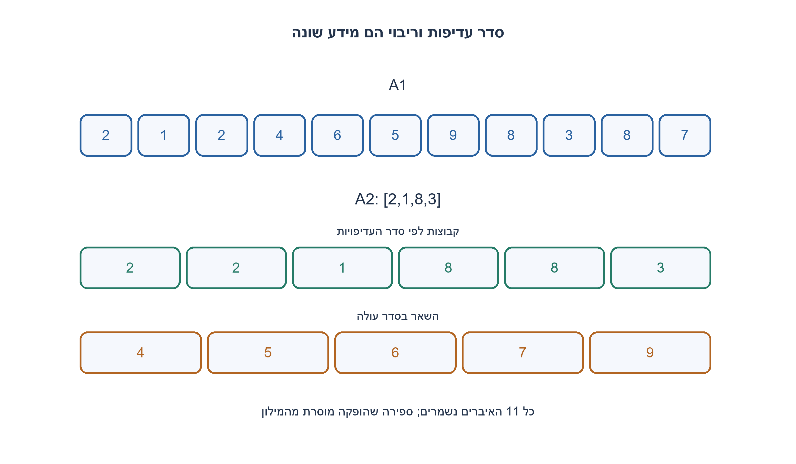
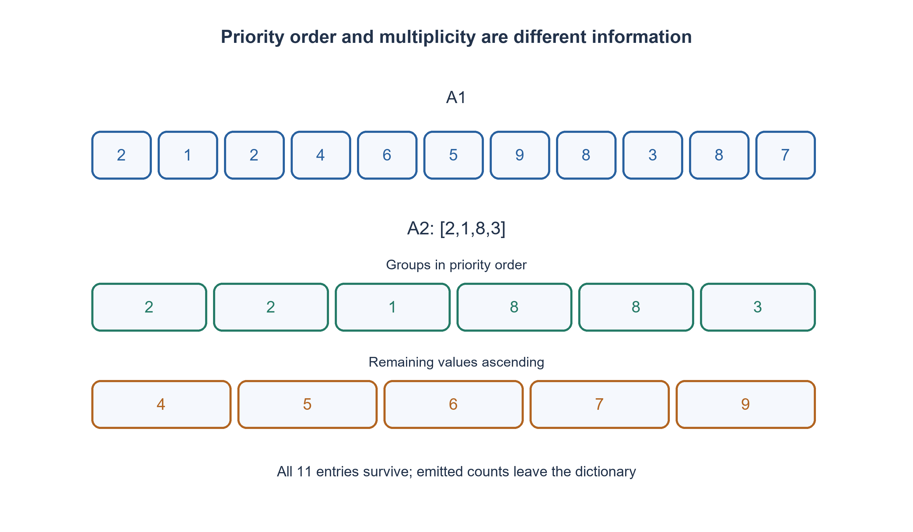

# PREP-287 — מיון יחסי: סדר עדיפויות ממערך שני

פתרון מוצע בסיוע AI; ביקורת מקצועית אנושית ממתינה. הקושי אינו מכויל.

## עברית

נתונים שני מערכי שלמים A1 ו־ A2. החזירו רשימה שבה ערכי A1 שמופיעים ב־ A2 מקובצים לפי סדר A2, עם כל ההופעות שהיו להם ב־ A1. אחריהם יופיעו כל ערכי A1 שאינם ב־ A2 בסדר עולה. אין לשנות את מערכי הקלט.

לדוגמה A1=[2,1,2,4,6,5,9,8,3,8,7], A2=[2,1,8,3] מחזירים [2,2,1,8,8,3,4,5,6,7,9]. השלמת חוזה: ערכי A2 ייחודיים; ערך בו שאינו נמצא ב־ A1 מדולג. כפילויות ב־ A2 הן קלט שגוי. מותר מילון ספירות ומותר למיין את הערכים הנותרים. דונו בשליליים, קלט ריק ובעלות הזמן והמקום.

1. המערך השני מגדיר עדיפות לערכים, ולא את מספר ההופעות שיש להדפיס.
2. ספרו את מופעי A1. לאחר הוצאת קבוצה לפי A2, הסירו אותה מן הספירות כדי שלא תופיע שוב בסוף.
3. עברו על A2 והפיקו count[value] עותקים; אחר כך עברו על מפתחות הספירה שנותרו בסדר עולה והפיקו את ריבוייהם.

### מפרידים בין סדר לבין ריבוי
A2=[2,1,8,3] אומר שכל ה־ 2 קודמים לכל ה־ 1, אחריהם כל ה־ 8 ואחריהם כל ה־ 3. הוא אינו אומר שכל ערך מופיע פעם אחת. מילון ספירות של A1 שומר בדיוק את המידע החסר: כמה עותקים צריך להפיק לכל ערך.

סופרים את A1 במעבר אחד. עוברים על A2 לפי סדרו: מוציאים מן המילון את הספירה של הערך ומוסיפים בדיוק מספר זה של עותקים לפלט. אם הערך חסר, הספירה אפס. לאחר מכן ממיינים את מפתחות המילון שנותרו ומוסיפים כל אחד לפי הספירה שלו. מיון מפתחות שונים בלבד מספיק, כי כל העותקים של אותו ערך זהים.

### הדוגמה
הספירות כוללות 2 פעמיים ו־ 8 פעמיים. מעבר העדיפויות מפיק [2,2,1,8,8,3]. במילון נשארים 4,5,6,7,9, פעם אחת כל אחד, והם מצטרפים בסדר עולה. כל 11 איברי A1 מופיעים בדיוק פעם אחת בפלט בהתאם למספר מופעיהם המקורי.

### נכונות
לאחר טיפול ב־ j ערכי A2, הפלט מכיל בדיוק את כל מופעי ערכי העדיפות שכבר טופלו, בסדרם, והמילון מכיל בדיוק את היתר. הסרת הספירה מונעת הדפסה כפולה. בסיום השלב הראשון נשארים רק ערכים שאינם בעדיפויות; מיון המפתחות קובע סדר עולה וכל ספירה משמרת את הריבוי. זה מוכיח גם את הסדר וגם את שימור המולטי־סט, בלי לשנות את הקלט.

נסמן n=|A1|, m=|A2|, u מספר הערכים השונים ב־ A1 ו־ r מספר הערכים השונים שנותרו. בהנחת פעולות hash בתוחלת O(1), זמן כולל צפוי O(n+m+r log r), כולל כתיבת n איברי הפלט; אחסון הספירות ובדיקת ייחודיות A2 הוא O(u+m), והפלט עצמו O(n). אין לכנות זאת O(1) מקום או זמן גרוע־ביותר בלתי מותנה של גיבוב. אפשר גם למיין את A1 עם מפתח שמורכב מדרגת A2; זה פתרון תקף אחר עם O(n log n) זמן מיון.

A1 ריק מחזיר ריק; A2 ריק מחזיר מיון רגיל של A1. שליליים מתנהגים כמו שאר השלמים. כפילות ב־ A2 נדחית במפורש במקום להפיק עותקים פעמיים או לנחש למה התכוון המשתמש.

```python
"""Return A1 grouped by unique A2 priorities, then ascending leftovers."""


def relative_sort(a1, a2):
    if (type(a1) is not list or type(a2) is not list
            or any(type(x) is not int for x in a1)
            or any(type(x) is not int for x in a2)):
        raise ValueError("integer lists required")
    if len(set(a2)) != len(a2):
        raise ValueError("a2 priorities must be unique")
    counts = {}
    for value in a1:
        counts[value] = counts.get(value, 0) + 1
    result = []
    for value in a2:
        for _ in range(counts.pop(value, 0)):
            result.append(value)
    for value in sorted(counts):
        for _ in range(counts[value]):
            result.append(value)
    return result
```




## English

Given integer arrays A1 and A2, return A1’s values grouped in A2’s order, preserving every occurrence from A1. Append A1 values absent from A2 in ascending order. Do not mutate either input.

For A1=[2,1,2,4,6,5,9,8,3,8,7], A2=[2,1,8,3], return [2,2,1,8,8,3,4,5,6,7,9]. Chosen contract: A2 values must be unique; a priority value absent from A1 is skipped. Duplicate A2 priorities are invalid. A frequency dictionary and sorting the remaining distinct values are allowed. Discuss negatives, empty inputs and time/space cost.

1. The second array specifies value priority, not how many copies to output.
2. Count A1 values. Remove each emitted priority group so it cannot reappear in the tail.
3. Emit count[value] copies for A2 values in order, then sort the remaining count keys and emit their multiplicities.

### Separate priority from multiplicity
A2=[2,1,8,3] means all twos precede all ones, then all eights and all threes. It does not mean one copy of each. A frequency dictionary records how many copies of each A1 value must be emitted.

Count A1 in one pass. Visit A2 in order, removing that value’s count from the dictionary and emitting exactly that many copies. An absent value has count zero. Finally sort the remaining distinct keys and emit their multiplicities. Sorting distinct keys suffices because copies of a value are identical.

### Example
A1 contains two twos and two eights. The priority pass emits [2,2,1,8,8,3]. Remaining keys 4,5,6,7,9 each occur once and are appended ascendingly. All eleven A1 entries are represented with their original multiplicities.

### Correctness
After j priority values, the output contains exactly the occurrences of processed priority values in the required order; the dictionary contains exactly the remaining occurrences. Removing a count prevents duplicate emission. At the end of the priority pass only unlisted values remain. Sorting their keys ensures ascending order and their counts preserve multiplicity. Thus both ordering and the complete multiset are correct, without modifying the inputs.

Let n=|A1|, m=|A2|, u the number of distinct A1 values and r the remaining distinct values. Assuming expected O(1) hash operations, expected time is O(n+m+r log r), including writing n output elements. Counts plus priority uniqueness checking use O(u+m) auxiliary storage; the returned output uses O(n). This is neither O(1) storage nor an unconditional worst-case hashing bound. Another valid approach sorts A1 with a key based on A2 rank, taking O(n log n) sorting time.

Empty A1 returns empty; empty A2 gives ordinary ascending A1. Negatives behave like other integers. Duplicate A2 priorities are rejected explicitly rather than emitting repeated copies or guessing the intended interpretation.

```python
"""Return A1 grouped by unique A2 priorities, then ascending leftovers."""


def relative_sort(a1, a2):
    if (type(a1) is not list or type(a2) is not list
            or any(type(x) is not int for x in a1)
            or any(type(x) is not int for x in a2)):
        raise ValueError("integer lists required")
    if len(set(a2)) != len(a2):
        raise ValueError("a2 priorities must be unique")
    counts = {}
    for value in a1:
        counts[value] = counts.get(value, 0) + 1
    result = []
    for value in a2:
        for _ in range(counts.pop(value, 0)):
            result.append(value)
    for value in sorted(counts):
        for _ in range(counts[value]):
            result.append(value)
    return result
```




## חומר משלים / Supporting material

```json
{
  "assumptions": {
    "he": [
      "שלמים, A2 ייחודי, ערכים חסרים בעדיפות מדולגים, הקלט אינו משתנה."
    ],
    "en": [
      "Integers, unique A2, absent priorities skipped, input preserved."
    ]
  },
  "optimality": {
    "he": "זמן צפוי O(n+m+r log r); O(u+m) אחסון עזר ועוד O(n) לפלט. אין טענת אופטימום לכל מודל.",
    "en": "Expected O(n+m+r log r) time; O(u+m) auxiliary storage plus O(n) output. No universal optimality claim."
  },
  "verification": {
    "he": "161 דוגמאות ומדגמים מול אורקל מיון מלא לפי rank; בדיקת כפילות עדיפות שגויה ושימור קלט.",
    "en": "161 examples/samples against a rank-key full-sort oracle; invalid duplicate priority and input-preservation checks."
  },
  "edge_cases": {
    "he": [
      "A1 ריק, A2 ריק, עדיפות חסרה, שליליים וריבויים רבים."
    ],
    "en": [
      "Empty A1/A2, absent priorities, negatives and repeated values."
    ]
  },
  "common_mistakes": {
    "he": [
      "לא להסיק מספר הופעות מ־ A2; לא להדפיס שוב קבוצות שכבר הופקו; לא לשכוח למיין את השאר."
    ],
    "en": [
      "Do not infer multiplicities from A2, emit a processed group again, or forget sorting leftovers."
    ]
  },
  "interview_answer": {
    "he": "סופרים את הראשון, מפיקים קבוצות בסדר השני ואז ממיינים ומפיקים את הספירות שנותרו.",
    "en": "Count the first array, emit groups by the second array’s order, then sort and emit remaining counts."
  },
  "source_ambiguities": {
    "he": "המקור אינו מגדיר כפילויות במערך העדיפויות או שינוי קלט. נבחרו ייחודיות והחזרת רשימה חדשה.",
    "en": "The source omits duplicate-priority and mutation behavior; unique priorities and a new output list are explicit choices."
  },
  "solution_extensions": {
    "he": [
      {
        "question": "מה אפשר לשפר כאשר כל הערכים בתחום קטן ידוע?",
        "answer_direction": "מערך ספירות עשוי להחליף גיבוב ומיון, בעלות תלויה בגודל התחום.",
        "principle": "הבחנה בין החוזה לבין הרחבה שלו"
      }
    ],
    "en": [
      {
        "question": "What changes if all values lie in a known small range?",
        "answer_direction": "A counting array can replace hashing and sorting, with cost depending on domain size.",
        "principle": "Distinguish the contract from an extension"
      }
    ]
  }
}
```
