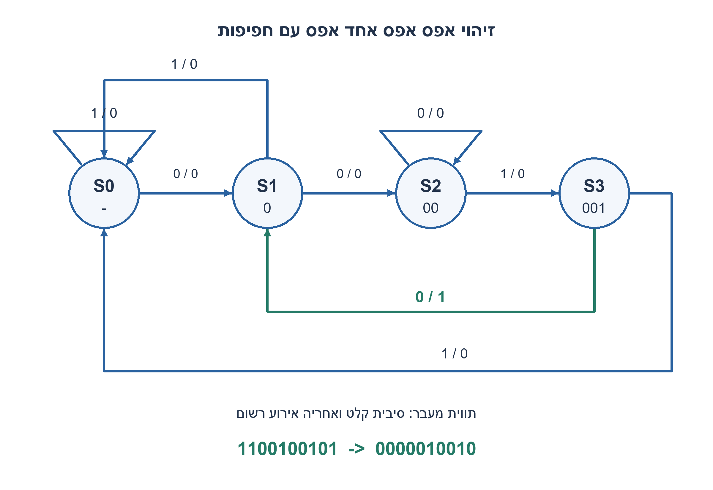
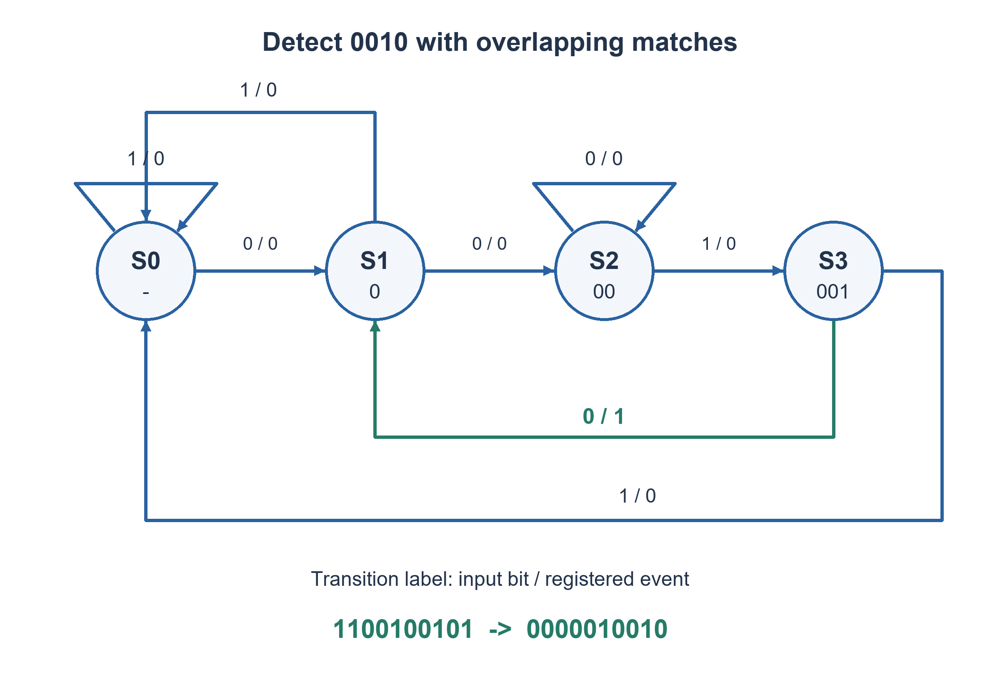

# PREP-288 — זיהוי הרצף0010 בזרם סיביות, כולל חפיפות

פתרון מוצע בסיוע AI; ביקורת מקצועית אנושית ממתינה. הקושי אינו מכויל.

[צילום מקור פרטי](../sources/2026-11-07-batch20-18.png)

בנה מכונת מצבים המקבלת רצף של סיביות ומזהה את הרצף 0010. לדוגמה קלט 1100100101 ופלט 0000010010.

חברות לפי הדיווח בצילום בלבד: Intel, Texas Instruments.

## עברית

בנו מכונת מצבים הקולטת זרם סיביות ומוציאה1 בזיהוי הרצף0010, ו־0 אחרת. דוגמת המקור: קלט1100100101, פלט0000010010.

השלמה מפורשת: כל עליית שעון עם bit_valid=1 מקבלת ביט, לפי סדר הזרם משמאל לימין. איפוס סינכרוני מאפס היסטוריה וגובר על קלט. חפיפות מותרות; found הוא פולס רשום אחרי העלייה המקבלת את האפס האחרון. bit_valid=0 משמר את מצב ההתאמה אך מוציא found=0 באותו מחזור. לאחר איפוס אין להשלים מילה באמצעות אפסים דמיוניים לפני תחילת הקלט. הציגו מצבים, טבלת מעברים, מימוש וניתוח מספר FF.

1. המצב צריך לזכור רק סיומת שכבר עשויה להיות תחילת0010, לא את כל הזרם.
2. אילו קידומות חלקיות יש? בדקו מה נשאר אחרי עוד0 כאשר כבר יש00.
3. שמרו מצבים ללא התאמה,0,00,001. ממצב001 על0 הוציאו פולס וחזרו למצב0־שהותאם, כי האפס האחרון יכול להתחיל התאמה חדשה.

### המצב הוא אורך הקידומת השימושית
נגדיר S0 ללא קידומת, S1 לסיומת0, S2 לסיומת00 ו־S3 לסיומת001. אלה הקידומות החלקיות של0010. בטבלה כל תא הוא מצב הבא ואירוע; את האירוע רושמים ב־FF כדי שהפלט אחרי העלייה יתאים לביט שהתקבל.

|מצב|קלט0: מצב/אירוע|קלט1: מצב/אירוע|
|---|---|---|
|S0|S1 /0|S0 /0|
|S1|S2 /0|S0 /0|
|S2|S2 /0|S3 /0|
|S3|S1 /1|S0 /0|

ב־S2 על0 הסיומת החדשה היא000, והקידומת הארוכה השימושית עדיין00. ב־S3 על0 מתקבלת0010; אחריה נשארת סיומת0, היכולה להתחיל התאמה חופפת. ב־S3 על1 מתקבל0011, בלי סיומת שהיא קידומת לא־ריקה של היעד.

לכל קידומת מעובדת, המצב שומר את הקידומת החלקית הארוכה ביותר של0010 שהיא גם סיומת הזרם. בדיקת שני הביטים האפשריים בכל שורה מוכיחה שהמעבר משמר זאת. אירוע1 מתקבל רק כאשר S3 כבר זוכר001 והביט החדש0; זה בדיוק סיום הרצף. איפוס S0 מונע זיהוי לפני שהתקבלו ארבע סיביות אמיתיות, בלי צורך במונה אורך נוסף.

בדוגמת המקור הזיהויים מסתיימים בסיביות6 ו־9 במספור מאחד. לכן1100100101 נותן0000010010 כפי שכתוב — אין אי־התאמה בדוגמה. רצף0010010 מזוהה בסיביות4 ו־7; חזרה עיוורת ל־S0 אחרי זיהוי הייתה מאבדת את החפיפה.

ארבעה מצבי prefix דורשים שני ביטי מצב בקידוד בינארי. לרישום found מוסיפים FF אחד: שלושה FF בסך הכול במימוש הנתון. זהו מבנה Mealy עם אירוע רשום, ולכן היציאה אינה תלויה מיידית בקלט האסינכרוני בין חזיתות; עדיין נדרשים setup/hold לכניסה. חלופת Moore בת חמישה מצבים יכולה להשתמש בשלושה ביטי מצב ופענוח בלי FF נפרד לפלט. אין להשוות ״שני FF״ של Mealy צירופי ל־״שלושה FF״ של פלט רשום בלי לציין את חוזה הזמן.

כאשר bit_valid=0 אין ביט חדש: מצב ההתאמה נשמר, אבל found מתאפס כדי להישאר פולס בן מחזור פיזי אחד. אם הממשק היה מצפה לפלט שנשמר עד אישור צרכן, נדרש חוזה אחר. הבדיקות מונות את כל4,094 המילים באורכים1..11 מול אורקל סיומות עצמאי, עם מחזורי השהיה ואיפוס.

### קוד SystemVerilog; תוצאות סימולציה בדוח נפרד

```systemverilog
`timescale 1ns/1ps
// Four proper-prefix states plus one registered event output.
module prep288_sequence0010_batch1107b20(
 input wire clk,rst,bit_valid,bit_in,output reg found);
 reg [1:0] state;
 always @(posedge clk)begin
   if(rst)begin state<=0;found<=0;end
   else begin
     found<=0;
     if(bit_valid)begin
       found<=(state==3 && !bit_in);
       case(state)
         0:state<=bit_in?0:1;
         1:state<=bit_in?0:2;
         2:state<=bit_in?3:2;
         3:state<=bit_in?0:1;
       endcase
     end
   end
 end
endmodule
```




### assumptions

0010 עם חפיפות; קלט תקף בלבד מקדם מצב; פלט אירוע רשום; איפוס לפני מילה.

### optimality

שני ביטי מצב ועוד FF לפולס; זמן/מקום קבועים עבור יעד באורך4. לא מינימום שערים פיזי.

### verification

בדיקות Python עצמאיות עברו:64 שלשות למיון,4 שורות אמת, שלילת18 רשתות NOR בנות שני שערים,4,094 מילים טוריות עם40,962 קידומות ו־161 לוחות זמנים של פייפליין. ראיה: checks/batch1107b20-hardware-model-verification.json. קוד RTL ומודל מתגי MOS הם חומר נפרד מהמודל; קומפילציה וסימולציה נרשמות בדוח native של האצווה. מודל המתגים אינו מדמה מתח סף או שולי רעש; לא בוצעו סינתזה או אישור תזמון.

### edge_cases

```json
[
  "פחות מארבעה ביטים,0010,0010010,00010 ו־0011.",
  "דוגמת המקור, אפסים רבים, valid=0 אחרי זיהוי ואיפוס באמצע התאמה."
]
```

### common_mistakes

חזרה ל־S0 במקוםS1 לאחר זיהוי; אפסי אתחול שנחשבים קלט; השארת found=1 בזמן השהיה; בלבול פלט Mealy צירופי עם פולס רשום.

### interview_answer

אשמור את הסיומת שהיא קידומת היעד.001 ועוד0 נותנים פולס, והאפס האחרון נשמר כהתחלת הזיהוי הבא.

### source_ambiguities

בדוגמת המקור אין סתירה: הזיהויים ב־6 וב־9. איפוס, תקפות, חפיפות ורישום הפלט נוספו כהנחות מפורשות.

### solution_extensions

```json
{
  "question": "איך עוברים לגרסה ללא חפיפות?",
  "direction": "אחרי זיהוי חוזריםS0 ולא שומרים את האפס האחרון; יתר השורות נשמרות בהתאם לחוזה.",
  "tests": [
    "0010010 נותן זיהוי ראשון בלבד",
    "00100010 נותן שתי התאמות נפרדות"
  ]
}
```

## English

Build an FSM accepting a bit stream and asserting one when0010 is detected, zero otherwise. The source example is input1100100101, output0000010010.

Explicit completion: each rising edge with bit_valid1 accepts the next bit, read left to right. Synchronous reset clears history and overrides data. Overlaps are allowed; found is registered after the edge accepting the final zero. bit_valid0 holds match state but drives found0 for that cycle. Do not complete a word using imaginary startup zeros. Give states, transitions, implementation and flip-flop accounting.

1. Remember only a suffix that could still begin0010, rather than the entire stream.
2. List the partial prefixes. What remains after another zero when00 is already matched?
3. Use states empty,0,00,001. From001 on zero pulse and retain prefix0, because the last zero can begin the next match.

### State is the useful matched prefix
Use S0 for no prefix, S1 for suffix0, S2 for00 and S3 for001. These are the proper prefixes of0010. Each table cell gives next state / event; register the event so the post-edge output describes the bit just accepted.

|State|Input0: state/event|Input1: state/event|
|---|---|---|
|S0|S1 /0|S0 /0|
|S1|S2 /0|S0 /0|
|S2|S2 /0|S3 /0|
|S3|S1 /1|S0 /0|

At S2 a zero yields suffix000, whose longest useful prefix suffix remains00. At S3 a zero completes0010 and leaves suffix0, allowing overlap. At S3 a one gives0011, with no nonempty suffix that is a target prefix.

Invariant: state records the longest proper prefix of0010 that is a suffix of the processed stream. Examining both possible appended bits in each row preserves this property. An event occurs only when S3 already remembers001 and the new bit is0, exactly completing the target. Reset to S0 prevents premature matches using nonexistent startup bits, without a separate length counter.

The source example detects at one-based positions6 and9. Thus1100100101 correctly yields0000010010; the printed example needs no correction. Input0010010 detects at4 and7; blindly resetting to S0 after a match loses the overlap.

Four prefix states need two binary state bits; registering found adds one flip-flop, for three in this design. This is a Mealy transition event with registered output, not an immediate asynchronous input decode; input setup/hold is still required. A five-state Moore alternative can use three state bits and a combinational state decode without a separate output flip-flop. Comparing a two-FF combinational Mealy output with a three-FF registered contract without explaining timing is misleading.

On bit_valid0 no new bit arrives: hold match state but clear found, keeping a pulse one physical clock period long. An output held until consumer acknowledgment would require a different interface. Verification enumerates all4,094 words of lengths1..11 against an independent suffix oracle, including idle and reset cycles.

### SystemVerilog; simulation results are in a separate report

```systemverilog
`timescale 1ns/1ps
// Four proper-prefix states plus one registered event output.
module prep288_sequence0010_batch1107b20(
 input wire clk,rst,bit_valid,bit_in,output reg found);
 reg [1:0] state;
 always @(posedge clk)begin
   if(rst)begin state<=0;found<=0;end
   else begin
     found<=0;
     if(bit_valid)begin
       found<=(state==3 && !bit_in);
       case(state)
         0:state<=bit_in?0:1;
         1:state<=bit_in?0:2;
         2:state<=bit_in?3:2;
         3:state<=bit_in?0:1;
       endcase
     end
   end
 end
endmodule
```




### assumptions

Overlapping0010, valid-only state advancement, registered event and reset between words.

### optimality

Two state bits plus one pulse FF, constant work/storage for a four-bit target; no physical minimum-gate claim.

### verification

Independent Python checks passed:64 sorting triples,4 truth-table rows, exclusion of18 two-NOR networks,4,094 serial words with40,962 prefixes and161 pipeline schedules. Evidence: checks/batch1107b20-hardware-model-verification.json. RTL and the MOS switch abstraction are separate from these models; compilation and simulation are recorded in the batch native report. Digital switches do not model threshold loss or noise margin; no synthesis or timing signoff is claimed.

### edge_cases

```json
[
  "Fewer than four bits,0010,0010010,00010 and0011.",
  "Source example, long zero runs, idle immediately after a match and mid-prefix reset."
]
```

### common_mistakes

Returning to S0 instead of S1 after detection; counting reset zeros as input; holding found high during idle; confusing combinational Mealy output with a registered pulse.

### interview_answer

Keep the suffix that is a target prefix.001 followed by0 emits a pulse, retaining that final zero as the next match’s beginning.

### source_ambiguities

The source example is consistent, detecting at6 and9. Reset, validity, overlap and output registration are explicit additions.

### solution_extensions

```json
{
  "question": "How would non-overlapping detection differ?",
  "direction": "After a match return to S0 instead of retaining its final zero; keep other transitions under the declared contract.",
  "tests": [
    "0010010 detects only the first",
    "00100010 has two disjoint matches"
  ]
}
```


## Native verification

אימות native נוסף: חמש יחידות ה־RTL/מתגים ורתמת האצווה קומפלו ב־Icarus Verilog12.0-3 והורצו בפועל ב־Ubuntu26.04.1 בסביבה מבודדת עם רשת חסומה. עברו96,555 בדיקות:4,094 מילים טוריות,40,962 קידומות,5,256 מחזורי היסטוריה ו־4 שורות אמת. ראיה וחתימות קבצים: checks/batch1107b20-native-verification.json. הבדיקה של המעגל בן ארבעת הטרנזיסטורים היא מתגים לוגיים אידאליים בלבד, ללא מתח סף, SPICE או אישור רעש/תזמון.

Additional native execution: the five RTL/switch units and batch harness were compiled with Icarus Verilog12.0-3 and executed on Ubuntu26.04.1 in an isolated network-denied environment. All96,555 checks passed:4,094 serial words,40,962 prefixes,5,256 history cycles and4 truth rows. Evidence and source hashes: checks/batch1107b20-native-verification.json. The four-transistor check uses ideal digital switches only, without MOS threshold, SPICE or noise/timing qualification.
