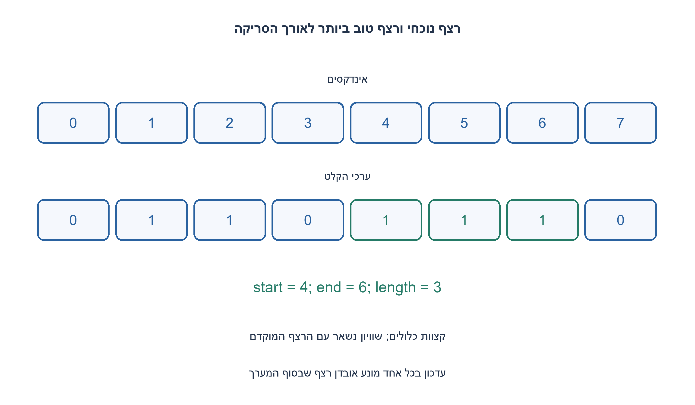
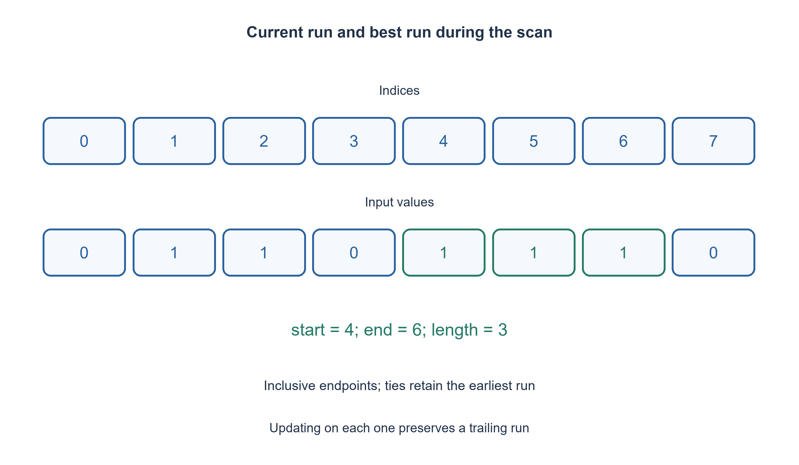

# PREP-289 — הרצף הארוך ביותר של אחדות במערך: התחלה וסיום

פתרון מוצע בסיוע AI; ביקורת מקצועית אנושית ממתינה. הקושי אינו מכויל.

## עברית

נתון מערך של אפסים ואחדות. מצאו את הרצף הרציף הארוך ביותר של אחדות והחזירו את אינדקס ההתחלה ואינדקס הסיום שלו.

השלמת חוזה: הקלט רשימה סופית של שלמים 0 או 1; אין לשנות אותה. האינדקסים מתחילים באפס ושני הקצוות כלולים. בשוויון אורכים מחזירים את הרצף שמתחיל מוקדם יותר. למערך ריק או ללא אחדות מחזירים [-1, -1]. לדוגמה [0,1,1,0,1,1,1,0] מחזיר [4,6]. נתחו זמן ומקום; אין כאן מגבלת לולאה לפי אורך הרצף או קלט ארוז במילה בת 32 ביטים.

1. איזה מידע צריך לשמור על הרצף שמסתיים באינדקס הנוכחי?
2. אפס מסיים את הרצף הנוכחי. אחד מתחיל רצף חדש או מאריך את הקיים; השוו את אורכו לטוב ביותר.
3. שמרו התחלה ואורך נוכחיים, ועדכנו את הקצוות הטובים רק כשנמצא אורך גדול ממש. עדכון בתוך ענף האחד מטפל גם ברצף שבקצה המערך.

### רצף שמסתיים כאן ורצף טוב ביותר עד כאן
במעבר משמאל לימין שומרים את אורך רצף האחדות שמסתיים במקום הנוכחי. אם הערך אפס מאפסים את האורך. אם הוא אחד והאורך היה אפס, שומרים את האינדקס כהתחלה; בכל אחד מגדילים את האורך ומשווים לשיא.

כאשר האורך גדול ממש מהשיא, שומרים את ההתחלה הנוכחית ואת האינדקס הנוכחי כסיום. בשוויון לא מחליפים: הרצף שכבר נשמר הופיע קודם. למשל במערך [1,1,0,1,1] שני רצפים באורך שניים, והתוצאה [0,1].

### אינווריאנט וגבול המערך
אחרי עיבוד כל אינדקס, current_length מתאר בדיוק את סיומת האחדות של הקידומת שנקראה, והזוג הטוב ביותר הוא הרצף הארוך והראשון בקידומת. אפס מסיים את הסיומת, ואחד מאריך אותה בדיוק באחד; העדכון שומר את שני חלקי האינווריאנט. בסוף הקידומת היא כל הקלט ולכן התוצאה נכונה.

מעדכנים בזמן קריאת אחד, ולא רק כאשר פוגשים אפס. לכן גם [0,1,1] מחזיר [1,2] ולא מאבד את הרצף האחרון. ערכי ברירת המחדל [-1, -1] נשארים רק כשלא נקרא אחד כלל; במערך [1] מתקבל [0,0].

הסריקה ובדיקת התקינות עולות Θ(n) זמן ו־ O(1) מילות עזר. במודל שבו ניגשים לתאי מערך, אי אפשר להבטיח תשובה בלי לבדוק את כולם במקרה הגרוע: תא לא נקרא עלול להיות האחד היחיד במערך שהיה נראה כולו אפסים. זהו חסם למודל המערך, לא טענה על קלט שכבר ארוז כולו במילת מכונה.

```python
"""Longest ones run in an array; inclusive endpoints, earliest tie."""


def longest_ones(bits):
    if type(bits) is not list or any(type(bit) is not int or bit not in (0, 1) for bit in bits):
        raise ValueError("a list of integer bits is required")
    current_start = 0
    current_length = 0
    best_start = best_end = -1
    best_length = 0
    for index, bit in enumerate(bits):
        if bit == 0:
            current_length = 0
        else:
            if current_length == 0:
                current_start = index
            current_length += 1
            if current_length > best_length:
                best_start, best_end = current_start, index
                best_length = current_length
    return [best_start, best_end]
```




## English

Given an array of zeros and ones, find its longest contiguous run of ones and return the start and end indices.

Chosen contract: input is a finite list of integer bits 0 or 1 and must not change. Indices are zero-based and both endpoints are inclusive. Equal lengths choose the earliest start. Empty input or no ones returns [-1, -1]. For [0,1,1,0,1,1,1,0], return [4,6]. Analyze time and space. This is an array, without a 32-bit-word representation or an iteration bound based on run length.

1. What information describes the run ending at the current index?
2. Zero ends the current run. One starts a run or extends it; compare its length with the best.
3. Keep current start/length and replace best endpoints only on a strictly longer run. Updating inside the one branch also handles a run ending at the array boundary.

### The run ending here and the best run so far
Scan left to right while tracking the length of the ones suffix ending at the current position. Zero resets its length. On one, record a new start if the old length was zero, increment length and compare with the best.

Only a strictly longer run replaces the saved endpoints. Equality retains the earlier run. For [1,1,0,1,1], both runs have length two and the result is [0,1].

### Invariant and the final boundary
After each index, current_length is exactly the ones suffix of the processed prefix, and the saved pair is its longest, earliest run. Zero ends the suffix; one extends it by exactly one. Comparing its new length preserves the best-run invariant. At termination the prefix is the entire input, proving correctness.

Update on each one rather than only when zero closes a run. Thus [0,1,1] returns [1,2], including the unfinished-at-end run. The default [-1, -1] survives only if no one was seen; [1] returns [0,0].

The scan and validation take Θ(n) time and O(1) auxiliary words. In the array-access model the worst case requires inspecting every cell: an unread entry could be the only one in an otherwise zero array. This lower bound does not describe an entire input already packed into one machine word.

```python
"""Longest ones run in an array; inclusive endpoints, earliest tie."""


def longest_ones(bits):
    if type(bits) is not list or any(type(bit) is not int or bit not in (0, 1) for bit in bits):
        raise ValueError("a list of integer bits is required")
    current_start = 0
    current_length = 0
    best_start = best_end = -1
    best_length = 0
    for index, bit in enumerate(bits):
        if bit == 0:
            current_length = 0
        else:
            if current_length == 0:
                current_start = index
            current_length += 1
            if current_length > best_length:
                best_start, best_end = current_start, index
                best_length = current_length
    return [best_start, best_end]
```




## חומר משלים / Supporting material

```json
{
  "assumptions": {
    "he": [
      "רשימת שלמים 0/1, קצוות כלולים, שוויון לפי התחלה מוקדמת."
    ],
    "en": [
      "Integer-bit list, inclusive endpoints, earliest-start ties."
    ]
  },
  "optimality": {
    "he": "Θ(n) זמן ו־ O(1) מילות עזר; אופטימלי במספר גישות למערך במקרה הגרוע.",
    "en": "Θ(n) time and O(1) auxiliary words; worst-case array-access optimal."
  },
  "verification": {
    "he": "כל 2,047 המערכים הבינאריים עד אורך 10 הושוו לאורקל שבודק כל תת־קטע; נבדק שימור קלט.",
    "en": "All 2,047 binary arrays through length 10 compared with an all-interval oracle; input preservation checked."
  },
  "edge_cases": {
    "he": [
      "ריק, כל האפסים, כל האחדות, שוויון ורצף שמסתיים בתא האחרון."
    ],
    "en": [
      "Empty, all zeros/ones, ties and a run ending at the final cell."
    ]
  },
  "common_mistakes": {
    "he": [
      "לא לשכוח רצף בסוף; לא להחזיר אורך במקום קצוות; לא לערבב קצה כלול עם קצה בלעדי."
    ],
    "en": [
      "Do not miss a trailing run, return length instead of endpoints, or mix inclusive and exclusive ends."
    ]
  },
  "interview_answer": {
    "he": "שומרים רצף נוכחי וטוב ביותר ומחליפים רק בשיפור ממש, כך שהשוויון נפתר אוטומטית לפי הסדר.",
    "en": "Track current and best runs and replace only on strict improvement, resolving ties by scan order."
  },
  "source_ambiguities": {
    "he": "המקור אינו מגדיר אינדוקס, שוויון או קלט ללא אחדות; אלה הושלמו במפורש.",
    "en": "Indexing, ties and all-zero behavior are explicitly completed."
  },
  "solution_extensions": {
    "he": [
      {
        "question": "מה משתנה אם מותר להפוך אפס אחד לאחד?",
        "answer_direction": "השתמשו בחלון שמכיל לכל היותר אפס אחד והגדירו מחדש את פלט הקצוות.",
        "principle": "הרחבת חוזה באופן מפורש"
      }
    ],
    "en": [
      {
        "question": "What if one zero may be flipped?",
        "answer_direction": "Use a window containing at most one zero and define its endpoint output.",
        "principle": "Make an extension explicit"
      }
    ]
  }
}
```
