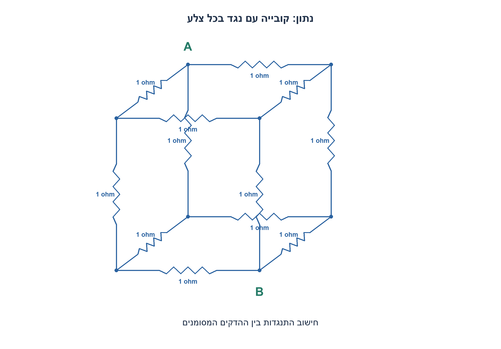
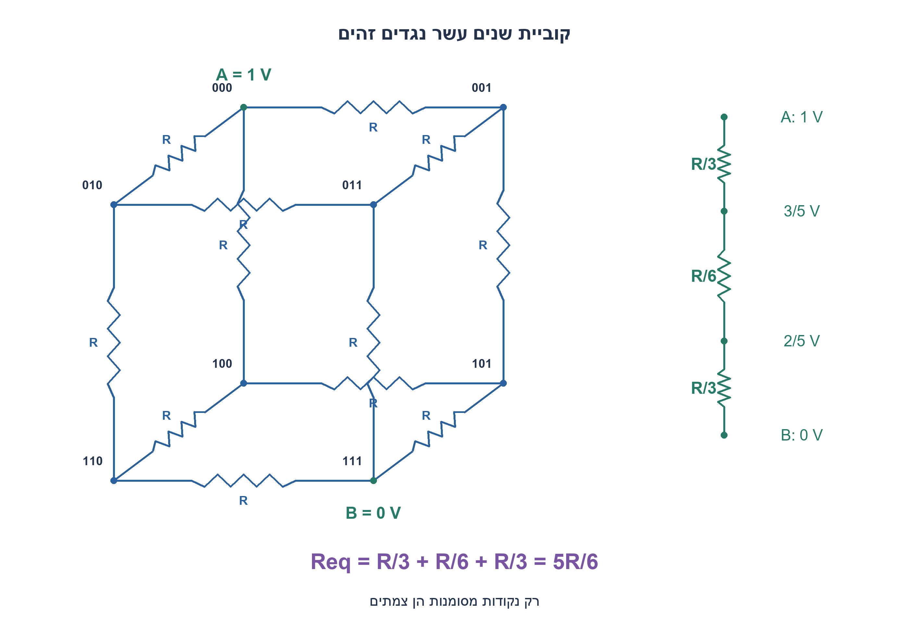
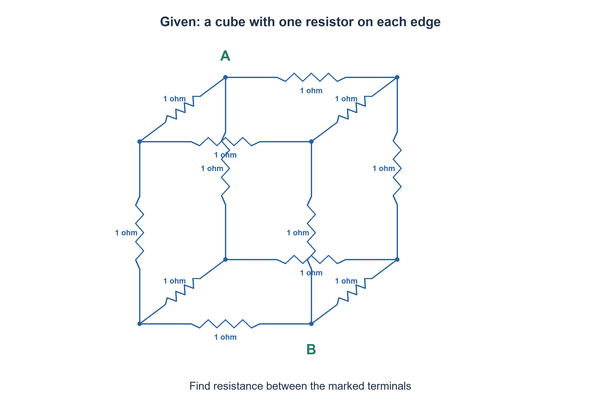
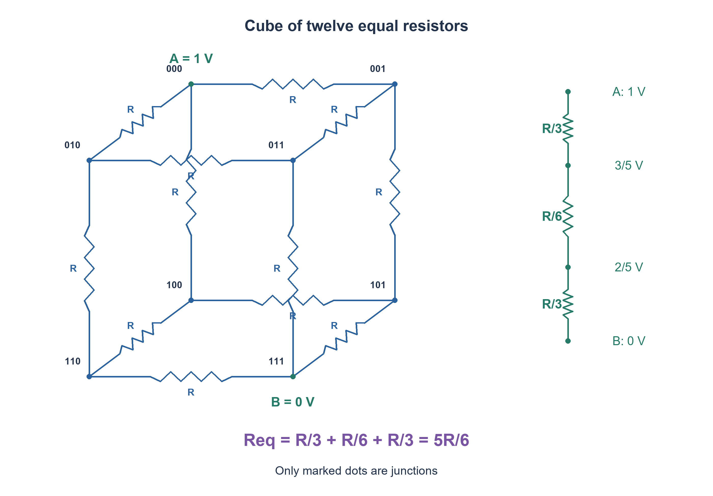

# PREP-290 — קוביית שנים עשר נגדים: התנגדות בין קודקודים נגדיים

פתרון מוצע בסיוע AI; ביקורת מקצועית אנושית ממתינה. הקושי אינו מכויל.

[צילום מקור פרטי](../sources/2026-11-07-night30-03.png)

חישוב התנגדות שקולה. בתמונה רשת קובייה של נגדים; All resistors are 1 Ω; יש לחשב בין A ל-B כפי שמסומנים בתמונה.

חברות לפי הדיווח בצילום בלבד: Intel.

## עברית

בכל אחת מ־12 צלעות קובייה יש נגד של 1Ω. חשבו התנגדות שקולה בין A ו־B, קודקודים נגדיים באלכסון הגוף כמסומן בשרטוט. הסבירו אילו צמתים שווי פוטנציאל ומדוע מותר לצמצם את הרשת.

הנחות הניתוח: נגדים אידאליים, חיווט אידאלי ו־DC. החיתוכים בהיטל שאינם מסומנים בנקודה אינם חיבור חשמלי. אפשר לסמן כל קודקוד בשלוש סיביות; הצלע מחברת קודקודים הנבדלים בסיבית אחת, A=000 ו־B=111. הכלילו לנגד אחיד R>0.

1. הסתכלו על סימטריה שמשאירה את שני ההדקים במקומם ומחליפה בין שלושת הכיוונים.
2. שלושת השכנים של A שווי פוטנציאל; גם שלושת השכנים של B. כמה צלעות מחברות בין הקבוצות?
3. לאחר איחוד צמתים שווי מתח מתקבלים שלושה מקטעים בטור: שלושה נגדים במקביל, שישה במקביל, ואז שלושה במקביל.

### למה הסימטריה מאפשרת צמצום
מקבעים A במתח 1V ו־B באפס. החלפה בין שלושת הצירים אינה משנה שום נגד או תנאי שפה, ולכן לפי יחידות פתרון הרשת היא אינה משנה מתחים. קודקודים שמרחקם צלע אחת מ־A נמצאים באותו מתח; שלושת הקודקודים שמרחקם שתי צלעות מ־A נמצאים במתח משותף אחר. אין טענה שכל ששת הפנימיים באותו מתח.

בין A לקבוצה הראשונה יש שלוש צלעות, בין הקבוצות שש, ובין הקבוצה השנייה ל־B שלוש. באיחוד כל קבוצה אין הפרש מתח בין חבריה ולכן לא משנים זרמים. מתקבל `Req=R/3+R/6+R/3=5R/6`; עבור R=1Ω התשובה 5/6Ω. קבוצות הנגדים בטור הן הקבוצות המצומצמות, לא כל צלע מצוירת בנפרד.

### בדיקה בלתי תלויה
בהזנה של 1V הזרם הכולל הוא 6/(5R). הירידה במקטע הראשון היא 2/5V, ולכן מתח הקבוצה הראשונה 3/5V והשנייה 2/5V. כל אחת משלוש צלעות הקצה נושאת 2/(5R) אמפר; כל אחת משש הצלעות האמצעיות נושאת 1/(5R) אמפר. בכל צומת פנימי הזרם הנכנס שווה לסכום שני הזרמים היוצאים.

מודל Python המצורף אינו מניח את הצמצום: הוא פותר שש משוואות KCL רציונליות על הקובייה המלאה ומחשב את זרם ההדק. הוא מאמת 5R/6 בחמישה ערכי R. זה חישוב רשת אידאלית, לא מדידה פיזית. אם הדקי השאלה סמוכים או על אלכסון פאה, הסימטריה והמספר משתנים; יש לבדוק את ההדקים לפני שזוכרים נוסחה.

### מודל Python שנבדק

```python
"""Exact nodal analysis: cube vertices 0..7; terminals 000 and 111."""
from fractions import Fraction


def cube_resistance(edge_ohms=1):
    resistance = Fraction(edge_ohms)
    if resistance <= 0:
        raise ValueError("Every edge resistance must be positive")
    interior = list(range(1, 7))
    rows = []
    for vertex in interior:
        row = [Fraction(0)] * 7
        row[interior.index(vertex)] = 3
        for mask in (1, 2, 4):
            neighbor = vertex ^ mask
            if neighbor == 0:
                row[-1] += 1  # terminal A is held at one volt
            elif neighbor != 7:
                row[interior.index(neighbor)] -= 1
        rows.append(row)
    for column in range(6):
        pivot = next(r for r in range(column, 6) if rows[r][column])
        rows[column], rows[pivot] = rows[pivot], rows[column]
        divisor = rows[column][column]
        rows[column] = [v / divisor for v in rows[column]]
        for r in range(6):
            if r != column:
                factor = rows[r][column]
                rows[r] = [a - factor*b for a,b in zip(rows[r], rows[column])]
    voltage = {0: Fraction(1), 7: Fraction(0)}
    voltage.update({v: rows[i][-1] for i,v in enumerate(interior)})
    current = sum((1-voltage[v])/resistance for v in (1,2,4))
    return 1/current, voltage
```






### assumptions

12 נגדים שווים, R>0; הדקים באלכסון הגוף; DC אידאלי.

### optimality

הצמצום כולל שלוש קבוצות בטור; אין טענת אופטימליות חישובית כללית.

### verification

מודלים עצמאיים עברו: קובייה בחמישה ערכי התנגדות, 3,072 גשרי DC במתח שאינו אפס, דוגמת מתח אפס, 64 זוגות נגדי משוב ו־256 בדיקות הגבר סופי, עשר פאזות סינוס, 1,024 קלטי מכפיל, 256 קלטי ספירת אחדות, 256 זוגות חיבור וארבע שורות NAND. ראיה: checks/night1107n30-hardware-model-verification.json. בדיקות אלה הן Python וחישוב רציונלי; קומפילציית SystemVerilog מתועדת בנפרד בדוח native של האצווה. לא בוצעו SPICE, סינתזה, ניתוח תזמון או מדידת חומרה.

בדיקת Icarus Verilog 12 בפועל עברה: 1,664 השוואות RTL באצוות החומרה, כולל כל קלטי המכפיל, ספירת אחדות וחיבור, כל שורות NAND ו־124 בדיקות לוח פאזה עם איפוס והשהיה. ראיה: checks/night1107n30-native-verification.json. ריצת הקוד הייתה בסביבה זמנית מבודדת ללא רשת; אין להסיק מכך SPICE או סינתזה.

### edge_cases

```json
[
  "R=1Ω נותן 5/6Ω.",
  "הכפלת כל R מכפילה את Req."
]
```

### common_mistakes

```json
[
  "איחוד כל הצמתים הפנימיים.",
  "קריאת הצטלבות קווים כצומת."
]
```

### interview_answer

סימטריה נותנת קבוצות של 3 ו־3 צמתים; שלוש, שש ושלוש צלעות מקבילות יוצרות 5R/6.

### source_ambiguities

נבחר מודל אידאלי; ההדקים נלקחו מהשרטוט המקורי.

### solution_extensions

```json
[
  {
    "question": "מה קורה אם נגד אחד שונה?",
    "direction": "סימטריה עלולה להישבר; פותרים KCL לרשת המלאה.",
    "tests": "שינוי צלע ליד A ובדיקת זרם."
  }
]
```

## English

Every one of the twelve edges of a cube contains a 1Ω resistor. Find the equivalent resistance between body-diagonal opposite vertices A and B, as drawn. Explain which vertices are equipotential and why the network can be reduced.

Analysis assumptions: ideal resistors, ideal wires and DC. Projected wire crossings without dots are not junctions. A vertex may be labeled by three bits; an edge changes one bit, with A=000 and B=111. Generalize to equal edge resistance R>0.

1. Use a symmetry that fixes both terminals while permuting the three coordinate directions.
2. The three neighbors of A are equipotential, as are the three neighbors of B. How many edges connect the groups?
3. After merging equal-voltage nodes, three parallel resistors, six parallel resistors, and three parallel resistors form a series chain.

### Why symmetry permits reduction
Hold A at 1V and B at zero. Permuting coordinate axes preserves every resistor and boundary condition; uniqueness of the resistor-network solution therefore preserves voltages. The three vertices one edge from A share one voltage; the three vertices two edges from A share another. All six interior vertices are not equipotential.

There are three edges from A to the first group, six between groups, and three from the second group to B. Merging equal-voltage nodes changes no currents. The reduced chain gives `Req=R/3+R/6+R/3=5R/6`, hence 5/6Ω for R=1Ω. The series elements are the reduced groups, not arbitrary individual edges in the drawing.

### Independent check
With 1V applied, total current is 6/(5R). The first segment drops 2/5V, leaving interior layer voltages 3/5V and 2/5V. Each of the three terminal edges carries 2/(5R) amperes; each of the six middle edges carries 1/(5R) amperes. At every interior vertex the entering current equals the sum of two outgoing currents.

The accompanying Python model solves six exact rational KCL equations on the full cube without assuming the reduction, then measures terminal current. It confirms 5R/6 at five resistance scales. This is ideal circuit analysis, not a physical measurement. Adjacent terminals or a face diagonal give different reductions; identify the actual terminals before recalling a formula.

### Verified Python teaching model

```python
"""Exact nodal analysis: cube vertices 0..7; terminals 000 and 111."""
from fractions import Fraction


def cube_resistance(edge_ohms=1):
    resistance = Fraction(edge_ohms)
    if resistance <= 0:
        raise ValueError("Every edge resistance must be positive")
    interior = list(range(1, 7))
    rows = []
    for vertex in interior:
        row = [Fraction(0)] * 7
        row[interior.index(vertex)] = 3
        for mask in (1, 2, 4):
            neighbor = vertex ^ mask
            if neighbor == 0:
                row[-1] += 1  # terminal A is held at one volt
            elif neighbor != 7:
                row[interior.index(neighbor)] -= 1
        rows.append(row)
    for column in range(6):
        pivot = next(r for r in range(column, 6) if rows[r][column])
        rows[column], rows[pivot] = rows[pivot], rows[column]
        divisor = rows[column][column]
        rows[column] = [v / divisor for v in rows[column]]
        for r in range(6):
            if r != column:
                factor = rows[r][column]
                rows[r] = [a - factor*b for a,b in zip(rows[r], rows[column])]
    voltage = {0: Fraction(1), 7: Fraction(0)}
    voltage.update({v: rows[i][-1] for i,v in enumerate(interior)})
    current = sum((1-voltage[v])/resistance for v in (1,2,4))
    return 1/current, voltage
```






### assumptions

Twelve equal positive resistors; body-diagonal terminals; ideal DC.

### optimality

Three reduced series groups; no general computational optimality claim.

### verification

Independent models passed: five cube resistance scales, 3,072 nonzero-source DC bridges plus a zero-source example, 64 feedback-resistor pairs and 256 finite-gain checks, ten sine phases, 1,024 multiplier inputs, 256 popcount inputs, 256 addition pairs and four NAND truth rows. Evidence: checks/night1107n30-hardware-model-verification.json. These are Python/exact-rational checks; SystemVerilog compilation is documented separately in the batch native report. No SPICE, synthesis, timing analysis or hardware measurement was performed.

Actual Icarus Verilog12 execution passed 1,664 hardware RTL comparisons, including all multiplier, popcount and adder inputs, all NAND rows and 124 phase-schedule checks with reset and hold. Evidence: checks/night1107n30-native-verification.json. Execution used a temporary isolated environment with networking denied; this is not SPICE or synthesis.

### edge_cases

```json
[
  "R=1Ω gives 5/6Ω.",
  "Scaling every R scales Req."
]
```

### common_mistakes

```json
[
  "Merging all interior vertices.",
  "Treating a projected crossing as a junction."
]
```

### interview_answer

Symmetry gives two groups of three vertices; parallel edge groups of three, six and three yield 5R/6.

### source_ambiguities

An ideal model is chosen; terminal positions follow the source diagram.

### solution_extensions

```json
[
  {
    "question": "What if one resistor differs?",
    "direction": "Symmetry can break; solve the full nodal equations.",
    "tests": "Change an edge near A and check terminal current."
  }
]
```
