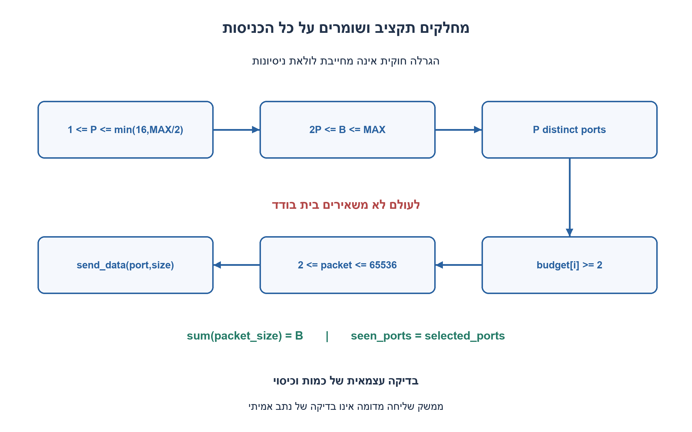
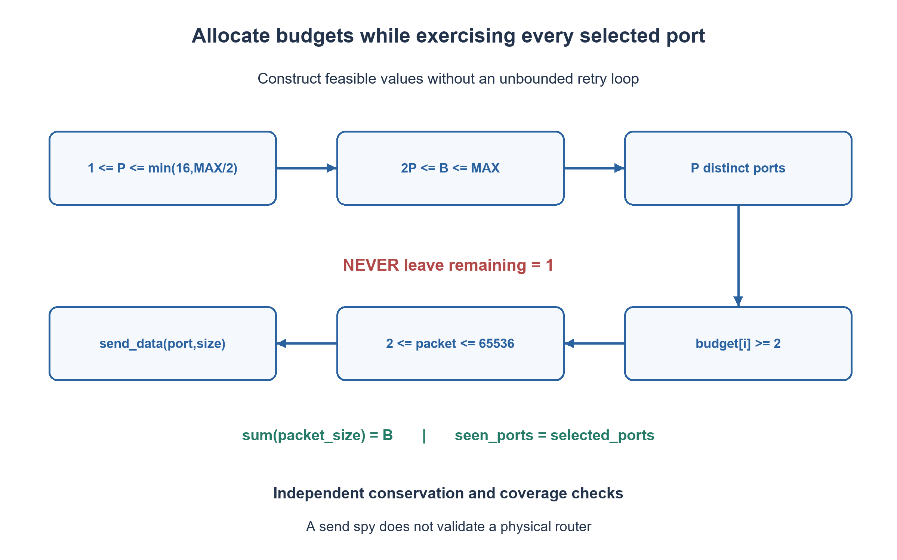

# PREP-291 — נתב בעל 16 כניסות: תעבורה אקראית עם תקציב מדויק

פתרון מוצע בסיוע AI; ביקורת מקצועית אנושית ממתינה. הקושי אינו מכויל.

## עברית

תכננו מחולל בדיקות לנתב שכניסותיו ממוספרות 0–15. קיימת הפעולה `send_data(port_num, data_size)`. יש להגריל את סך הבתים של הבדיקה, את מספר הכניסות הפעילות בין 1 ל־16 ואת גדלי החבילות. כל חבילה גדולה מבית אחד ואינה גדולה מ־64 KiB.

הנחות התרגיל שנבחרו: התקציב B הוא לכל הבדיקה יחד; 64 KiB הם 65,536 בתים. בדיוק P כניסות שונות ייבחרו, ולכל אחת תישלח לפחות חבילה אחת. בוחרים גבול סופי MAX בין 2 למיליון בתים, מגרילים P אפשרי ואז B בתחום 2P עד MAX. הממשק סינכרוני: קריאה מצליחה מקבלת את כל החבילה, ושגיאה עוצרת את הבדיקה.

כתבו אלגוריתם ומימוש SystemVerilog פרוצדורלי שמסיימים תמיד ומעבירים בדיוק B בתים בגדלים 2–65,536. צרפו בדיקה עצמאית של הכמות והכיסוי. אין צורך להבטיח התפלגות אחידה על כל החלוקות האפשריות או לבדוק נתב פיזי.

1. מהו תקציב הבתים המינימלי שמאפשר להפעיל P כניסות, אם חבילה אינה יכולה להיות באורך בית אחד?
2. הקצו קודם תקציב של לפחות שני בתים לכל כניסה שנבחרה. לאחר מכן חלקו כל תקציב לחבילות בלי להשאיר שארית של בית אחד.
3. כאשר נותרו R בתים, אפשר לבחור גודל s בטווח 2 עד min(R,65536), אך אסור לבחור s=R−1. ב־R=3 בוחרים 3, וב־R=65537 אסור לבחור 65536.

### בונים קלט אפשרי במקום לקוות שהגרלה תצליח
נבחר `P` לכל היותר `min(16, MAX//2)`, ואז נבחר `B` בטווח `[2P, MAX]`. כך אין צורך בלולאת ניסיונות למציאת זוג אפשרי. מערבבים את 16 מספרי הכניסות ובוחרים את P הראשונים, ללא חזרות. לכל כניסה מקצים תחילה שני בתים. את יתרת `B−2P` מחלקים ביניהן: בכל שלב בוחרים תוספת בין אפס ליתרה, ובשלב האחרון נותנים את כל היתרה. קיבלנו תקציבים חיוביים שסכומם B וכל אחד לפחות 2.

### למה השארית היא החלק החשוב
מחלקים תקציב של כניסה אחת כאשר נותרו R בתים. מגרילים s בין 2 ל־`min(R,65536)`, פרט לערך `R−1` אם הוא בטווח. שולחים ומחליפים את R ב־`R−s`. כך שארית חדשה היא אפס או לפחות 2. קיימת תמיד בחירה: אם R=2 בוחרים 2; אם R=3 בוחרים 3; ואם R≥4 אז 2 חוקי, מלבד מקרה שאינו מתרחש כאן. בלולאה הממשית הקוד ממפה אינדקס אקראי לתחום בלי הערך האסור, ולכן אין גם לולאת הגרלה פנימית שעלולה להיתקע.

לדוגמה, B=7 ו־P=2 יכולים לתת תקציבים 3 ו־4, ולכן חבילות באורך 3 לכניסה אחת ו־2,2 לאחרת. עבור תקציב 65,537 אין לשלוח 65,536 ואז בית בודד; אפשר לשלוח למשל 65,535 ועוד 2. לכל כניסה שנבחרה יש תקציב של לפחות 2 ולכן לפחות קריאה אחת, וכניסה אחרת כלל אינה משמשת.

### נכונות, אקראיות ועלות
אינווריאנט חלוקת התקציב שומר שסך התקציבים שהוקצו ועוד היתרה שווה ל־B. אינווריאנט הפיצול שומר שסך החבילות שכבר נשלחו ועוד R שווה לתקציב הכניסה, ו־R לעולם אינו 1. כל איטרציה מקטינה את R לפחות ב־2, ולכן התהליך מסתיים, ובסיום סכום כל הקריאות הוא B. מספר החבילות K חסום ב־`floor(B/2)`; זמן המחולל O(P+K), בהנחת פעולות הגרלה ושליחה לממשק קבועות. שמירת תכנית בפייתון עולה O(P+K), ואילו מימוש ה־SV שולח תוך כדי ונעזר במערכים בגודל 16 בלבד. מחיר מערכת תקשורת אמיתית תלוי גם בבתים ובזמן השליחה.

בחירת הכניסות והגדלים משתנה בין זרעים, אך אינה מתיימרת לבחור חלוקה שלמה באחידות. גם מיפוי מודולו של PRNG ב־SV עלול להיות מוטה מעט; הדבר אינו פוגע בחוזה החוקיות והכיסוי. אם נדרשת התפלגות מוגדרת, יש להגדיר אותה ולבחון אותה בנפרד.

### מה הבדיקה באמת בודקת
המימוש כולל `send_data` מדומה שסופר בתים וכניסות. בסביבה אמיתית מחליפים את גוף השליחה בממשק הנתון ומשאירים scoreboard עצמאי. רתמת הבדיקה מאמתת את המחולל ואת חוזה הקריאה; היא אינה מוכיחה שהנתב קיבל, ניתב או שמר את הנתונים. מימוש ה־SV פרוצדורלי ואינו מסתמך על תמיכת מהדר ב־constraint randomization.

```systemverilog
// Procedural simulation driver, not synthesizable RTL or constrained-random SV.
// send_data below is the test spy. Replace its body with the supplied synchronous
// interface in an actual environment, preserving the scoreboard independently.
module prep291_router_driver;
    integer ports[0:15];
    integer budgets[0:15];
    integer hits[0:15];
    integer total_sent, packet_count;
    reg [31:0] random_state;

    function automatic integer pick(input integer upper_exclusive);
        reg [31:0] x;
        begin
            if (upper_exclusive <= 0) $fatal(1, "invalid random range");
            x = random_state;
            x = x ^ (x << 13); x = x ^ (x >> 17); x = x ^ (x << 5);
            random_state = x;
            // Bounded modulo selection is reproducible, not exactly uniform.
            pick = x % upper_exclusive;
        end
    endfunction

    task automatic send_data(input integer port_num, input integer data_size);
        begin
            if (port_num < 0 || port_num > 15 || data_size < 2 || data_size > 65536)
                $fatal(1, "illegal packet");
            hits[port_num] = hits[port_num] + 1;
            total_sent = total_sent + data_size;
            packet_count = packet_count + 1;
        end
    endtask

    task automatic run_test(input integer total, input integer active_count,
                            input reg [31:0] seed);
        integer i, j, swap_port, remaining, extra, take, upper, skip, count, size;
        reg skip_present;
        begin
            if (active_count < 1 || active_count > 16 || total < 2*active_count || total > 1000000)
                $fatal(1, "infeasible configuration");
            random_state = seed == 0 ? 32'h1 : seed;
            total_sent = 0; packet_count = 0;
            for (i = 0; i < 16; i = i+1) begin ports[i] = i; hits[i] = 0; end
            for (i = 15; i > 0; i = i-1) begin
                j = pick(i+1); swap_port = ports[i]; ports[i] = ports[j]; ports[j] = swap_port;
            end
            extra = total - 2*active_count;
            for (i = 0; i < active_count; i = i+1) begin
                take = i == active_count-1 ? extra : pick(extra+1);
                budgets[i] = 2 + take; extra = extra-take;
            end
            for (i = 0; i < active_count; i = i+1) begin
                remaining = budgets[i];
                while (remaining != 0) begin
                    upper = remaining < 65536 ? remaining : 65536;
                    skip = remaining-1;
                    skip_present = skip >= 2 && skip <= upper;
                    count = upper-1-(skip_present ? 1 : 0);
                    size = 2+pick(count);
                    if (skip_present && size >= skip) size = size+1;
                    send_data(ports[i], size);
                    remaining = remaining-size;
                end
            end
            if (total_sent != total) $fatal(1, "byte conservation failed");
            for (i = 0; i < 16; i = i+1) begin
                if (i < active_count && hits[ports[i]] == 0) $fatal(1, "active port omitted");
                if (i >= active_count && hits[ports[i]] != 0) $fatal(1, "inactive port used");
            end
        end
    endtask

    task automatic random_test(input integer max_total, input reg [31:0] seed);
        integer p, total, max_ports;
        reg [31:0] next_seed;
        begin
            if (max_total < 2 || max_total > 1000000) $fatal(1, "invalid test maximum");
            random_state = seed == 0 ? 32'h1 : seed;
            max_ports = max_total/2 < 16 ? max_total/2 : 16;
            p = 1+pick(max_ports);
            total = 2*p+pick(max_total-2*p+1);
            next_seed = random_state;
            run_test(total, p, next_seed);
        end
    endtask
endmodule
```




## English

Design a test generator for a router with input ports numbered 0–15. An existing `send_data(port_num, data_size)` operation sends a packet. Randomize the total byte count, the number of active ports from 1 to 16, and packet sizes. Every packet is larger than one byte and at most 64 KiB.

Chosen exercise assumptions: the byte budget B applies to the entire test; 64 KiB means 65,536 bytes. Choose exactly P distinct ports and send at least one packet to each. Set a finite MAX from 2 through one million bytes, choose a feasible P, then choose B from 2P through MAX. The interface synchronously accepts the entire packet or raises a failure which stops the test.

Give an algorithm and procedural SystemVerilog implementation which terminate and send exactly B bytes in packets of 2–65,536 bytes. Independently verify conservation and port coverage. Uniformity over all possible packet partitions and testing a physical router are not required.

1. What is the smallest byte budget that can exercise P ports when one-byte packets are forbidden?
2. First allocate at least two bytes to each chosen port. Then packetize each budget without leaving a one-byte remainder.
3. For R remaining bytes choose s from 2 through min(R,65536), excluding s=R−1. When R=3 choose three; when R=65537 do not choose 65536.

### Construct feasible random inputs
Choose `P <= min(16, MAX//2)` and then `B` in `[2P, MAX]`. No retry loop is needed to discover feasible parameters. Shuffle the sixteen port numbers and select the first P, without replacement. Give every selected port a two-byte budget, then distribute the remaining `B−2P` bytes: choose an extra amount from zero through the remaining extra for each port except the last, which receives the rest. Every budget is at least two and their sum is B.

### Protect the final remainder
For a port with R remaining bytes, choose a size s in `[2,min(R,65536)]`, excluding `R−1` if it lies in the range. Send the packet and subtract s. The new remainder is zero or at least two. A legal choice always exists: R=2 permits two, R=3 permits three, and R≥4 permits two. The code maps a random index around the excluded value, so it does not need an unbounded rejection-sampling loop.

For example, B=7 and P=2 can produce budgets three and four: send a three-byte packet to one port and two two-byte packets to the other. A 65,537-byte budget must not become a 65,536-byte packet plus an illegal byte; 65,535 plus two is a valid alternative. Positive budgets ensure every selected port receives a packet, while unselected ports are never used.

### Correctness, randomness and cost
During budget allocation, assigned budgets plus unassigned extra equal B. During packetization, bytes already sent plus R equal that port's budget, with R never one. Every iteration reduces R by at least two, proving termination and exact conservation. For K packets, K≤floor(B/2), and generation costs O(P+K) under constant-time PRNG/interface calls. The Python stored plan costs O(P+K) space; the streaming SV driver uses fixed arrays of sixteen entries. Actual communication cost also depends on payload bytes and delivery time.

The choices vary with the seed, but the algorithm does not claim uniformity over whole partitions. Modulo mapping in the SV PRNG can also introduce a small bias; legal sizes and exact coverage do not depend on statistical uniformity. A specific required distribution needs a separate contract and statistical assessment.

### What is verified
The included `send_data` is a spy which counts bytes and port hits. Replace its body with the provided interface in a real environment and retain an independent scoreboard. This harness validates generator/interface behavior, not actual routing, delivery or payload integrity. The SV implementation is procedural simulation code and does not depend on class constraint-randomization support.

```systemverilog
// Procedural simulation driver, not synthesizable RTL or constrained-random SV.
// send_data below is the test spy. Replace its body with the supplied synchronous
// interface in an actual environment, preserving the scoreboard independently.
module prep291_router_driver;
    integer ports[0:15];
    integer budgets[0:15];
    integer hits[0:15];
    integer total_sent, packet_count;
    reg [31:0] random_state;

    function automatic integer pick(input integer upper_exclusive);
        reg [31:0] x;
        begin
            if (upper_exclusive <= 0) $fatal(1, "invalid random range");
            x = random_state;
            x = x ^ (x << 13); x = x ^ (x >> 17); x = x ^ (x << 5);
            random_state = x;
            // Bounded modulo selection is reproducible, not exactly uniform.
            pick = x % upper_exclusive;
        end
    endfunction

    task automatic send_data(input integer port_num, input integer data_size);
        begin
            if (port_num < 0 || port_num > 15 || data_size < 2 || data_size > 65536)
                $fatal(1, "illegal packet");
            hits[port_num] = hits[port_num] + 1;
            total_sent = total_sent + data_size;
            packet_count = packet_count + 1;
        end
    endtask

    task automatic run_test(input integer total, input integer active_count,
                            input reg [31:0] seed);
        integer i, j, swap_port, remaining, extra, take, upper, skip, count, size;
        reg skip_present;
        begin
            if (active_count < 1 || active_count > 16 || total < 2*active_count || total > 1000000)
                $fatal(1, "infeasible configuration");
            random_state = seed == 0 ? 32'h1 : seed;
            total_sent = 0; packet_count = 0;
            for (i = 0; i < 16; i = i+1) begin ports[i] = i; hits[i] = 0; end
            for (i = 15; i > 0; i = i-1) begin
                j = pick(i+1); swap_port = ports[i]; ports[i] = ports[j]; ports[j] = swap_port;
            end
            extra = total - 2*active_count;
            for (i = 0; i < active_count; i = i+1) begin
                take = i == active_count-1 ? extra : pick(extra+1);
                budgets[i] = 2 + take; extra = extra-take;
            end
            for (i = 0; i < active_count; i = i+1) begin
                remaining = budgets[i];
                while (remaining != 0) begin
                    upper = remaining < 65536 ? remaining : 65536;
                    skip = remaining-1;
                    skip_present = skip >= 2 && skip <= upper;
                    count = upper-1-(skip_present ? 1 : 0);
                    size = 2+pick(count);
                    if (skip_present && size >= skip) size = size+1;
                    send_data(ports[i], size);
                    remaining = remaining-size;
                end
            end
            if (total_sent != total) $fatal(1, "byte conservation failed");
            for (i = 0; i < 16; i = i+1) begin
                if (i < active_count && hits[ports[i]] == 0) $fatal(1, "active port omitted");
                if (i >= active_count && hits[ports[i]] != 0) $fatal(1, "inactive port used");
            end
        end
    endtask

    task automatic random_test(input integer max_total, input reg [31:0] seed);
        integer p, total, max_ports;
        reg [31:0] next_seed;
        begin
            if (max_total < 2 || max_total > 1000000) $fatal(1, "invalid test maximum");
            random_state = seed == 0 ? 32'h1 : seed;
            max_ports = max_total/2 < 16 ? max_total/2 : 16;
            p = 1+pick(max_ports);
            total = 2*p+pick(max_total-2*p+1);
            next_seed = random_state;
            run_test(total, p, next_seed);
        end
    endtask
endmodule
```




## חומר משלים / Supporting material

```json
{
  "assumptions": {
    "he": [
      "תקציב גלובלי, כניסות פעילות שנעשה בהן שימוש ממשי, חבילות 2–65536 בתים וממשק סינכרוני."
    ],
    "en": [
      "Global budget, actually exercised active ports, 2–65536-byte packets and a synchronous interface."
    ]
  },
  "optimality": {
    "he": "O(P+K) יצירת K חבילות; O(16) אחסון במחולל SV. אין טענת אחידות על חלוקות או אופטימליות במספר חבילות.",
    "en": "O(P+K) generation for K packets and fixed sixteen-entry SV storage. No global partition-uniformity or minimum-packet-count claim."
  },
  "verification": {
    "he": [
      "אורקל עצמאי מסכם אורכי חבילות, קבוצת כניסות וגבולות; בדיקות של שארית 1 וזרעים חוזרים.",
      "ראיית סימולציה נפרדת: רתמת SystemVerilog הודרה והורצה ב־Icarus בסביבה מבודדת; חלק התרגיל בדק 672 מקרי מודל. הדוח הוא checks/night1107n30-native-verification.json. אין זו בדיקת נתב אמיתי, STA או אישור חומרה."
    ],
    "en": [
      "An independent oracle checks packet sums, port sets and bounds, including residual-one boundaries and seed replay.",
      "Separate native evidence: the SystemVerilog harness was compiled and run with Icarus in an isolated environment; this exercise contributed 672 model cases. Evidence: checks/night1107n30-native-verification.json. This is not real-router validation, STA or hardware signoff."
    ]
  },
  "edge_cases": {
    "he": [
      "B=2P; B=2P+1; תקציבים 3 ו־65537; P=16; שגיאת שליחה."
    ],
    "en": [
      "B=2P, B=2P+1, budgets three and 65537, P=16 and send failures."
    ]
  },
  "common_mistakes": {
    "he": [
      "להתיר חבילת בית אחד, להשמיט כניסה ״פעילה״, או לטעון שבדיקת spy מאמתת נתב אמיתי."
    ],
    "en": [
      "Allowing a one-byte tail, omitting an active port, or claiming that a spy validates a real router."
    ]
  },
  "interview_answer": {
    "he": "אני מקצה לפחות שני בתים לכל כניסה שנבחרה, מחלק את היתרה ואז אוסר פיצול שמשאיר בית אחד. סכום החבילות וכיסוי הכניסות נבדקים בנפרד.",
    "en": "Allocate at least two bytes per selected port, distribute the extra, and forbid a packet which leaves one byte. Independently check the exact byte sum and selected-port coverage."
  },
  "source_ambiguities": {
    "he": [
      "המילים per port אינן מגדירות בבירור אם התקציב לכל כניסה או לבדיקה. נבחר כאן תקציב גלובלי ו־KiB מפורש."
    ],
    "en": [
      "The trailing per port wording does not clearly define budget scope; this exercise explicitly chooses a global budget and KiB units."
    ]
  },
  "solution_extensions": {
    "he": [
      {
        "question": "איך תוסיפו בדיקת שלמות נתונים בממשק אסינכרוני?",
        "answer_direction": "הוסיפו מזהי חבילות, בעלות ברורה על buffers, אישורי קבלה והשוואת payload צפוי מול נצפה; אל תספרו בקשה כאילו הושלמה.",
        "principle": "הפרדת מחולל, נהג ו־scoreboard."
      }
    ],
    "en": [
      {
        "question": "How would you check data integrity with an asynchronous interface?",
        "answer_direction": "Add packet IDs, buffer-ownership rules, acknowledgements and expected-versus-observed payload comparison; a submitted request is not a completed delivery.",
        "principle": "Separate stimulus generation, driver and scoreboard."
      }
    ]
  }
}
```
