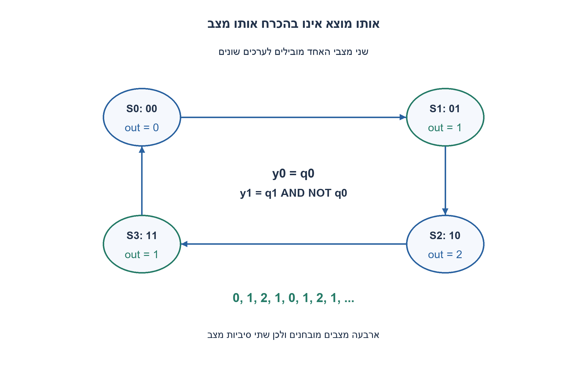
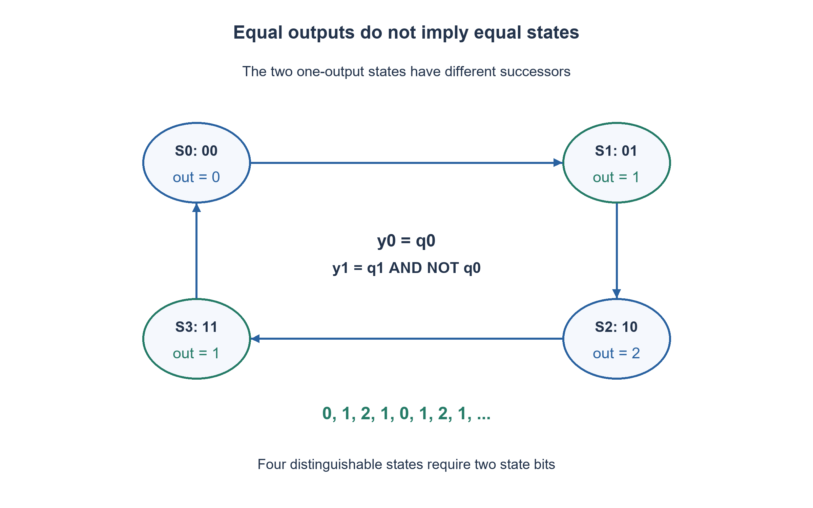

# PREP-292 — מונה מחזורי 0, 1, 2, 1 — ארבעה מצבים לשלושה ערכים

פתרון מוצע בסיוע AI; ביקורת מקצועית אנושית ממתינה. הקושי אינו מכויל.

## עברית

תכננו מונה סינכרוני שהמוצא הבינארי שלו הוא 0,1,2,1,0,1,2,1 וכן הלאה. הערך 0 מופיע פעם אחת בכל מחזור של ארבע פעימות. בהנחת reset סינכרוני פעיל בגבוה, המוצא לאחר reset הוא 0 וכל חזית עולה מקדמת צעד אחד. ציירו מכונת Moore, ממשו ב־FF ובשערים ונמקו את מספר סיביות המצב המינימלי. אין כניסת enable.

1. האם שתי הפעמים שבהן המוצא 1 צריכות להוביל לאותו מוצא הבא?
2. אחרי 1 אחד מגיע 2, ואחרי 1 אחר מגיע 0. לכן צריך לשמור את שלב המחזור, ולא רק את הערך שמוצג.
3. ספרו שלב בינארי 00,01,10,11. המוצא הוא 0,1,2,1 בהתאמה: הביט הנמוך הוא q0 והביט הגבוה הוא q1 AND NOT q0.

למחזור יש ארבעה שלבים: S0 שמציג 0, S1 שמציג 1, S2 שמציג 2 ו־S3 שמציג 1. המעברים הם S0→S1→S2→S3→S0. אין לאחד את S1 ואת S3: לאותה יציאה בהווה יכול להיות עתיד אחר.

מקודדים את השלב בשתי סיביות q1,q0, ומקדמים אותו מודולו 4. ברכיבי DFF, לפני בחירת reset, משוואות המצב הן `D0=NOT q0`, `D1=q1 XOR q0`. משוואות המוצא הן `y0=q0`, `y1=q1 AND NOT q0`. כך המצב 11 מציג 01, ולא 11. כל ארבעת קידודי המצב חוקיים. reset טוען 00; קוד ה־RTL משתמש בחיבור בן שתי סיביות, שהגלישה שלו מממשת את החזרה ל־00.

זו מכונת Moore, כי המוצא נקבע רק לפי המצב השמור. לאחר reset ובשמונה החזיתות שאחריו נקבל 0,1,2,1,0,1,2,1,0. המונח ״0 פעם אחת״ מתפרש כאן כהופעה אחת במחזור, ולא כהופעה יחידה בכל חיי הרכיב.

למכונת Moore דרושים לפחות ארבעה מצבים: שלבים עם מוצא שונה נבדלים מיד; שני השלבים שמציגים 1 נבדלים לאחר פעימה אחת, כי אחד מוביל ל־2 והשני ל־0. ארבעת השלבים לכן אינם ניתנים למיזוג, ונדרשות לפחות שתי סיביות מצב. המימוש משיג זאת בשני FF. זה אינו נימוק למינימום של כל סוגי השערים או להספק מינימלי.

מוצא צירופי משלב בינארי עלול להציג glitch קצר עקב השהיות שונות, בפרט כאשר שתי סיביות המצב משתנות. הסימולציה הלוגית אינה STA ואינה הבטחת מוצא נטול גליצ׳ים. אם נדרש מוצא רשום או קידוד אחר, יש להגדיר את דרישת התזמון ולנתח את העלות מחדש.

```systemverilog
module prep292_counter0121(input logic clk, rst,
                          output logic [1:0] value);
    logic [1:0] phase;
    always_ff @(posedge clk) begin
        if (rst) phase <= 2'b00;
        else phase <= phase + 2'b01;
    end
    assign value = {phase[1] & ~phase[0], phase[0]};
endmodule
```




## English

Design a synchronous counter with binary output 0,1,2,1,0,1,2,1,... . Zero occurs once in each four-step period. Assume synchronous active-high reset, output zero after reset, and one step per rising edge, with no enable input. Draw a Moore machine, implement it using FFs and gates, and justify the minimum number of state bits.

1. Should both occurrences of output one lead to the same next output?
2. One occurrence of one is followed by two; the other is followed by zero. Store the phase rather than only the displayed value.
3. Count binary phases 00,01,10,11, displaying 0,1,2,1. The low output bit is q0; the high bit is q1 AND NOT q0.

Use four phases: S0 displays zero, S1 displays one, S2 displays two, and S3 displays one. Follow S0→S1→S2→S3→S0. S1 and S3 cannot be merged: equal present outputs need not imply equal future behavior.

Encode the phase as q1,q0 and increment it modulo four. Before reset selection, DFF equations are `D0=NOT q0` and `D1=q1 XOR q0`. Output equations are `y0=q0` and `y1=q1 AND NOT q0`. Thus phase 11 displays 01 rather than 11. All four phase encodings are valid. Reset loads 00; the two-bit RTL addition wraps naturally back to 00.

This is a Moore machine because output depends only on stored state. Starting after reset, successive samples are 0,1,2,1,0,1,2,1,0. Zero appearing once means once per period, not once in the lifetime of the device.

At least four Moore states are necessary. Different displayed values distinguish phases immediately. The two phases displaying one are distinguished by one further edge: one leads to two, the other to zero. Therefore all four phases are behaviorally distinct, requiring at least two state bits; the implementation attains this with two FFs. This is not a proof of minimum gate count or power.

A combinational decode of binary state can glitch briefly because state bits have unequal delays, especially on a two-bit transition. Logical simulation is not STA or a guarantee of glitch-free physical output. A registered-output or alternative-encoding requirement must be specified and its cost analyzed separately.

```systemverilog
module prep292_counter0121(input logic clk, rst,
                          output logic [1:0] value);
    logic [1:0] phase;
    always_ff @(posedge clk) begin
        if (rst) phase <= 2'b00;
        else phase <= phase + 2'b01;
    end
    assign value = {phase[1] & ~phase[0], phase[0]};
endmodule
```




## חומר משלים / Supporting material

```json
{
  "assumptions": {
    "he": [
      "0 פעם אחת בכל תקופה של ארבעה צעדים; reset סינכרוני פעיל בגבוה."
    ],
    "en": [
      "One zero per four-step period; synchronous active-high reset."
    ]
  },
  "optimality": {
    "he": "ארבעה מצבי Moore, שתי סיביות מצב מינימליות; לוגיקת מעבר ופענוח בגודל קבוע.",
    "en": "Four Moore states and a minimum of two state bits; constant-size transition/decode logic."
  },
  "verification": {
    "he": [
      "כל ארבעת המעברים נבדקים מול טבלת המחזור; רצף ארוך נבדק מול k modulo 4 ו־reset.",
      "ראיית סימולציה נפרדת: רתמת SystemVerilog הודרה והורצה ב־Icarus בסביבה מבודדת; חלק התרגיל בדק 1,024 מקרי מודל. הדוח הוא checks/night1107n30-native-verification.json. אין זו בדיקת נתב אמיתי, STA או אישור חומרה."
    ],
    "en": [
      "Exhaust all four transitions and compare long reset traces with an independent k-modulo-four oracle.",
      "Separate native evidence: the SystemVerilog harness was compiled and run with Icarus in an isolated environment; this exercise contributed 1,024 model cases. Evidence: checks/night1107n30-native-verification.json. This is not real-router validation, STA or hardware signoff."
    ]
  },
  "edge_cases": {
    "he": [
      "המעבר 1→0 בסוף המחזור שונה מהמעבר 1→2; 11 הוא מצב חוקי."
    ],
    "en": [
      "The final one→zero transition differs from one→two; 11 is a legal phase."
    ]
  },
  "common_mistakes": {
    "he": [
      "מיזוג שני מצבי 1, מונה מודולו 3, או רצף שמכפיל את 0 בקצה המחזור."
    ],
    "en": [
      "Merging both one states, implementing modulo three, or doubling zero at the period boundary."
    ]
  },
  "interview_answer": {
    "he": "צריך לזכור ארבעה שלבים למרות שיש רק שלושה ערכי מוצא. אני סופר מודולו 4 ומפענח את 11 לערך 1.",
    "en": "Three output values require four phases. Count modulo four and decode phase 11 as value one."
  },
  "source_ambiguities": {
    "he": [
      "הניסוח 0 פעם אחת עלול להתפרש אחרת; נבחר במפורש מחזור 0,1,2,1."
    ],
    "en": [
      "The phrase zero once is ambiguous in isolation; the exercise explicitly uses the repeated 0,1,2,1 period."
    ]
  },
  "solution_extensions": {
    "he": [
      {
        "question": "מה ישתנה אם צריך שכל סיביות המצב ישתנו אחת בכל פעם?",
        "answer_direction": "אפשר לקודד את ארבעת השלבים בקוד Gray מחזורי 00,01,11,10 ולגזור מחדש מעבר ופענוח. עדיין יש שני FF, אך אין להסיק מכך שכל נתיב צירופי נקי מגליצ׳ים.",
        "principle": "הפרדה בין מצב פנימי, מוצא וקידוד."
      }
    ],
    "en": [
      {
        "question": "What changes if only one state bit may change per transition?",
        "answer_direction": "Use cyclic Gray phases 00,01,11,10 and rederive transition/decode equations. Two FFs still suffice, without a blanket glitch-free combinational-path claim.",
        "principle": "Separate internal state, displayed output and encoding."
      }
    ]
  }
}
```
