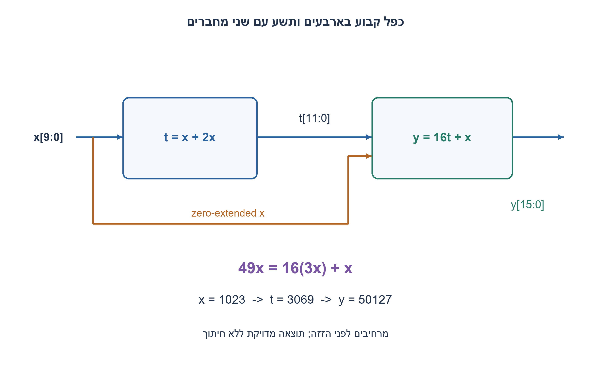
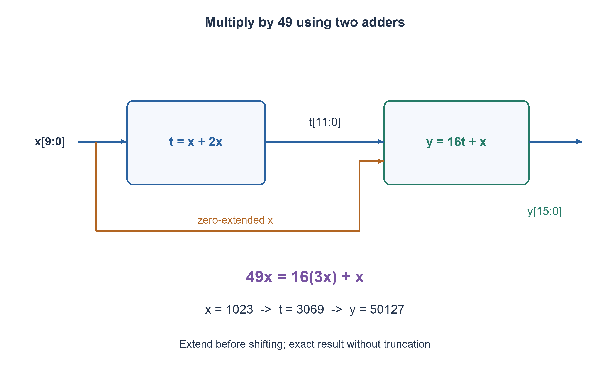

# PREP-293 — כפל מספר בן עשר סיביות ב־49 באמצעות הזזות וחיבור

פתרון מוצע בסיוע AI; ביקורת מקצועית אנושית ממתינה. הקושי אינו מכויל.

[צילום מקור פרטי](../sources/2026-11-07-night30-09.png)

בנה מעגל שמכפיל מספר באורך 10 ביטים ב-49.

חברות לפי הדיווח בצילום בלבד: Intel.

## עברית

בנו מעגל שמכפיל מספר בן עשר סיביות ב־49. הציגו מסלול נתונים, רוחבי ביניים ומוצא, ונמקו נכונות.

השלמה שנבחרה: x אינו מסומן, 0..1023, והפלט מדויק ללא חיתוך. מותר להשתמש במחברים ובחיווט של הזזות קבועות; אין צורך ברכיב כפל כללי. המעגל צירופי, ללא שעון. הציעו מימוש בשני מחברים ובדקו את הקלט המרבי. אין דרישה להוכחת מספר מחברים מינימלי.

1. כתבו 49 כסכום חזקות של שתיים, ואז נסו לשתף סכום ביניים.
2. 49 הוא 16 כפול 3 ועוד 1. את 3x אפשר לחשב מחיבור x ו־2x.
3. קבעו t=3x ברוחב 12; אחר כך y=(t<<4)+x ברוחב 16. הרחיבו לפני ההזזות.

### קודם מפרקים את הקבוע
אפשר לחשב 49x=32x+16x+x. ניסוח שמשתף ביניים הוא `t=(x<<1)+x=3x`, ואחריו `y=(t<<4)+x=49x`. הזזה במספר מקומות ידוע היא חיווט: מוסיפים אפסים נמוכים ומחברים כל סיבית למיקום גבוה יותר. אין כאן barrel shifter משתנה.

### הרוחב הוא חלק מהפתרון
x מגיע עד 1023, ולכן t מגיע עד 3069 וצריך 12 סיביות. y מגיע עד 50127; 15 סיביות אינן מספיקות כי 2^15−1=32767. נדרשות 16. בקוד מרחיבים את x ל־12 לפני ההזזה הראשונה, ובשלב השני משרשרים ארבעה אפסים ל־t ו־6 אפסים גבוהים ל־x. כך נשא לא אובד עוד לפני ההשמה למוצא רחב.

לדוגמה x=1 נותן t=3 ו־y=49; x=1023 נותן 3069 ו־50127. זהות אלגברית מוכיחה נכונות לכל הקלטים, ובדיקה ממצה נפרדת משווה את כל 1024 הקלטים למכפלה של מספרים שלמים.

המימוש כולל מחבר בן 12 סיביות ומחבר בן 16 סיביות, עם מסלול תלוי העובר בשניהם. סינתזה עשויה לצמצם עמודות אפס; אין בכך הוכחת שטח מזערי. אפשרות נוספת היא 64x−16x+x, עם מחסר ומחבר ורוחב ביניים מתאים. עבור קלט מסומן צריך הרחבת סימן ורוחב תוצאה אחר; עבור פלט בן 10 סיביות בלבד מתקבלת מכפלה מודולו 1024, תרגיל נפרד.

### קוד SystemVerilog; תוצאות סימולציה בדוח נפרד

```systemverilog
// Exact unsigned product; fixed shifts are wiring after explicit extension.
module prep293_times49(input wire [9:0] x, output wire [15:0] y);
  wire [11:0] x12 = {2'b0,x};
  wire [11:0] three = (x12 << 1) + x12;
  assign y = {three,4'b0} + {6'b0,x};
endmodule
```




### assumptions

Unsigned 10 סיביות; פלט מדויק 16; מחברים וחיווט מותרים.

### optimality

שני מחברים, רוחבים 12 ו־16, שני שלבים תלויים; אין טענת מינימום.

### verification

מודלים עצמאיים עברו: קובייה בחמישה ערכי התנגדות, 3,072 גשרי DC במתח שאינו אפס, דוגמת מתח אפס, 64 זוגות נגדי משוב ו־256 בדיקות הגבר סופי, עשר פאזות סינוס, 1,024 קלטי מכפיל, 256 קלטי ספירת אחדות, 256 זוגות חיבור וארבע שורות NAND. ראיה: checks/night1107n30-hardware-model-verification.json. בדיקות אלה הן Python וחישוב רציונלי; קומפילציית SystemVerilog מתועדת בנפרד בדוח native של האצווה. לא בוצעו SPICE, סינתזה, ניתוח תזמון או מדידת חומרה.

בדיקת Icarus Verilog 12 בפועל עברה: 1,664 השוואות RTL באצוות החומרה, כולל כל קלטי המכפיל, ספירת אחדות וחיבור, כל שורות NAND ו־124 בדיקות לוח פאזה עם איפוס והשהיה. ראיה: checks/night1107n30-native-verification.json. ריצת הקוד הייתה בסביבה זמנית מבודדת ללא רשת; אין להסיק מכך SPICE או סינתזה.

### edge_cases

```json
[
  "0→0",
  "1023→50127",
  "ערכים סביב חזקות שתיים."
]
```

### common_mistakes

```json
[
  "הזזה ברוחב עשר ואז הרחבה.",
  "הנחת פלט בן 15 סיביות."
]
```

### interview_answer

מחשב 3x ואז 16 פעמים הביניים ועוד x, עם הרחבה מפורשת; התוצאה המרבית 50127.

### source_ambiguities

המקור לא קובע סימן או ספריית רכיבים; אלה הובהרו בתרגיל.

### solution_extensions

```json
[
  {
    "question": "איך אפשר להעלות תדר?",
    "direction": "להוסיף אוגר ביניים ולדחות גם את עותק x לשלב השני.",
    "tests": "רצף קלטים שונים כדי לחשוף ערבוב דגימות."
  }
]
```

## English

Build a circuit multiplying a ten-bit number by 49. Show the datapath, intermediate/output widths and correctness.

Chosen completion: x is unsigned 0..1023, and the result is exact without truncation. Adders and fixed-shift wiring are allowed; a general multiplier is unnecessary. The circuit is combinational without a clock. Give a two-adder construction and check the largest input. A minimum-adder proof is not required.

1. Write 49 as powers of two, then look for a reusable intermediate sum.
2. 49 is 16 times 3 plus 1. Form 3x by adding x and 2x.
3. Use twelve-bit t=3x, then sixteen-bit y=(t<<4)+x. Extend before shifting.

### Factor the constant first
One form is 49x=32x+16x+x. A reusable intermediate gives `t=(x<<1)+x=3x`, followed by `y=(t<<4)+x=49x`. A fixed shift is wiring: append low zeros and connect each bit to a higher position. No variable barrel shifter is needed.

### Width is part of correctness
The largest x is 1023, so t reaches 3069 and requires twelve bits. The result reaches 50127; fifteen bits cannot hold it because 2^15−1=32767. Sixteen bits are required. The code first extends x to twelve bits before shifting; the final step concatenates four low zeros to t and six high zeros to x. This prevents losing a carry before assignment to a wider output.

For x=1, t=3 and y=49; for x=1023, t=3069 and y=50127. The algebraic identity proves all-input correctness; a separate exhaustive check compares all 1024 inputs with integer multiplication.

The construction uses a twelve-bit adder followed by a sixteen-bit adder, with a dependent path through both. Synthesis may eliminate zero columns; that is not a minimum-area proof. Another valid form is 64x−16x+x, using a subtractor and adder with suitable intermediate widths. Signed inputs require sign extension and a different result-width contract; retaining only ten output bits computes the product modulo 1024, a separate exercise.

### SystemVerilog; simulation results are in a separate report

```systemverilog
// Exact unsigned product; fixed shifts are wiring after explicit extension.
module prep293_times49(input wire [9:0] x, output wire [15:0] y);
  wire [11:0] x12 = {2'b0,x};
  wire [11:0] three = (x12 << 1) + x12;
  assign y = {three,4'b0} + {6'b0,x};
endmodule
```




### assumptions

Unsigned ten-bit input; exact sixteen-bit output; adders and wiring allowed.

### optimality

Two adders, widths twelve and sixteen, in two dependent stages; no minimum claim.

### verification

Independent models passed: five cube resistance scales, 3,072 nonzero-source DC bridges plus a zero-source example, 64 feedback-resistor pairs and 256 finite-gain checks, ten sine phases, 1,024 multiplier inputs, 256 popcount inputs, 256 addition pairs and four NAND truth rows. Evidence: checks/night1107n30-hardware-model-verification.json. These are Python/exact-rational checks; SystemVerilog compilation is documented separately in the batch native report. No SPICE, synthesis, timing analysis or hardware measurement was performed.

Actual Icarus Verilog12 execution passed 1,664 hardware RTL comparisons, including all multiplier, popcount and adder inputs, all NAND rows and 124 phase-schedule checks with reset and hold. Evidence: checks/night1107n30-native-verification.json. Execution used a temporary isolated environment with networking denied; this is not SPICE or synthesis.

### edge_cases

```json
[
  "0→0",
  "1023→50127",
  "Values near powers of two."
]
```

### common_mistakes

```json
[
  "Shifting within ten bits before extending.",
  "Assuming fifteen result bits suffice."
]
```

### interview_answer

Compute 3x, then sixteen times that plus x, with explicit extension; the maximum result is 50127.

### source_ambiguities

The source omits signedness and cell library; the exercise makes them explicit.

### solution_extensions

```json
[
  {
    "question": "How could clock rate be increased?",
    "direction": "Register the intermediate and delay the corresponding x into the second stage.",
    "tests": "Use varying consecutive inputs to expose mismatched samples."
  }
]
```
