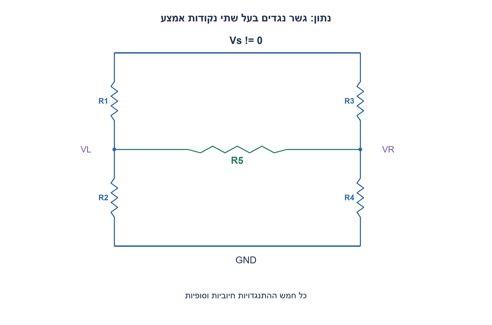
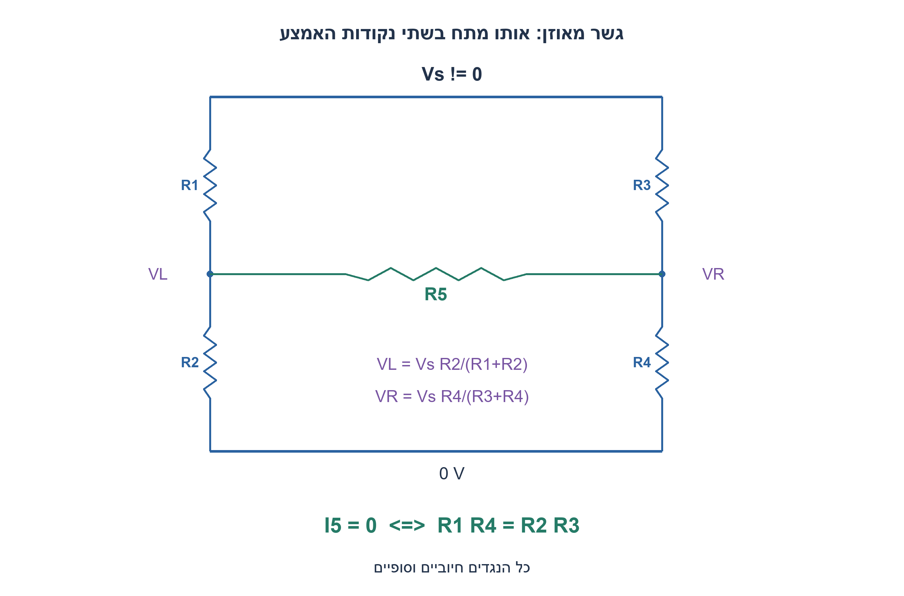
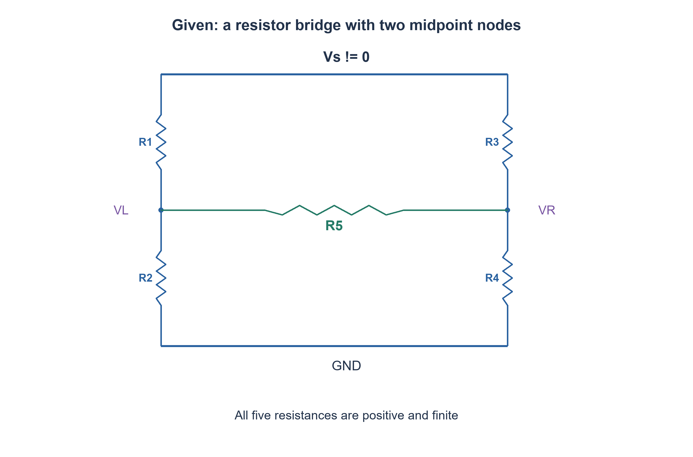
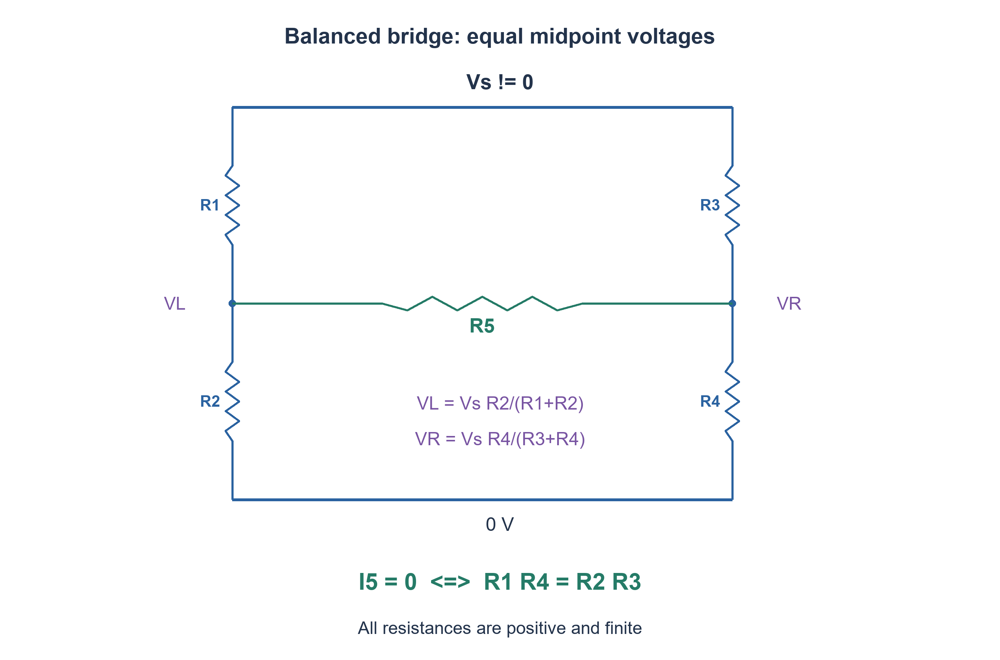

# PREP-294 — גשר ויטסטון: מתי לא זורם זרם בנגד האמצעי?

פתרון מוצע בסיוע AI; ביקורת מקצועית אנושית ממתינה. הקושי אינו מכויל.

[צילום מקור פרטי](../sources/2026-11-07-night30-12.png)

מה התנאי על R1,R2,R3,R4 כך שלא יזרום זרם דרך R5? בתמונה מקור מתח V מזין שני מחלקי מתח, R1 מעל R2 בשמאל ו-R3 מעל R4 בימין, ו-R5 מחבר בין נקודות האמצע; הקו התחתון מוארק.

חברות לפי הדיווח בצילום בלבד: Intel.

## עברית

בגשר שבשרטוט R1 מעל R2 בענף השמאלי, R3 מעל R4 בענף הימני, ו־R5 מחבר בין נקודות האמצע. מצאו תנאי על R1,R2,R3,R4 כך שלא יזרום זרם דרך R5, והסבירו מדוע הוא מספיק והכרחי.

הנחות מפורשות: DC, מקור מתח אידאלי Vs שאינו אפס בין הצומת העליון לתחתון, וכל חמש ההתנגדויות חיוביות וסופיות. אין להניח את R5 פתוח או קצר. דונו גם במה שמשתנה אם Vs=0.

1. זרם בנגד סופי מתאפס כאשר המתח בשני קצותיו שווה.
2. אם הזרם ב־R5 אפס, כל ענף צדדי הוא מחלק מתח עצמאי.
3. השוו Vs·R2/(R1+R2) ל־Vs·R4/(R3+R4) ופשטו בהנחת Vs שאינו אפס.

### אין הפרש מתח, אין זרם
נסמן את נקודות האמצע VL ו־VR. לפי חוק אוהם `I5=(VL−VR)/R5`. כאשר I5=0, המחלקים אינם מעמיסים זה על זה ולכן `VL=Vs·R2/(R1+R2)` ו־`VR=Vs·R4/(R3+R4)`. השוואה, ביטול Vs והכפלה במכנים חיוביים נותנים `R2R3=R1R4`, או `R1/R2=R3/R4`.

זה תנאי הכרחי. הוא גם מספיק: אם מתקיים יחס זה, פתרון שני המחלקים נותן מתח אמצע משותף; הוספת R5 ביניהם אינה מוסיפה זרם והמשוואות נשארות תקפות. יחידות פתרון רשת הנגדים מבטיחה שזה הפתרון. אי אפשר להשתמש בשני מחלקים עצמאיים במקרה כללי שאינו מאוזן, כי אז R5 מעמיס אותם.

דוגמה: R1=1kΩ,R2=2kΩ,R3=3kΩ,R4=6kΩ. שתי נקודות האמצע הן 2Vs/3, לכל R5 חיובי וסופי. אם משנים R4 ל־4kΩ אין איזון. ערך R5 קובע אז כמה זרם זורם ואת העמסת המחלקים; הוא אינו מופיע בתנאי האיזון.

אם Vs=0, כל הצמתים באפס ואין זרם בכל בחירת נגדים. לכן היחס אינו הכרחי במצב זה וההנחה על מקור שאינו אפס חשובה. הקוד פותר במפורש את שתי משוואות KCL עם מוליכות R5, ולכן בודק את התנאי בלי להניח מראש מחלקים שאינם מועמסים. 3072 צירופי נגדים ומקורות לא־אפס נבדקו בחשבון רציונלי מדויק.

### מודל Python שנבדק

```python
"""Exact DC midpoint solution; every resistance is positive and finite."""
from fractions import Fraction as F


def bridge(r1, r2, r3, r4, r5, volts=1):
    r1,r2,r3,r4,r5 = map(F, (r1,r2,r3,r4,r5))
    volts = F(volts)
    if min(r1,r2,r3,r4,r5) <= 0:
        raise ValueError("Positive finite resistances required")
    a = 1/r1 + 1/r2 + 1/r5
    b = -1/r5
    c = 1/r3 + 1/r4 + 1/r5
    u,v = volts/r1, volts/r3
    determinant = a*c-b*b
    left = (u*c-b*v)/determinant
    right = (a*v-b*u)/determinant
    return left, right, (left-right)/r5


def balanced(r1, r2, r3, r4):
    if min(r1,r2,r3,r4) <= 0:
        raise ValueError("Positive finite resistances required")
    return F(r1)*F(r4) == F(r2)*F(r3)
```






### assumptions

מקור Vs≠0; R1..R5 חיוביים וסופיים; הגשר מחובר כפי שמסומן.

### optimality

בדיקת איזון דורשת השוואת שני מכפלות; ניתוח כללי דורש פתרון שתי משוואות.

### verification

מודלים עצמאיים עברו: קובייה בחמישה ערכי התנגדות, 3,072 גשרי DC במתח שאינו אפס, דוגמת מתח אפס, 64 זוגות נגדי משוב ו־256 בדיקות הגבר סופי, עשר פאזות סינוס, 1,024 קלטי מכפיל, 256 קלטי ספירת אחדות, 256 זוגות חיבור וארבע שורות NAND. ראיה: checks/night1107n30-hardware-model-verification.json. בדיקות אלה הן Python וחישוב רציונלי; קומפילציית SystemVerilog מתועדת בנפרד בדוח native של האצווה. לא בוצעו SPICE, סינתזה, ניתוח תזמון או מדידת חומרה.

בדיקת Icarus Verilog 12 בפועל עברה: 1,664 השוואות RTL באצוות החומרה, כולל כל קלטי המכפיל, ספירת אחדות וחיבור, כל שורות NAND ו־124 בדיקות לוח פאזה עם איפוס והשהיה. ראיה: checks/night1107n30-native-verification.json. ריצת הקוד הייתה בסביבה זמנית מבודדת ללא רשת; אין להסיק מכך SPICE או סינתזה.

### edge_cases

```json
[
  "Vs=0 מפריך הכרחיות של היחס.",
  "R5 קטן מאוד אך חיובי עדיין אינו משנה איזון."
]
```

### common_mistakes

```json
[
  "היפוך יחס בענף אחד בלבד.",
  "הפעלת מחלקי מתח בלי לבדוק זרם גשר."
]
```

### interview_answer

משווה את מתחי אמצע המחלקים; במקור שאינו אפס מתקבל R1R4=R2R3, בלי תלות ב־R5.

### source_ambiguities

הנחות חיוביות וסופיות ומתח מקור שאינו אפס הושלמו לניתוח חד־משמעי.

### solution_extensions

```json
[
  {
    "question": "איך משתמשים בגשר למדידת שינוי קטן?",
    "direction": "משנים נגד אחד ומנתחים מתח הפרש סמוך לאיזון.",
    "tests": "בדקו כיוון וסדר גודל תחת שינוי קטן וחיובי."
  }
]
```

## English

In the bridge, R1 sits above R2 on the left branch, R3 above R4 on the right, and R5 connects their midpoints. Find a condition on R1,R2,R3,R4 for zero current through R5; explain necessity and sufficiency.

Explicit assumptions: DC, an ideal nonzero voltage source Vs between top and bottom, and five positive finite resistances. Do not assume R5 is an open circuit or short. Also discuss Vs=0.

1. A finite resistor carries zero current when its terminal voltages match.
2. When R5 carries no current, each side is an independent voltage divider.
3. Equate Vs·R2/(R1+R2) and Vs·R4/(R3+R4), then simplify using nonzero Vs.

### No voltage difference means no current
Call the midpoints VL and VR. Ohm's law gives `I5=(VL−VR)/R5`. If I5=0, the two dividers do not load each other: `VL=Vs·R2/(R1+R2)` and `VR=Vs·R4/(R3+R4)`. Equating them, canceling nonzero Vs and multiplying positive denominators yields `R2R3=R1R4`, or `R1/R2=R3/R4`.

This proves necessity. It is also sufficient: matching divider voltages solve both branches, and adding R5 between those equal potentials introduces no current. The nodal equations remain satisfied; uniqueness gives the network solution. Independent-divider formulas cannot be used for a general unbalanced bridge, because R5 then loads both dividers.

Example: R1=1kΩ,R2=2kΩ,R3=3kΩ,R4=6kΩ. Both midpoints are 2Vs/3 for any positive finite R5. Changing R4 to 4kΩ unbalances the bridge. R5 then determines loading and current, but it does not enter the balance condition.

If Vs=0, all voltages and currents vanish for any resistor choices. The ratio is no longer necessary, explaining the nonzero-source assumption. The supplied code solves both KCL equations with R5 conductance included, so it checks the balance condition without assuming unloaded dividers. Exact rational checks cover 3072 nonzero-source cases.

### Verified Python teaching model

```python
"""Exact DC midpoint solution; every resistance is positive and finite."""
from fractions import Fraction as F


def bridge(r1, r2, r3, r4, r5, volts=1):
    r1,r2,r3,r4,r5 = map(F, (r1,r2,r3,r4,r5))
    volts = F(volts)
    if min(r1,r2,r3,r4,r5) <= 0:
        raise ValueError("Positive finite resistances required")
    a = 1/r1 + 1/r2 + 1/r5
    b = -1/r5
    c = 1/r3 + 1/r4 + 1/r5
    u,v = volts/r1, volts/r3
    determinant = a*c-b*b
    left = (u*c-b*v)/determinant
    right = (a*v-b*u)/determinant
    return left, right, (left-right)/r5


def balanced(r1, r2, r3, r4):
    if min(r1,r2,r3,r4) <= 0:
        raise ValueError("Positive finite resistances required")
    return F(r1)*F(r4) == F(r2)*F(r3)
```






### assumptions

Vs is nonzero; R1..R5 are positive finite resistances with the drawn topology.

### optimality

Balance is a comparison of two products; the general network needs two nodal equations.

### verification

Independent models passed: five cube resistance scales, 3,072 nonzero-source DC bridges plus a zero-source example, 64 feedback-resistor pairs and 256 finite-gain checks, ten sine phases, 1,024 multiplier inputs, 256 popcount inputs, 256 addition pairs and four NAND truth rows. Evidence: checks/night1107n30-hardware-model-verification.json. These are Python/exact-rational checks; SystemVerilog compilation is documented separately in the batch native report. No SPICE, synthesis, timing analysis or hardware measurement was performed.

Actual Icarus Verilog12 execution passed 1,664 hardware RTL comparisons, including all multiplier, popcount and adder inputs, all NAND rows and 124 phase-schedule checks with reset and hold. Evidence: checks/night1107n30-native-verification.json. Execution used a temporary isolated environment with networking denied; this is not SPICE or synthesis.

### edge_cases

```json
[
  "Vs=0 removes necessity of the ratio.",
  "A very small positive R5 still does not change balance."
]
```

### common_mistakes

```json
[
  "Reversing only one branch ratio.",
  "Using unloaded dividers when bridge current is nonzero."
]
```

### interview_answer

Equal divider midpoints give R1R4=R2R3 for nonzero excitation, independently of R5.

### source_ambiguities

Positive finite resistances and nonzero excitation make the terse source unambiguous.

### solution_extensions

```json
[
  {
    "question": "How can a bridge measure a small change?",
    "direction": "Vary one resistor and analyze differential voltage near balance.",
    "tests": "Check sign and scale for a small positive change."
  }
]
```
