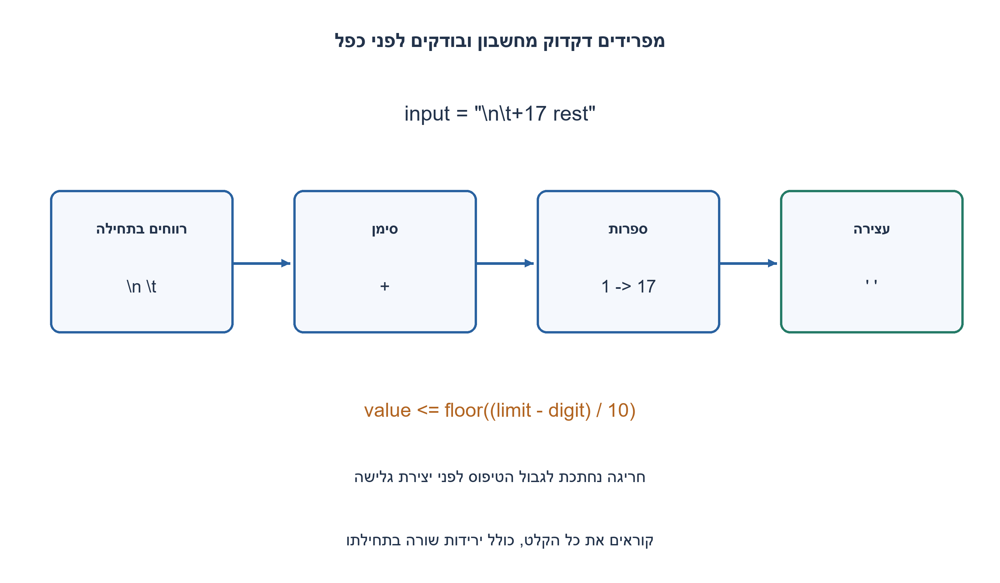
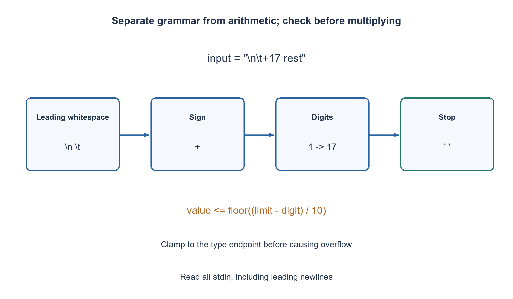

# PREP-295 — פענוח מחרוזת למספר שלם ב־ C++: חוזה בסגנון atoi

פתרון מוצע בסיוע AI; ביקורת מקצועית אנושית ממתינה. הקושי אינו מכויל.

## עברית

ממשו ב־ C++ פונקציה שמקבלת מחרוזת המייצגת מספר ומחזירה מספר שלם, ללא שימוש ב־ atoi, stoi או from_chars במימוש.

השלמת חוזה בטוחה: C++17, פלט int32_t. דלגו על רווחי ASCII בתחילת הקלט בלבד: רווח, טאב, ירידת שורה, חזרת עגלה, form feed ו־ vertical tab. לאחריהם מותר סימן + או − אחד, ואחריו רצף ספרות ASCII עשרוניות. מפסיקים בתו הראשון שאינו ספרה; אם לא נקראה ספרה מחזירים 0. גלישה נחתכת ל־ INT32_MIN או INT32_MAX לפי הסימן. לדוגמה קלט של ירידת שורה וטאב ואחריהם +17 rest מחזיר 17; ‎-42xyz מחזיר ‎-42.

זהו חוזה מפורש בסגנון atoi, ולא טענה שהתנהגות הגלישה של std::atoi מוגדרת כך. בתוכנית ההרצה קוראים את כל stdin, כולל ירידות שורה בתחילתו, ומדפיסים רק את המספר ושורת סיום. אפשר לממש פונקציה על string_view בלי להעתיק את המחרוזת.

1. הפרידו בין דילוג על רווחים, סימן וקריאת ספרות; מה עושים כשהרצף אינו מתחיל במספר?
2. ספרה חדשה מעדכנת value*10+digit, אבל לפני כן צריך לבדוק גבול שמתאים לסימן.
3. הגבול לגודל שלילי הוא 2147483648 ולחיובי 2147483647. בדקו value>(limit−digit)/10 לפני העדכון, ואז החזירו את גבול הפלט במקום לגלוש.

### דקדוק קטן לפני החשבון
קודם מדלגים על ששת תווי הרווח שהוגדרו. לאחר סימן אופציונלי קוראים רק '0' עד '9'. זה מונע תלות ב־ locale או פירוש ספרות Unicode שלא הוגדרו. סימן נוסף אינו ספרה, ולכן "+-12" מחזיר 0; ב־"12.34" מתקבל 12, ו־"0x10" מחזיר 0 כי זהו פענוח עשרוני של הקידומת "0".

### בודקים לפני שיוצרים גלישה
שומרים גודל לא שלילי value ומחשבים limit לפי הסימן. עבור ספרה d, התנאי 10·value+d≤limit שקול ל־ value≤floor((limit−d)/10). לכן אפשר לבדוק לפני הכפל. אם הוא נכשל, עוד ספרות לא יכולות להקטין את גודל המספר, ומחזירים מיד את גבול int32 המתאים. אחרת העדכון בטוח.

נבחר int64_t למשתנה הגודל, כך שהגודל 2147483648 של INT32_MIN ניתן לייצוג. לא שוללים int32 מינימלי ולא מבצעים גלישה ואז מנסים לזהות אותה. אחרי הסימן השלילי הערך הסופי נמצא בטווח int32; המרה לטיפוס הפלט בטוחה. משתנה שמתחיל באפס מחזיר באופן טבעי אפס גם אם לא נקראה ספרה.

### נכונות וממשק התוכנית
האינווריאנט הוא value שווה לערך הספרות שכבר נקראו, כל עוד הוא אינו חורג מהגבול. מעבר הספרות משמר אותו לפי כתיב עשרוני; תחילת רווחים וסימן נקבעים פעם אחת. עצירה מחזירה בדיוק את הקידומת המותרת. במקרה גלישה, בדיקת הגבול מזהה שהקידומת כבר גדולה מדי ולכן חיתוך הקצה נכון.

הפונקציה על string_view משתמשת ב־ O(1) מילות עזר וסורקת O(k) תווים עד העצירה או החיתוך, כאשר k הוא אורך הקידומת שנבדקה. תוכנית ה־ CLI קוראת קודם את כל L בתי stdin למחרוזת, ולכן לתוכנית כולה O(L) זמן קריאה ו־ O(L) אחסון קלט, גם אם הפענוח עצמו נעצר מוקדם. istreambuf_iterator שומר גם ירידות שורה בתחילה; שימוש ב־ cin>>token היה משנה את החוזה. תו NUL בתוך string_view הוא תו שאינו ספרה, ולא בקשה לקרוא מעבר לסוף האחסון.

הכלל חשוב: אין להשתמש בקריאה ל־ std::atoi על ערך גולש בתור אורקל למימוש הבטוח. הפתרון נבדק מול תוצאות גבול מפורשות ואורקל נפרד בעל שלמים בלתי חסומים.

```cpp
#include <cstdint>
#include <iostream>
#include <iterator>
#include <limits>
#include <string>
#include <string_view>

static bool ascii_space(char c) {
    return c == ' ' || c == '\t' || c == '\n' || c == '\r' || c == '\f' || c == '\v';
}

// Deliberately defined safe atoi-style behavior, including clamped overflow.
std::int32_t parse_int32(std::string_view text) {
    std::size_t index = 0;
    while (index < text.size() && ascii_space(text[index])) ++index;
    bool negative = false;
    if (index < text.size() && (text[index] == '+' || text[index] == '-')) {
        negative = text[index] == '-';
        ++index;
    }
    const std::int64_t limit = negative ? INT64_C(2147483648) : INT64_C(2147483647);
    std::int64_t value = 0;
    while (index < text.size() && text[index] >= '0' && text[index] <= '9') {
        const std::int64_t digit = text[index] - '0';
        if (value > (limit - digit) / 10) {
            return negative ? std::numeric_limits<std::int32_t>::min()
                            : std::numeric_limits<std::int32_t>::max();
        }
        value = value * 10 + digit;
        ++index;
    }
    return static_cast<std::int32_t>(negative ? -value : value);
}

#ifndef JOBRUN_PREP295_NO_MAIN
int main() {
    // Read all bytes, including leading newlines and embedded NUL bytes.
    const std::string input{std::istreambuf_iterator<char>(std::cin), std::istreambuf_iterator<char>()};
    std::cout << parse_int32(input) << '\n';
    return 0;
}
#endif
```




## English

Implement a C++ function receiving a numeric string and returning an integer, without using atoi, stoi or from_chars in the candidate.

Chosen safe contract: C++17, int32_t output. Skip only leading ASCII whitespace: space, tab, newline, carriage return, form feed and vertical tab. Accept one optional + or - sign, then a maximal sequence of ASCII decimal digits. Stop at the first nondigit; return zero if no digit was read. Clamp overflow to INT32_MIN or INT32_MAX according to sign. A newline and tab followed by +17 rest yields 17; -42xyz yields -42.

This explicitly defined atoi-style contract does not claim std::atoi overflow behaves this way. The runnable program reads all stdin, including leading newlines, and prints only the integer and a newline. The function may use string_view without copying its input.

1. Separate whitespace, sign and digit phases. What happens when no numeric prefix starts?
2. A new digit updates value*10+digit, but first check the sign-dependent bound.
3. The negative magnitude bound is 2147483648 and positive is 2147483647. Check value>(limit−digit)/10 before appending and clamp instead of overflowing.

### Establish the grammar before doing arithmetic
Skip the six chosen ASCII whitespace characters, accept one optional sign, then read only '0' through '9'. This avoids locale-dependent classification or unrequested Unicode numerals. A second sign is a nondigit, so "+-12" returns zero. "12.34" yields 12, and "0x10" yields zero from the decimal prefix "0".

### Check before causing overflow
Maintain a nonnegative magnitude value and a sign-dependent limit. Appending digit d is legal exactly when 10·value+d≤limit, equivalently value≤floor((limit−d)/10). Test this before multiplication. If it fails, subsequent digits cannot reduce the magnitude, so immediately return the corresponding int32 endpoint. Otherwise the append is safe.

The magnitude uses int64_t, which can represent 2147483648 for INT32_MIN. Never negate the minimum int32 or overflow first and try to detect it afterward. After applying the sign the final value fits int32 and conversion is safe. Initial zero naturally handles a missing digit sequence.

### Invariant and program interface
The invariant equates value with the digits already consumed, while within its bound. Each append preserves it by decimal positional notation; whitespace and sign are handled once. Normal stopping returns precisely the accepted prefix. The pre-check proves that an overflowing prefix already exceeds the allowed magnitude, justifying clamping.

The string_view function uses O(1) auxiliary words and O(k) inspected characters before stopping or clamping. The CLI first reads all L stdin bytes into a string, so the whole program has O(L) input-read time and O(L) input storage even if parsing ends early. istreambuf_iterator preserves leading newlines; cin>>token would change that interface. An embedded NUL is simply a nondigit within a length-bounded string_view.

Do not use an overflowing std::atoi call as an oracle for this safe parser. Boundary expectations and an independent unbounded-integer oracle test the chosen behavior.

```cpp
#include <cstdint>
#include <iostream>
#include <iterator>
#include <limits>
#include <string>
#include <string_view>

static bool ascii_space(char c) {
    return c == ' ' || c == '\t' || c == '\n' || c == '\r' || c == '\f' || c == '\v';
}

// Deliberately defined safe atoi-style behavior, including clamped overflow.
std::int32_t parse_int32(std::string_view text) {
    std::size_t index = 0;
    while (index < text.size() && ascii_space(text[index])) ++index;
    bool negative = false;
    if (index < text.size() && (text[index] == '+' || text[index] == '-')) {
        negative = text[index] == '-';
        ++index;
    }
    const std::int64_t limit = negative ? INT64_C(2147483648) : INT64_C(2147483647);
    std::int64_t value = 0;
    while (index < text.size() && text[index] >= '0' && text[index] <= '9') {
        const std::int64_t digit = text[index] - '0';
        if (value > (limit - digit) / 10) {
            return negative ? std::numeric_limits<std::int32_t>::min()
                            : std::numeric_limits<std::int32_t>::max();
        }
        value = value * 10 + digit;
        ++index;
    }
    return static_cast<std::int32_t>(negative ? -value : value);
}

#ifndef JOBRUN_PREP295_NO_MAIN
int main() {
    // Read all bytes, including leading newlines and embedded NUL bytes.
    const std::string input{std::istreambuf_iterator<char>(std::cin), std::istreambuf_iterator<char>()};
    std::cout << parse_int32(input) << '\n';
    return 0;
}
#endif
```




## חומר משלים / Supporting material

```json
{
  "assumptions": {
    "he": [
      "C++17, דקדוק ASCII, קידומת ספרות, פלט int32 וחיתוך גלישה מפורש."
    ],
    "en": [
      "C++17, ASCII prefix grammar, int32 output and explicit clamping."
    ]
  },
  "optimality": {
    "he": "פונקציה O(k) זמן ו־ O(1) עזר; תוכנית שקוראת את כל stdin משתמשת ב־ O(L) אחסון קלט.",
    "en": "Function O(k) time/O(1) auxiliary words; the whole-stdin CLI stores O(L) input."
  },
  "verification": {
    "he": "קומפל והורץ ב־ g++ 15.2 וב־ C++17 עם אזהרות כשגיאות: 25 מקרי harness עברו, כולל תו NUL ואלף ספרות, ובדיקת CLI עם ירידת שורה בתחילת stdin החזירה 17 כנדרש.",
    "en": "Compiled and executed with g++ 15.2 in C++17 with warnings as errors: all 25 harness cases passed, including NUL and thousand-digit inputs. The whole-stdin CLI also returned 17 for input beginning with a newline and tab."
  },
  "edge_cases": {
    "he": [
      "ריק, סימן בלבד, רווחים, שורה חדשה בהתחלה, INT32_MIN/MAX, גלישה וטקסט אחרי המספר."
    ],
    "en": [
      "Empty, lone sign, whitespace/newlines, INT32 endpoints, overflow and trailing text."
    ]
  },
  "common_mistakes": {
    "he": [
      "לא להשתמש בגלישת signed כבדיקה; לא לסווג locale בלי חוזה; לא לקרוא רק שורת קלט אחת במקום כל stdin."
    ],
    "en": [
      "Do not use signed overflow as a check, assume locale rules, or read only one line instead of all stdin."
    ]
  },
  "interview_answer": {
    "he": "מפרידים דקדוק מחשבון ומאמתים כל צירוף ספרה לפני הכפל; הגלישה נחתכת במפורש.",
    "en": "Separate grammar from arithmetic and validate each append before multiplication; clamping is explicit."
  },
  "source_ambiguities": {
    "he": "המקור אינו קובע רווחים, טקסט נוסף או טיפול בגלישה. כל אלה הוגדרו לצורך תרגיל בטוח.",
    "en": "Whitespace, trailing text and overflow policies are explicit completions of the source."
  },
  "solution_extensions": {
    "he": [
      {
        "question": "איך להחזיר גם מיקום עצירה וסיבת כישלון?",
        "answer_direction": "החזירו מבנה result הכולל value, consumed ו־ status; הגדירו הפרדה בין אין ספרות לבין גלישה.",
        "principle": "הרחבת חוזה באופן מפורש"
      }
    ],
    "en": [
      {
        "question": "How can the parser also return an end position and failure reason?",
        "answer_direction": "Return value, consumed and status, distinguishing missing digits from overflow.",
        "principle": "Make an extension explicit"
      }
    ]
  }
}
```
