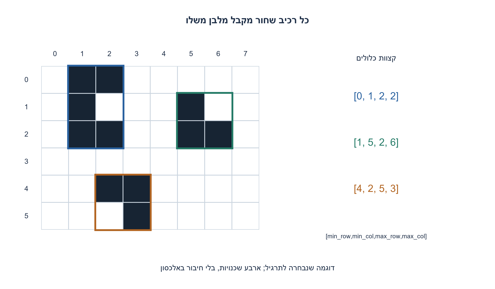
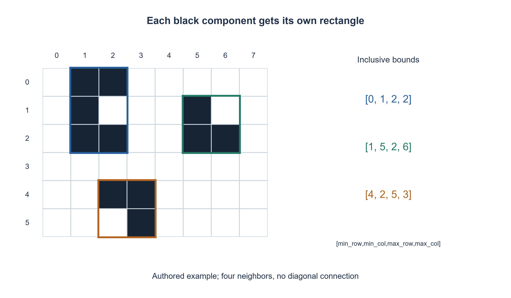

# PREP-296 — מלבנים חוסמים לצורות שחורות בתמונה בינארית

פתרון מוצע בסיוע AI; ביקורת מקצועית אנושית ממתינה. הקושי אינו מכויל.

## עברית

נתונה תמונה ובה צורות שחורות על רקע לבן. החזירו קואורדינטות של מלבן המקיף כל צורה.

השלמת חוזה: התמונה היא רשימה מלבנית של שורות; 0 מייצג לבן ו־ 1 שחור. רשימה ריקה היא תמונה ריקה; אחרת יש לפחות עמודה אחת. צורה היא רכיב קשירות בארבע שכנויות: למעלה, למטה, שמאלה וימינה. מגע באלכסון בלבד אינו מחבר צורות; מגע בצלע מחבר אותן.

לכל רכיב החזירו [min_row, min_col, max_row, max_col], עם אינדוקס מאפס וקצוות כלולים, בסדר גילוי הרכיבים בסריקת שורות משמאל לימין. אין לשנות את התמונה. כל המלבן צריך להכיל את הרכיב אך מותר שיכיל גם פיקסלים לבנים; מלבנים של רכיבים שונים עשויים לחפוף. אין בקשה לזהות שתי ישויות סמנטיות שנוגעות באותה צורה שחורה.

1. מלבן חוסם נקבע לפי ארבעה קיצונים, אך קודם צריך לדעת אילו פיקסלים שייכים לאותה צורה.
2. סרקו את התמונה; פיקסל שחור שטרם סומן מתחיל חיפוש רכיב, וממנו עוברים רק לשכנים שחורים בארבעה כיוונים.
3. סמנו בזמן הכנסה לתור. במהלך החיפוש עדכנו מינימום ומקסימום של שורה ועמודה; בסיומו הוסיפו מלבן אחד.

### קודם רכיב, אחר כך קיצונים
לא מספיק לחפש פיקסל שחור ראשון ואחרון בכל התמונה: כך מקבלים מלבן של כל הצורות יחד. במקום זאת סורקים לפי שורות. כל פיקסל שחור שלא בוקר הוא זרע של צורה חדשה, ומריצים ממנו BFS. עוברים רק בין פיקסלים שחורים שכנים בארבעה כיוונים; מסמנים פיקסל מיד כשמכניסים לתור, כך שלא ייכנס שוב דרך שכן אחר.

מחזיקים ארבעה קיצונים שמאותחלים למיקום הזרע. כל פיקסל שיוצא מהתור מעדכן מינימום ומקסימום של השורה והעמודה. כשהתור מתרוקן, מוסיפים לפלט בדיוק מלבן אחד. התמונה עצמה נשארת ללא שינוי; סימוני הביקור נמצאים במטריצה נפרדת.

### למה אלה בדיוק המלבנים הנכונים
כל צעד BFS עובר בקשת שכנות שחורה ולכן אינו יוצא מהרכיב. להפך, לכל פיקסל ברכיב יש מסלול שכנות מהזרע; לפי אורך המסלול החיפוש יגיע גם אליו. לכן נאספים כל פיקסלי הרכיב ורק הם. סריקת התמונה מתחילה רכיב פעם אחת בלבד, כי כולם מסומנים לאחר סיומו.

המלבן שכל צדדיו נמצאים בקיצוני הרכיב מכיל אותו. כל מלבן ישר לצירים שמכיל את הרכיב חייב להגיע לפחות לכל אחד מארבעת הקיצונים, ולכן אי אפשר לצמצם צד. זו מינימליות של מלבן ישר לצירים, לא של מלבן שמותר לסובב.

למשל [[1,0], [0,1]] מכילה שני רכיבים ומחזירה [[0,0,0,0], [1,1,1,1]]. תחת שמונה שכנויות הייתה זו צורה אחת, ולכן הבחירה בשכנות היא חלק מהחוזה. טבעת שחורה וכתם מבודד בתוכה עשויים ליצור מלבנים חופפים למרות שהרכיבים אינם נוגעים.

לתמונה H×W לא ריקה, כל תא נסרק וכל פיקסל שחור מוכנס לתור פעם אחת ונבדקים ארבעה שכנים: Θ(HW) זמן. מטריצת הביקור והתור דורשים O(HW) מקום במקרה הגרוע, ועוד הפלט. תור deque מונע הזזת רשימה בכל הסרה; אין צורך ברקורסיה שיכולה לגלוש במחסנית. התמונה הריקה מחזירה רשימה ריקה.

```python
"""Four-connected binary image components; inclusive bounding boxes."""
from collections import deque


def component_boxes(image):
    if type(image) is not list or any(type(row) is not list for row in image):
        raise ValueError("a rectangular list of bit rows is required")
    height = len(image)
    width = len(image[0]) if height else 0
    if (height and width == 0) or any(len(row) != width or any(type(v) is not int or v not in (0, 1) for v in row)
           for row in image):
        raise ValueError("a rectangular list of integer bits is required")
    seen = [[False] * width for _ in range(height)]
    boxes = []
    for row in range(height):
        for column in range(width):
            if image[row][column] == 0 or seen[row][column]:
                continue
            seen[row][column] = True
            queue = deque([(row, column)])
            low_row = high_row = row
            low_col = high_col = column
            while queue:
                r, c = queue.popleft()
                low_row, high_row = min(low_row, r), max(high_row, r)
                low_col, high_col = min(low_col, c), max(high_col, c)
                for nr, nc in ((r - 1, c), (r + 1, c), (r, c - 1), (r, c + 1)):
                    if (0 <= nr < height and 0 <= nc < width and image[nr][nc] == 1
                            and not seen[nr][nc]):
                        seen[nr][nc] = True
                        queue.append((nr, nc))
            boxes.append([low_row, low_col, high_row, high_col])
    return boxes
```




## English

A picture contains black shapes on a white background. Return coordinates of a rectangle enclosing each shape.

Chosen contract: a rectangular list of rows, with zero white and one black. An empty list is an empty image; a nonempty image has at least one column. A shape is a four-neighbor black connected component: up, down, left and right. Diagonal-only contact does not connect shapes; edge contact does.

For each component return zero-based inclusive [min_row, min_col, max_row, max_col], in component-discovery order during a row-major scan. Do not mutate the image. A rectangle may contain white pixels and rectangles of different components may overlap. The task does not semantically separate two objects whose black pixels touch.

1. Four extrema determine a bounding rectangle, but first identify which pixels belong to one shape.
2. Scan the image; every unseen black pixel starts a component search through its four black neighbors.
3. Mark pixels when enqueueing. Maintain row/column minima and maxima during the search, then append one rectangle.

### Identify a component before measuring its extrema
Finding the first and last black pixels of the entire image only bounds all shapes together. Instead scan by rows. Each unseen black pixel seeds a BFS over four-neighbor black pixels. Mark when enqueueing, so another neighbor cannot enqueue the same pixel again.

Initialize four extrema at the seed. Each dequeued pixel updates minimum/maximum row and column. When the queue empties, append one rectangle. The original image is unchanged; visitation lives in a separate matrix.

### Why these are exactly the required bounds
Every BFS step follows a black adjacency edge and stays within the component. Conversely every component pixel has a neighbor path from the seed, so induction on path length shows BFS reaches it. Thus the search visits precisely that component. The outer scan starts it only once because all its pixels are then marked.

Its extrema rectangle contains every component pixel. Any axis-aligned containing rectangle must reach each of those four extrema, so no side can be moved inward. This proves minimal axis-aligned bounds, not optimality among rotated rectangles.

For [[1,0], [0,1]], four-connectivity produces two boxes [[0,0,0,0], [1,1,1,1]]. Eight-connectivity would merge them; connectivity belongs to the specification. An outer ring and an isolated inner patch can have overlapping bounding rectangles without touching components.

For a nonempty H×W image, each cell is scanned and each black pixel is enqueued once with four neighbor checks: Θ(HW) time. Visitation and the queue use O(HW) worst-case space, plus output. deque avoids shifting an array at each dequeue; deep recursion is unnecessary. An empty image returns an empty list.

```python
"""Four-connected binary image components; inclusive bounding boxes."""
from collections import deque


def component_boxes(image):
    if type(image) is not list or any(type(row) is not list for row in image):
        raise ValueError("a rectangular list of bit rows is required")
    height = len(image)
    width = len(image[0]) if height else 0
    if (height and width == 0) or any(len(row) != width or any(type(v) is not int or v not in (0, 1) for v in row)
           for row in image):
        raise ValueError("a rectangular list of integer bits is required")
    seen = [[False] * width for _ in range(height)]
    boxes = []
    for row in range(height):
        for column in range(width):
            if image[row][column] == 0 or seen[row][column]:
                continue
            seen[row][column] = True
            queue = deque([(row, column)])
            low_row = high_row = row
            low_col = high_col = column
            while queue:
                r, c = queue.popleft()
                low_row, high_row = min(low_row, r), max(high_row, r)
                low_col, high_col = min(low_col, c), max(high_col, c)
                for nr, nc in ((r - 1, c), (r + 1, c), (r, c - 1), (r, c + 1)):
                    if (0 <= nr < height and 0 <= nc < width and image[nr][nc] == 1
                            and not seen[nr][nc]):
                        seen[nr][nc] = True
                        queue.append((nr, nc))
            boxes.append([low_row, low_col, high_row, high_col])
    return boxes
```




## חומר משלים / Supporting material

```json
{
  "assumptions": {
    "he": [
      "ארבע שכנויות, אפס לבן ואחד שחור, מלבן ישר לצירים וקצוות כלולים; סדר גילוי בסריקת שורות."
    ],
    "en": [
      "Four-connectivity, binary colors, inclusive axis-aligned bounds and row-major component discovery."
    ]
  },
  "optimality": {
    "he": "Θ(HW) זמן ו־ O(HW) מקום עזר; כל מלבן מינימלי בין מלבנים ישרים לצירים עבור הרכיב שלו.",
    "en": "Θ(HW) time/O(HW) auxiliary space; each component box is minimal among axis-aligned containing rectangles."
  },
  "verification": {
    "he": "652 תמונות מול אורקל union-find עצמאי, כולל כל 512 תמונות 3×3, מגע אלכסוני, טבעת וכתם פנימי; שימור קלט נבדק.",
    "en": "652 images against an independent union-find oracle, including all 512 three-by-three images, diagonal contact and a ring/inner patch; input preservation checked."
  },
  "edge_cases": {
    "he": [
      "ריק, הכול לבן או שחור, פיקסל יחיד, צורה שנוגעת בגבול, חור ומלבנים חופפים."
    ],
    "en": [
      "Empty, all white/black, singleton, border contact, holes and overlapping boxes."
    ]
  },
  "common_mistakes": {
    "he": [
      "לא להניח שהצורה מלבנית; לא לחבר אלכסונים בלי רשות; לא להפיק מלבן כולל לכל השחורים."
    ],
    "en": [
      "Do not assume rectangular shapes, connect diagonals silently, or return one global black-pixel rectangle."
    ]
  },
  "interview_answer": {
    "he": "מוצאים רכיבי קשירות ובכל רכיב שומרים ארבעה קיצונים; כל רכיב מפיק מלבן אחד.",
    "en": "Find connected components and maintain four extrema per component, producing one box each."
  },
  "source_ambiguities": {
    "he": "המקור אינו מגדיר ייצוג, שכנות או קצוות. אלה נבחרו; אין המצאת תמונת מקור שלא סופקה.",
    "en": "Representation, connectivity and endpoint semantics are chosen explicitly; no unseen source image is invented."
  },
  "solution_extensions": {
    "he": [
      {
        "question": "מה משתנה אם רוצים שמונה שכנויות?",
        "answer_direction": "מוסיפים את ארבעת האלכסונים לבדיקת השכנים; שאר הוכחת החיפוש והקיצונים נשארת.",
        "principle": "הרחבת חוזה באופן מפורש"
      }
    ],
    "en": [
      {
        "question": "What changes for eight-connectivity?",
        "answer_direction": "Add four diagonal neighbors; the component-search and extrema reasoning remains.",
        "principle": "Make an extension explicit"
      }
    ]
  }
}
```
