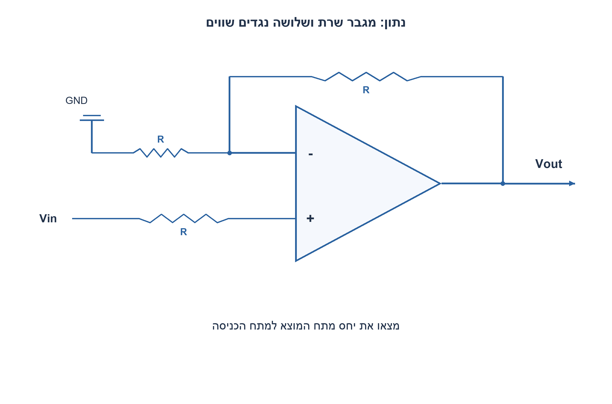
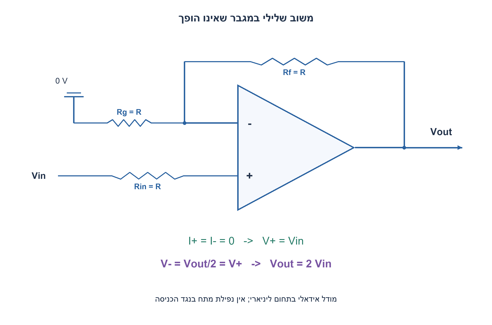
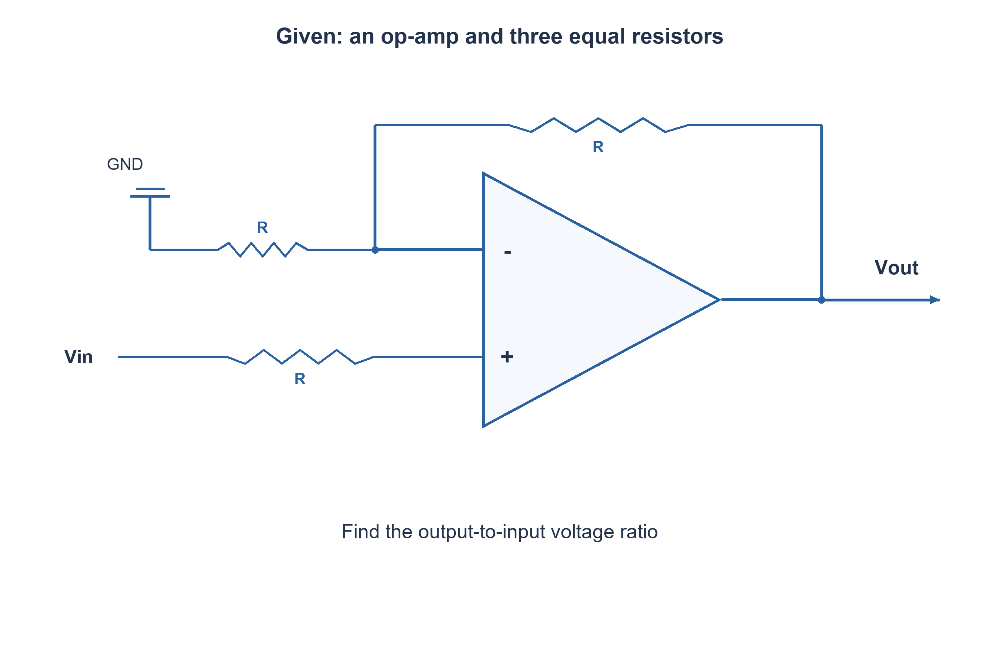
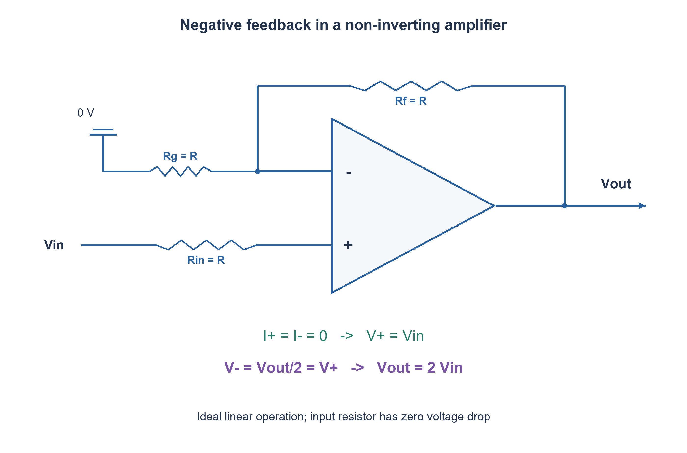

# PREP-297 — מגבר שאינו הופך עם שלושה נגדים שווים: מציאת ההגבר

פתרון מוצע בסיוע AI; ביקורת מקצועית אנושית ממתינה. הקושי אינו מכויל.

[צילום מקור פרטי](../sources/2026-11-07-night30-21.png)

למצוא הגבר Vout/Vin. בתמונה מגבר שרת: הכניסה הלא-הופכת מחוברת ל-Vin דרך נגד R, הכניסה ההופכת מחוברת לאדמה דרך R ולמוצא במשוב דרך R.

חברות לפי הדיווח בצילום בלבד: SolarEdge.

## עברית

מצאו Vout/Vin במעגל שבשרטוט: Vin מגיע דרך נגד R אל הכניסה הלא־הופכת +; הכניסה ההופכת − מחוברת דרך נגד R לאדמה ודרך נגד R אל Vout. הסבירו גם את תפקיד הנגד שבטור לכניסה +.

הנחות שנבחרו: שלושת הנגדים שווים וחיוביים, מגבר שרת אידאלי במשוב שלילי ובתחום ליניארי, מקור מתח אידאלי ועומס שאינו מגביל את היציאה. לאחר התשובה האידאלית דונו בהגבר חוג פתוח סופי, זרמי הטיה ורוויה; אין נתוני רכיב לחישוב שגיאה מספרית אמיתית.

1. במודל אידאלי מה הזרם שנכנס לכניסות מגבר השרת? האם יש נפילת מתח בנגד הכניסה?
2. הצומת − נמצא באמצע שני נגדים שווים בין המוצא לאדמה.
3. משוב שלילי ליניארי כופה V−=V+=Vin; הציבו V−=Vout/2.

### הנגד השלישי אינו מחלק מתח אידאלי
הכניסה + אינה צורכת זרם במודל האידאלי. לכן בנגד שבין Vin ל־+ אין זרם ואין נפילת מתח: V+=Vin. בנקודת − גם אין זרם כניסה, ולכן שני הנגדים במשוב הם מחלק מתח: V−=Vout/2. משוב שלילי בחוג סגור ובתחום הליניארי מביא ל־V−=V+, ומתקבל Vout=2Vin. המוצא אינו הופך סימן.

בדיקת משוב אינטואיטיבית: אם Vout נמוך מ־2Vin, אז V−<V+, והמגבר מעלה את המוצא; אם הוא גבוה, המגבר מוריד אותו. משוב בכיוון ההפוך אינו מצדיק את השוויון בין הכניסות. השוויון הוא קירוב הנובע מהמשוב, לא קצר פיזי בין + ל־−.

### כאשר המגבר אינו אידאלי
עבור הגבר DC פתוח A>0, כותבים Vout=A(Vin−Vout/2), ולכן `Vout/Vin=2A/(A+2)`. כאשר A גדל מתקבלת התקרבות ל־2 מלמטה. עבור נגדים שונים Rg לאדמה ו־Rf למשוב, ההגבר האידאלי הוא 1+Rf/Rg. הקוד מאמת משוואות אלה מול KCL ב־64 זוגות נגדים ו־256 ערכי הגבר סופי.

זרם הטיה אמיתי דרך נגד הכניסה יוצר שגיאת מתח, והנגד מוסיף רעש. אין לומר שהוא מבטיח פיצוי: תחת דגם פשוט של זרמי הטיה שווים, נגד הפיצוי הקלאסי הוא Rg||Rf=R/2 ולא R כפי שמצויר כאן. למגבר אמיתי יש גם תחום common-mode, מסילות, יכולת זרם, רוחב פס ו־slew rate. למשל, בקשת 2Vin מחוץ לתחום היציאה גורמת לרוויה; אסור להמשיך להשתמש בשוויון האידאלי. הניתוח המצורף הוא מודל ליניארי, ללא SPICE או מדידה.

### מודל Python שנבדק

```python
"""DC linear feedback model; not a saturation or transistor-level model."""
from fractions import Fraction as F


def closed_loop_gain(ground_r, feedback_r, open_loop=None):
    ground_r, feedback_r = F(ground_r), F(feedback_r)
    if ground_r <= 0 or feedback_r <= 0:
        raise ValueError("Positive resistances required")
    beta = ground_r/(ground_r+feedback_r)
    if open_loop is None:
        return 1/beta
    open_loop = F(open_loop)
    if open_loop <= 0:
        raise ValueError("Positive real DC open-loop gain required")
    return open_loop/(1+open_loop*beta)
```






### assumptions

שלושה נגדים R>0, כניסות ללא זרם ומשוב שלילי בתחום ליניארי.

### optimality

ניתוח KCL קבוע; ההגבר אינו מדד למינימום רכיבים.

### verification

מודלים עצמאיים עברו: קובייה בחמישה ערכי התנגדות, 3,072 גשרי DC במתח שאינו אפס, דוגמת מתח אפס, 64 זוגות נגדי משוב ו־256 בדיקות הגבר סופי, עשר פאזות סינוס, 1,024 קלטי מכפיל, 256 קלטי ספירת אחדות, 256 זוגות חיבור וארבע שורות NAND. ראיה: checks/night1107n30-hardware-model-verification.json. בדיקות אלה הן Python וחישוב רציונלי; קומפילציית SystemVerilog מתועדת בנפרד בדוח native של האצווה. לא בוצעו SPICE, סינתזה, ניתוח תזמון או מדידת חומרה.

בדיקת Icarus Verilog 12 בפועל עברה: 1,664 השוואות RTL באצוות החומרה, כולל כל קלטי המכפיל, ספירת אחדות וחיבור, כל שורות NAND ו־124 בדיקות לוח פאזה עם איפוס והשהיה. ראיה: checks/night1107n30-native-verification.json. ריצת הקוד הייתה בסביבה זמנית מבודדת ללא רשת; אין להסיק מכך SPICE או סינתזה.

### edge_cases

```json
[
  "Vin=0 נותן אפס במודל ללא היסט.",
  "Vin שלילי נשמר בסימן.",
  "חריגת מסילות פוסלת מודל ליניארי."
]
```

### common_mistakes

```json
[
  "התייחסות לנגד בטור כאל מחלק בלי מסלול זרם.",
  "שימוש באדמה וירטואלית בכניסה − שאינה באפס."
]
```

### interview_answer

אין זרם בכניסה ולכן V+=Vin; מחלק המשוב נותן V−=Vout/2, ומשוב שלילי נותן הגבר 2.

### source_ambiguities

הכניסות והחיבורים נלקחו מהשרטוט; המודל האידאלי הוצהר במפורש.

### solution_extensions

```json
[
  {
    "question": "מה ההגבר כשנגד המשוב שונה?",
    "direction": "V−=Vout·Rg/(Rg+Rf), לכן ההגבר 1+Rf/Rg.",
    "tests": "Rf=Rg, פי שניים ופי שלושה."
  }
]
```

## English

Find Vout/Vin for the drawn circuit: Vin reaches the non-inverting + input through R; the inverting − input connects through R to ground and through another R to Vout. Explain the role of the series resistor at +.

Chosen assumptions: three equal positive resistors, an ideal op-amp under negative feedback in its linear range, an ideal voltage source and a non-limiting output load. After the ideal answer discuss finite open-loop gain, bias currents and saturation; no device data are supplied for a real numerical error calculation.

1. What current enters an ideal op-amp input? Is there a voltage drop across the input resistor?
2. The − node sits between equal resistors from output to ground.
3. Linear negative feedback gives V−=V+=Vin; substitute V−=Vout/2.

### The third resistor is not an ideal voltage divider
An ideal + input draws no current, so the resistor between Vin and + has no current and no voltage drop: V+=Vin. The − input also draws no current, so its two feedback resistors form a divider: V−=Vout/2. Linear closed-loop negative feedback makes V−=V+, giving Vout=2Vin. The output preserves sign.

Intuitively, if Vout is below 2Vin, then V−<V+ and the amplifier raises its output; if it is above, feedback lowers it. Reversed feedback would not justify equal inputs. Their approximate equality is a consequence of feedback, not a physical short between + and −.

### Non-ideal operation
For positive real DC open-loop gain A, write Vout=A(Vin−Vout/2), giving `Vout/Vin=2A/(A+2)`. It approaches two from below as A grows. With unequal ground resistor Rg and feedback resistor Rf, ideal gain is 1+Rf/Rg. The model checks these relations with KCL for 64 resistor pairs and 256 finite-gain cases.

Real input bias current creates an error across the series input resistor, which also adds noise. Do not automatically call this perfect compensation: under the simple equal-bias-current model the usual compensating resistance is Rg||Rf=R/2, not the drawn R. A real amplifier also has common-mode limits, output rails, drive-current limits, bandwidth and slew rate. A demanded 2Vin beyond the output range causes saturation, invalidating the ideal equality. The supplied analysis is a linear model, without SPICE or physical measurement.

### Verified Python teaching model

```python
"""DC linear feedback model; not a saturation or transistor-level model."""
from fractions import Fraction as F


def closed_loop_gain(ground_r, feedback_r, open_loop=None):
    ground_r, feedback_r = F(ground_r), F(feedback_r)
    if ground_r <= 0 or feedback_r <= 0:
        raise ValueError("Positive resistances required")
    beta = ground_r/(ground_r+feedback_r)
    if open_loop is None:
        return 1/beta
    open_loop = F(open_loop)
    if open_loop <= 0:
        raise ValueError("Positive real DC open-loop gain required")
    return open_loop/(1+open_loop*beta)
```






### assumptions

Three equal positive resistors, zero input currents and linear negative feedback.

### optimality

Constant-size nodal analysis; gain does not establish component minimality.

### verification

Independent models passed: five cube resistance scales, 3,072 nonzero-source DC bridges plus a zero-source example, 64 feedback-resistor pairs and 256 finite-gain checks, ten sine phases, 1,024 multiplier inputs, 256 popcount inputs, 256 addition pairs and four NAND truth rows. Evidence: checks/night1107n30-hardware-model-verification.json. These are Python/exact-rational checks; SystemVerilog compilation is documented separately in the batch native report. No SPICE, synthesis, timing analysis or hardware measurement was performed.

Actual Icarus Verilog12 execution passed 1,664 hardware RTL comparisons, including all multiplier, popcount and adder inputs, all NAND rows and 124 phase-schedule checks with reset and hold. Evidence: checks/night1107n30-native-verification.json. Execution used a temporary isolated environment with networking denied; this is not SPICE or synthesis.

### edge_cases

```json
[
  "Zero input gives zero in the offset-free model.",
  "Negative input retains sign.",
  "Rail limits invalidate the linear model."
]
```

### common_mistakes

```json
[
  "Treating the series resistor as a divider without a current path.",
  "Calling the − input zero when it actually follows Vin."
]
```

### interview_answer

No input current means V+=Vin; the feedback divider gives V−=Vout/2, so negative feedback gives gain two.

### source_ambiguities

Input polarity and wiring follow the sketch; ideal operation is explicitly assumed.

### solution_extensions

```json
[
  {
    "question": "What if the feedback resistance changes?",
    "direction": "Use the divider V−=Vout·Rg/(Rg+Rf), giving 1+Rf/Rg.",
    "tests": "Test equal, double and triple feedback resistance."
  }
]
```
