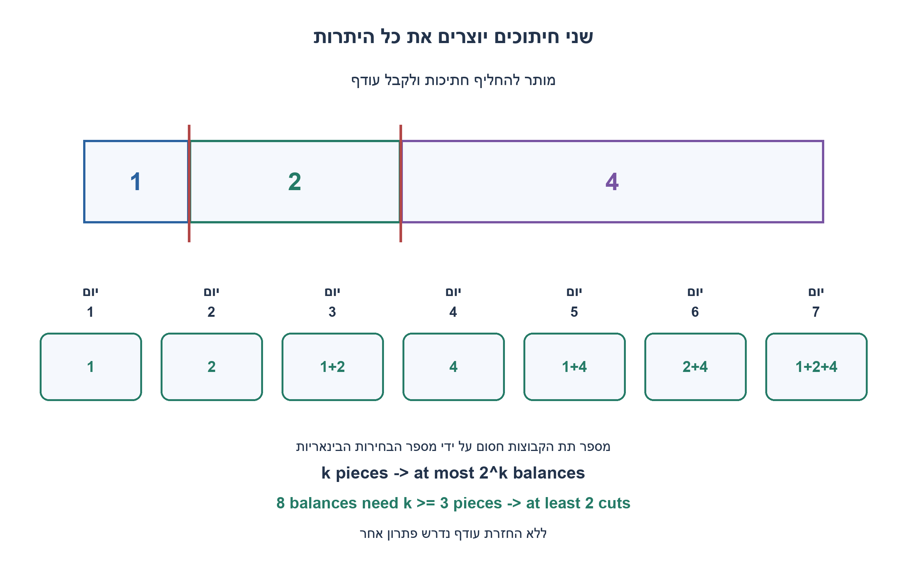
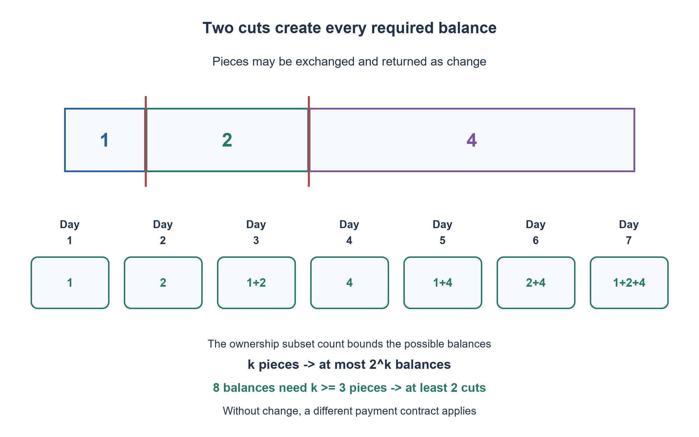

# PREP-298 — תשלום יומי במטיל זהב לשבעה ימים — מינימום חיתוכים

פתרון מוצע בסיוע AI; ביקורת מקצועית אנושית ממתינה. הקושי אינו מכויל.

## עברית

עובד מועסק במשך שבעה ימים, ובסוף כל יום עליו להחזיק בזהב ששוויו בדיוק מספר הימים שעבד כפול השכר היומי. ברשות המעסיק מטיל אחיד ששווה שבעה שכרי יום. מה מספר החיתוכים המינימלי ואיך משלמים בכל יום?

הנחות התרגיל שנבחרו: אפשר לקבל בחזרה חתיכות ששולמו קודם ולתת אחרות כעודף. אין זהב או אמצעי תשלום נוספים. כל חיתוך מפצל חתיכה אחת לשתיים; לא עורמים או מקפלים חלקים לחיתוך משותף, ולא מאבדים חומר. אין צורך להעביר כל יום חתיכה חדשה דווקא, אלא לשמור על היתרה המצטברת המדויקת.

1. האם העובד חייב לשמור כל חתיכה שקיבל, או שאפשר להחליף חתיכות ולתת עודף?
2. חשבו אילו שלושה משקלים מאפשרים לייצג באמצעות תת־קבוצה כל מספר בין 0 ל־7.
3. חתכו לחתיכות בשווי 1,2,4. ביום השני מחזירים 1 ונותנים 2; ביום הרביעי מחזירים 1 ו־2 ונותנים 4.

נמדוד זהב ביחידות של שכר יום. שני חיתוכים, אחרי היחידה הראשונה ואחרי היחידה השלישית לאורך המטיל המקורי, יוצרים חתיכות בשווי 1,2,4. לאחר כל חיתוך מספר החלקים גדל באחד, ולכן כעת יש שלוש חתיכות.

| יום | נותנים לעובד | מקבלים ממנו בחזרה | מה נשאר אצלו |
|---|---|---|---|
|1|1|—|1|
|2|2|1|2|
|3|1|—|1+2|
|4|4|1,2|4|
|5|1|—|1+4|
|6|2|1|2+4|
|7|1|—|1+2+4|

בכל מעבר השווי נטו אצל העובד עולה באחת. הוא אינו צריך להחזיק את אותה חתיכה לאורך כל השבוע. הקידוד הבינארי של מספר היום מסמן בדיוק אילו חתיכות נמצאות אצלו: הסיביות מייצגות 1,2,4. זו גם דרך שיטתית לבנות את התשלומים בלי לשנן את הטבלה.

### למה שני חיתוכים הם מינימום
צריך לממש שמונה יתרות שונות, 0 בתחילה ואז 1 עד 7. אם יש רק k חתיכות שאסור לפצל שוב, לעובד יש לכל היותר `2^k` תת־קבוצות של חתיכות, ולכן לכל היותר מספר כזה של יתרות. עם חיתוך אחד יש לכל היותר שתי חתיכות וארבע תת־קבוצות, וזה אינו מספיק לשמונה יתרות. חייבים לפחות שלוש חתיכות, ולכן לפחות שני חיתוכים. החתיכות 1,2,4 מממשות את כולן ומוכיחות שהחסם מושג. הטענה אינה מניחה שחיתוך נעשה דווקא לפני היום הראשון; גם לאחר יום שביעי חיתוך יחיד אינו יכול ליצור מספיק יתרות אפשריות.

אם אסור לקבל עודף, התרגיל משתנה: בכל יום צריך להוסיף זהב בשווי יחידה שלא ניתן להחזיר, ולכן דרושות שבע חתיכות יחידה ושישה חיתוכים. ההבדל הוא כלל התשלום, לא טעות באסטרטגיית 1,2,4. המודל כאן מאפשר במפורש החזרת עודף.

האימות מונה את שמונה תת־הקבוצות ובודק גם את בעלות החתיכות בכל יום: לא ניתן לתת חתיכה שכבר אצל העובד או לקבל בחזרה חתיכה שאינה אצלו. זמן וזיכרון הפקת התכנית קבועים עבור שבעת הימים; אופטימליות מתייחסת למספר החיתוכים, ולא למספר החלפות החתיכות.

```python
def gold_payments():
    """Pieces are physical identities; each ownership mask is a daily balance."""
    pieces = (1, 2, 4)
    previous_mask = 0
    result = []
    for day in range(1, 8):
        mask = day
        give = [pieces[i] for i in range(3) if mask & (1 << i) and not previous_mask & (1 << i)]
        take_back = [pieces[i] for i in range(3) if previous_mask & (1 << i) and not mask & (1 << i)]
        result.append({"day": day, "give": give, "take_back": take_back,
                       "holds": [pieces[i] for i in range(3) if mask & (1 << i)]})
        previous_mask = mask
    return result
```




## English

An employee works for seven days. At each day end, the employee must hold gold worth exactly the number of completed days times the daily wage. The employer has one uniform bar worth seven daily wages. Find the minimum cuts and a daily payment schedule.

Chosen exercise assumptions: earlier pieces may be returned as change and exchanged for other pieces. No additional gold or currency is available. Each cut splits one piece into two, without stacking/folding pieces into a shared cut or losing material. The requirement is an exact cumulative balance, not a fresh separate one-unit piece each day.

1. Must the employee keep every earlier piece, or may pieces be exchanged as change?
2. Which three piece values can represent every balance from zero through seven as a subset?
3. Cut values 1,2,4. On day two, take back one and give two; on day four, take back one and two and give four.

Measure the bar in daily-wage units. Cut after the first unit and after the third unit of the original bar, producing values 1,2,4. Every cut increases the piece count by one, so two cuts create three pieces.

| Day | Give | Take back | Employee holds |
|---|---|---|---|
|1|1|—|1|
|2|2|1|2|
|3|1|—|1+2|
|4|4|1,2|4|
|5|1|—|1+4|
|6|2|1|2+4|
|7|1|—|1+2+4|

Every exchange increases the employee's net balance by one. Keeping the same piece permanently is unnecessary. The binary digits of the day identify exactly which 1,2,4 pieces the employee holds, providing a systematic schedule.

### Why two cuts are minimal
Eight distinct balances are required: zero initially and one through seven. With k indivisible pieces there are at most `2^k` employee-ownership subsets, hence at most that many balances. At most one cut creates at most two pieces and four subsets, insufficient for eight balances. At least three pieces, and therefore at least two cuts, are required. The 1,2,4 construction realizes every balance and attains the bound. Cuts need not all occur before day one for this lower bound; even after day seven a single cut cannot have provided enough ownership possibilities.

Without returning change, the contract differs: every day must add a fresh one-unit value which cannot be returned. Seven unit pieces and six cuts are then needed. The difference is the payment rule, not a flaw in the 1,2,4 strategy; this exercise explicitly permits change.

Verification enumerates all eight subsets and tracks physical ownership at each exchange, preventing a piece from being given twice or returned while absent. Schedule generation uses constant time and space for seven days. The optimality metric is the number of cuts, not the number of piece exchanges.

```python
def gold_payments():
    """Pieces are physical identities; each ownership mask is a daily balance."""
    pieces = (1, 2, 4)
    previous_mask = 0
    result = []
    for day in range(1, 8):
        mask = day
        give = [pieces[i] for i in range(3) if mask & (1 << i) and not previous_mask & (1 << i)]
        take_back = [pieces[i] for i in range(3) if previous_mask & (1 << i) and not mask & (1 << i)]
        result.append({"day": day, "give": give, "take_back": take_back,
                       "holds": [pieces[i] for i in range(3) if mask & (1 << i)]})
        previous_mask = mask
    return result
```




## חומר משלים / Supporting material

```json
{
  "assumptions": {
    "he": [
      "שבעה ימים, מטיל אחיד, החזרת עודף מותרת וחיתוך חתיכה אחת בכל פעולה."
    ],
    "en": [
      "Seven days, a uniform bar, change allowed and one piece split per cut."
    ]
  },
  "optimality": {
    "he": "שני חיתוכים מינימליים: שלוש חתיכות מספיקות, ושתי חתיכות אינן מאפשרות שמונה יתרות.",
    "en": "Two cuts are minimal: three pieces suffice, while two cannot represent eight balances."
  },
  "verification": {
    "he": [
      "מניית תת־קבוצות, בעלות פיזית ושווי מצטבר בכל אחד משבעת הימים."
    ],
    "en": [
      "Exhaust subset sums, physical ownership and cumulative value for all seven days."
    ]
  },
  "edge_cases": {
    "he": [
      "יתרה 0 בתחילה; החלפות בימים 2,4,6; כלל ללא עודף הוא תרגיל אחר."
    ],
    "en": [
      "Initial zero balance, exchanges on days2,4,6, and the distinct no-change contract."
    ]
  },
  "common_mistakes": {
    "he": [
      "לשכוח שבסוף כל יום נדרשת יתרה מדויקת, או להציע שלוש חתיכות בלי הוכחת מינימום."
    ],
    "en": [
      "Ignoring exact day-end balances or proposing three pieces without a lower bound."
    ]
  },
  "interview_answer": {
    "he": "חותכים ל־1,2,4 ומשלמים לפי סיביות מספר היום, תוך החזרת עודף. פחות משלוש חתיכות לא מספק שמונה יתרות אפשריות, ולכן שני חיתוכים מינימליים.",
    "en": "Cut 1,2,4 and use the day number as an ownership bit mask, exchanging change. Fewer than three pieces cannot represent eight balances, proving two cuts minimal."
  },
  "source_ambiguities": {
    "he": [
      "האפשרות להחזרת עודף אינה מפורשת במקור; נבחרה כאן כהנחת תרגיל גלויה."
    ],
    "en": [
      "Returning change is not explicit in the source; it is a stated exercise assumption."
    ]
  },
  "solution_extensions": {
    "he": [
      {
        "question": "איך תשלמו במשך 15 ימים באותם כללים?",
        "answer_direction": "חתיכות 1,2,4,8 דורשות שלושה חיתוכים ומייצגות 16 יתרות. שלוש חתיכות מאפשרות לכל היותר 8 יתרות, ולכן אינן מספיקות.",
        "principle": "ספירת אפשרויות והצגה בינארית."
      }
    ],
    "en": [
      {
        "question": "How would you pay for fifteen days under the same rules?",
        "answer_direction": "Pieces 1,2,4,8 require three cuts and represent sixteen balances. Three pieces offer at most eight balances and cannot suffice.",
        "principle": "Counting possibilities and binary representation."
      }
    ]
  }
}
```
