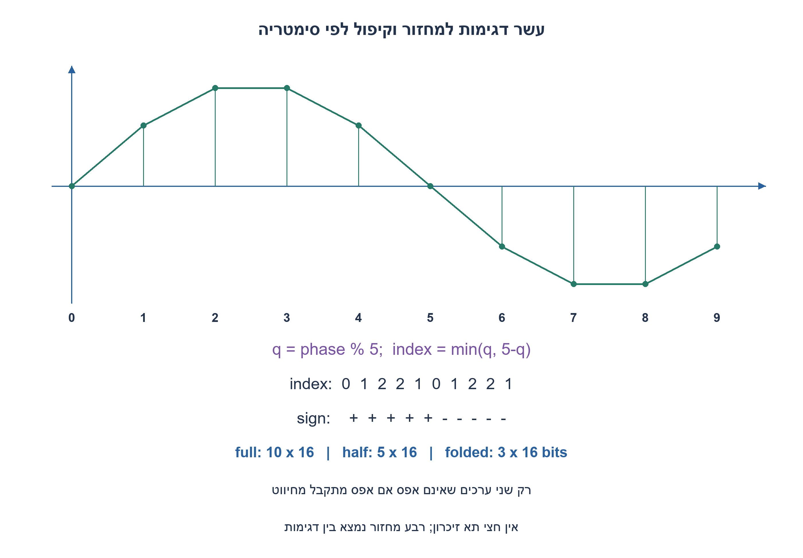
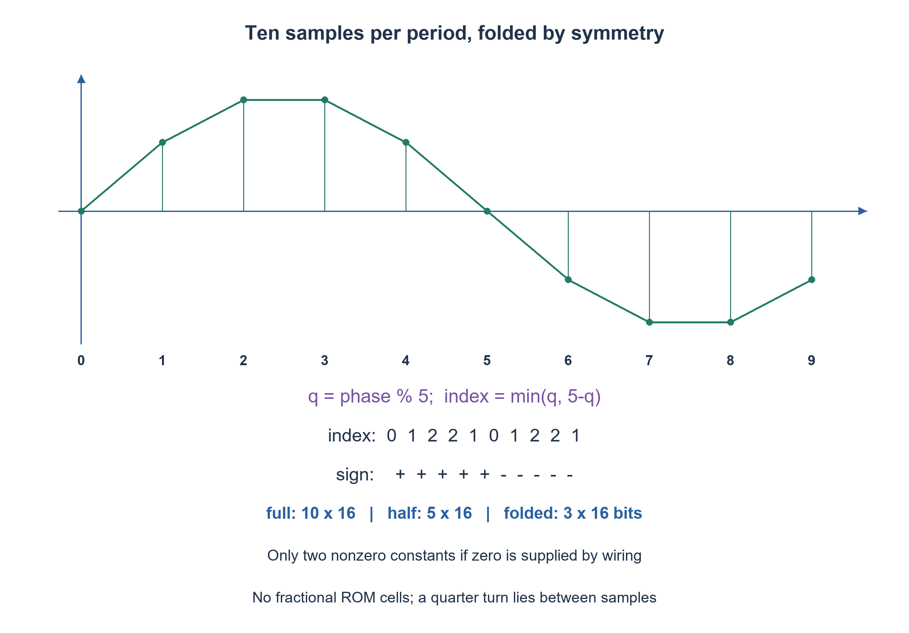

# PREP-299 — סינוס 100kHz בדגימה של 1MHz: זיכרון מלא, חצי ורבע

פתרון מוצע בסיוע AI; ביקורת מקצועית אנושית ממתינה. הקושי אינו מכויל.

[צילום מקור פרטי](../sources/2026-11-07-night30-23.png)

קיים גנרטור של אות סינוס בתדר 100kHz. רוצים להוציא את האות בתדר דגימה 1M. א. מה גודל הזיכרון שצריך כדי לשדר לפלט את הסינוס וכיצד נשתמש בו? ב. אם השתמשנו בזיכרון בגודל x ויש רק x/2 תאי זיכרון? ג. אם יש רק x/4 תאי זיכרון?

חברות לפי הדיווח בצילום בלבד: Elbit.

## עברית

יש לייצר דגימות של סינוס בתדר 100kHz בקצב 1MHz. מה מספר תאי הזיכרון למחזור מלא ואיך קוראים אותם? כיצד מנצלים סימטריה עם חצי מהזיכרון, ומה עושים כשמבקשים רבע?

השלמה מפורשת: פאזה התחלתית אפס, דגימות signed בנות 16 סיביות באמפליטודה סימטרית 32767, ועיגול לשלם הקרוב של 32767·sin(2πn/10). מונה פאזה 0..9 מתקדם רק כש־en=1; איפוס סינכרוני קובע פאזה אפס וגובר על en. המוצא הוא ערך צירופי של הפאזה הנוכחית; התדר המצוין תקף בהתקדמות בכל מחזור. אין לאפשר תא זיכרון חלקי: יש לדון בנפרד אם אפס חייב להישמר ב־ROM או יכול להגיע מחיווט. המוצא הדיגיטלי אינו אות אנלוגי רציף ללא DAC ושחזור.

1. חלקו את קצב הדגימה בתדר הסינוס. מספר זה הוא מספר כתובות הפאזה במחזור.
2. בחצי השני הערכים הם שלילת החצי הראשון. בחצי החיובי יש גם ערכים שווים סביב שיא הסינוס.
3. עשר אינו מתחלק בארבע. עבור q=phase%5 השתמשו בכתובת min(q,5−q); מתקבלים שלושה גדלים שונים, שאחד מהם אפס.

### מחזור מלא וחצי מחזור
1MHz/100kHz=10, לכן טבלה ישירה כוללת עשר מילים בנות 16 סיביות, 160 ביט, ללא ספירת לוגיקת בקרה. קוראים כתובות 0..9 שוב ושוב. הטבלה שנבחרה היא:

`[0,19260,31163,31163,19260,0,-19260,-31163,-31163,-19260]`.

החלפת הסימן אחרי חצי מחזור מאפשרת לשמור חמש מילים: `[0,19260,31163,31163,19260]`, בסך 80 ביט. עבור n<5 קוראים ישירות; אחרת קוראים n−5 ומשנים סימן. בשימוש באמפליטודה 32767 השלילה אינה נתקעת בערך ‎−32768 שאינו מיוצג כחיובי ב־signed16.

### רבע אינו 2.5 תאים
רבע מחזור נמצא בין דגימות 2 ו־3, ולא בכתובת שלמה. אין לחלק עשר בארבע ולדווח 2.5 תאים. נסמן q=n%5; הכתובת `min(q,5−q)` נותנת 0,1,2,2,1. לכן מספיק לשמור שלושה גדלים `[0,19260,31163]`, 48 ביט, ולהפיק סימן לפי n≥5. זה קיפול דגימות בסימטריה עם עיגול מספר התאים; הוא אינו עומד בהבטחה מילולית של לכל היותר 40 ביט ROM.

אם אפס מותר כחיווט ולא כמילה שמורה, שומרים רק שני קבועים שאינם אפס: 19260 ו־31163. שתי מילים הן 32 ביט, ובכתובת אפס מחזירים אפסים משערים/חיווט. כך מקיימים תקציב ROM של x/4=40 ביט עבור x=160, במחיר מונה, פענוח, קיפול ושלילת סימן שאינם תאי ROM. אם מחייבים לשמור גם אפס כמילת נתונים, אי אפשר לטעון ששלוש מילים נכנסות לשתיים וחצי; צריך לשנות תקציב או שיטת קידוד.

### שעון, עיגול ואיכות אות
המונה דורש ארבע סיביות, אף שרק עשרה מצבים חוקיים. איפוס בעלייה קובע 0, en=0 משהה פאזה; שינוי sample מגיע אחרי עיכוב צירופי. הבדיקה משווה את כל עשר הפאזות של שלוש שיטות הטבלה לערכי sin מחושבים בנפרד, וקוד RTL נבדק בנפרד מול לוח ערכים. התצוגה בין דגימות היא גרם מדרגות אם משתמשים ב־DAC מחזיק; מסנן שחזור נועד לצמצם תמונות ספקטרליות. עשר דגימות למחזור אינן אישור לעיוות או לרעש כימות מסוימים. שינוי פאזה התחלתית או יחס תדרים שונה עלולים לשנות את מספר הגדלים השונים ואת לוגיקת הכתובות.

### מודל Python שנבדק

```python
"""Ten uniformly spaced samples; symmetric signed Q15 amplitude 32767."""
import math


def full_table():
    return [round(32767*math.sin(2*math.pi*n/10)) for n in range(10)]


def half_sample(phase):
    if not 0 <= phase < 10:
        raise ValueError("phase must be 0..9")
    half = [0,19260,31163,31163,19260]
    return (-1 if phase >= 5 else 1)*half[phase % 5]


def quarter_sample(phase):
    if not 0 <= phase < 10:
        raise ValueError("phase must be 0..9")
    q = phase % 5
    address = min(q,5-q)
    magnitude = [0,19260,31163][address]
    return -magnitude if phase >= 5 else magnitude
```


### קוד SystemVerilog; תוצאות סימולציה בדוח נפרד

```systemverilog
// Signed symmetric Q15 amplitude: +/-32767, not the asymmetric -32768 endpoint.
// Two nonzero ROM constants; zero is supplied by wiring. Quarter-fold has
// three distinct magnitudes if zero is charged as a stored ROM word.
module prep299_sine_rom(input wire clk,rst,en,
                       output reg [3:0] phase,
                       output reg signed [15:0] sample);
  reg [2:0] q,index;
  reg signed [15:0] magnitude;
  always @(posedge clk) begin
    if (rst) phase <= 0;
    else if (en) phase <= (phase==9) ? 0 : phase+1'b1;
  end
  always @* begin
    q = (phase>=5) ? phase-5 : phase;
    index = (q>2) ? 5-q : q;
    case(index)
      0: magnitude=16'sd0;
      1: magnitude=16'sd19260;
      2: magnitude=16'sd31163;
      default: magnitude=16'sd0;
    endcase
    sample = (phase>=5) ? -magnitude : magnitude;
  end
endmodule
```




### assumptions

יחס תדרים 10, פאזה אפס, signed16 באמפליטודה 32767, ROM נמדד בנפרד מלוגיקת בקרה.

### optimality

מלא 160 ביט, חצי 80, שלושה גדלים 48; שני גדלים שאינם אפס עם חיווט אפס 32. מונה ופענוח אינם חינם.

### verification

מודלים עצמאיים עברו: קובייה בחמישה ערכי התנגדות, 3,072 גשרי DC במתח שאינו אפס, דוגמת מתח אפס, 64 זוגות נגדי משוב ו־256 בדיקות הגבר סופי, עשר פאזות סינוס, 1,024 קלטי מכפיל, 256 קלטי ספירת אחדות, 256 זוגות חיבור וארבע שורות NAND. ראיה: checks/night1107n30-hardware-model-verification.json. בדיקות אלה הן Python וחישוב רציונלי; קומפילציית SystemVerilog מתועדת בנפרד בדוח native של האצווה. לא בוצעו SPICE, סינתזה, ניתוח תזמון או מדידת חומרה.

בדיקת Icarus Verilog 12 בפועל עברה: 1,664 השוואות RTL באצוות החומרה, כולל כל קלטי המכפיל, ספירת אחדות וחיבור, כל שורות NAND ו־124 בדיקות לוח פאזה עם איפוס והשהיה. ראיה: checks/night1107n30-native-verification.json. ריצת הקוד הייתה בסביבה זמנית מבודדת ללא רשת; אין להסיק מכך SPICE או סינתזה.

### edge_cases

```json
[
  "פאזה 9 חוזרת ל־0.",
  "en=0 אינו מקדם.",
  "איפוס גובר על en.",
  "אין ‎−32768 בטבלה הסימטרית."
]
```

### common_mistakes

```json
[
  "דיווח על 2.5 תאי זיכרון.",
  "שכחת היפוך הסימן בחצי השני.",
  "הצגת פלט דיגיטלי כסינוס אנלוגי נקי."
]
```

### interview_answer

עשר פאזות במחזור; סימטריית חצי חוסכת חצי. קיפול דורש שלושה גדלים, או שני קבועים ואפס מחיווט כדי לעמוד בתקציב רבע.

### source_ambiguities

רזולוציה, עיגול ופאזה אינם במקור; בחרנו חוזה מפורש. דרישת x/4 נשמרת כמגבלת תקציב עם דיון באי־שלמות תאים.

### solution_extensions

```json
[
  {
    "question": "מה משתנה ל־12 דגימות במחזור?",
    "direction": "נקודת רבע המחזור נופלת על כתובת 3; יש לטפל בשיתוף קצות רבעים ובסימן.",
    "tests": "בדקו אפסים, שיאים וכל 12 הכתובות."
  }
]
```

## English

Generate samples of a 100kHz sine at 1MHz. How many memory words represent one complete period, and how are they read? How can symmetry halve storage, and what happens when quarter storage is requested?

Explicit completion: zero starting phase, signed sixteen-bit samples with symmetric amplitude 32767, rounding 32767·sin(2πn/10) to the nearest integer. A phase counter 0..9 advances only when en=1; synchronous reset selects phase zero and overrides en. Output is a combinational function of the current phase; the stated frequency assumes advancing every cycle. Fractional memory cells are not allowed: distinguish storing zero in ROM from generating it through wiring. Digital samples require a DAC and reconstruction to become a continuous analog waveform.

1. Divide sample rate by sine frequency to obtain phase addresses per period.
2. The second half is the negative of the first. The positive half also mirrors around the sine peak.
3. Ten is not divisible by four. Set q=phase%5 and index=min(q,5−q); there are three distinct magnitudes, including zero.

### Full and half periods
1MHz/100kHz=10, so a direct table contains ten sixteen-bit words, or 160 bits excluding control logic. Read addresses zero through nine repeatedly. The chosen table is:

`[0,19260,31163,31163,19260,0,-19260,-31163,-31163,-19260]`.

The second half is the negative of the first, so store five words `[0,19260,31163,31163,19260]`, totaling eighty bits. For n<5 read directly; otherwise read n−5 and negate. Symmetric amplitude 32767 avoids the signed-sixteen-bit asymmetric endpoint −32768, whose positive counterpart is unrepresentable.

### A quarter is not 2.5 cells
A quarter turn lies between samples two and three, not at an integer address. Dividing ten by four does not create 2.5 memory cells. Let q=n%5; `min(q,5−q)` produces addresses 0,1,2,2,1. Three stored magnitudes `[0,19260,31163]` suffice, totaling forty-eight bits, with sign selected by n≥5. This is symmetry folding with an integer-word rounding overhead; it does not satisfy a literal forty-bit ROM limit.

If zero may be supplied by wiring instead of stored as a data word, only the two nonzero constants 19260 and 31163 need storage: thirty-two bits. Address zero selects hardwired zeros. This meets x/4=40 ROM bits when x=160, at the cost of a counter, decoding, folding and negation outside the ROM budget. If zero must also occupy a ROM word, three words cannot be claimed to fit in two and a half; budget or encoding must change.

### Clocking, rounding and signal quality
The phase counter needs four bits despite having ten legal values. Synchronous reset selects zero; en=0 holds phase; sample follows after combinational delay. Independent models compare all ten phases of full, half and quarter-fold representations with separately computed sine samples; RTL is checked separately against the numerical sequence. A hold-type DAC produces a staircase between samples, and a reconstruction filter suppresses spectral images. Ten samples per period do not certify any distortion or quantization-noise target. A different starting phase or frequency ratio can change distinct magnitudes and addressing logic.

### Verified Python teaching model

```python
"""Ten uniformly spaced samples; symmetric signed Q15 amplitude 32767."""
import math


def full_table():
    return [round(32767*math.sin(2*math.pi*n/10)) for n in range(10)]


def half_sample(phase):
    if not 0 <= phase < 10:
        raise ValueError("phase must be 0..9")
    half = [0,19260,31163,31163,19260]
    return (-1 if phase >= 5 else 1)*half[phase % 5]


def quarter_sample(phase):
    if not 0 <= phase < 10:
        raise ValueError("phase must be 0..9")
    q = phase % 5
    address = min(q,5-q)
    magnitude = [0,19260,31163][address]
    return -magnitude if phase >= 5 else magnitude
```


### SystemVerilog; simulation results are in a separate report

```systemverilog
// Signed symmetric Q15 amplitude: +/-32767, not the asymmetric -32768 endpoint.
// Two nonzero ROM constants; zero is supplied by wiring. Quarter-fold has
// three distinct magnitudes if zero is charged as a stored ROM word.
module prep299_sine_rom(input wire clk,rst,en,
                       output reg [3:0] phase,
                       output reg signed [15:0] sample);
  reg [2:0] q,index;
  reg signed [15:0] magnitude;
  always @(posedge clk) begin
    if (rst) phase <= 0;
    else if (en) phase <= (phase==9) ? 0 : phase+1'b1;
  end
  always @* begin
    q = (phase>=5) ? phase-5 : phase;
    index = (q>2) ? 5-q : q;
    case(index)
      0: magnitude=16'sd0;
      1: magnitude=16'sd19260;
      2: magnitude=16'sd31163;
      default: magnitude=16'sd0;
    endcase
    sample = (phase>=5) ? -magnitude : magnitude;
  end
endmodule
```




### assumptions

Rate ratio ten, zero phase, signed-sixteen-bit amplitude 32767; ROM is budgeted separately from control logic.

### optimality

Full 160 bits, half eighty, three magnitudes forty-eight; two nonzero magnitudes with wired zero thirty-two. Counter and decoding are additional resources.

### verification

Independent models passed: five cube resistance scales, 3,072 nonzero-source DC bridges plus a zero-source example, 64 feedback-resistor pairs and 256 finite-gain checks, ten sine phases, 1,024 multiplier inputs, 256 popcount inputs, 256 addition pairs and four NAND truth rows. Evidence: checks/night1107n30-hardware-model-verification.json. These are Python/exact-rational checks; SystemVerilog compilation is documented separately in the batch native report. No SPICE, synthesis, timing analysis or hardware measurement was performed.

Actual Icarus Verilog12 execution passed 1,664 hardware RTL comparisons, including all multiplier, popcount and adder inputs, all NAND rows and 124 phase-schedule checks with reset and hold. Evidence: checks/night1107n30-native-verification.json. Execution used a temporary isolated environment with networking denied; this is not SPICE or synthesis.

### edge_cases

```json
[
  "Phase nine wraps to zero.",
  "en=0 holds.",
  "Reset overrides en.",
  "The symmetric table excludes −32768."
]
```

### common_mistakes

```json
[
  "Claiming 2.5 memory cells.",
  "Forgetting second-half negation.",
  "Calling digital samples a clean analog sine."
]
```

### interview_answer

Ten phases per period; half-wave symmetry halves storage. Folding needs three magnitudes, or two constants and wired zero to meet a quarter-ROM budget.

### source_ambiguities

Resolution, rounding and phase are chosen explicitly. The x/4 requirement is retained as a budget, with fractional-word impossibility explained.

### solution_extensions

```json
[
  {
    "question": "What changes for twelve samples per period?",
    "direction": "A quarter turn falls at address three; account for shared quadrant endpoints and sign.",
    "tests": "Check zeros, peaks and all twelve addresses."
  }
]
```
