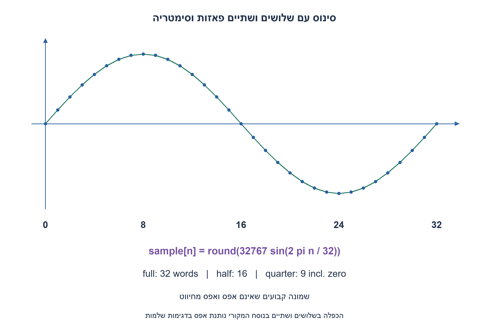
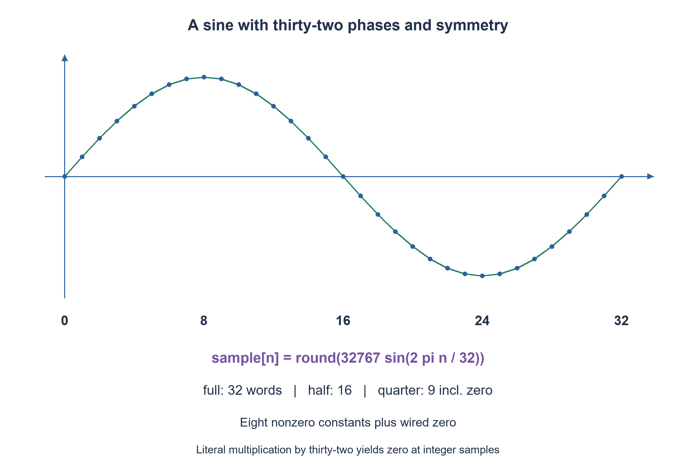

# PREP-299 — סינוס 100kHz בדגימה של 1MHz: זיכרון מלא, חצי ורבע

פתרון מוצע בסיוע AI; ביקורת מקצועית אנושית ממתינה. דירוג הקושי פנימי ואינו מוצג ללומדים.

[צילום מקור פרטי](../sources/2026-11-08-batch20-18.png)

ממשו מכונה המממשת sin: Sin(2pi*n*T), כאשרT=32. כמה דגימותn נצטרך? האם ניתן לשפר?

חברות לפי הדיווח בצילום בלבד: Elbit.

## עברית

### וריאציה: מה פירוש T=32 בנוסחת הסינוס?
המקור כותב Sin(2π·n·T), עם T=32, ושואל כמה דגימות n צריך והאם ניתן לשפר. עבור n שלם הנוסחה המילולית היא sin(64πn)=0 בכל דגימה.

כדי ליצור תרגיל מחולל שימושי נבחר במפורש פירוש אחר: T=32 הוא מספר הדגימות למחזור, ולכן sample[n]=round(32767·sin(2πn/32)). נשתמש ב־signed16 עם אמפליטודה סימטרית32767; מונה פאזה0..31 מתקדם בעליית שעון רק כש־en=1, איפוס סינכרוני גובר וקובע0, והמוצא צירופי לפי הפאזה. הסבירו מספר כתובות, f_out ביחס ל־f_s וחיסכון ROM בסימטריה, כולל קצות רבע המחזור. זו השלמה שלנו, לא טענה שכך נכתבה הנוסחה בראיון.

1. בדקו קודם אם הנוסחה המקורית נותנת בכלל אות שאינו אפס בדגימות שלמות.
2. בפירוש הנבחר יש32 כתובות ומונה בן5 ביטים. החצי השני הוא שלילת הראשון.
3. בקיפול רבע צריך גם אפס וגם שיא: כתובות0..8 הן9 גדלים. אפשר לחווט אפס ולשמור8 גדלים שאינם אפס.

### מפרידים נוסחה מילולית מן התרגיל שנבחר
לכל n שלם,32n שלם ו־sin(2π·32n)=0. שגיאות עיגול של sin במחשב אינן סינוס בעל מידע; יש להבחין בזה לפני הקצאת ROM. בפירוש שסימנו כהשלמה, T הוא אורך המחזור בדגימות והנוסחה מחלקת ב־32. המונה שומר פאזה בחמש סיביות, כך שגלישה טבעית מחזירה31 ל־0. בהתקדמות בכל שעון מתקבל f_out=f_s/32; השהיה ב־en עוצרת פאזה ולכן משנה את קצב ההתקדמות בזמן.

### מלא, חצי ורבע
טבלה מלאה מכילה32 מילים של16 ביט,512 ביט. סימטריית חצי מאפשרת16 מילים ו־sign,256 ביט. לרבע ראשון, כולל שני קצותיו, יש את הגדלים הבאים:

`[0,6393,12539,18204,23170,27245,30273,32137,32767]`.

נסמן q=phase%16 ו־index=min(q,16−q). הכתובות0..8 משחזרות את שתי מחציות הגודל, ו־phase≥16 קובע סימן שלילי. אם כל גודל כולל אפס חייב להיות מילת ROM, נדרשות9 מילים,144 ביט. אם אפס מחווט, שומרים8 קבועים שאינם אפס,128 ביט, והלוגיקה מחזירה אפס בכתובת0. אין להעלים את שיא32767 או את כתובת האפס כדי לטעון לחיסכון לא מנומק.

בחירת אמפליטודה32767 שומרת שלילה סימטרית ב־signed16, בלי צורך להפיק ‎+32768. הפאזות0,8,16,24 מפיקות0,+32767,0,−32767. קוד המודל משווה את כל32 הכתובות לערכי sin שחושבו בנפרד; בדיקת RTL נוספת בוחנת איפוס, hold וגלישה. אין בכך מדידת עיוות, כימות או שחזור DAC פיזי. גם כשהדגימות נכונות, אות אנלוגי רציף דורש DAC ושחזור מתאים.

### מודל Python שנבדק

```python
"""Chosen interpretation is sin(2*pi*n/32), not the literal *32."""
import math

QUARTER=[0,6393,12539,18204,23170,27245,30273,32137,32767]


def sample(phase):
    if type(phase) is not int or not 0<=phase<32:
        raise ValueError('phase0..31 required')
    q=phase%16
    index=min(q,16-q)
    magnitude=QUARTER[index]
    return -magnitude if phase>=16 else magnitude


def full_table():
    return [round(32767*math.sin(2*math.pi*n/32)) for n in range(32)]
```


### קוד SystemVerilog; תוצאות סימולציה בדוח נפרד

```systemverilog
// Chosen interpretation sin(2*pi*n/32); the literal source's *32 is zero.
// Symmetric signed Q15; zero is wired, eight nonzero magnitudes are stored.
module prep299_sine32(input wire clk,rst,en,
                     output reg [4:0] phase,
                     output reg signed [15:0] sample);
  reg [4:0] index;
  reg signed [15:0] magnitude;
  always @(posedge clk)begin
    if(rst)phase<=0;
    else if(en)phase<=phase+1'b1;
  end
  always @* begin
    index = phase[3:0]>8 ? 16-{1'b0,phase[3:0]} : {1'b0,phase[3:0]};
    case(index)
      0:magnitude=0;
      1:magnitude=6393;
      2:magnitude=12539;
      3:magnitude=18204;
      4:magnitude=23170;
      5:magnitude=27245;
      6:magnitude=30273;
      7:magnitude=32137;
      8:magnitude=32767;
      default:magnitude=0;
    endcase
    sample=phase[4] ? -magnitude : magnitude;
  end
endmodule
```




### assumptions

פירוש נבחר ומוצהר sin(2πn/32), פאזה5 ביט, signed16, איפוס סינכרוני ו־enable.

### optimality

מלא512 ביט; חצי256; רבע9 מילים144 ביט או8 מילים128 ביט עם אפס מחווט. בקרה אינה חינם.

### verification

בדיקות מודלים עצמאיות עברו: 81 חישובי פינות תזמון מול זמני הגעה מוחלטים, 27 דוגמאות RC בסף יחיד ו־27 בקבל מצומד לאדמה, 100 חלונות ADC ו־32 דוגמאות aliasing, ‏23,254 תצפיות גאומטריות בחיישני עץ, זוג מסלולים המדגים חוסר נצפות בעץ קצר, 32 פאזות סינוס וכל 65,536 זוגות min/max. ראיה: checks/batch1108b20-hardware-model-verification.json. בדיקות Python וחישוב מספרי אינן SPICE, נתוני תהליך, STA או מדידת ADC. קוד SystemVerilog נבדק בנפרד, ותנאי הסביבה והיקף ההרצה מתועדים בדוח native של האצווה. סימולציית Icarus 12.0 עברה 66,134 השוואות: 65,536 זוגות min/max, ‏404 דגימות חיישני עץ ו־194 צעדי סינוס. הבתים של הקוד אומתו מול SHA-256, וההרצה החוזרת בוצעה ללא גישת רשת. ראיה: checks/batch1108b20-native-verification.json. זהו כיסוי סופי מוגבל לחוזים המתוארים, ולא הוכחת חומרה פיזית.

### edge_cases

```json
[
  "0 ו־16 הם אפס.",
  "8 ו־24 שיאים מנוגדים.",
  "31 חוזר ל־0.",
  "הנוסחה המילולית המקורית אפסית."
]
```

### common_mistakes

```json
[
  "החלפה שקטה של כפל ב־T בחלוקה.",
  "שכחת קצה רבע מחזור.",
  "הנחת תדר יציאה כש־enable משהה."
]
```

### interview_answer

בודק את היחידות והנוסחה; בפירוש32 דגימות משתמש במונה5 ביט ובקיפול עם סימן, ומספורש את עלות האפס והשיא.

### source_ambiguities

Sin(2πnT),T=32 נשמר כנוסח המקור. פירוש32 דגימות למחזור מסומן כהשלמת עריכה ולא תיקון נסתר.

### solution_extensions

```json
[
  {
    "question": "איך יוצרים תדר שאינו f_s/32?",
    "direction": "משתמשים במצטבר פאזה רחב ומדרגת פאזה, ומנתחים כימות כתובת וספקטרום בנפרד.",
    "tests": "מדרגות פאזה שונות, גלישה ושמירת סימטריה."
  }
]
```

## English

### Variant: what does T=32 mean in the sine formula?
The source writes Sin(2π·n·T), with T=32, asks how many samples n are needed and whether this can be improved. For integer n the literal expression sin(64πn) is zero at every sample.

To form a useful generator exercise, explicitly choose another interpretation: T=32 means samples per period, so sample[n]=round(32767·sin(2πn/32)). Use signed-sixteen-bit symmetric amplitude32767. A phase counter0..31 advances on an enabled rising edge; synchronous reset overrides enable and selects zero. Output is combinational from current phase. Explain address count, output frequency relative to sample rate and symmetry-based ROM savings, including quadrant endpoints. This is our completion, not a claim that the interview formula was written this way.

1. First check whether the literal formula yields a nonzero sequence at integer samples.
2. The chosen interpretation has32 addresses and a five-bit phase counter; the second half negates the first.
3. A quarter fold includes zero and peak: addresses0..8 contain nine magnitudes. Wire zero and store eight nonzero constants if that cost model is allowed.

### Separate the literal formula from the chosen exercise
For integer n,32n is an integer and sin(2π·32n)=0. Floating-point sine roundoff is not an informative waveform; recognize this before allocating ROM. Under the explicitly chosen completion, T is period length in samples and the formula divides by32. A five-bit phase counter naturally wraps31 to zero. Advancing every clock gives f_out=f_s/32; disabling enable holds phase and changes progression in wall-clock time.

### Full, half and quarter
A full table contains32 sixteen-bit words,512 bits. Half-wave symmetry uses16 words plus sign,256 bits. The first quarter including both endpoints has magnitudes:

`[0,6393,12539,18204,23170,27245,30273,32137,32767]`.

Let q=phase%16 and index=min(q,16−q). Addresses0..8 reconstruct magnitude in both half-quadrants; phase≥16 supplies the negative sign. If zero must occupy a ROM word, nine words cost144 bits. If zero is wired, store eight nonzero constants for128 bits and decode address zero to zero. Do not drop the peak32767 or the zero endpoint to assert unsupported savings.

Symmetric amplitude32767 allows negation in signed16 without requiring+32768. Phases0,8,16,24 produce0,+32767,0,−32767. All32 model addresses are compared with independently calculated sine values, while separate RTL checks cover reset, hold and wrap. This is not measured distortion, quantization performance or physical DAC reconstruction. Correct samples still need a DAC and suitable reconstruction for a continuous analog signal.

### Verified Python teaching model

```python
"""Chosen interpretation is sin(2*pi*n/32), not the literal *32."""
import math

QUARTER=[0,6393,12539,18204,23170,27245,30273,32137,32767]


def sample(phase):
    if type(phase) is not int or not 0<=phase<32:
        raise ValueError('phase0..31 required')
    q=phase%16
    index=min(q,16-q)
    magnitude=QUARTER[index]
    return -magnitude if phase>=16 else magnitude


def full_table():
    return [round(32767*math.sin(2*math.pi*n/32)) for n in range(32)]
```


### SystemVerilog; simulation results are in a separate report

```systemverilog
// Chosen interpretation sin(2*pi*n/32); the literal source's *32 is zero.
// Symmetric signed Q15; zero is wired, eight nonzero magnitudes are stored.
module prep299_sine32(input wire clk,rst,en,
                     output reg [4:0] phase,
                     output reg signed [15:0] sample);
  reg [4:0] index;
  reg signed [15:0] magnitude;
  always @(posedge clk)begin
    if(rst)phase<=0;
    else if(en)phase<=phase+1'b1;
  end
  always @* begin
    index = phase[3:0]>8 ? 16-{1'b0,phase[3:0]} : {1'b0,phase[3:0]};
    case(index)
      0:magnitude=0;
      1:magnitude=6393;
      2:magnitude=12539;
      3:magnitude=18204;
      4:magnitude=23170;
      5:magnitude=27245;
      6:magnitude=30273;
      7:magnitude=32137;
      8:magnitude=32767;
      default:magnitude=0;
    endcase
    sample=phase[4] ? -magnitude : magnitude;
  end
endmodule
```




### assumptions

Explicit chosen sin(2πn/32) interpretation, five-bit phase, signed16, synchronous reset and enable.

### optimality

Full512 bits; half256; quarter nine words144 bits or eight words128 bits with wired zero. Control logic is additional.

### verification

Independent models passed:81 corner budgets compared with absolute arrival times,27 single-threshold RC and27 ground-coupling cases,100 ADC slots and32 alias examples,23,254 geometric wood observations, one indistinguishable short-wood trajectory pair,32 sine phases and all65,536 min/max pairs. Evidence: checks/batch1108b20-hardware-model-verification.json. Python/numerical checks are not SPICE, process characterization, STA or physical ADC measurements. SystemVerilog is verified separately; execution conditions and coverage are recorded in the batch native report. Icarus12.0 simulation passed66,134 comparisons:65,536 min/max pairs,404 wood-sensor samples and194 sine steps. Source bytes were checked against SHA-256, and the confirmation run had network access denied. Evidence: checks/batch1108b20-native-verification.json. This is finite coverage of the stated contracts, not physical hardware signoff.

### edge_cases

```json
[
  "0 and16 are zero.",
  "8 and24 are opposite peaks.",
  "31 wraps to zero.",
  "The literal source formula is identically zero."
]
```

### common_mistakes

```json
[
  "Silently replacing multiplication by T with division.",
  "Losing a quadrant endpoint.",
  "Assuming the same output frequency while enable holds."
]
```

### interview_answer

Check the formula/units; for the chosen32-sample period use a five-bit counter and signed folding, explicitly accounting for zero and peak.

### source_ambiguities

Sin(2πnT),T=32 remains the original wording; the32-samples-per-period interpretation is a marked editorial completion.

### solution_extensions

```json
[
  {
    "question": "How can output frequency differ from f_s/32?",
    "direction": "Use a wider phase accumulator and phase increment, separately analyzing address truncation and spectrum.",
    "tests": "Test different phase increments, wrap and symmetry."
  }
]
```

