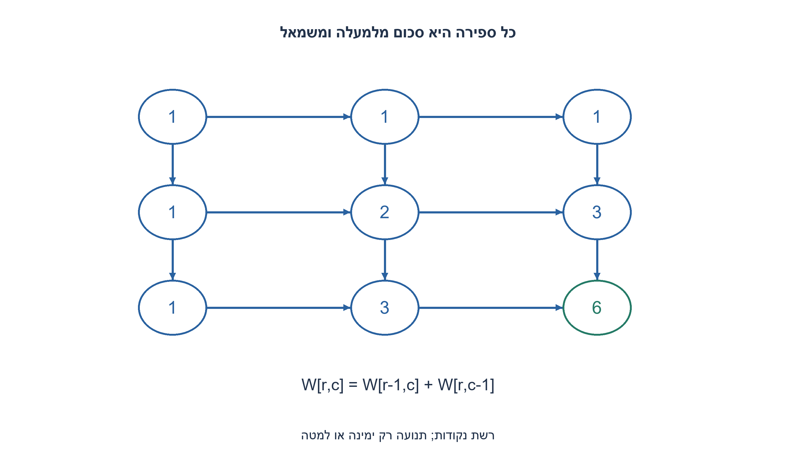
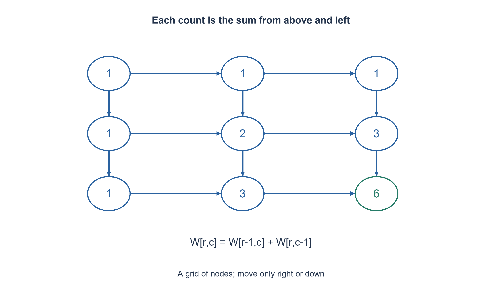

# PREP-300 — ספירת מסלולים ברשת ריבועית באמצעות תכנון דינמי

פתרון מוצע בסיוע AI; ביקורת מקצועית אנושית ממתינה. הקושי אינו מכויל.

## עברית

בהינתן n ורשת n×n, כתבו תוכנית שמחשבת כמה דרכים יש מן הנקודה (0,0) לנקודה (n−1, n−1). אסור להשתמש ישירות בנוסחה קומבינטורית במימוש.

השלמת חוזה: n הוא שלם חיובי; מדובר ב־ n שורות ו־ n עמודות של נקודות, ללא מכשולים. בכל צעד מותר לזוז נקודה אחת ימינה או למטה בלבד. מחזירים מספר שלם מדויק; עבור n=1 יש דרך ריקה אחת. תנועות אחרות או חזרות לנקודות לא נכללות. במימוש Python אפשר להשתמש בשלמים בלתי חסומים. הסבירו את הנסיגה, מקרי הבסיס, זיכרון העזר ועלות גדילת המספרים.

1. מה יכולים להיות שני המקומות שמהם מגיע הצעד האחרון לנקודה פנימית?
2. כל המסלולים מתחלקים לפי הגעה מלמעלה או משמאל. בשורה הראשונה ובעמודה הראשונה יש דרך יחידה.
3. שמרו שורת ספירות שמתחילה באחדות. עדכנו משמאל לימין ways[c]+=ways[c−1], כשהערך הישן הוא מלמעלה והערך המעודכן משמאל.

### מחלקים לפי הצעד האחרון
נסמן W(r, c) כמספר הדרכים לנקודה (r, c). לנקודה פנימית מגיעים או מ־(r−1, c) או מ־(r, c−1). אלו אפשרויות זרות שמכסות את כל הדרכים, ולכן W(r, c)=W(r−1, c)+W(r, c−1). בשורה העליונה אפשר לנוע רק ימינה ובעמודה הראשונה רק למטה, ולכן ערכי הגבול הם אחד.

ברשת 3×3 טבלת הספירות היא שורות [1,1,1], [1,2,3], [1,3,6], והתשובה 6. ברשת 1×1 מתחילים כבר ביעד; הרצף הריק הוא דרך אחת, ולא אפס.

### שורה אחת במקום טבלה מלאה
מאתחלים ways=[1]*n עבור השורה הראשונה. בכל שורה נוספת עוברים בעמודות 1 עד n−1. לפני עדכון עמודה c, ways[c] עדיין מכיל את ספירת השורה הקודמת, ואילו ways[c−1] כבר מכיל את ספירת התא שמשמאל בשורה הנוכחית. סכומם הוא בדיוק הנסיגה. התא הראשון נשאר אחד.

זהו אינווריאנט הלולאה: החלק שמשמאל לאינדקס העדכון שייך לשורה החדשה, והחלק הנותר לשורה הקודמת. כך כל עדכון והמעבר לשורה הבאה נכונים; בסוף התא האחרון הוא W(n−1, n−1).

מספר החיבורים הוא (n−1)², וזמן ההקמה O(n). לכן נדרשות Θ(n²) פעולות אריתמטיות עבור n שגדל ו־ O(n) תאי ספירה; אין כאן שימוש ישיר בנוסחת בינום. גם אין טענה שזהו האלגוריתם המהיר ביותר בכל מודל שמאפשר פעולות אריתמטיות אחרות.

הספירה גדולה: למשל n=18 נותן 2,333,606,220, מעבר לגבול signed 32-bit. Python שומר תוצאה מדויקת; בשפה בעלת רוחב קבוע צריך לבחור טיפוס מספיק או לזהות גלישה. המספרים דורשים O(n) ביטים, ולכן שורת הספירות יכולה לצרוך O(n²) ביטים. בהנחת חיבור בעלות לינארית ברוחב, O(n³) הוא חסם עליון לעלות הביטית של המימוש; O(n²) פעולות אינו זמן ביטי קבוע לחיבור.

אם לא מגבילים כיוון ומאפשרים לחזור לנקודות, אפשר להקיף לולאות שוב ושוב ומספר המסלולים אינו סופי. לכן בחירת ימין/מטה היא תנאי מהותי שנוסף בגלוי.

```python
"""Exact monotone paths on an n-by-n node grid, no binomial in candidate."""


def grid_paths(n):
    if type(n) is not int or n < 1:
        raise ValueError("n must be a positive integer")
    ways = [1] * n
    for _ in range(1, n):
        for column in range(1, n):
            ways[column] += ways[column - 1]
    return ways[-1]
```




## English

Given n and an n×n grid, count paths from (0,0) to (n−1, n−1). Do not use a direct combinatorial formula in the candidate implementation.

Chosen contract: n is a positive integer; the grid has n rows and n columns of nodes, without obstacles. A move goes one node right or down only. Return the exact integer count; n=1 has one empty path. Other moves and revisits are excluded. Python arbitrary-precision integers are allowed. Explain the recurrence, boundaries, storage and growing-number cost.

1. From which two nodes can the final move reach an interior node?
2. Partition paths by arriving from above or from the left. The first row and column each have one path.
3. Keep one row initialized to ones and update left to right with ways[c]+=ways[c−1]: the old value is above and the updated neighbor is left.

### Partition by the final step
Let W(r, c) count paths reaching node (r, c). An interior node is reached from either (r−1, c) or (r, c−1). These classes are disjoint and exhaustive, so W(r, c)=W(r−1, c)+W(r, c−1). The top row allows only right moves and the first column only down moves, giving boundary ones.

For a three-by-three grid, count rows are [1,1,1], [1,2,3], [1,3,6], yielding six. On a one-by-one grid, the start is already the destination: one empty path exists.

### One row instead of the full table
Initialize ways=[1]*n for the top row. For every later row, update columns 1 through n−1. Before updating c, ways[c] is still the count from the preceding row, while ways[c−1] already belongs to the current row. Their sum implements the recurrence. The first column remains one.

The loop invariant states that cells left of the update position belong to the new row and remaining cells to the preceding row. It proves each update and row transition correct; the last entry eventually equals W(n−1, n−1).

There are (n−1)² additions and O(n) initialization work: Θ(n²) arithmetic operations for growing n and O(n) count cells. No direct binomial formula appears in the candidate. This does not claim universal optimality among algorithms with different arithmetic capabilities.

Counts grow: n=18 yields 2,333,606,220, exceeding signed 32-bit. Python retains exact integers; fixed-width languages need sufficient width or overflow handling. Counts occupy O(n) bits, so the row can occupy O(n²) bits. With linear-cost addition, O(n³) is a bit-operation upper bound for this implementation; counting additions does not make them constant-cost regardless of width.

Without movement restrictions, revisiting nodes can create arbitrarily many looped routes. Right/down monotonicity is therefore an essential, explicitly added assumption.

```python
"""Exact monotone paths on an n-by-n node grid, no binomial in candidate."""


def grid_paths(n):
    if type(n) is not int or n < 1:
        raise ValueError("n must be a positive integer")
    ways = [1] * n
    for _ in range(1, n):
        for column in range(1, n):
            ways[column] += ways[column - 1]
    return ways[-1]
```




## חומר משלים / Supporting material

```json
{
  "assumptions": {
    "he": [
      "n≥1, נקודות ללא מכשולים, תנועה ימינה/מטה בלבד, תוצאה מדויקת."
    ],
    "en": [
      "n≥1, unobstructed nodes, right/down moves only, exact count."
    ]
  },
  "optimality": {
    "he": "Θ(n²) פעולות אריתמטיות ו־ O(n) תאי ספירה; שלמים גדלים דורשים עלות ביטית נפרדת.",
    "en": "Θ(n²) arithmetic operations and O(n) count cells; big-integer bit costs are separate."
  },
  "verification": {
    "he": "n=1..30 מול אורקל בינומי עצמאי, המשמש בבדיקה בלבד; n=1..6 מול מניית כל רצפי הצעדים. נבדקה תוצאה מעבר ל־ signed32.",
    "en": "n=1..30 checked against an independent binomial test oracle only; n=1..6 against explicit move-sequence enumeration; a result beyond signed32 checked."
  },
  "edge_cases": {
    "he": [
      "n=1, n=2, n לא חיובי וקלט שגוי, תוצאה שחורגת מרוחב מכונה."
    ],
    "en": [
      "n=1, n=2, nonpositive/invalid n and counts exceeding machine width."
    ]
  },
  "common_mistakes": {
    "he": [
      "לא לבלבל n נקודות עם n צעדים; לא לאתחל את נקודת ההתחלה באפס; לא לטעון ששלם בלתי חסום תופס מילה קבועה."
    ],
    "en": [
      "Do not confuse n nodes with n moves, initialize the start to zero, or treat arbitrary integers as fixed words."
    ]
  },
  "interview_answer": {
    "he": "כל דרך מגיעה מלמעלה או משמאל; מצרפים את שתי הספירות ושומרים רק שורה אחת.",
    "en": "Every path arrives from above or left; sum those counts while retaining one row."
  },
  "source_ambiguities": {
    "he": "המקור אינו מגדיר כיווני תנועה, מכשולים או גלישה; נבחרה רשת מונוטונית ללא מכשולים.",
    "en": "Movement directions, obstacles and overflow are completed by an unobstructed monotone-grid contract."
  },
  "solution_extensions": {
    "he": [
      {
        "question": "כיצד לטפל בתאים חסומים?",
        "answer_direction": "אפסו ספירת תא חסום; תא פתוח ממשיך לסכום מלמעלה ומשמאל, עם טיפול בהתחלה חסומה.",
        "principle": "הרחבת חוזה באופן מפורש"
      }
    ],
    "en": [
      {
        "question": "How can blocked cells be handled?",
        "answer_direction": "Set blocked-cell counts to zero and continue summing for open cells, including a blocked start.",
        "principle": "Make an extension explicit"
      }
    ]
  }
}
```
