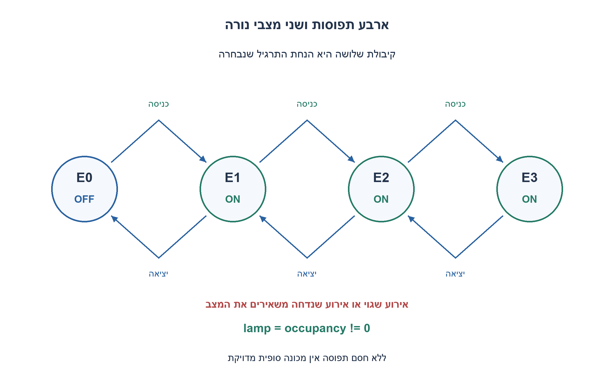
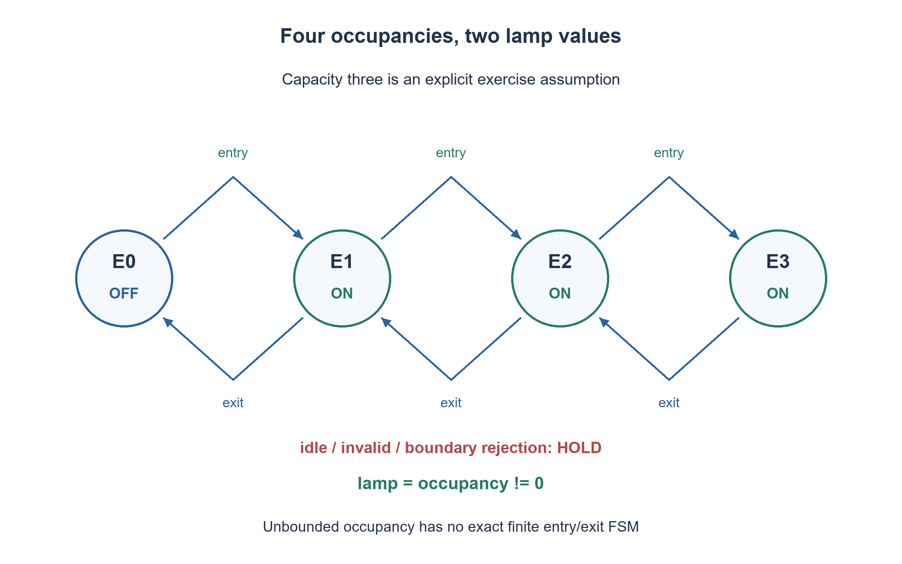

# PREP-301 — נורת חדר: הראשון מדליק והאחרון מכבה בארבעה מצבים

פתרון מוצע בסיוע AI; ביקורת מקצועית אנושית ממתינה. הקושי אינו מכויל.

## עברית

תכננו FSM עם פחות מחמישה מצבים: הנורה נדלקת כשנכנס האדם הראשון לחדר ונכבית כאשר יוצא האדם האחרון.

השלמת התרגיל שנבחרה: קיבולת החדר היא שלושה אנשים והוא ריק לאחר reset. בכל חזית שעון מתקבל קוד אירוע שכבר פוענח מחיישנים: 00 ללא אירוע, 01 כניסה אחת, 10 יציאה אחת, 11 קלט שגוי. כניסה כשהחדר מלא, יציאה כשהוא ריק וקוד 11 נדחים ואינם משנים את המצב. הפיקו גם אות rejected צירופי המציין אם האירוע הנוכחי יידחה לפי המצב שלפני החזית. reset סינכרוני פעיל בגבוה.

ציירו מכונת Moore, ממשו את הנורה והמעברים, ונמקו מדוע ארבעה מצבים מספיקים ומינימליים לחוזה הזה. הסבירו מדוע בלי חסם על מספר האנשים אין פתרון FSM סופי מדויק לפי אירועי כניסה ויציאה בלבד.

1. כשהנורה כבר דולקת, איך נבדיל בין אדם אחד בחדר לשניים לפני אירוע יציאה?
2. נורת on/off אינה זיכרון מספיק. תחת קיבולת שלושה אפשר לשמור את מספר האנשים: 0,1,2,3.
3. הנורה דולקת בדיוק במצבים 1,2,3. כניסה מקדמת, יציאה מורידה, ואירוע בלתי חוקי משאיר את אותו מצב ללא מצב שגיאה נוסף.

### שומרים את מה שצריך לדעת על היציאה הבאה
נגדיר ארבעה מצבי Moore לפי מספר האנשים: E0,E1,E2,E3. המוצא הוא `lamp=(occupancy!=0)`. כניסה חוקית מעבירה Ei אל E(i+1), ויציאה חוקית אל E(i−1). באין אירוע נשארים במקום. ב־E0 יציאה נדחית, ב־E3 כניסה נדחית, ובכל מצב קוד 11 נדחה. הדחייה היא אות צירופי, ולא מצב חמישי; היא מתארת את המצב והקלט שלפני החזית. אחרי החזית הוא מחושב מחדש ולכן יש לדגום אותו בזמן הנכון. reset גובר על העדכון וטוען E0.

לדוגמה, רצף כניסה,כניסה,יציאה משאיר אדם אחד והנורה נשארת דולקת; רק היציאה הבאה מכבה אותה. מימוש שמכבה בכל יציאה שגוי, וכך גם מימוש שמחזיק רק סיבית ״יש מישהו״. הקלט כאן כבר מציין כניסה או יציאה שהושלמה; אין להסיק ששער עם חיישן יחיד מזהה כיוון. פענוח תנועה מחיישנים הוא רכיב נפרד.

### אינווריאנט והוכחת מינימום
אחרי reset המצב שווה לאפס, וזה מספר האנשים. בהנחה של אירועים אמינים, בכל צעד חוקי שניהם משתנים באותו אחד, ובצעד שנדחה שניהם נשארים ללא שינוי. באינדוקציה המצב מייצג תמיד את התפוסה 0–3 והנורה נכונה. קוד שגוי אינו מעדכן תפוסה פיזית במודל: בקר הכניסה חייב למנוע בפועל כניסה רביעית. אם אדם עובר למרות שהאירוע נדחה, אין עוד ערובה לנכונות המונה.

כל שני מספרים i<j בין 0 ל־3 חייבים להיות מצבים נבדלים: אם i=0 הנורה כבר שונה, ואם i>0 נשלח i אירועי יציאה חוקיים. מ־i נגיע לאפס ולנורה כבויה, ומ־j נישאר עם j−i אנשים ונורה דולקת. לכן נדרשים לפחות ארבעה מצבים, ושתי סיביות מצב מספיקות למימושם. לוגיקת המעבר והמוצא בגודל קבוע; אין טענה למינימום שטח טרנזיסטורים.

### למה החסם הוא נתון מהותי
אם מספר האנשים אינו חסום, לכל i<j אפשר להשתמש באותו טיעון של i יציאות כדי להבחין בין שתי תפוסות. לכן יש אינסוף היסטוריות הניתנות להבחנה, ואין FSM סופי מדויק בחוזה כניסה/יציאה הזה. אם חיישן חיצוני כבר מספק ״ראשון נכנס״ ו״אחרון יוצא״, שתי קבוצות on/off מספיקות, אבל המידע על הספירה הועבר לרכיב החיצוני. כאן בחרנו קיבולת שלושה כדי לקבל תרגיל מלא עם ארבעה מצבים, בהתאם לדרישה של פחות מחמישה.

```systemverilog
module prep301_room(input logic clk, rst,
                    input logic [1:0] event_code,
                    output logic lamp, rejected,
                    output logic [1:0] occupancy);
    // 00idle,01entry,10exit,11invalid. Rejected is combinational pre-edge status.
    always_comb begin
        rejected = (event_code == 2'b11) ||
                   ((event_code == 2'b01) && (occupancy == 2'd3)) ||
                   ((event_code == 2'b10) && (occupancy == 2'd0));
    end
    always_ff @(posedge clk) begin
        if (rst) occupancy <= 2'd0;
        else if (!rejected) begin
            case (event_code)
                2'b01: occupancy <= occupancy + 2'd1;
                2'b10: occupancy <= occupancy - 2'd1;
                default: occupancy <= occupancy;
            endcase
        end
    end
    assign lamp = |occupancy;
endmodule
```




## English

Design an FSM with fewer than five states: turn the room lamp on when the first person enters and off when the last person leaves.

Chosen completion: capacity is three people and reset starts empty. Each rising clock edge receives an already-decoded event: 00 idle, 01 one entry, 10 one exit, 11 invalid. Entry when full, exit when empty, and code 11 are rejected without changing state. Also provide combinational rejected, indicating whether the current event will be rejected using the pre-edge state. Reset is synchronous active high.

Draw a Moore machine, implement transitions and the lamp, and justify why four states are sufficient and minimal for this contract. Explain why unbounded occupancy cannot be tracked exactly by a finite FSM using only entry/exit events.

1. When the lamp is on, how can an exit distinguish one occupant from two?
2. An on/off bit is insufficient memory. With capacity three, store occupancy 0,1,2,3.
3. The lamp is on in states 1,2,3. Entry increments, exit decrements, and invalid events hold without requiring a fifth error state.

### Remember what the next exit needs
Use four Moore states E0,E1,E2,E3 for occupancy. Set `lamp=(occupancy!=0)`. A legal entry moves Ei to E(i+1), and a legal exit moves to E(i−1). Idle holds. Exit in E0, entry in E3, and code 11 in every state are rejected and hold. Rejection is a combinational output, not a fifth state; it describes the current pre-edge state/input. It is recomputed after the edge and must be sampled at the defined time. Reset takes priority and loads E0.

For example, entry,entry,exit leaves one person and the lamp stays on; only the next exit extinguishes it. Turning the lamp off on every exit is wrong, and a single someone-present bit cannot retain enough information. Inputs already identify completed entries/exits; direction detection from raw doorway sensors is a separate subsystem.

### Invariant and minimality
After reset both stored occupancy and actual modeled occupancy are zero. A legal event changes both by the same one, while a rejected event changes neither. Induction proves that the state always records occupancy 0–3 and the lamp is correct, assuming reliable events. A rejected full-room entry means no physical admission; an external admission controller must enforce capacity. If a fourth person passes despite rejection, the model no longer guarantees correct occupancy.

Every pair i<j in 0..3 must have distinct states. When i=0 the lamp already distinguishes them. Otherwise supply i valid exits: occupancy i reaches zero with lamp off, while j leaves j−i people with lamp on. Thus at least four states are necessary, and two state bits suffice. Transition/decode logic is constant-size; this is not a transistor-area minimum claim.

### Why the bound matters
For unbounded occupancy the same exit-suffix argument distinguishes every pair i<j. Infinitely many distinguishable histories require infinitely many states, so no finite exact entry/exit FSM exists. If an external sensor already supplies first-entry and last-exit events, two on/off states suffice, but the counting information has moved outside the FSM. Capacity three is the explicit completion which makes a complete four-state exercise consistent with fewer than five states.

```systemverilog
module prep301_room(input logic clk, rst,
                    input logic [1:0] event_code,
                    output logic lamp, rejected,
                    output logic [1:0] occupancy);
    // 00idle,01entry,10exit,11invalid. Rejected is combinational pre-edge status.
    always_comb begin
        rejected = (event_code == 2'b11) ||
                   ((event_code == 2'b01) && (occupancy == 2'd3)) ||
                   ((event_code == 2'b10) && (occupancy == 2'd0));
    end
    always_ff @(posedge clk) begin
        if (rst) occupancy <= 2'd0;
        else if (!rejected) begin
            case (event_code)
                2'b01: occupancy <= occupancy + 2'd1;
                2'b10: occupancy <= occupancy - 2'd1;
                default: occupancy <= occupancy;
            endcase
        end
    end
    assign lamp = |occupancy;
endmodule
```




## חומר משלים / Supporting material

```json
{
  "assumptions": {
    "he": [
      "חדר בקיבולת שלושה, ריק לאחר reset, אירוע מפוענח אחד לכל חזית; קבלה פיזית נאכפת בנפרד."
    ],
    "en": [
      "Capacity three, empty after reset, one decoded event per edge; physical admission is enforced separately."
    ]
  },
  "optimality": {
    "he": "ארבעה מצבים מינימליים ושני FF; rejected צירופי ואינו דורש מצב חמישי.",
    "en": "Four minimal states and two FFs; combinational rejected adds no fifth state."
  },
  "verification": {
    "he": [
      "כל 16 זוגות מצב/אירוע, reset, אירועים על גבולות ורצפים מעורבים מול מונה חסום עצמאי.",
      "ראיית סימולציה נפרדת: רתמת SystemVerilog הודרה והורצה ב־Icarus בסביבה מבודדת; חלק התרגיל בדק 16 מקרי מודל. הדוח הוא checks/night1107n30-native-verification.json. אין זו בדיקת נתב אמיתי, STA או אישור חומרה."
    ],
    "en": [
      "All sixteen state/event pairs, reset, boundary events and mixed traces against an independent bounded counter.",
      "Separate native evidence: the SystemVerilog harness was compiled and run with Icarus in an isolated environment; this exercise contributed 16 model cases. Evidence: checks/night1107n30-native-verification.json. This is not real-router validation, STA or hardware signoff."
    ]
  },
  "edge_cases": {
    "he": [
      "יציאה בריק, כניסה במלא, קוד 11, יציאה כשנותרו שניים וקדימות reset."
    ],
    "en": [
      "Exit while empty, entry while full, code 11, intermediate exits and reset priority."
    ]
  },
  "common_mistakes": {
    "he": [
      "שמירת רק מצב הנורה, הנחת קיבולת שלא נאמרה, או טענה ש־rejected מונע בעצמו מעבר פיזי."
    ],
    "en": [
      "Storing only the lamp bit, silently assuming capacity, or claiming rejected physically blocks admission."
    ]
  },
  "interview_answer": {
    "he": "בלי חסם אין FSM סופי מדויק. בהנחת קיבולת שלושה שומרים 0–3 בארבעה מצבים והנורה היא OR של סיביות התפוסה.",
    "en": "Unbounded occupancy has no exact finite FSM. With capacity three, four states store 0–3 and the lamp is the OR of occupancy bits."
  },
  "source_ambiguities": {
    "he": [
      "המקור אינו קובע קיבולת או ממשק אירועים; נבחרו שלושה אנשים וקודי כניסה/יציאה מפוענחים."
    ],
    "en": [
      "The source omits capacity and event interface; the exercise chooses three occupants and decoded entry/exit codes."
    ]
  },
  "solution_extensions": {
    "he": [
      {
        "question": "מה דרוש לחדר בקיבולת M?",
        "answer_direction": "M+1 מצבי תפוסה מובחנים ו־ceil(log2(M+1)) סיביות לפחות; פענוח וסירוב על גבולות נשארים לפי החוזה.",
        "principle": "זיכרון מינימלי ומידע חסר בקלט."
      }
    ],
    "en": [
      {
        "question": "What is needed for capacity M?",
        "answer_direction": "M+1 distinguishable occupancy states and at least ceil(log2(M+1)) bits; preserve the stated boundary-rejection protocol.",
        "principle": "Minimum state and information available in the interface."
      }
    ]
  }
}
```
