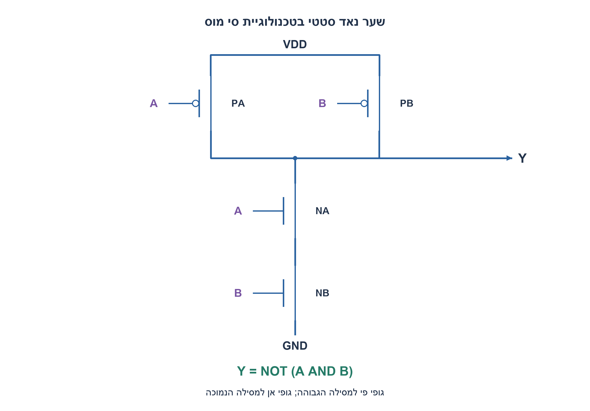
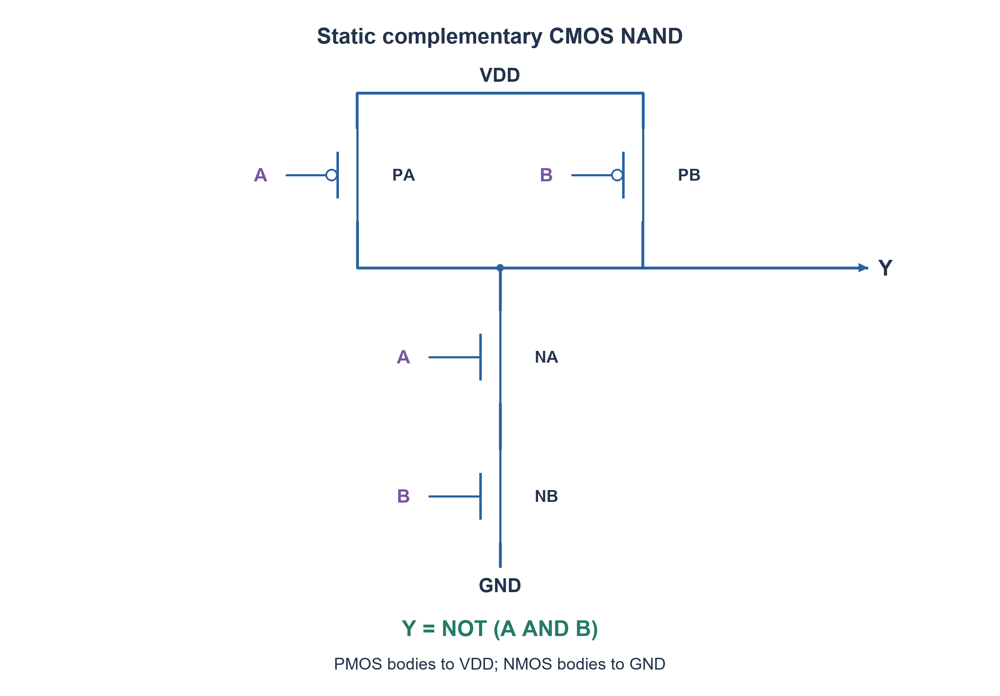

# PREP-302 — מימוש שער NAND בשני קלטים ברמת CMOS

פתרון מוצע בסיוע AI; ביקורת מקצועית אנושית ממתינה. הקושי אינו מכויל.

[צילום מקור פרטי](../sources/2026-11-07-night30-29.png)

ממש NAND מ-CMOS.

חברות לפי הדיווח בצילום בלבד: Mellanox.

## עברית

שרטטו שער NAND בשני קלטים A,B באמצעות CMOS והסבירו את פעולתו בכל שורת אמת. סמנו VDD, אדמה, המוצא Y, שערי הטרנזיסטורים וקשרי הגוף.

השלמה שנבחרה: CMOS סטטי משלים, NMOS מוליך כאשר שערו גבוה ו־PMOS כאשר שערו נמוך, קלטים תקינים בין המסילות ובדיקת מצב יציב. רשת Pull-Up ורשת Pull-Down צריכות לתת מוצא מלא ללא מסלול DC מכוון בין המסילות. דונו בנפרד במעבר, קיבול ועקרונות sizing; אין נתוני תהליך להשהיה או ליחס רוחבים מספרי.

1. באיזה מצב בלבד NAND צריך להוציא אפס? מה התנאי למסלול שמושך את Y לאדמה?
2. שני NMOS בטור מוליכים רק אם A וגם B גבוהים. הרשת המשלימה צריכה להוליך אם לפחות אחד הקלטים נמוך.
3. חברו שני PMOS במקביל ל־VDD, ושני NMOS בטור לאדמה; לכל קלט שער של PMOS ושל NMOS אחד.

### רשת משיכה למטה ורשת משלימה
המוצא צריך להיות אפס רק עבור A=B=1. לכן מחברים שני NMOS בטור בין Y לאדמה: שער אחד ל־A והשני ל־B. שני PMOS במקביל בין VDD ל־Y מבטיחים טעינה של המוצא כאשר לפחות אחד הקלטים נמוך. לכל קלט שני שערים, אחד מכל סוג; אין לחבר את קלט A או B למסילת מקור במקום לשער.

| A | B | מסלול למעלה | מסלול למטה | Y |
| --- | --- | --- | --- | --- |
| 0 | 0 | שני PMOS מוליכים | מנותק | 1 |
| 0 | 1 | PMOS של A | מנותק | 1 |
| 1 | 0 | PMOS של B | מנותק | 1 |
| 1 | 1 | מנותק | שני NMOS בטור | 0 |

במודל המסילה המקובל גוף PMOS מחובר ל־VDD וגוף NMOS לאדמה, בכפוף לתהליך ולבארות; מקורות שני PMOS ב־VDD, וטרנזיסטור NMOS התחתון מחובר לאדמה. הצומת בין שני NMOS הוא צומת פנימי ועשוי להיות צף בחלק משורות האמת, אך Y עדיין מונע על ידי רשת תקינה. תאי ספרייה מגדירים פרטי layout וגוף בפועל.

### ארבעה טרנזיסטורים אינם כל סיפור התזמון
במצב יציב אידאלי רק רשת אחת מוליכה, ולכן אין זרם DC מכוון בין המסילות. בזמן מעבר ייתכן ששתי הרשתות מוליכות חלקית, ויש גם טעינה ופריקה של קיבולים ודליפה אמיתית. שני NMOS בטור מעלים את התנגדות הפריקה ביחס ליחיד, ולכן sizing תלוי בעומס, ניידות ובספריית התהליך. אין כלל אוניברסלי של PMOS ברוחב כפול מ־NMOS, במיוחד מול ערימה טורית.

קוד SystemVerilog משתמש בפרימיטיבי pmos/nmos לבדיקת קישוריות אידאלית, וכל ארבע שורות האמת נבדקות. מודל זה אינו מדמה גוף, מתח סף, שולי רעש, זרמים או השהיה אנלוגית, ואינו תחליף ל־SPICE. הוא מאמת את הטופולוגיה והפונקציה הלוגית המוצעת.

### קוד SystemVerilog; תוצאות סימולציה בדוח נפרד

```systemverilog
// Ideal connectivity abstraction only; no threshold, delay, body diode or SPICE.
module prep302_cmos_nand(input wire a,b, output wire y);
  supply1 vdd;
  supply0 gnd;
  wire middle;
  pmos pa(y,vdd,a);
  pmos pb(y,vdd,b);
  nmos na(y,middle,a);
  nmos nb(middle,gnd,b);
endmodule
```




### assumptions

שני קלטים תקינים; CMOS סטטי משלים; דיון בסיסי בגוף לפי מסילות.

### optimality

ארבעה MOS: שני PMOS ושני NMOS. עלות/תזמון פיזיים אינם נקבעים רק מהספירה.

### verification

מודלים עצמאיים עברו: קובייה בחמישה ערכי התנגדות, 3,072 גשרי DC במתח שאינו אפס, דוגמת מתח אפס, 64 זוגות נגדי משוב ו־256 בדיקות הגבר סופי, עשר פאזות סינוס, 1,024 קלטי מכפיל, 256 קלטי ספירת אחדות, 256 זוגות חיבור וארבע שורות NAND. ראיה: checks/night1107n30-hardware-model-verification.json. בדיקות אלה הן Python וחישוב רציונלי; קומפילציית SystemVerilog מתועדת בנפרד בדוח native של האצווה. לא בוצעו SPICE, סינתזה, ניתוח תזמון או מדידת חומרה.

בדיקת Icarus Verilog 12 בפועל עברה: 1,664 השוואות RTL באצוות החומרה, כולל כל קלטי המכפיל, ספירת אחדות וחיבור, כל שורות NAND ו־124 בדיקות לוח פאזה עם איפוס והשהיה. ראיה: checks/night1107n30-native-verification.json. ריצת הקוד הייתה בסביבה זמנית מבודדת ללא רשת; אין להסיק מכך SPICE או סינתזה.

### edge_cases

```json
[
  "00 עדיין מפיק 1.",
  "הצומת הפנימי עשוי לצוף בלי ש־Y צף.",
  "מעבר אינו מצב יציב אידאלי."
]
```

### common_mistakes

```json
[
  "PMOS בטור ו־NMOS במקביל יוצרים NOR.",
  "טענת אפס זרם מוחלט במעגל אמיתי.",
  "טענת יחס רוחב אוניברסלי."
]
```

### interview_answer

NAND מושך לאדמה רק כששני הקלטים גבוהים: שני NMOS בטור, ורשת PMOS מקבילית משלימה.

### source_ambiguities

המקור אומר רק NAND מ־CMOS; נבחר שער סטטי בעל שתי כניסות. קיים קישור לשאלת אימות פרטית דומה.

### solution_extensions

```json
[
  {
    "question": "איך משתנה רשת NOR?",
    "direction": "NMOS במקביל ו־PMOS בטור; אמת משלימה של OR.",
    "tests": "כל ארבע שורות האמת, במיוחד 00."
  }
]
```

## English

Draw a two-input CMOS NAND with inputs A,B and explain every truth-table row. Label VDD, ground, output Y, transistor gates and body connections.

Chosen completion: static complementary CMOS; an NMOS conducts with high gate, a PMOS with low gate; valid rail-to-rail inputs and settled-state analysis. Pull-up and pull-down networks should provide full output levels without an intentional DC rail path. Separately discuss transitions, capacitance and sizing principles; no process data justify a numerical delay or width ratio.

1. In which single case should NAND be zero? What condition should connect Y to ground?
2. Series NMOS devices conduct only when A and B are high. The complementary network must conduct if either input is low.
3. Use two PMOS in parallel to VDD and two NMOS in series to ground; each input controls one PMOS and one NMOS.

### Pull-down and complementary pull-up
The output is low only for A=B=1. Put two NMOS devices in series from Y to ground, with gates driven by A and B. Put two PMOS devices in parallel from VDD to Y so that either low input can charge the output. Each input controls one gate of each device type; inputs are not attached to a source rail instead of a gate.

| A | B | Pull-up path | Pull-down path | Y |
| --- | --- | --- | --- | --- |
| 0 | 0 | Both PMOS on | Disconnected | 1 |
| 0 | 1 | A-controlled PMOS | Disconnected | 1 |
| 1 | 0 | B-controlled PMOS | Disconnected | 1 |
| 1 | 1 | Disconnected | Both NMOS in series | 0 |

Under the usual rail-body convention PMOS bodies connect to VDD and NMOS bodies to ground, subject to process/well rules. Both PMOS sources are at VDD; the lower NMOS connects to ground. The internal NMOS-stack node may float for some input combinations while Y remains driven by the proper network. Library cells define physical layout and body details.

### Four transistors do not specify timing
In settled ideal operation exactly one network conducts, avoiding an intentional DC path between rails. During a transition both networks can partially conduct; real cells also charge/discharge capacitance and exhibit leakage. Series NMOS devices increase pull-down resistance, so sizing depends on load, carrier mobility and process library. A PMOS width exactly twice an NMOS width is not a universal rule, especially for a series stack.

The SystemVerilog model uses pmos/nmos primitives to check ideal connectivity for all four truth rows. It does not model body behavior, threshold voltages, noise margins, analog currents or propagation delay, and is not a substitute for SPICE. It verifies the proposed topology and logical function.

### SystemVerilog; simulation results are in a separate report

```systemverilog
// Ideal connectivity abstraction only; no threshold, delay, body diode or SPICE.
module prep302_cmos_nand(input wire a,b, output wire y);
  supply1 vdd;
  supply0 gnd;
  wire middle;
  pmos pa(y,vdd,a);
  pmos pb(y,vdd,b);
  nmos na(y,middle,a);
  nmos nb(middle,gnd,b);
endmodule
```




### assumptions

Two valid inputs; static complementary CMOS; conventional rail body ties.

### optimality

Four MOS devices: two PMOS and two NMOS. Physical area/timing is not determined by count alone.

### verification

Independent models passed: five cube resistance scales, 3,072 nonzero-source DC bridges plus a zero-source example, 64 feedback-resistor pairs and 256 finite-gain checks, ten sine phases, 1,024 multiplier inputs, 256 popcount inputs, 256 addition pairs and four NAND truth rows. Evidence: checks/night1107n30-hardware-model-verification.json. These are Python/exact-rational checks; SystemVerilog compilation is documented separately in the batch native report. No SPICE, synthesis, timing analysis or hardware measurement was performed.

Actual Icarus Verilog12 execution passed 1,664 hardware RTL comparisons, including all multiplier, popcount and adder inputs, all NAND rows and 124 phase-schedule checks with reset and hold. Evidence: checks/night1107n30-native-verification.json. Execution used a temporary isolated environment with networking denied; this is not SPICE or synthesis.

### edge_cases

```json
[
  "00 still gives one.",
  "The internal node may float while Y does not.",
  "A transition is not a settled ideal state."
]
```

### common_mistakes

```json
[
  "Series PMOS and parallel NMOS implement NOR.",
  "Claiming absolutely zero current in a real circuit.",
  "Claiming a universal width ratio."
]
```

### interview_answer

NAND pulls low only when both inputs are high: series NMOS and a complementary parallel PMOS network.

### source_ambiguities

The source only says CMOS NAND; a static two-input gate is chosen. A similar private verification question is cross-linked.

### solution_extensions

```json
[
  {
    "question": "How does a NOR network differ?",
    "direction": "Parallel NMOS and series PMOS produce inverted OR.",
    "tests": "All four truth rows, especially 00."
  }
]
```
