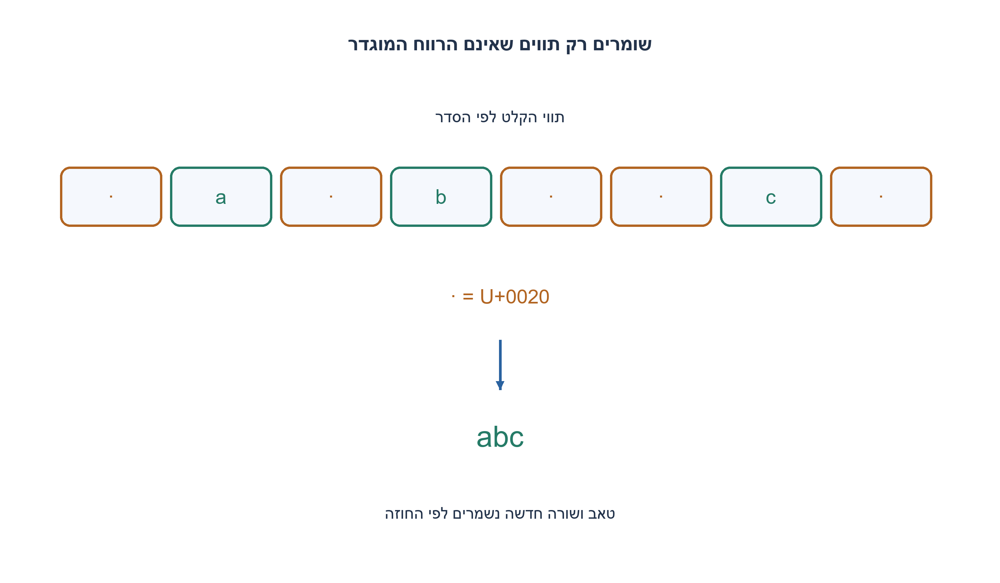
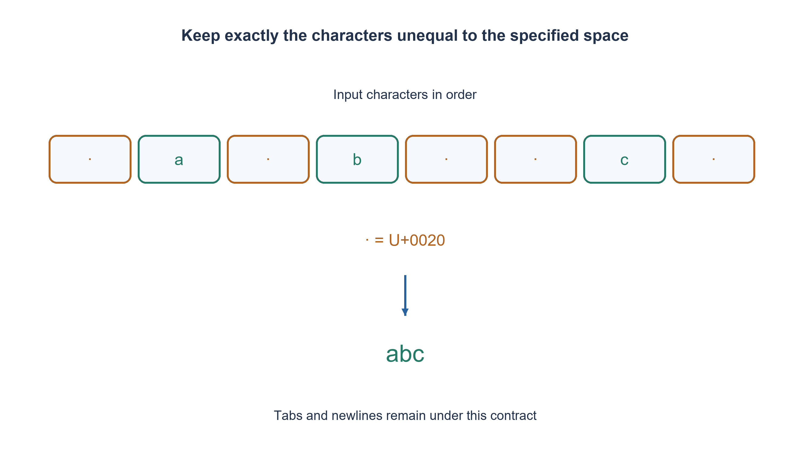

# PREP-303 — הסרת כל הרווחים ממחרוזת, תוך שמירת סדר התווים

פתרון מוצע בסיוע AI; ביקורת מקצועית אנושית ממתינה. הקושי אינו מכויל.

## עברית

נתונה מחרוזת של משפט. החזירו אותה ללא רווחים.

השלמת חוזה: מסירים רק את תו הרווח U+0020, מכל מקום ובכל כמות, בלי לשנות את סדר שאר התווים. טאב, ירידת שורה ורווח בלתי שביר נשמרים. הקלט מחרוזת Python שאינה משתנה; פלט חדש מותר. לדוגמה " a b  c " מחזיר "abc", וריק מחזיר ריק. ממשו remove_spaces(text), והסבירו זמן ומקום.

1. האם צריך להחליף את מקומם של התווים שנשארים?
2. סרקו כל תו והעבירו לפלט רק תו שאינו רווח לפי ההגדרה המדויקת.
3. בנו את התוצאה בחיבור יחיד של התווים המסוננים; שרשור חוזר של מחרוזות עלול להעתיק שוב ושוב את אותה קידומת.

### מסננים תווים, לא מילים
עוברים על המחרוזת משמאל לימין. כל תו שאינו שווה לרווח הרגיל מועבר לפלט, וכל רווח נזנח. אין צורך לזהות מילים, לאחד רווחים לרווח אחד או להסיר רק את הקצוות. "a  b" צריך להפוך ל־"ab".

### מדוע הסדר והתוים נשמרים
אחרי כל קידומת של הקלט, התווים שנאספו הם בדיוק תווי הקידומת שאינם U+0020 ובאותו סדר. רווח אינו מוסיף דבר; תו אחר נוסף בסוף. בסיום זו בדיוק התוצאה המבוקשת. גם ריק, קלט שמורכב רק מרווחים וקלט ללא רווחים נובעים מאותו כלל, בלי טיפול מיוחד.

### עלות וגבולות
join עם מחולל מבצע סריקה ליניארית ובניית תוצאה אחת; n תווי הקלט נקראים ו־ k תווים נכתבים. הזמן Θ(n), ולתוצאה ולחומר שנאסף דרוש O(n) מקום במקרה הגרוע. זה אינו פתרון במקום: מחרוזת Python אינה ניתנת לשינוי. במודל גישה לתווים חייבים לבדוק את כולם במקרה הגרוע, אחרת תו שלא נקרא עשוי להיות רווח שיש להסיר. בטאב או בירידת שורה לא נוגעים לפי החוזה; אם רוצים למחוק כל whitespace צריך לשנות במפורש את התנאי והבדיקות. הפתרון נבדק מול replace כאורקל נפרד, לא כדרישה להשתמש בפונקציית ספרייה מסוימת.

```python
"""Remove literal U+0020 spaces; retain all other code points."""


def remove_spaces(text):
    if not isinstance(text, str):
        raise TypeError("a string is required")
    return "".join(character for character in text if character != " ")
```




## English

Given a sentence string, return it without spaces.

Chosen contract: remove only literal U+0020 space, everywhere and in every quantity, preserving all other characters in order. Tabs, newlines and nonbreaking spaces remain. Input is an immutable Python string and a new result is allowed. For example " a b  c " becomes "abc"; empty becomes empty. Implement remove_spaces(text) and analyze time and space.

1. Must the retained characters change their relative order?
2. Scan characters and retain exactly those unequal to the specified space.
3. Build the result with one join of retained characters; repeated immutable-string concatenation can recopy prefixes.

### Filter characters, not words
Read left to right, retain a character exactly when it is not ordinary U+0020 space, and omit every space. There is no need to tokenize words, collapse runs to one space, or trim only the ends. "a  b" must become "ab".

### Correctness
After each input prefix, the retained characters are precisely its nonspace characters in their original order. Space adds nothing; any other character is appended. At termination the invariant describes the requested result. Empty input, all spaces and no spaces follow from the same rule.

### Cost and boundaries
A generator plus join scans once and builds the result without repeated prefix concatenation. Reading n characters and writing k retained characters takes Θ(n) time and O(n) worst-case storage including the collected result. This is not an in-place Python string edit. Every input position must be inspected in the worst-case character-access model: an unread character might be a space that must disappear. Tabs/newlines stay by contract; removing every whitespace character is an explicit different predicate. Tests compare the filtering algorithm with an independent replace oracle, without requiring a particular library implementation.

```python
"""Remove literal U+0020 spaces; retain all other code points."""


def remove_spaces(text):
    if not isinstance(text, str):
        raise TypeError("a string is required")
    return "".join(character for character in text if character != " ")
```




## חומר משלים / Supporting material

```json
{
  "assumptions": {
    "he": [
      "מסירים רק U+0020; שאר התווים נשמרים, כולל טאב ושורה חדשה."
    ],
    "en": [
      "Only U+0020 is removed; all other characters remain."
    ]
  },
  "optimality": {
    "he": "Θ(n) זמן ו־ O(n) מקום במקרה הגרוע, כולל הפלט; חסם קריאה ליניארי במודל תווים.",
    "en": "Θ(n) time and O(n) worst-case storage including output; linear character-read lower bound."
  },
  "verification": {
    "he": "1,366 מחרוזות ובדיקות גבול הושוו לאורקל replace נפרד.",
    "en": "1,366 strings and boundary checks compared with a separate replace oracle."
  },
  "edge_cases": {
    "he": [
      "ריק, רק רווחים, רווחים רצופים, טאב, שורה חדשה וטקסט עברי."
    ],
    "en": [
      "Empty, all spaces, repeated spaces, tabs, newlines and Hebrew text."
    ]
  },
  "common_mistakes": {
    "he": [
      "strip מסיר קצוות בלבד; split/join עשוי למחוק גם טאב; += חוזר עלול להעתיק קידומות."
    ],
    "en": [
      "strip only trims ends; split/join can also remove tabs; repeated += may recopy prefixes."
    ]
  },
  "interview_answer": {
    "he": "מסננים כל רווח מוגדר ושומרים את שאר התווים באותו סדר.",
    "en": "Filter every specified space and preserve the remaining order."
  },
  "source_ambiguities": {
    "he": "המקור אינו מגדיר מהו רווח או מקום עזר; נבחרו U+0020 ופלט חדש במפורש.",
    "en": "The source does not define whitespace or auxiliary storage; U+0020 and a new output are explicit choices."
  },
  "solution_extensions": {
    "he": [
      {
        "question": "איך משתנה הפתרון עבור מערך תווים שניתן לערוך במקום?",
        "answer_direction": "משתמשים באינדקס קריאה ובאינדקס כתיבה שמתקדם רק על תו שנשמר, ומקצרים בסוף.",
        "principle": "הרחבת חוזה באופן מפורש"
      }
    ],
    "en": [
      {
        "question": "How does a mutable in-place character array change the solution?",
        "answer_direction": "Use read/write indices; advance the writer only for retained characters, then truncate.",
        "principle": "Make an extension explicit"
      }
    ]
  }
}
```
